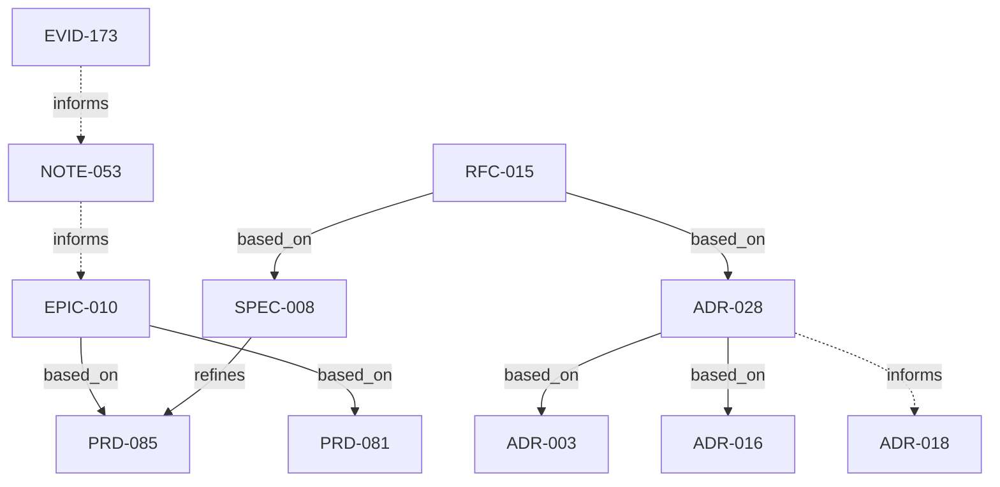

---
assigned_number: 10
created: 2026-10-16
owner: null
predicted_number: 10
slug: epic-constellation-contextpack
target: не фиксирован — зависит от измерений S1-V/S4-V
updated: 2026-10-16
---

# EPIC-010: Constellation — актуальный индекс, федеративное чтение и ContextPack

## Progress (Aggregated)

```
S1  0А/0Б  ░░░░░░░░░░░░░░░░░░░░░░░░  0/1  (  0%)
S2  1–5    ░░░░░░░░░░░░░░░░░░░░░░░░  0/1  (  0%)
S3  6      ░░░░░░░░░░░░░░░░░░░░░░░░  0/1  (  0%)
S4  7–9    ░░░░░░░░░░░░░░░░░░░░░░░░  0/1  (  0%)
─────────────────────────────────────────────────
TOTAL                                   0/4  (  0%)   истории НЕ приняты
```

Реализовано **0 из 4** историй. Ни одна история не принята, потому что ни одна не начиналась: этот прогон — подготовка, не код.

## Vision

Дать агенту актуальный read plane поверх нескольких самостоятельных `.forgeplan` workspace — без второго устанавливаемого продукта и без молчаливой несвежести.

## Outcomes (Measurable)

1. **Индекс держит себя сам**: после pull/checkout/merge/rebase расхождение либо устраняется, либо видимо — ноль ручных команд (из L01–L16).
2. **Ноль нарушений source read boundary** на эталонном наборе: ноль подменённых версий, ноль незаметных неполных отрицательных ответов (из F01–F11).
3. **ContextPack полезен**: 30 эталонных задач, обязательные ограничения найдены, payload укладывается в собственный budget, omissions видимы (из F08–F10).
4. **Incremental == full rebuild** на одинаковом snapshot (F11).

Пороги скорости **не** фиксируются заранее: latency Constellation ещё не измерена, порог ставится после замера на указанной машине и corpus.

## Problem Space

Актуальность индекса, федеративное чтение и полнота контекста — три грани одной проблемы: **инструмент тихо отвечает хуже, чем отказывает**. Устаревший индекс не выглядит подозрительно; недоступный источник выглядит как отсутствие совпадений; неполный обход выглядит как «ограничений нет». Все три обманывают одинаково — тихо. Поэтому и лечатся вместе.

## Scope

### In Scope

- Стадии 0А–9 из DOCX: проекция, векторы, чтение, реестр, snapshots, ссылки, native MCP, контекст, impact, кэш/адаптеры.
- Один бинарник `forgeplan`, один настраиваемый MCP.
- Markdown остаётся источником истины; индекс производный.

### Out of Scope

- Второй устанавливаемый продукт, Python bridge, обязательный брокер.
- Перенос исполнения задач внутрь forgeplan-core.
- Обязательные artifact UUID (существующий canonical key достаточен).
- Изменение R_eff, правил activate и семантики локальных команд.

## Children

| Type | ID | Title | Status | Story |
|------|------|-------|--------|-------|
| SPEC | SPEC-008 | Constellation 0А/0Б — проекция и embeddings | draft | S1 |
| RFC | RFC-015 | Constellation 0А/0Б — одна история и приёмка | draft | S1 |
| ADR | ADR-028 | Встроенная Rust-плоскость чтения | draft | программа |
| PRD | PRD-085 | Индекс держит себя сам (AC-2) | draft | S1 |
| PRD | PRD-081 | Федеративное чтение и адресация (G5/G6/G7) | draft | S2–S4 |
| ADR | ADR-018 | Прежняя read-boundary граница (draft) | draft | сверяется |
| SPEC | SPEC-006 | Сохранённый событийный срез (draft) | draft | отложенное направление |
| NOTE | NOTE-053 | Подготовка, передача MiniMax, отложенные Rust-проверки | draft | подготовка |

**Примечание**: EPIC-009 / vNext не принят — программа к нему не присоединена.

## Dependency Graph



## Phases

До S1-A требуется принятая независимая PREP-REVIEW. Артефакты и регистрация не разрешают кодирование. Каждый будущий SPEC/RFC для S2–S4 создаётся только в соответствующей Sx-A; привязки Artifact/Type и префиксы A/C/R/V/G затем обновляются на действительные ID без смены ключей и UID.

### S1 — 0А/0Б: локальная актуальность и embeddings
SPEC-008 → RFC-015 → приёмка L01–L16. Блокирует S2.

### S2 — 1–5: федеративное чтение, версии, read MCP
Идентичность WorkspaceKey/CheckoutId/ArtifactKey/ArtifactVersionRef, pinned OID, typed refs, native read MCP. Приёмка F01–F07.

### S3 — 6: ContextPack
Evidence units, обязательный обход, budget, continuation, receipt. Приёмка F08–F10.

### S4 — 7–9: impact, кэш, адаптеры
Объяснимый impact, измеренный кэш, переносимые refs/bytes/graph, Contextee/SCIP provenance. Приёмка F09–F11.

Событийное направление G1–G4 (PRD-081) сохранено **отдельно** и не входит в цепочку S1–S4.

## Risks

| Risk | Impact | Mitigation |
|------|--------|------------|
| Read-путь уходит через `LanceStore::open` и запускает migrations чужого workspace | High | отдельный reader; F05/F06 доказывают отсутствие записи |
| Несвежесть маскируется как полнота | High | отдельные поля coverage/freshness; запрет «ноль совпадений = нет ограничений» |
| Числовые пределы выдуманы моделью, а не выбраны | Medium | S1-A фиксирует их как проектные параметры до кода |
| Много задач в core размывают границу | Medium | ADR-028 фиксирует, что исполнение остаётся выше Core |

## Timeline

Не фиксируется. Срок зависит от измерений сборки и приёмки, которые по выбранной политике выполняются **после** записи истории. Даты в плане не выдумываются.

## Implementation Log

_(нет — реализация не начиналась)_

## Related

- ADR-003 — markdown источник истины
- ADR-016 — single resolution chain
- PRD-081 — федеративное чтение и адресация


