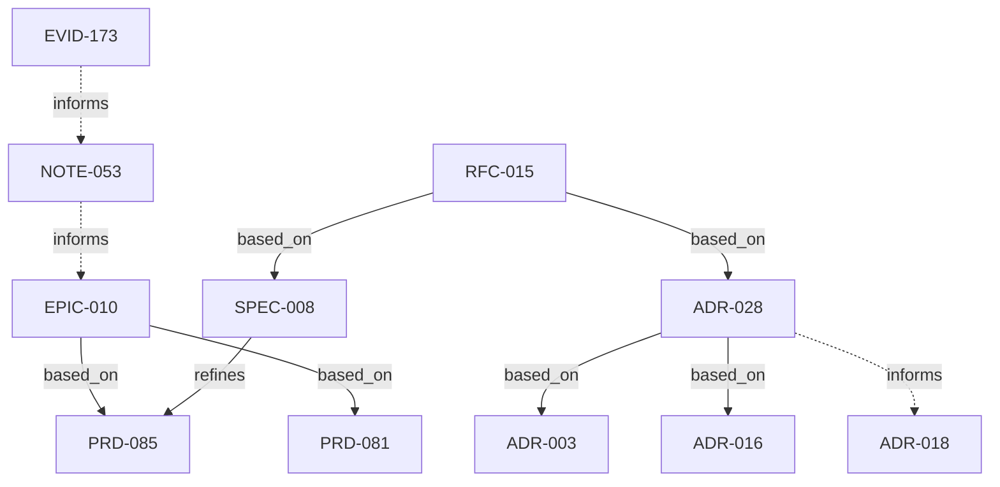

---
assigned_number: 10
created: 2026-10-16
owner: null
predicted_number: 10
slug: epic-constellation-contextpack
target: не фиксирован — зависит от измерений S1-V/S4-V
updated: 2026-10-16
---

# EPIC-010: Constellation — актуальный индекс, федеративное чтение и ContextPack

## Progress (Aggregated)

```
S1  0А/0Б  ░░░░░░░░░░░░░░░░░░░░░░░░  0/1  (  0%)
S2  1–5    ░░░░░░░░░░░░░░░░░░░░░░░░  0/1  (  0%)
S3  6      ░░░░░░░░░░░░░░░░░░░░░░░░  0/1  (  0%)
S4  7–9    ░░░░░░░░░░░░░░░░░░░░░░░░  0/1  (  0%)
─────────────────────────────────────────────────
TOTAL                                   0/4  (  0%)   истории НЕ приняты
```

Принято **0 из 4** историй. Реализация ведётся в worktree `ForgePlan-Constellation-P0`; исходная формулировка «ни одна не начиналась» устарела. Наличие кода и успешный `cargo check` не закрывают приёмку S1–S4.

## Vision

Дать агенту актуальный read plane поверх нескольких самостоятельных `.forgeplan` workspace — без второго устанавливаемого продукта и без молчаливой несвежести.

## Outcomes (Measurable)

1. **Индекс держит себя сам**: после pull/checkout/merge/rebase расхождение либо устраняется, либо видимо — ноль ручных команд (из L01–L16).
2. **Ноль нарушений source read boundary** на эталонном наборе: ноль подменённых версий, ноль незаметных неполных отрицательных ответов (из F01–F11).
3. **ContextPack полезен**: 30 эталонных задач, обязательные ограничения найдены, payload укладывается в собственный budget, omissions видимы (из F08–F10).
4. **Incremental == full rebuild** на одинаковом snapshot (F11).

Пороги скорости **не** фиксируются заранее: latency Constellation ещё не измерена, порог ставится после замера на указанной машине и corpus.

## Problem Space

Актуальность индекса, федеративное чтение и полнота контекста — три грани одной проблемы: **инструмент тихо отвечает хуже, чем отказывает**. Устаревший индекс не выглядит подозрительно; недоступный источник выглядит как отсутствие совпадений; неполный обход выглядит как «ограничений нет». Все три обманывают одинаково — тихо. Поэтому и лечатся вместе.

## Scope

### In Scope

- Стадии 0А–9 из DOCX: проекция, векторы, чтение, реестр, snapshots, ссылки, native MCP, контекст, impact, кэш/адаптеры.
- Один бинарник `forgeplan`, один настраиваемый MCP.
- Markdown остаётся источником истины; индекс производный.

### Out of Scope

- Второй устанавливаемый продукт, Python bridge, обязательный брокер.
- Перенос исполнения задач внутрь forgeplan-core.
- Обязательные artifact UUID (существующий canonical key достаточен).
- Изменение R_eff, правил activate и семантики локальных команд.

## Children

| Type | ID | Title | Status | Story |
|------|------|-------|--------|-------|
| SPEC | SPEC-008 | Constellation 0А/0Б — проекция и embeddings | draft | S1 |
| RFC | RFC-015 | Constellation 0А/0Б — одна история и приёмка | draft | S1 |
| ADR | ADR-028 | Встроенная Rust-плоскость чтения | draft | программа |
| PRD | PRD-085 | Индекс держит себя сам (AC-2) | draft | S1 |
| PRD | PRD-081 | Федеративное чтение и адресация (G5/G6/G7) | draft | S2–S4 |
| ADR | ADR-018 | Прежняя read-boundary граница (draft) | draft | сверяется |
| SPEC | SPEC-006 | Сохранённый событийный срез (draft) | draft | отложенное направление |
| NOTE | NOTE-053 | Подготовка, передача MiniMax, отложенные Rust-проверки | draft | подготовка |

**Примечание**: EPIC-009 / vNext не принят — программа к нему не присоединена.

## Dependency Graph



## Phases

До S1-A требуется принятая независимая PREP-REVIEW. Артефакты и регистрация не разрешают кодирование. Каждый будущий SPEC/RFC для S2–S4 создаётся только в соответствующей Sx-A; привязки Artifact/Type и префиксы A/C/R/V/G затем обновляются на действительные ID без смены ключей и UID.

### S1 — 0А/0Б: локальная актуальность и embeddings
SPEC-008 → RFC-015 → приёмка L01–L16. Блокирует S2.

### S2 — 1–5: федеративное чтение, версии, read MCP
Идентичность WorkspaceKey/CheckoutId/ArtifactKey/ArtifactVersionRef, pinned OID, typed refs, native read MCP. Приёмка F01–F07.

### S3 — 6: ContextPack
Evidence units, обязательный обход, budget, continuation, receipt. Приёмка F08–F10.

### S4 — 7–9: impact, кэш, адаптеры
Объяснимый impact, измеренный кэш, переносимые refs/bytes/graph, Contextee/SCIP provenance. Приёмка F09–F11.

Событийное направление G1–G4 (PRD-081) сохранено **отдельно** и не входит в цепочку S1–S4.

## Risks

| Risk | Impact | Mitigation |
|------|--------|------------|
| Read-путь уходит через `LanceStore::open` и запускает migrations чужого workspace | High | отдельный reader; F05/F06 доказывают отсутствие записи |
| Несвежесть маскируется как полнота | High | отдельные поля coverage/freshness; запрет «ноль совпадений = нет ограничений» |
| Числовые пределы выдуманы моделью, а не выбраны | Medium | S1-A фиксирует их как проектные параметры до кода |
| Много задач в core размывают границу | Medium | ADR-028 фиксирует, что исполнение остаётся выше Core |

## Timeline

Не фиксируется. Срок зависит от измерений сборки и приёмки, которые по выбранной политике выполняются **после** записи истории. Даты в плане не выдумываются.

## Implementation Log

### 2026-10-19 — исходный объём и живая доска Orchestra сверены повторно

**Предмет работы — Constellation внутри ForgePlan:** актуальность локального индекса и чтение нескольких самостоятельных `.forgeplan` с явными источниками, версиями и неполнотой. ContextPack входит в программу как этап 6, но не является отдельным исполняющим агентом, вторым продуктом или условием приёмки локальных 0А/0Б. Формулировка «сборщик контекста» не описывает всю программу.

Основание: оригинальный `ForgePlan-Constellation-Architecture-2026-10-16.docx`, SHA256 `1c3c92fd6f1875f1a9be434d0e18f93c30c33c1ba08c9c851cda6d6f228551ec`; перечитан полностью. Его первая полезная поставка — 0А/0Б, затем этапы 1–2 дают федерацию. Полный согласованный объём 0А–9 не сокращён.

Orchestra проверена через `orchestra-beta-forge-agent`: workspace `ForgePlan` (`kgYnhWodYw7kNbJMAK5q`), project `Development` (`ZB8WYUpwNskvAZdRK8Jh`), identity `Forge Agent` (`7eea6f7ad3fc4b3196385e9d3e3cb856`). Прочитаны ROOT и все 28 дочерних задач, поля, описания, чек-листы и доступная история; число детей сверено отдельным counts-запросом. Пропущенные `read_messages` системные события восстановлены `search_messages`: число уникальных сообщений совпало со счётчиками каждой из 28 задач. Вложенных документов у ROOT и четырёх историй, а также task attachments не найдено. Снимок чтений: `.local/constellation-verification/scope-reconciliation/orchestra-readback.json`, SHA256 `3ff007ad78e3ceffa3f2ba49cf1b9f264ad4f38c402361a3970af0ca30b8bccc`. Изменений Orchestra в этой сверке нет.

| История | Исходный объём и приёмка | Что подтверждает живая доска |
|---|---|---|
| S1 | P1–P5, 0А/0Б; все L01–L16 | S1-A `it3ctaOPGmxCIXj4jgGv` — Review/Evidence, 10/10 static checklist; в описании записано принятие статического контракта координатором. S1-C `CAVAw0E2DCftle0W1A7m` — Doing/Code. S1-R/V/G — Backlog, приёмка истории не завершена |
| S2 | P6–P8, этапы 1–5: разрешённые источники, registry, identity, snapshots, typed refs и native read MCP; F01–F07 | История `6DdOWEziOwxPlcuybDKO` и A/C/R/V/G — Backlog; старт зависит от предметного PASS S1-G |
| S3 | P9, этап 6: точные цитаты и основания, обязательный обход, целые evidence units, итоговый budget, continuation/receipt; F08–F10 | История `3cTN4L8OfMry7lPRnzEb` и A/C/R/V/G — Backlog; зависит от PASS S2-G |
| S4 | P10–P11, этапы 7–9: объяснимый impact, измеренный кэш, переносимость и настоящие adapters с происхождением; F09–F11 | История `J5iwbG72Pndqp0dBCX0l` и A/C/R/V/G — Backlog; зависит от PASS S3-G |

Доска отстаёт от части фактически написанного и испытанного: в ветке уже есть элементы S2/S3/S4, а EVID-180 содержит реальные диагностические прогоны. Backlog и NOT_RUN в старых полях не доказывают отсутствия кода. Обратное также неверно: наличие кода, тестового файла или экспортного формата не означает принятую историю. Последовательность приёмки восстанавливается без удаления уже написанного и без отмены поздних поставок.

**Остаток до заявленной готовности:**

- **S1:** завершить проверку всех затронутых mutation/read callers, живого обновления serve/watch, восстановления owner/pending после сбоя и изоляции worktree. Выполнить полную L01–L16 и regression matrix на замороженных исходниках. `constellation_source_view` и `constellation_embedding_state` существуют, но не входили в итоговые 52 PASS EVID-180. Semantic feature прошёл прежний type-check; реальный положительный vector-channel CLI/MCP, корректность профиля модели и runtime/recovery matrix этим не подтверждены. Обязательный NOT RUN блокирует приёмку, но сам по себе не доказывает дефект реализации.
- **S2:** закрепить отдельный контракт и завершить его приёмку. Уже испытаны lexical search трёх источников, ambiguity, qualified get, required/optional coverage, pinned Git get и запрет write dispatch. Наблюдаемые дефекты остаются: working handle читает новые bytes вместо captured bytes либо `snapshot_expired`; declared qualified cross-project edge остаётся unresolved. Нужны также полные F01–F07: identity/worktree cases, missing OID без fetch/HEAD, границы пути при гонках, readonly constructor и source-only link mutation, два настоящих MCP-клиента.
- **S3:** устранить превышение окончательного сериализованного budget в CLI и MCP; принять обязательные основания, целостность evidence units, receipt/continuation и усечение без ложного отрицательного ответа. F10 — те же 30 задач в трёх режимах на тех же snapshots — ещё NOT RUN. Обычный успешный pack на трёх проектах не закрывает эту историю.
- **S4:** провести отдельную приёмку impact/TTL, incremental == rebuild и export/import/adapter round trip. Наличие `export.rs`/SCIP-shaped output не подтверждает внешний adapter. Кэш включается лишь после измерений; при отсутствии выигрыша допустимо оставить его выключенным с записанными числами.

Событийное G1–G4 сохранено задачей EVENT `0ZrqkBRXYjdXV7deNZPz` и **не входит в S1–S4**: доставка/replay/realtime требуют отдельного явного запроса. Network gateway/multi-tenant ACL — поздний отдельный инкремент, не условие начальной локальной федерации. Исполнение задач остаётся за внешними агентами/ForgeFarm; Contextee — дополнительный индекс/адаптер, не обязательная инфраструктура базового сценария.

Существующие 52 Rust PASS и 20 PASS / 4 FAIL CLI/MCP остаются ровно теми наблюдениями, которые записаны в EVID-180; новых Rust/E2E запусков в этой сверке нет. Диагностический запуск с `CARGO_BUILD_JOBS=4` не выдаётся за формальную Sx-V: текущие задачи V требуют одного build owner, `CARGO_BUILD_JOBS=1`, `CARGO_INCREMENTAL=0`, test-threads=1 и раздельных no-feature/semantic доказательств. Активация, выпуск, замена установленного бинарника и ложные Done не выполнялись.

### 2026-10-19 — настоящий трёхпроектный CLI/MCP прогон

EVID-180: собран текущий CLI без semantic-search; бинарник и build manifest сохранены в `.local/constellation-verification/bin/no-semantic/`. Проверенный production source SHA256: `75eb9172fb38b034d6bbb2f0db0fdb7db2b31924e132b8178b85586c92977fa1`.

- 52 Rust-регрессии PASS в четырёх test binaries: federation17, preservation24, pinned_search5, migrated MCP6. Первоначальный red preservation run 22/2 и исправление противоречивых тестовых ожиданий сохранены в evidence; production code ради этих assertions не менялся.
- Реальный CLI и MCP SDK stdio: 20 PASS / 4 FAIL / 3 OBSERVED на hub/shared/billing. Подтверждены общий lexical search, различение одинаковых ID, qualified get, required/optional coverage после hit limit, Git snapshots и write refusal в отдельном read router. Финальные source bytes не изменились.
- Приёмка остаётся красной: старый working scope возвращает новые bytes (F03); budget1 возвращает1603 CLI bytes и1602 MCP text bytes вместо cap4 (F08); declared cross-project based_on edge остаётся unresolved.
- Один клиент может открыть несколько именованных федераций из реестра. Дополнительный реальный сценарий подтвердил: новые регистрации доступны будущим open без рестарта, удаление source не отзывает старый handle, отдельный HOME-реестр ограничивает видимые имена. Это локальный registry-level read, не per-agent ACL и не remote gateway.
- Один проект может входить в несколько плоских наборов. Вложенные федерации не поддержаны; автоматическое выполнение задач и событийные G1–G4 не заявляются.
- Диск больше не блокирует эту проверку: после явно разрешённого cargo clean удалено21.9GiB. После последнего test run осталось17,658,503,168 bytes. Общее правило >=10GiB перед полным запуском сохраняется.
- Нельзя объявить готовыми S1–S4: полный L/F matrix, semantic/model/platform proofs и остальные исправления ещё не закрыты. Следующий функциональный барьер — F03/F08 и qualified graph resolution, не повторная проверка типов.


### 2026-10-19 — сверка фактической реализации с исходным ТЗ

- Программа остаётся федерацией двух и более самостоятельных `.forgeplan`, а не только обновлением локального индекса. Основание: исходный `ForgePlan-Constellation-Architecture-2026-10-16.docx`, PRD-081 G5/G6/G7 и критерии F01–F10. SPEC-008/RFC-015/ADR-029 описывают локальную основу S1; они не заменяют контракт всей федерации.
- В изменённом worktree есть локальный reconciler/publisher, prepare/complete embedding jobs, kernel generation pins, WorkspaceRead и федеративные CLI/MCP пути. Состояние — реализация и исправления, не принятая поставка. EVID-176/177/178 сохраняют отрицательные результаты ревью.
- EVID-179 фиксирует реальные успешные проверки типов core/CLI/MCP, включая semantic CLI и тестовые цели core. Выполнение тестов и реальный CLI/MCP E2E этой ревизии не подтверждены.
- В федеративном поиске исправлен преждевременный выход после заполнения hit limit: последующие источники продолжают проверяться; retained hits ограничены limit+1 для признака truncation. Добавлены три поведенческих теста на поздний required/optional failure, охват здоровых источников и точную границу truncation. Пока подтверждена только компиляция: `.local/constellation-verification/compiler-recovery/15-federation-coverage-test-types.log`, exit 0. F02 ещё не помечен PASS.
- Событийные G1–G4 не входят в эти заявления. Автоматическое выполнение агентов, push/merge и внешние адаптеры не объявлены готовыми.
- Следующий приёмочный барьер: исполнение L01–L16 и F01–F10 с бинарником этой ревизии. Полная сборка требует не менее 10 GiB; разрешённое пользователем исключение ниже порога касается только узкого cargo check с остановкой при менее 3 GiB. Проверки 2026-10-19 не снимают этот барьер.

## Related

- ADR-003 — markdown источник истины
- ADR-016 — single resolution chain
- PRD-081 — федеративное чтение и адресация


