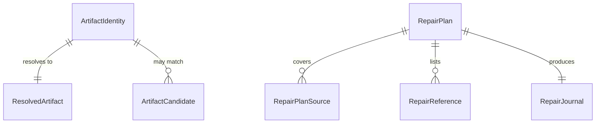

---
assigned_number: 9
created: 2026-10-28
prd: null
predicted_number: 9
slug: spec-canonical-artifact-identity-key-minting-resolution-storage-and-repair
type: API / Data Model / Protocol / UI Spec
updated: 2026-10-28
---

# SPEC-009: Canonical artifact identity: key minting, resolution, storage and repair

## Summary

This specification defines the canonical key of a ForgePlan artifact — how it is minted, how it is stored, how a caller reference is resolved to exactly one document, and how accumulated collisions are repaired without losing documents.

## Scope

Contracts and models described here:

- The canonical key format and its minting rule.
- The identity types carried by the core API and exposed by CLI and MCP.
- The resolution algorithm and its error taxonomy.
- The legacy index storage contract (schema version 5) and its staged migration.
- The repair plan, apply, and recovery contracts.

Out of scope: the number allocation algorithm's internal formatting, the embedding pipeline, the federation source model, and any change to the historical document corpus beyond an explicitly planned repair.

---

## Requirements

### Requirement: Canonical key format

The canonical key of a newly created artifact SHALL be `<kind>-<title-part>-k<32 lowercase hex>`, where:

- `<kind>` is the lower-case artifact kind prefix (`prd`, `spec`, `rfc`, `adr`, `note`, `evidence`, `problem`, `solution`, `epic`, `refresh`).
- `<title-part>` is the slugified title, truncated only at a hyphen boundary so that the total key length does not exceed 80 characters.
- `k<32 lowercase hex>` is 16 random bytes rendered as 32 hexadecimal characters.

#### Scenario: V1 — Distinct keys for identical titles

```gherkin
Given a workspace with no documents
When  two documents are created with the identical title "Weekly review"
Then  the canonical keys differ
And   the filename of each document equals "<canonical_key>.md"
And   both titles and bodies are preserved byte for byte
```

```gherkin
Given a workspace with no documents
When  two documents are created with the identical Cyrillic title "Еженедельный обзор"
Then  the canonical keys differ
And   the title part of each key is the ASCII word "document"
And   the kind prefix and the 32 hexadecimal characters are present
```

```gherkin
Given two existing documents with different canonical keys
When  the entropy source is forced to return the same 16 bytes twice
Then  the second creation does not overwrite any byte of the first document
And   the first document's canonical key is unchanged
```

### Requirement: Key independence from mutable and ambient data

The canonical key SHALL NOT be derived from the timestamp, the display number, the process id, the file path, or a hash of the content. The only source of uniqueness SHALL be the operating-system random source.

#### Scenario: Key is stable across edits

```gherkin
Given a document with canonical key K
When  its title, body, and status are updated
Then  the canonical key is still K
And   the filename is unchanged
And   the file is not renamed
```

#### Scenario: Key is stable across a copy

```gherkin
Given a document with canonical key K in one branch
When  the same document is present in another branch and the branches are merged
Then  both copies carry canonical key K
And   the merge produces an ordinary Git conflict on content, not a key conflict
```

### Requirement: Key minting failure

If the operating-system random source cannot produce 16 bytes, the creation SHALL fail and SHALL NOT write any artifact file, projection, index row, relation, or claim.

#### Scenario: Entropy source unavailable

```gherkin
Given the random source fails
When  a document is created
Then  the command exits non-zero with a diagnosable error
And   no file was created
And   no display number was consumed
```

### Requirement: Immutable identity through ordinary updates

An ordinary update SHALL NOT change the canonical key, including when the key arrives through nested or external frontmatter. Only an explicitly verified identity-repair operation may change a key.

#### Scenario: V7 — Update cannot substitute the key

```gherkin
Given a document with canonical key K
When  an update sets a different slug in the body, and then in a nested frontmatter block
Then  the canonical key is still K
And   the update is rejected with a diagnosable error
```

### Requirement: One resolution algorithm

Resolution SHALL operate over the fully parsed document set and SHALL follow exactly this order:

1. An empty or invalid selector, or a qualifier naming another source, is rejected.
2. An exact canonical key match wins. If several files claim that key, resolution SHALL report a conflicting-key error naming every claimant — it SHALL NOT pick one.
3. Otherwise the display id is normalized (`prd-74` becomes `PRD-074`) and **all** matches are collected. Exactly one match is the result; more than one is an ambiguity error; zero matches is "not found".
4. A numeric-shaped canonical key SHALL NOT take priority over a competing display alias of the same shape.

Resolution SHALL NOT select by filename prefix, by array order, by most recent file, by a LanceDB row, or by title similarity. Candidates SHALL be sorted by canonical key and then by relative path.

#### Scenario: V5 — Legacy selector routes never pick a winner silently

```gherkin
Given a workspace holding an exact key, a lowercase display id, a missing reference, two documents sharing one display id, two files claiming one canonical key, and a legacy numeric key shadowing a display alias
When  each reference is resolved through every legacy selector route
Then  the exact key resolves to its document
And   the lowercase display id resolves to its document
And   the missing reference yields "not found"
And   the duplicate display id yields an ambiguity error naming both candidates
And   the duplicate canonical key yields a conflicting-key error naming both claimants
And   the shadowed numeric key yields an ambiguity error
And   no file, index row, or claim changed as a result of any error
```

#### Scenario: V4 — Source-qualified addressing

```gherkin
Given two projects that both hold a document numbered PRD-001, and a federation scope that holds a copy of one canonical key
When  a qualified get is issued for one source
Then  the requested source and the exact body are returned
And   an unqualified get over the same scope reports ambiguity explicitly
And   the source graph keeps both vertices
```

### Requirement: Error taxonomy

A resolution failure SHALL distinguish these outcomes and SHALL NOT collapse them into "not found":

| Code | Meaning |
|------|---------|
| `ambiguous` | The input matched more than one document by display alias |
| `conflicting_canonical_key` | More than one file claims the same canonical key |
| `invalid_selector` | The input is empty or not a valid selector |
| `incomplete_capture` | The document set could not be fully parsed, so the result would be partial |

An I/O error, a parse error, and a limit error SHALL surface as errors, never as "not found". A partial report SHALL remain a diagnostic result; writing against a partial document set is forbidden.

#### Scenario: Absence differs from ambiguity

```gherkin
Given a workspace where no document matches the reference and another where two match
When  each reference is resolved
Then  the first yields a not-found result
And   the second yields an ambiguity error with candidates
And   the two outcomes are distinguishable by the caller
```

### Requirement: Public response shape

Successful `new`, `get`, `list`, `search`, and `export` responses SHALL keep the existing `id` field with its current meaning and SHALL add the canonical key. No existing tool SHALL gain a new mandatory input parameter.

The CLI SHALL print the ambiguity candidates as canonical key, title, and relative path, and SHALL exit non-zero. The MCP layer SHALL return a tool error carrying a machine-readable code, the input, and the candidates, preserving the existing transport and error envelope. Absolute paths and other sources' data SHALL NOT be disclosed.

#### Scenario: V6 — Existing command surfaces keep working

```gherkin
Given the CLI and MCP surfaces for new, get, update, link, unlink, list, search, score, validate, activate, delete, restore, export, and import, plus phase, claim, tag, and parent references
When  each runs on an unambiguous input
Then  the same arguments are accepted as before
And   each successful response carries the existing id and the canonical key
And   two documents sharing one display number never mix body, relations, state, score, or embedding
```

### Requirement: Storage by canonical key

The legacy index SHALL store artifacts, relations, and evidence references under the canonical key. The public `id` SHALL remain the display id. Uniqueness, upsert, and mutation SHALL use the canonical key only.

The current schema version 4 SHALL be raised to 5. The `artifacts` table SHALL gain a `canonical_key` column. Relations SHALL continue to store their endpoints in the existing `source_id` and `target_id` fields, but those fields SHALL hold canonical keys.

#### Scenario: V8 — Legacy index migration is atomic

```gherkin
Given a schema-4 workspace with a nested slug, two display aliases, and old evidence
When  the v5 migration is run and then interrupted at each stage and re-run
Then  either a complete v5 index or the preserved v4 index exists
And   the readiness marker never promises a partial set of tables
And   the document count, edges, and embeddings reconcile against the Markdown
And   a constellation layout creates no legacy index tables
```

### Requirement: Staged index migration

The migration SHALL:

1. Build the identity-v5 tables from the Markdown, never by copying `canonical_key = id` in SQL.
2. Place them under the existing legacy Lance root as `artifacts_identity_v5`, `relations_identity_v5`, and `evidence_identity_v5`, leaving the old tables untouched during preparation. `fpf_spec` and the historical `change_log` SHALL NOT be duplicated.
3. Verify the full source digest, the document count, key uniqueness, alias distinguishability, references, and a round-trip of the payload before publication. A row that cannot be mapped, and any canonical duplicate, SHALL be reported and SHALL block publication; the original index SHALL be preserved.
4. Write and fsync `lance/IDENTITY_V5.json` atomically only after verification, recording the version, the three table names, the source digest, and completion. The presence of columns alone SHALL NOT confirm readiness.
5. On failure before the marker, a subsequent run rebuilds only the stage tables under the lock. After the marker, only the v5 set is used. A damaged marker SHALL be an explicit error, never a silent fallback to v4.
6. Convert a legacy layout to the constellation layout with the marker and new tables accounted for, archiving the whole old derived plane. A constellation layout SHALL NOT open or create a legacy index.

#### Scenario: Migration preserves the old index until the new one is verified

```gherkin
Given a schema-4 workspace
When  the migration is run
Then  the old tables still exist and still hold their rows
And   the new tables exist and hold a full document set
And   the readiness marker names exactly the three new tables
```

#### Scenario: Ambiguous legacy rows block publication

```gherkin
Given a schema-4 workspace containing two documents that map to one canonical key
When  the migration runs
Then  it reports the conflicting rows
And   it does not publish the v5 set
And   the v4 index remains readable
```

### Requirement: Shared number allocation

Display-number allocation SHALL use the existing per-kind lock in the Git common directory and SHALL consult a ledger stored beside it as `forgeplan/id-<KIND>.json` holding a schema version and a high watermark. A project without Git SHALL keep the same file beside its existing local allocator lock. The ledger is local bookkeeping, not a tracked file and not a global key.

Under the lock, the next number SHALL be the maximum of: the ledger watermark, the canonical frontmatter of the current tree, the frontmatter of every already-initialized linked worktree of the same Git common directory (discovered through `git worktree list --porcelain -z`, never by scanning neighbouring directories), and any admissible legacy index. A missing `.forgeplan` in another worktree is admissible; a damaged ledger or an unreadable existing workspace is not ignorable.

The reservation SHALL be persisted and fsynced before the file is created, so a failure leaves a gap rather than a repeated number. The ledger MAY accelerate accounting but SHALL NOT replace a scan of newly imported frontmatter. A `u32` overflow SHALL be an error, not a wrap.

Lock order SHALL be workspace mutation lock, then per-kind allocator lock; a neighbouring tree's workspace lock SHALL NOT be taken while the shared allocator lock is held.

#### Scenario: V2 — Linked worktrees never reuse a number

```gherkin
Given two linked worktrees of one clone at the same commit
When  a document is created sequentially in the first, then in the second
Then  the reserved display numbers differ
And   the canonical keys differ
```

```gherkin
Given two linked worktrees of one clone at the same commit
When  a document is created concurrently in both
Then  the reserved display numbers differ
And   the canonical keys differ
```

```gherkin
Given a reserved number whose file write did not complete
When  the next document is created
Then  the number is not reused
```

#### Scenario: V12 — Damaged allocation state fails loudly

```gherkin
Given an empty ledger, a missing ledger, a damaged ledger, a u32 maximum watermark, and a worktree whose config is missing
When  a document is created in each state
Then  each yields an explicit diagnosable error or a documented recovery
And   no number is silently reused
And   no file is written into the wrong tree
```

### Requirement: Numbering and canonical key are independent

Allocation of a display number SHALL NOT influence the canonical key, and the canonical key SHALL be minted once, before any attempt to reserve a display number. A repeated user command SHALL be a new operation, never a hidden retry that changes identity.

#### Scenario: One key per creation

```gherkin
Given a creation that retries internally after a write failure
When  the creation finally succeeds
Then  the canonical key used is the one minted before the first attempt
```

### Requirement: New file naming

A newly created document SHALL be written to `<canonical_key>.md`. Existing files SHALL keep their paths. A change to title, status, or body SHALL NOT rename a file and SHALL NOT change a key.

#### Scenario: New document file name

```gherkin
Given a newly created document
When  its file is listed
Then  the name is "<canonical_key>.md"
```

#### Scenario: Existing document keeps its path

```gherkin
Given an existing document at its historical path
When  its title and body are updated
Then  the path is unchanged
And   the canonical key is unchanged
```

### Requirement: Publication without clobbering

A new document SHALL be published without overwriting an existing path. A canonical key that is already claimed SHALL abort the creation; the existing document SHALL NOT be overwritten, and the operation SHALL NOT mint a second key after relations have already been published against the first.

#### Scenario: Clobber is refused

```gherkin
Given an existing document with canonical key K
When  a creation is attempted that would publish at K
Then  the creation fails
And   the existing document's bytes are unchanged
```

### Requirement: Single creation mechanism

Every producer SHALL use the same creation mechanism: the CLI `new`, `capture`, `generate`, `ingest`, `promote`, `reason --save`, and `remember`; the core playbook and lifecycle writers; and the MCP new, generate, capture, decompose, and ingest-related builders. Import and restore SHALL use a separate path that preserves the key from the full document or the receipt. Before the contract is frozen, a census of `NewArtifact` builders, `create_artifact_with_projection`, `import_artifact_with_projection`, and the `allocate_and_create_artifact*` functions SHALL be taken; any remaining direct next-id creator is a defect.

#### Scenario: No producer bypasses the mechanism

```gherkin
Given the census of creation call sites
When  each site is inspected
Then  every site either calls the shared creation mechanism or the preserve-identity path
```

### Requirement: Canonical-key relations and state

New local `links`, `parent_epic`, `informs`, `based_on`, `refines`, and `supersedes` relations SHALL be written as canonical keys. Existing unique references by number SHALL continue to resolve. An unresolved forward or qualified reference SHALL be preserved as before; an **ambiguous** reference SHALL be a distinct diagnostic — neither a forward reference nor evidence for an R_eff score.

Claims, phase state, receipts, destructive operations, embedding job keys, and derived relations SHALL use the canonical key. A legacy sidecar keyed by display id SHALL be migrated only when exactly one document matches; with two candidates the operation SHALL fail explicitly before any state changes. Historical journal and activity events SHALL keep their original description; a link to the canonical key MAY be added, but the events are not rewritten. Historical prose, quotations, and commit messages SHALL NOT be changed by a mass regex.

#### Scenario: Ambiguous reference is a distinct diagnostic

```gherkin
Given a relation whose target display id matches two documents
When  the relation is written
Then  the write is refused with an ambiguity diagnostic
And   the relation is not recorded as a forward reference
And   no R_eff score is derived from it
```

#### Scenario: Legacy sidecar with two candidates

```gherkin
Given a phase-state sidecar named after a display id that two documents share
When  the state is migrated
Then  the migration fails with an explicit error
And   no state file changed
```

### Requirement: Graph identity

The graph SHALL use the canonical key as the node id and SHALL label the node with the display id and the title. Two documents with the same display id SHALL NOT be merged into one vertex.

#### Scenario: Equal display ids stay separate vertices

```gherkin
Given two documents that share one display id
When  the graph is built
Then  both appear as distinct vertices
And   each is labelled with its own title
```

### Requirement: Repair plan

`forgeplan reconcile-ids` SHALL be extended, not duplicated by a second repair interface. The existing safe filename and predicted-number operations SHALL remain. The existing `--check-only` SHALL continue to diagnose. New flags:

```text
forgeplan reconcile-ids --plan-out identity-plan.json --json
forgeplan reconcile-ids --apply-plan identity-plan.json --json
forgeplan reconcile-ids --recover <transaction-id> --rollback --json
```

`--plan-out` SHALL be read-only with respect to the workspace and SHALL write only the requested plan. `--apply-plan` and `--recover` are mutually exclusive. Errors, a stale plan, and unresolved references SHALL exit non-zero.

A version-1 plan SHALL contain the canonical workspace path, the Git HEAD and common-dir identity when Git is present, a full inventory digest, for every source the relative path and the SHA-256 of the full file, the body, and the frontmatter, the old and new keys, the proposed path, the exact reference occurrences, and the mapping. New keys are reserved in the plan and do not change at apply time. The digest covers every plan field; it is an integrity check, not an authorization.

#### Scenario: Plan is read-only

```gherkin
Given a workspace with collision groups
When  a plan is produced
Then  the workspace is byte-identical afterwards
And   the plan file is the only thing written
```

#### Scenario: Stale plan is refused

```gherkin
Given a plan produced against a workspace
When  a source file, the HEAD, a reference, or a destination changes
Then  the apply is refused
And   no file changed
```

### Requirement: Preserve-all repair

The first application SHALL use preserve-all: no deletion, no content merge, and no choice of a single "main" report. Every candidate for one canonical key SHALL receive its own new key. Different existing canonical keys sharing one display number SHALL NOT change. Historical display numbers SHALL be preserved — the goal is to remove addressing ambiguity, not to rewrite the numbering history.

Inbound references SHALL be listed separately per exact source path, per field (`links`, `parent_epic`, sidecar), and per occurrence. Unambiguous unique references SHALL be translated mechanically. For a conflicting reference, the target SHALL be taken only from the content or history of that specific relation and from an independent review; a number, a title, and a modification time are not sufficient evidence. A textual mention inside a quotation SHALL NOT be rewritten. `--apply-plan` SHALL NOT accept unresolved structural references onto changed keys: an unknown relation SHALL be clarified by the owner, not by a language model.

#### Scenario: V10 — The pilot corpus keeps every document

```gherkin
Given copies of the ForgePlanWeb and ForgePlanMarketplace workspaces with their 16 collision groups
When  the repair is applied to the copies
Then  every source document is preserved
And   canonical collisions are zero
And   the reference census reconciles exactly
And   unresolved structural references on remapped keys are zero before the apply
And   both projects answer reads and writes
```

#### Scenario: Conflicting inbound reference blocks the apply

```gherkin
Given a repair plan whose inbound reference cannot be attributed
When  the plan is applied
Then  the apply is refused with the exact conflict named
And   the workspace is unchanged
```

### Requirement: Repair transaction and recovery

Before the first mutation, the transaction SHALL write and fsync a complete manifest with preimages and the planned post-image hashes into `.forgeplan/identity-repair/<transaction-id>/`. Each file publication SHALL be atomic. A multi-file transaction SHALL NOT be described as an atomic Git commit. The repair SHALL use ordinary filesystem operations, not `git mv` or staging, because the Git index is not part of the repair transaction.

On error, the preimages SHALL be restored. After a crash, the next mutation or maintenance run SHALL refuse to proceed until an explicit recovery. A rollback SHALL NOT overwrite unrelated changes: it accepts only the expected post-images and pre-images, and otherwise preserves the journal with the exact conflict.

After a complete apply, an owner-specific reconcile SHALL refresh the index and the semantic backlog. If indexing fails after the canonical commit, the journal SHALL report `canonical_committed/index_pending` — neither "the rollback already ran" nor "everything is ready". An explicit rollback remains available until new user edits appear; it restores the canonical preimages, and the index is rebuilt afterwards.

#### Scenario: V9 — Repair is safe and reversible

```gherkin
Given a repair plan over a workspace with collision groups
When  the plan is produced twice, then a source, the HEAD, a reference, or a destination changes, then a symlink or traversal target is introduced, then a crash, a rollback, and a restart occur
Then  producing the plan does not change the workspace
And   a stale or unsafe plan is refused
And   the original bytes and paths are restored
And   a concurrent unrelated edit is not overwritten
```

#### Scenario: Index failure after a canonical commit

```gherkin
Given a repair whose canonical commit succeeded and whose indexing failed
When  the journal is read
Then  it reports canonical_committed/index_pending
And   the rollback remains available
```

### Requirement: Numbering scope

Globally consecutive short numbers SHALL NOT be promised to independent clones. Between linked worktrees of one clone the numbers agree through the shared ledger. After independent clones are merged, a repeated number is admissible and SHALL NOT cause a document loss. A command addressed by such a number SHALL require the permanent key.

#### Scenario: V3 — Independent clones merge without document loss

```gherkin
Given two independent clones with no shared ledger that create a document with the same title and number
When  the branches are merged with Git
Then  both documents survive
And   each is independently readable and updatable by its canonical key
And   a display-only selector returns both candidates and writes nothing
```

### Requirement: Semantic index follows the canonical key

Semantic search SHALL return the edited document for its new text, under the correct canonical key, and SHALL NOT return the old text as its current version. The embedding backlog SHALL actually be drained; no manual embed may be required.

#### Scenario: V11 — Semantic search tracks the edited document

```gherkin
Given a configured semantic index and a document with canonical key K
When  a unique text is edited through the CLI and then through the MCP, with no manual embed
Then  the new text is found by meaning under canonical key K
And   the old text is not returned as the current version
And   the backlog is drained
```

---

## Data Models

### Entity: ArtifactIdentity

```typescript
interface ArtifactIdentity {
  canonical_key: string; // permanent key: "<kind>-<title-part>-k<32 hex>"
  display_id: string;    // display alias: "PRD-074"
}
```

**Constraints**:
- `canonical_key`: 1–80 characters, immutable through ordinary updates, unique per workspace.
- `display_id`: the human-facing number; may repeat across documents and across projects.

### Entity: ResolvedArtifact

```typescript
interface ResolvedArtifact {
  identity: ArtifactIdentity;
  relative_path: string; // workspace-relative; never absolute
}
```

### Entity: ArtifactCandidate

```typescript
interface ArtifactCandidate {
  canonical_key: string;
  display_id: string;
  title: string;
  relative_path: string;
}
```

### Entity: ResolveError

```typescript
type ResolveError =
  | { kind: "ambiguous"; input: string; candidates: ArtifactCandidate[] }
  | { kind: "conflicting_canonical_key"; key: string; candidates: ArtifactCandidate[] }
  | { kind: "invalid_selector"; input: string }
  | { kind: "incomplete_capture"; message: string };
```

### Entity: IdentityLedger

```typescript
interface IdentityLedger {
  schema_version: number;
  high_watermark: number; // highest display number ever reserved for this kind
}
```

**Constraints**:
- Stored at `forgeplan/id-<KIND>.json` beside the per-kind allocator lock; for a non-Git project, beside the local allocator lock.
- Local bookkeeping: never tracked by Git, never a global key.

### Entity: RepairPlan (version 1)

```typescript
interface RepairPlan {
  version: 1;
  workspace_path: string;
  git: { head: string; common_dir: string } | null;
  inventory_digest: string;
  sources: Array<{
    relative_path: string;
    file_sha256: string;
    body_sha256: string;
    frontmatter_sha256: string;
    old_key: string;
    new_key: string;
    proposed_path: string;
  }>;
  references: Array<{
    source_path: string;
    field: string;        // "links" | "parent_epic" | sidecar name
    occurrence: number;
    from: string;
    to: string;
    mapping: Record<string, string>;
  }>;
  digest: string; // covers every field above
}
```

**Constraints**:
- `new_key` values are reserved in the plan and do not change at apply time.
- `digest` is an integrity check over the plan, not an authorization.

### Entity: RepairJournal

```typescript
interface RepairJournal {
  transaction_id: string;
  manifest_sha256: string;
  preimages: Record<string, string>; // relative path -> sha256
  planned_postimages: Record<string, string>;
  operations: Array<{ path: string; state: "pending" | "published" | "rolled_back" | "conflict" }>;
  status: "in_progress" | "canonical_committed" | "canonical_committed/index_pending" | "rolled_back" | "conflict";
}
```

---

## Relationships



---

## Validation Rules

| Field | Rule | Error |
|-------|------|-------|
| `canonical_key` | 1–80 characters; lowercase; hyphen-separated; the random part is 32 hex characters | `invalid canonical key` |
| `canonical_key` | Unique across the workspace; a second claim is a conflicting-key error | `conflicting_canonical_key` |
| `display_id` | `<KIND>-<number>`; normalization accepts a lower-case prefix and a non-padded number | `invalid_selector` |
| `high_watermark` | A `u32`; exceeding it is an error | `number space exhausted` |
| `inventory_digest` | Must match the workspace at apply time | `plan is stale` |
| `relative_path` | Workspace-relative; no traversal, no symlink escape | `unsafe path` |

---

## Events / Side Effects

| Trigger | Event | Consumers |
|---------|-------|-----------|
| Document created | canonical key minted, display number reserved | index, projection, claims |
| Number reserved | ledger watermark advanced and fsynced | next allocation |
| Document updated | key preserved; index row upserted by key | index, semantic backlog |
| Repair applied | journal records each published file | index rebuild, semantic backlog |
| Ambiguity detected | diagnostics recorded | CLI exit code, MCP error envelope |

---

## Versioning

| Version | Date | Changes |
|---------|------|---------|
| 1.0 | 2026-10-28 | Initial specification: key format, resolution order, error taxonomy, schema v5, staged migration, repair plan and recovery |

---

## Related

- PRD-090: Collision-safe artifact identity across projects and Git workspaces
- RFC-019: Implementation of canonical-key artifact identity
- ADR-030: Canonical key as authoritative artifact identity, display id as alias
- PROB-067: ID counter race condition across parallel worktrees
- SPEC-005: Frontmatter contract (extended by this specification)
- Issue #552: duplicate numbers across linked worktrees
