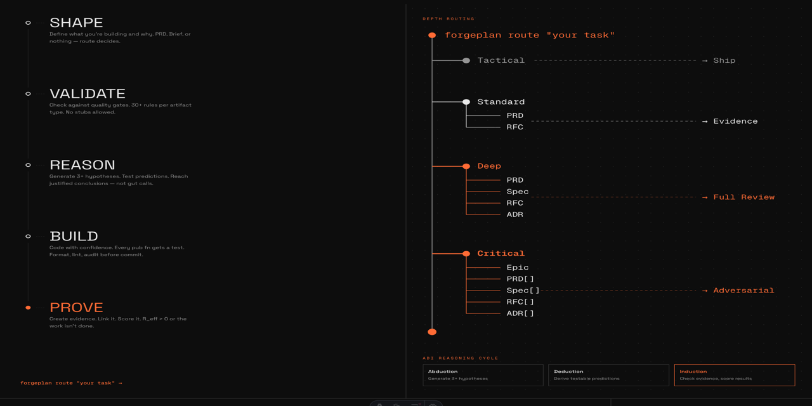
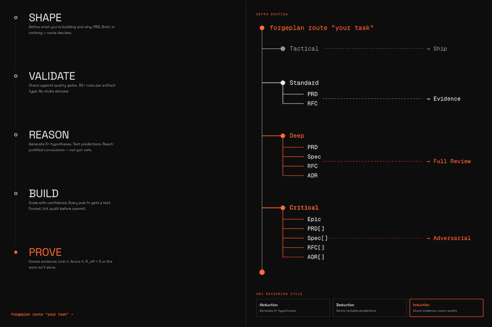
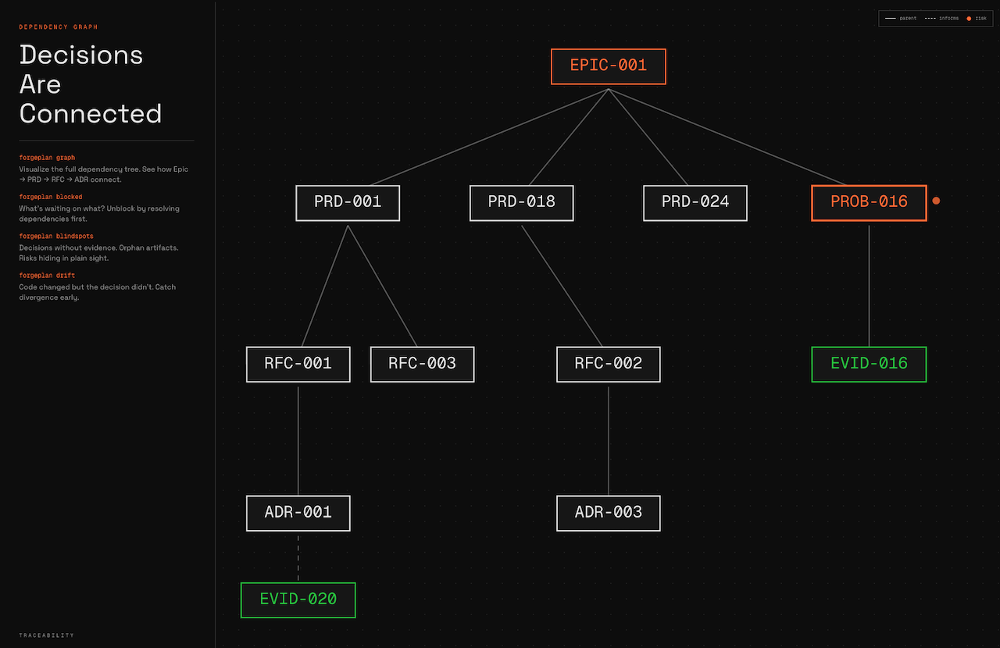

<div align="center">

# ForgePlan



### From raw idea to proven decision

An **engineering decision framework** for teams that want their ideas to leave a paper trail.
Structured artifacts (PRD, RFC, ADR, Epic, Spec), quality scoring, evidence, and native AI-agent integration.

<br>

[](LICENSE)
[](https://github.com/ForgePlan/forgeplan/releases)
[](https://github.com/ForgePlan/forgeplan/actions)
[](.forgeplan/)

**[Website](https://forgeplan.dev)** ·
**[Documentation](docs/README.md)** ·
**[Methodology](docs/methodology/FORGEPLAN-GUIDE.md)** ·
**[Releases](https://github.com/ForgePlan/forgeplan/releases)** ·
**[Marketplace](https://github.com/ForgePlan/marketplace)**

<br>

[English](README.md)  **·**  [Русский](README.ru.md)

<br>

</div>

---

<div align="center">

```
    ┌─────────┐    ┌────────┐    ┌────────┐    ┌───────┐    ┌────────┐    ┌──────┐
    │ OBSERVE │ ─▶ │ ROUTE  │ ─▶ │ SHAPE  │ ─▶ │ BUILD │ ─▶ │ PROVE  │ ─▶ │ SHIP │
    └─────────┘    └────────┘    └────────┘    └───────┘    └────────┘    └──────┘
     health        depth          PRD/RFC       code+test    evidence      activate
```

**Every decision leaves a trail. Every trail has proof. Every proof decays honestly.**

</div>

---

## Why ForgePlan

<table>
<tr>
<td width="50%">

### Before
- Decisions scattered in Slack, Linear, email
- "Why did we pick X?" — silence six months later
- AI agents produce plausible-but-shallow work
- ADRs exist in theory, never get written
- Research never reaches the implementation

</td>
<td width="50%">

### After
- Every decision is a git-tracked artifact
- Full `Problem → Decision → Consequence` trail
- Depth calibration forces appropriate rigor
- `forgeplan new adr` — create a draft template, then fill and validate it
- ADI reasoning demands 3+ hypotheses

</td>
</tr>
</table>

## Install

```bash
# Homebrew (macOS, Linux)
brew install ForgePlan/tap/forgeplan
# Homebrew 6.0+: if install is refused with "untrusted tap",
# run `brew trust ForgePlan/tap` once, then re-run the line above.

# Install script
curl -fsSL https://raw.githubusercontent.com/ForgePlan/forgeplan/main/install.sh | sh

# From source
git clone https://github.com/ForgePlan/forgeplan.git && cd forgeplan
cargo install --path crates/forgeplan-cli --features semantic-search
```

### After installing

Release binaries include semantic search; a plain Cargo build does not enable it
by default. The source-install recipe above enables `semantic-search`. Inference
uses the pure-Rust `tract` engine, but model weights are downloaded separately.

| Capability | Preparation |
|---|---|
| Local semantic search | `forgeplan setup` downloads the BGE-M3 model (about 2.1 GB). A complete cached snapshot is required offline. |
| FPF knowledge base | Install `/plugin install fpf@ForgePlan-marketplace`, then run `forgeplan fpf ingest`. Inspect it with `forgeplan fpf status`. |
| Agent commands | Install the [agent harness plugins](https://forgeplan.dev/docs/getting-started/installation/) for commands such as `/smith` and `/audit`. |

Models are shared across workspaces in `~/.forgeplan/models`
(`%USERPROFILE%\.forgeplan\models` on Windows). `FORGEPLAN_MODEL_CACHE` takes
priority; `HF_HOME` does not override the tract cache. Existing cache directories
are not moved or deleted automatically.

`forgeplan init` can offer a model download interactively; scripted initialization
must explicitly request `forgeplan init -y --with-model`. This is not a download
recipe for an already initialized workspace, where init may return early.
`forgeplan setup --skip-model` skips the model; `--skip-alias` skips the `fpl` alias.

Search mode matters. Default smart search can combine keyword and semantic
results; do not assume forced `search --semantic` silently falls back.
On a Constellation workspace it reports an error when the published embedding
profile or eligible vectors are unavailable. Run `forgeplan embed` explicitly
after indexing. Automatic embedding additionally requires active
`config.embedding`, a supported cached model, and a live maintenance writer.
Manual `embed` does not save that configuration.

**2 — FPF.** The First Principles Framework corpus ships as a separate skill,
not inside the binary. Install and ingest it for FPF knowledge-base search;
inspect the result with `forgeplan fpf status`. `forgeplan reason` runs ADI
through the configured LLM provider. The project's Standard+ workflow requires
that reasoning step; ingestion alone neither configures the provider nor proves
that real alternatives were evaluated.

**3 — the harness.** CLI operations also work from a plain shell. Marketplace
plugins add agent-driving commands; they are not prerequisites for direct
CLI use.

Interface availability also depends on workspace layout. In the scoped
`0.39.0+constellation.s1.1` build, CLI `validate` gives a named legacy-store
refusal on migrated workspaces; full MCP `forgeplan_validate` was exercised
successfully there. This does not establish parity for all tools (issue #538).

## Start a draft

Use a new directory outside any existing workspace: discovery walks up parent
directories. `init -y` is a no-op when a workspace is already found.

```bash
forgeplan init -y
forgeplan route "Add OAuth2 authentication" --level 0
forgeplan new prd "OAuth2 Authentication"
```

This creates a template, not an activation-ready PRD. Fill its requirements and
depth-specific sections, configure an LLM before `reason`, and record real
evidence rather than a sample test claim. On a compatible legacy workspace,
`forgeplan validate PRD-001` reports schema findings and `forgeplan review PRD-001`
shows the lifecycle checklist. Activation also checks length, evidence and stubs;
zero validation MUST findings alone does not guarantee activation.
For migrated workspaces, use the [Constellation interface reference](https://forgeplan.dev/docs/reference/constellation/)
to select a supported CLI/MCP operation.

<div align="center">

</div>

## The seven things that matter

| | |
|:---|:---|
| **📝 Markdown-first** | All artifacts are plain markdown in git. LanceDB is a derived index — you can rebuild it from the files. |
| **🎯 Quality scoring** | `R_eff` (weakest-link evidence trust) and `F-G-R` (formality, granularity, reliability), automatic. |
| **🧭 Smart routing** | Analyzes your task, picks the right depth and artifact pipeline. No over-documenting typo fixes. |
| **🧠 ADI reasoning** | Abduction → Deduction → Induction. The reasoning workflow asks for 3+ hypotheses; it does not prove their independence or correctness automatically. |
| **🤖 MCP-native** | Agent tools for Claude Code, Cursor, Aider, Continue. The scoped Constellation build registers 76 full-profile tools and a separate 9-tool read profile; registration is not proof of migrated-layout support. |
| **🔍 Local semantic search** | BGE-M3 (1024 dims) on `tract` — pure-Rust inference without API keys or query egress once the model is cached. |
| **⏰ Evidence decay** | Expired `valid_until` is reported as stale; expired evidence scores 0.1. This is deadline-based detection, not automatic renewal or a background lifecycle transition. |

## Artifacts at a glance

<table>
<tr>
<th>Artifact</th>
<th>Answers</th>
<th>When</th>
</tr>
<tr>
<td><b>PRD</b></td>
<td>What are we building and why?</td>
<td>New feature, product decision</td>
</tr>
<tr>
<td><b>RFC</b></td>
<td>How will we build it?</td>
<td>Architecture, API design</td>
</tr>
<tr>
<td><b>ADR</b></td>
<td>Why did we choose this way?</td>
<td>Irreversible technical decisions</td>
</tr>
<tr>
<td><b>Spec</b></td>
<td>What are the exact contracts?</td>
<td>API contracts, data models</td>
</tr>
<tr>
<td><b>Epic</b></td>
<td>What is the bigger picture?</td>
<td>Cross-cutting, multi-PRD initiatives</td>
</tr>
<tr>
<td><b>Evidence</b></td>
<td>Does it actually work?</td>
<td>After implementation, before activation</td>
</tr>
</table>

See [`docs/methodology/PRD-RFC-ADR-FLOW.md`](docs/methodology/PRD-RFC-ADR-FLOW.md) for the full decision tree.

<div align="center">

</div>

## Documentation

Three entry points — pick the one that matches what you need right now.

| I want to... | Start here |
|---|---|
| **Learn the methodology** | [`docs/methodology/FORGEPLAN-GUIDE.md`](docs/methodology/FORGEPLAN-GUIDE.md) |
| **Browse all docs** | [`docs/README.md`](docs/README.md) |
| **Work with AI agents** | [`CLAUDE.md`](CLAUDE.md) · [`AGENTS.md`](AGENTS.md) |
| **Use Constellation** | [User guide](https://forgeplan.dev/docs/guides/constellation/) · [Interface reference](https://forgeplan.dev/docs/reference/constellation/) |
| **Pilot a migration** | [Portable runbook (RU)](docs/operations/CONSTELLATION-PILOT.ru.md) |

The website is the task-oriented user documentation; `docs/` holds contributor
methodology, architecture and operational contracts. Constellation pages describe
the scoped `0.39.0+constellation.s1.1` build, not the published `0.38.0` release.

## Dogfood

<table>
<tr>
<td align="center"><b>437</b><br>tracked artifacts</td>
<td align="center"><b>3349</b><br>tests passing</td>
<td align="center"><b>82</b><br>CLI commands</td>
<td align="center"><b>73</b><br>MCP tools</td>
</tr>
</table>

These are historical repository counters, not a fresh measurement or acceptance
result for the Constellation build.

This repository uses ForgePlan to manage itself. Every PRD, RFC, ADR, and Evidence lives in
[`.forgeplan/`](./.forgeplan/) — browse them or run `forgeplan list` locally.

## Contributing

See **[CLAUDE.md](CLAUDE.md)** for the full guide. Short version:

```bash
# Branch from dev
git checkout dev && git pull
git checkout -b feat/my-feature

# Work the cycle: Route → Shape → Validate → Build → Evidence → Activate
# cargo fmt + cargo test before every commit
# PR → dev (main is touched only via release branches)
```

### Cargo features

| Feature | Default | Purpose |
|---|---|---|
| `semantic-search` | **on** in released binaries | BGE-M3 vector search on the pure-Rust `tract` engine. Weights are separate (**~2.1 GB**), cached per machine (`FORGEPLAN_MODEL_CACHE`) — see [Install](#install). Off by default in a plain `cargo build`; offline use needs a complete cached snapshot. |
| `test-helpers` | off | **Test fixtures only** — exposes `*_for_test` escape hatches on `LanceStore` that bypass the projection pipeline. **MUST NOT be enabled in production binaries.** Internally gated on `cfg(debug_assertions)` so release builds with the feature accidentally enabled still keep the ADR-003 lockdown. Downstream test crates that need direct DB seeding should enable it under `[dev-dependencies]` only (see `forgeplan-mcp/Cargo.toml` for the canonical example). |

## License

MIT — see [LICENSE](LICENSE).

<br>

<div align="center">

### Structure. Evidence. Trust.

**[→ Install now](#install)** and run `forgeplan route "your next task"`.

<br>

Built on top of [Quint-code](https://github.com/m0n0x41d/quint-code) · [BMAD](https://github.com/bmadcode/BMAD-METHOD) · [OpenSpec](https://github.com/Fission-AI/OpenSpec) · [FPF](https://github.com/ailev/FPF) · [LanceDB](https://lancedb.com/) · [tract](https://github.com/sonos/tract)

<sub>Made with care by <a href="https://github.com/ForgePlan">@ForgePlan</a> · <a href="README.ru.md">Русская версия</a></sub>

</div>
