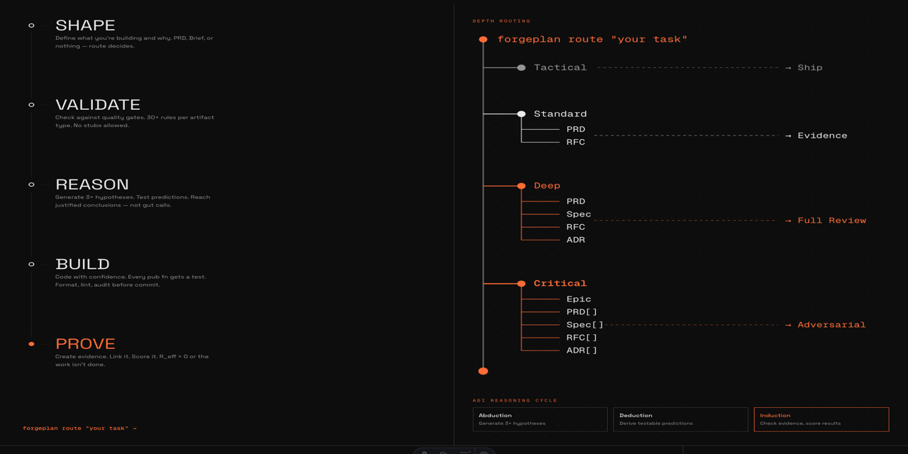
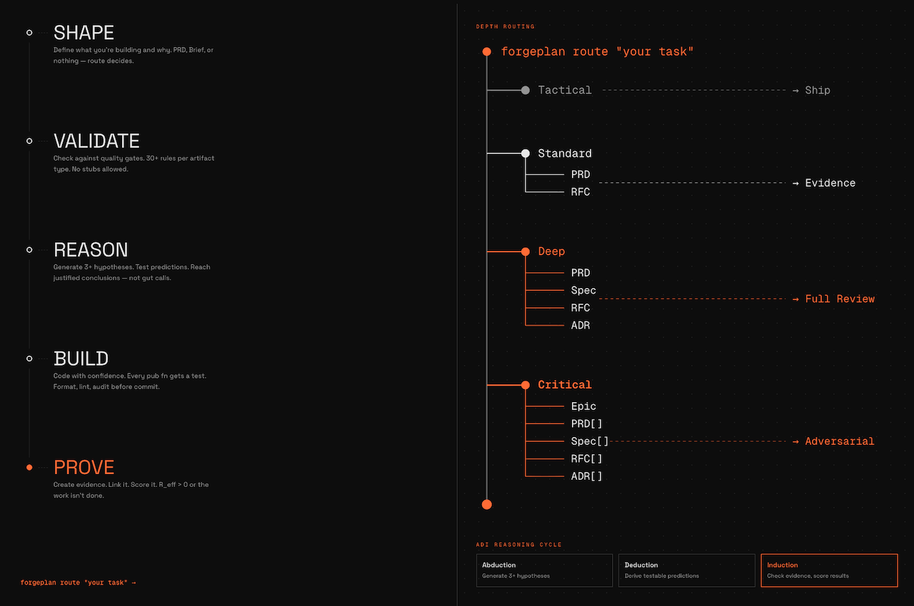
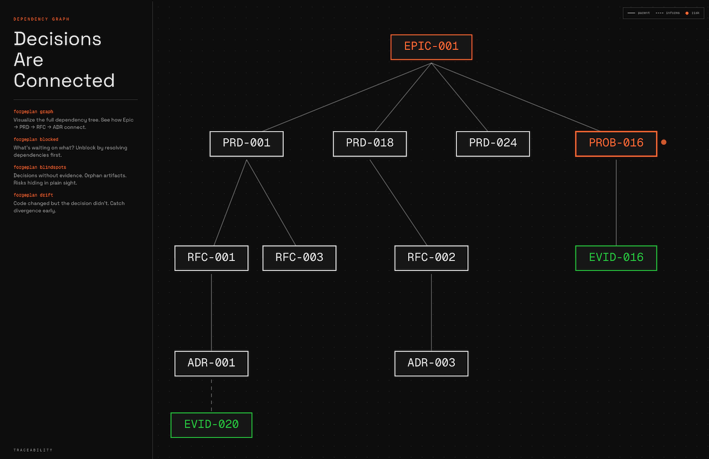

<div align="center">

# ForgePlan



### From raw idea to proven decision

An **engineering decision framework** for teams that want their ideas to leave a paper trail.
Structured artifacts (PRD, RFC, ADR, Epic, Spec), quality scoring, evidence, and native AI-agent integration.

<br>

[](LICENSE)
[](https://github.com/ForgePlan/forgeplan/releases)
[](https://github.com/ForgePlan/forgeplan/actions)

**[Website](https://forgeplan.dev)** ·
**[Documentation](docs/README.md)** ·
**[Methodology](docs/methodology/FORGEPLAN-GUIDE.md)** ·
**[Releases](https://github.com/ForgePlan/forgeplan/releases)** ·
**[Marketplace](https://github.com/ForgePlan/marketplace)**

<br>

[English](README.md)  **·**  [Русский](README.ru.md)

<br>

</div>

---

<div align="center">

```
    ┌─────────┐    ┌────────┐    ┌────────┐    ┌───────┐    ┌────────┐    ┌──────┐
    │ OBSERVE │ ─▶ │ ROUTE  │ ─▶ │ SHAPE  │ ─▶ │ BUILD │ ─▶ │ PROVE  │ ─▶ │ SHIP │
    └─────────┘    └────────┘    └────────┘    └───────┘    └────────┘    └──────┘
     health        depth          PRD/RFC       code+test    evidence      activate
```

**Every decision leaves a trail. Every trail has proof. Every proof decays honestly.**

</div>

---

## Why ForgePlan

<table>
<tr>
<td width="50%">

### Before
- Decisions scattered in Slack, Linear, email
- "Why did we pick X?" — silence six months later
- AI agents produce plausible-but-shallow work
- ADRs exist in theory, never get written
- Research never reaches the implementation

</td>
<td width="50%">

### After
- Every decision is a git-tracked artifact
- Full `Problem → Decision → Consequence` trail
- Depth calibration forces appropriate rigor
- `forgeplan new adr "Decision title"` creates a draft to fill and validate
- ADI reasoning demands 3+ hypotheses

</td>
</tr>
</table>

## Install

```bash
# Homebrew (macOS, Linux)
brew install ForgePlan/tap/forgeplan
# Homebrew 6.0+: if install is refused with "untrusted tap",
# run `brew trust ForgePlan/tap` once, then re-run the line above.

# Install script
curl -fsSL https://raw.githubusercontent.com/ForgePlan/forgeplan/main/install.sh | sh

# From the published v0.38.0 source (semantic search is opt-in for Cargo builds)
git clone --branch v0.38.0 https://github.com/ForgePlan/forgeplan.git && cd forgeplan
cargo install --path crates/forgeplan-cli --features semantic-search
```

### After installing: three steps that are not automatic

The published **0.38.0** binary provides artifacts, routing, validation, scoring,
the graph and keyword search. This checkout's `Cargo.toml` still declares
**0.37.0**; a build from this branch is not the published 0.38.0 release.

| Capability | Preparation | Without it |
|---|---|---|
| **Semantic search** | `forgeplan setup`, then `forgeplan embed` in each populated workspace | No usable artifact vectors; search may fall back to keywords or omit unembedded artifacts |
| **FPF knowledge base** | Install `fpf@ForgePlan-marketplace`, then `forgeplan fpf ingest` | No local FPF corpus for `fpf search` or `reason --fpf` |
| **Agent workflows** | Install the plugins you need from the [public marketplace](https://github.com/ForgePlan/marketplace) | Marketplace skills and commands are unavailable; the CLI still works |

**1 — the model.** Semantic search ships in every published release binary;
the engine is `tract`, pure Rust. Source builds still need the
`semantic-search` feature. The binary does not contain the 2.1 GB of weights.
`forgeplan setup` downloads them with a progress bar and creates the `fpl`
alias missing after `cargo install` (brew and `install.sh` get it from
cargo-dist). Both steps are idempotent; `--skip-model` and `--skip-alias`
opt out of either.

Weights are cached in the platform cache directory
(`~/Library/Caches/forgeplan/models` on macOS, `~/.cache/forgeplan/models` on
Linux) — shared across all your projects, not one copy per repository. Override
with `FORGEPLAN_MODEL_CACHE`.

`forgeplan init` offers the same download interactively. It never downloads
under `-y`; pass `--with-model` to request it in a scripted install. `setup`
also installs `post-merge` and `post-checkout` git hooks in the current repository
to keep the derived index in sync. Use `--skip-hooks` to opt out, or run
`forgeplan git-sync` after a merge and `forgeplan reindex` to rebuild from markdown.
Hooks do not generate embeddings; run `forgeplan embed` after content changes.

**2 — FPF.** The First Principles Framework corpus ships in the separate
`fpf` plugin, not in the binary. `forgeplan fpf status` reports the local corpus
state. `forgeplan reason ID --fpf` uses it to ground LLM-generated alternatives;
`reason` requires a configured LLM provider. Generated analysis is not verification.

**3 — the harness.** The public marketplace catalog **1.187.1** contains
**23 plugins**, not one mandatory bundle. `fpl-skills` **1.75.1** supplies
`/smith`, `/research`, `/sprint` and `/audit`; `forgeplan-workflow` **1.23.1**
supplies `/forge-cycle` and `/forge-audit`. Install `forgeplan-orchestra`
**3.6.0** only if you want the task-tracker integration, and configure its
Orchestra MCP connection separately. `forgeplan setup-skill` installs the
small `/forge` reference skill, not those plugins or a full agent harness.

Cross-session Hindsight memory is another optional integration (`fpl-hsmem`
**3.7.0**). It requires an explicit project `.hindsight.json` with `url`,
`banks` and `defaultBank`, and those banks must already exist on the server.
Its recall/retain hooks default off. It is not Forgeplan's `remember`/`recall`
artifact store.

Everything else — routing, artifacts, scoring, validation, the graph, keyword
search — works identically on every build.

## First artifact

The commands below create a draft, not a completed or verified decision.
Use the ID returned by `new` in subsequent commands; `PRD-001` is an example
for an empty workspace.

```bash
forgeplan init -y
forgeplan route "Add OAuth2 authentication"
forgeplan new prd "OAuth2 Authentication"
forgeplan get PRD-001
```

Fill the requirements in a separate UTF-8 file, then submit the body through
`forgeplan update PRD-001 --body @requirements.md`. Do not edit the
`.forgeplan/` projection directly.

```bash
forgeplan validate PRD-001
# Optional LLM analysis after configuring a provider:
forgeplan reason PRD-001 --fpf
```

Implement and independently verify the requirements before creating evidence.
An EvidencePack needs actual results and structured `verdict`,
`congruence_level` and `evidence_type` fields in its body; its title alone does
not prove anything. Link it with
`forgeplan link EVID-001 PRD-001 --relation informs`, then run
`forgeplan score PRD-001`, `forgeplan review PRD-001` and, if ready,
`forgeplan activate PRD-001`. No fixed score or PASS result is implied.
See the [evidence protocol](docs/methodology/EVIDENCE-PROTOCOL.md).

<div align="center">

</div>

## The seven things that matter

| | |
|:---|:---|
| **📝 Markdown-first** | All artifacts are plain markdown in git. LanceDB is a derived index — you can rebuild it from the files. |
| **🎯 Quality scoring** | `R_eff` (weakest-link evidence trust) and `F-G-R` (formality, granularity, reliability), automatic. |
| **🧭 Smart routing** | Suggests depth and an artifact pipeline; LLM routing uses the configured provider, with rule-based fallback. |
| **🧠 ADI reasoning** | Abduction → Deduction → Induction. Generates three alternatives with an LLM; practical verification remains separate. |
| **🤖 MCP-native** | 73 tools in the 0.38.0 server for compatible MCP clients. Marketplace orchestration is installed separately. |
| **🔍 Local semantic search** | BGE-M3 (1024 dims) on `tract`. Inference runs locally after the model download; LLM commands have separate provider/network requirements. |
| **⏰ Evidence decay** | Expired `valid_until` is reported by `stale`; expired evidence scores 0.1. Reporting expiry does not itself rewrite the stored lifecycle status. |

## Artifacts at a glance

<table>
<tr>
<th>Artifact</th>
<th>Answers</th>
<th>When</th>
</tr>
<tr>
<td><b>PRD</b></td>
<td>What are we building and why?</td>
<td>New feature, product decision</td>
</tr>
<tr>
<td><b>RFC</b></td>
<td>How will we build it?</td>
<td>Architecture, API design</td>
</tr>
<tr>
<td><b>ADR</b></td>
<td>Why did we choose this way?</td>
<td>Irreversible technical decisions</td>
</tr>
<tr>
<td><b>Spec</b></td>
<td>What are the exact contracts?</td>
<td>API contracts, data models</td>
</tr>
<tr>
<td><b>Epic</b></td>
<td>What is the bigger picture?</td>
<td>Cross-cutting, multi-PRD initiatives</td>
</tr>
<tr>
<td><b>Evidence</b></td>
<td>Does it actually work?</td>
<td>After implementation, before activation</td>
</tr>
</table>

See [`docs/methodology/PRD-RFC-ADR-FLOW.md`](docs/methodology/PRD-RFC-ADR-FLOW.md) for the full decision tree.

<div align="center">

</div>

## Documentation

Three entry points — pick the one that matches what you need right now.

| I want to... | Start here |
|---|---|
| **Learn the methodology** | [`docs/methodology/FORGEPLAN-GUIDE.md`](docs/methodology/FORGEPLAN-GUIDE.md) |
| **Browse all docs** | [`docs/README.md`](docs/README.md) |
| **Work with AI agents** | [`CLAUDE.md`](CLAUDE.md) · [`AGENTS.md`](AGENTS.md) |

## Dogfood


This repository uses ForgePlan to manage itself. PRDs, RFCs, ADRs and Evidence
are tracked under `.forgeplan/`; use `forgeplan list` in a full clone.
The published 0.38.0 interface has **82 top-level CLI commands**
(**103 including subcommands**) and **73 MCP tools**. These are interface
counts, not a claim that this checkout's tests have just passed.

## Contributing

See **[CLAUDE.md](CLAUDE.md)** for the full guide. Short version:

```bash
# Branch from dev
git checkout dev && git pull
git checkout -b feat/my-feature

# Work the cycle: Route → Shape → Validate → Build → Evidence → Activate
# cargo fmt + cargo test before every commit
# PR → dev (main is touched only via release branches)
```

### Cargo features

| Feature | Default | Purpose |
|---|---|---|
| `semantic-search` | **on** in released binaries | BGE-M3 vector search on the pure-Rust `tract` engine. The model is **~2.1 GB**, cached per machine (`FORGEPLAN_MODEL_CACHE`). See [preparation](#after-installing-three-steps-that-are-not-automatic). Off by default in plain `cargo build` and `cargo install`. |
| `test-helpers` | off | **Test fixtures only** — exposes `*_for_test` escape hatches on `LanceStore` that bypass the projection pipeline. **MUST NOT be enabled in production binaries.** Internally gated on `cfg(debug_assertions)` so release builds with the feature accidentally enabled still keep the ADR-003 lockdown. Downstream test crates that need direct DB seeding should enable it under `[dev-dependencies]` only (see `forgeplan-mcp/Cargo.toml` for the canonical example). |

## License

MIT — see [LICENSE](LICENSE).

<br>

<div align="center">

### Structure. Evidence. Trust.

**[→ Install now](#install)** and run `forgeplan route "your next task"`.

<br>

Built on top of [Quint-code](https://github.com/m0n0x41d/quint-code) · [BMAD](https://github.com/bmadcode/BMAD-METHOD) · [OpenSpec](https://github.com/Fission-AI/OpenSpec) · [FPF](https://github.com/ailev/FPF) · [LanceDB](https://lancedb.com/) · [tract](https://github.com/sonos/tract)

<sub>Made with care by <a href="https://github.com/ForgePlan">@ForgePlan</a> · <a href="README.ru.md">Русская версия</a></sub>

</div>
