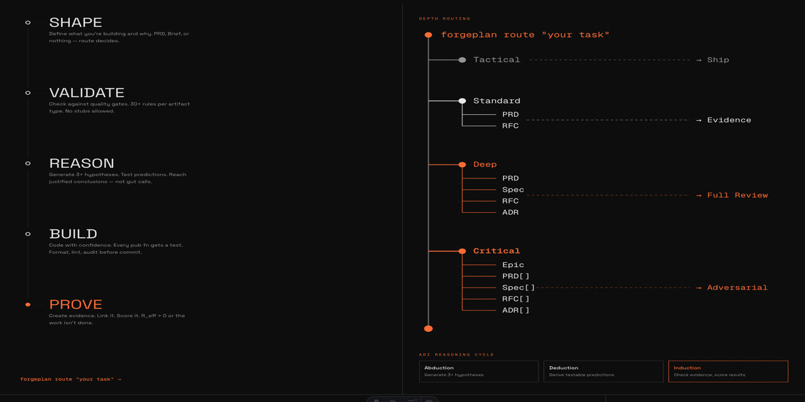
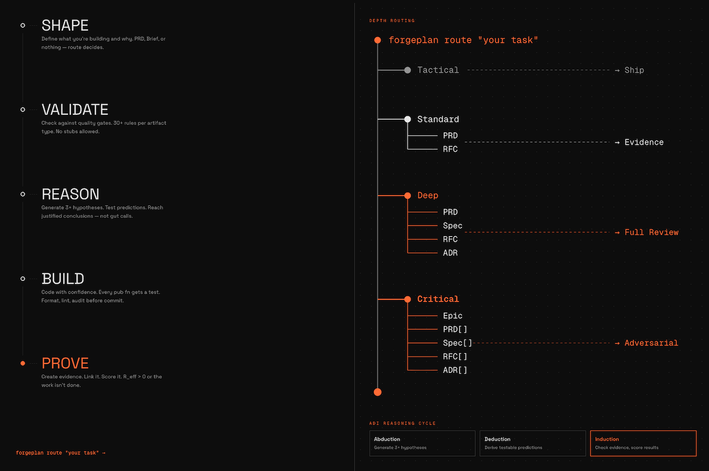
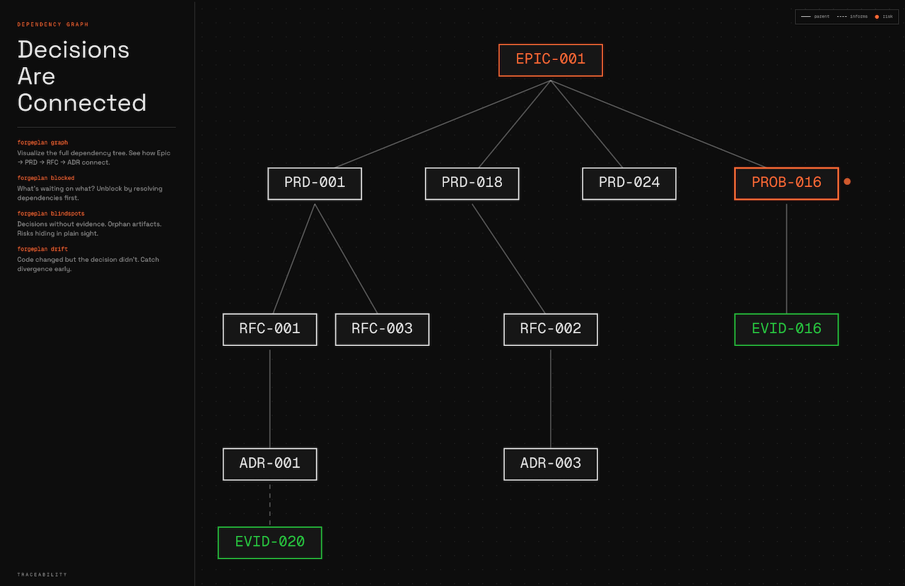

<div align="center">

# ForgePlan



### От сырой идеи до проверенного решения

**Engineering decision framework** для команд, которые хотят, чтобы их идеи оставляли след.
Структурированные артефакты (PRD, RFC, ADR, Epic, Spec), автоматический scoring качества, evidence и нативная интеграция с AI-агентами.

<br>

[](LICENSE)
[](https://github.com/ForgePlan/forgeplan/releases)
[](https://github.com/ForgePlan/forgeplan/actions)

**[Сайт](https://forgeplan.dev)** ·
**[Документация](docs/README.ru.md)** ·
**[Методология](docs/methodology/FORGEPLAN-GUIDE.ru.md)** ·
**[Релизы](https://github.com/ForgePlan/forgeplan/releases)** ·
**[Marketplace](https://github.com/ForgePlan/marketplace)**

<br>

[English](README.md)  **·**  [Русский](README.ru.md)

<br>

</div>

---

<div align="center">

```
    ┌─────────┐    ┌────────┐    ┌────────┐    ┌───────┐    ┌────────┐    ┌──────┐
    │ OBSERVE │ ─▶ │ ROUTE  │ ─▶ │ SHAPE  │ ─▶ │ BUILD │ ─▶ │ PROVE  │ ─▶ │ SHIP │
    └─────────┘    └────────┘    └────────┘    └───────┘    └────────┘    └──────┘
     health        depth          PRD/RFC       code+test    evidence      activate
```

**Каждое решение оставляет след. Каждый след имеет доказательство. Каждое доказательство честно устаревает.**

</div>

---

## Зачем

<table>
<tr>
<td width="50%">

### До
- Решения теряются в Slack, Linear, почте
- «Почему мы выбрали X?» — тишина через полгода
- AI-агенты выдают правдоподобную, но поверхностную работу
- ADR существуют в теории, но не пишутся
- Ресёрч не доходит до реализации

</td>
<td width="50%">

### После
- Каждое решение — git-трекаемый артефакт
- Полный трейл `Problem → Decision → Consequence`
- Depth calibration заставляет нужный уровень строгости
- `forgeplan new adr "Название решения"` создаёт черновик для заполнения и проверки
- ADI reasoning требует 3+ гипотезы

</td>
</tr>
</table>

## Установка

```bash
# Homebrew (macOS, Linux)
brew install ForgePlan/tap/forgeplan
# Homebrew 6.0+: если установка отклонена с "untrusted tap",
# один раз выполните `brew trust ForgePlan/tap` и повторите строку выше.

# Install script
curl -fsSL https://raw.githubusercontent.com/ForgePlan/forgeplan/main/install.sh | sh

# Из исходников опубликованного v0.38.0 (для Cargo семантический поиск включается явно)
git clone --branch v0.38.0 https://github.com/ForgePlan/forgeplan.git && cd forgeplan
cargo install --path crates/forgeplan-cli --features semantic-search
```

### После установки: три отдельных шага

Опубликованный бинарь **0.38.0** предоставляет артефакты, маршрутизацию,
валидацию, оценку качества, граф и поиск по словам. В `Cargo.toml` этой
ветки пока **0.37.0**; сборка из неё не равна опубликованному релизу 0.38.0.

| Возможность | Подготовка | Без неё |
|---|---|---|
| **Семантический поиск** | `forgeplan setup`, затем `forgeplan embed` в каждом заполненном workspace | Нет векторов артефактов; поиск может перейти к словам или пропустить неиндексированные артефакты |
| **База знаний FPF** | Установить `fpf@ForgePlan-marketplace`, затем `forgeplan fpf ingest` | Нет локального корпуса для `fpf search` и `reason --fpf` |
| **Агентские процессы** | Установить нужные плагины из [публичного marketplace](https://github.com/ForgePlan/marketplace) | Их skills и команды недоступны; CLI продолжает работать |

**1 — модель.** Во всех опубликованных бинарях семантический поиск работает
на чистом Rust-движке `tract`. Веса BGE-M3 (**~2.1 GB**) загружаются отдельно.
`forgeplan setup` скачивает модель и создаёт алиас `fpl`, которого нет после
обычного `cargo install`. Повторный запуск допустим; `--skip-model` и
`--skip-alias` отключают соответствующие шаги.

Кеш общий для проектов: `~/Library/Caches/forgeplan/models` на macOS,
`~/.cache/forgeplan/models` на Linux. Путь меняется через
`FORGEPLAN_MODEL_CACHE`.

`forgeplan init` предлагает загрузку интерактивно; с `-y` её не запускает.
Для явной загрузки в скрипте есть `--with-model`. `setup` также устанавливает
в текущем git-репозитории хуки `post-merge` и `post-checkout` для синхронизации
производного индекса. Их можно пропустить через `--skip-hooks`, после merge
выполнить `forgeplan git-sync`, а для полной пересборки — `forgeplan reindex`.
Хуки не создают эмбеддинги; после изменения содержимого нужен `forgeplan embed`.

**2 — FPF.** Корпус First Principles Framework поставляется отдельным плагином
`fpf`, не в бинаре. `forgeplan fpf status` показывает его состояние.
`forgeplan reason ID --fpf` использует корпус в LLM-анализе; для `reason`
нужен настроенный LLM-провайдер. Сгенерированный анализ не заменяет проверку.

**3 — агентское окружение.** Публичный каталог **1.187.1** содержит
**23 плагина**, а не один обязательный набор. `fpl-skills` **1.75.1**
предоставляет `/smith`, `/research`, `/sprint`, `/audit`;
`forgeplan-workflow` **1.23.1** — `/forge-cycle`, `/forge-audit`.
`forgeplan-orchestra` **3.6.0** нужен для интеграции с трекером; подключение
Orchestra MCP настраивается отдельно. `forgeplan setup-skill` устанавливает
небольшой справочный `/forge`, а не эти плагины или полное агентское окружение.

Память Hindsight — отдельная опциональная интеграция (`fpl-hsmem` **3.7.0**).
Нужен явный проектный `.hindsight.json` с `url`, `banks`, `defaultBank`;
банки уже должны существовать на сервере. Хуки recall/retain по умолчанию
выключены. Это не хранилище артефактов `forgeplan remember`/`recall`.

## Первый артефакт

Команды создают черновик, а не завершённое проверенное решение.
Дальше используйте ID из вывода `new`; `PRD-001` — пример для пустого workspace.

```bash
forgeplan init -y
forgeplan route "Добавить OAuth2 авторизацию"
forgeplan new prd "OAuth2 Authentication"
forgeplan get PRD-001
```

Подготовьте требования в отдельном UTF-8-файле и передайте тело командой
`forgeplan update PRD-001 --body @requirements.md`. Не редактируйте проекцию
в `.forgeplan/` напрямую.

```bash
forgeplan validate PRD-001
# Необязательный LLM-анализ после настройки провайдера:
forgeplan reason PRD-001 --fpf
```

Реализуйте требования и независимо проверьте результат до создания evidence.
В теле EvidencePack нужны реальные результаты и структурированные поля
`verdict`, `congruence_level`, `evidence_type`; заголовок ничего не доказывает.
Свяжите пакет через `forgeplan link EVID-001 PRD-001 --relation informs`,
затем выполните `forgeplan score PRD-001`, `forgeplan review PRD-001`
и, если артефакт готов, `forgeplan activate PRD-001`. Фиксированный score
или PASS не обещается. См. [протокол evidence](docs/methodology/EVIDENCE-PROTOCOL.ru.md).

<div align="center">

</div>

## Семь вещей, которые важны

| | |
|:---|:---|
| **📝 Markdown-first** | Все артефакты — обычный markdown в git. LanceDB — производный индекс, пересобирается из файлов. |
| **🎯 Quality scoring** | `R_eff` (доверие по weakest link) и `F-G-R` (formality, granularity, reliability) — автоматически. |
| **🧭 Smart routing** | Предлагает глубину и набор артефактов; LLM-маршрутизация использует настроенного провайдера, при недоступности — правила. |
| **🧠 ADI reasoning** | Abduction → Deduction → Induction. LLM генерирует три альтернативы; практическая проверка выполняется отдельно. |
| **🤖 MCP-native** | 73 инструмента сервера 0.38.0 для совместимых MCP-клиентов. Агентские процессы из marketplace устанавливаются отдельно. |
| **🔍 Локальный семантический поиск** | BGE-M3 (1024 dims) на `tract`. Вычисления локальны после загрузки модели; у LLM-команд отдельные требования к провайдеру и сети. |
| **⏰ Evidence decay** | `stale` сообщает об истёкшем `valid_until`; истёкшее evidence получает 0.1. Отчёт сам не меняет сохранённый lifecycle-статус. |

## Артефакты одним взглядом

<table>
<tr>
<th>Артефакт</th>
<th>Отвечает на</th>
<th>Когда</th>
</tr>
<tr>
<td><b>PRD</b></td>
<td>Что мы делаем и зачем?</td>
<td>Новая фича, продуктовое решение</td>
</tr>
<tr>
<td><b>RFC</b></td>
<td>Как будем делать?</td>
<td>Архитектура, API design</td>
</tr>
<tr>
<td><b>ADR</b></td>
<td>Почему выбрали именно так?</td>
<td>Необратимые технические решения</td>
</tr>
<tr>
<td><b>Spec</b></td>
<td>Какие точные контракты?</td>
<td>API контракты, data models</td>
</tr>
<tr>
<td><b>Epic</b></td>
<td>Какая большая картина?</td>
<td>Cross-cutting, мульти-PRD инициативы</td>
</tr>
<tr>
<td><b>Evidence</b></td>
<td>Это реально работает?</td>
<td>После реализации, перед активацией</td>
</tr>
</table>

Полное дерево решений: [`docs/methodology/PRD-RFC-ADR-FLOW.ru.md`](docs/methodology/PRD-RFC-ADR-FLOW.ru.md).

<div align="center">

</div>

## Документация

Три точки входа — выбери ту, что соответствует твоей задаче сейчас.

| Я хочу... | Начать отсюда |
|---|---|
| **Изучить методологию** | [`docs/methodology/FORGEPLAN-GUIDE.ru.md`](docs/methodology/FORGEPLAN-GUIDE.ru.md) |
| **Посмотреть всю доку** | [`docs/README.ru.md`](docs/README.ru.md) |
| **Работать с AI-агентами** | [`CLAUDE.md`](CLAUDE.md) · [`AGENTS.md`](AGENTS.md) |

## Dogfood


Этот репозиторий использует ForgePlan для управления самим собой. PRD, RFC,
ADR и Evidence хранятся в `.forgeplan/`; в полном клоне используйте `forgeplan list`.
Интерфейс опубликованного 0.38.0 содержит **82 команды CLI верхнего уровня**
(**103 с подкомандами**) и **73 инструмента MCP**. Это числа интерфейса,
а не утверждение, что тесты этой ветки только что прошли.

## Contributing

Полный гайд — **[CLAUDE.md](CLAUDE.md)**. Краткая версия:

```bash
# Ветка из dev
git checkout dev && git pull
git checkout -b feat/my-feature

# Проходи цикл: Route → Shape → Validate → Build → Evidence → Activate
# cargo fmt + cargo test перед каждым коммитом
# PR → dev (main трогаем только через release ветки)
```

### Cargo features

| Feature | По умолчанию | Назначение |
|---|---|---|
| `semantic-search` | **Включена** в релизных бинарях | BGE-M3 на чистом Rust-движке `tract`. Модель **~2.1 GB**, кеш общий для машины (`FORGEPLAN_MODEL_CACHE`). См. [подготовку](#после-установки-три-отдельных-шага). В обычных `cargo build` и `cargo install` выключена. |
| `test-helpers` | Выключена | Только тестовые фикстуры: открывает обходные `*_for_test` на `LanceStore`, минуя projection pipeline. Нельзя включать в production-бинарях; в release дополнительно ограничена `cfg(debug_assertions)`. Для тестовых crates включается только в `[dev-dependencies]`, как в `forgeplan-mcp/Cargo.toml`. |

## License

MIT — см. [LICENSE](LICENSE).

<br>

<div align="center">

### Structure. Evidence. Trust.

**[→ Установить сейчас](#установка)** и запустить `forgeplan route "твоя следующая задача"`.

<br>

Построен на [Quint-code](https://github.com/m0n0x41d/quint-code) · [BMAD](https://github.com/bmadcode/BMAD-METHOD) · [OpenSpec](https://github.com/Fission-AI/OpenSpec) · [FPF](https://github.com/ailev/FPF) · [LanceDB](https://lancedb.com/) · [tract](https://github.com/sonos/tract)

<sub>С заботой от <a href="https://github.com/ForgePlan">@ForgePlan</a> · <a href="README.md">English version</a></sub>

</div>
