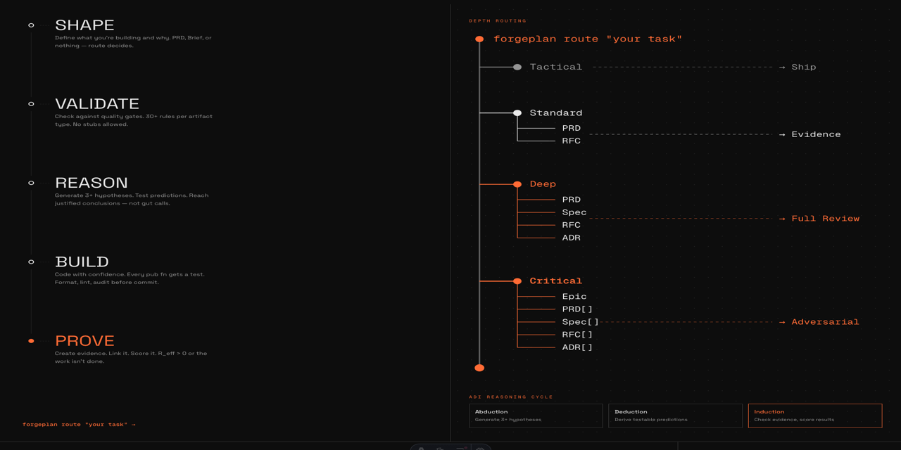
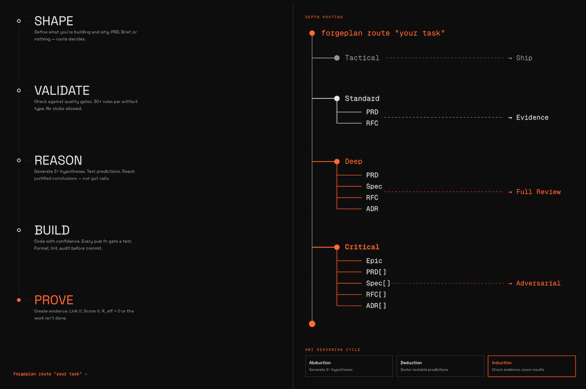
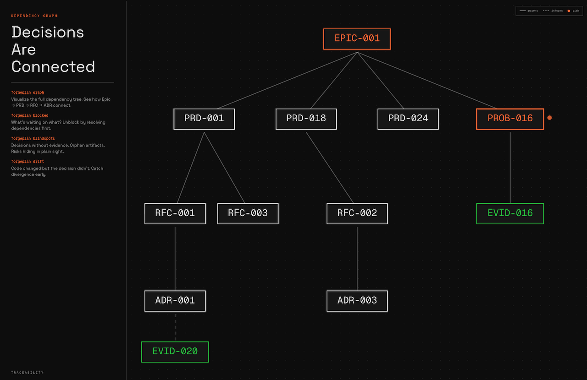

<div align="center">

# ForgePlan



### От сырой идеи до проверенного решения

**Engineering decision framework** для команд, которые хотят, чтобы их идеи оставляли след.
Структурированные артефакты (PRD, RFC, ADR, Epic, Spec), автоматический scoring качества, evidence и нативная интеграция с AI-агентами.

<br>

[](LICENSE)
[](https://github.com/ForgePlan/forgeplan/releases)
[](https://github.com/ForgePlan/forgeplan/actions)
[](.forgeplan/)

**[Сайт](https://forgeplan.dev)** ·
**[Документация](docs/README.md)** ·
**[Методология](docs/methodology/FORGEPLAN-GUIDE.md)** ·
**[Релизы](https://github.com/ForgePlan/forgeplan/releases)** ·
**[Marketplace](https://github.com/ForgePlan/marketplace)**

<br>

[English](README.md)  **·**  [Русский](README.ru.md)

<br>

</div>

---

<div align="center">

```
    ┌─────────┐    ┌────────┐    ┌────────┐    ┌───────┐    ┌────────┐    ┌──────┐
    │ OBSERVE │ ─▶ │ ROUTE  │ ─▶ │ SHAPE  │ ─▶ │ BUILD │ ─▶ │ PROVE  │ ─▶ │ SHIP │
    └─────────┘    └────────┘    └────────┘    └───────┘    └────────┘    └──────┘
     health        depth          PRD/RFC       code+test    evidence      activate
```

**Каждое решение оставляет след. Каждый след имеет доказательство. Каждое доказательство честно устаревает.**

</div>

---

## Зачем

<table>
<tr>
<td width="50%">

### До
- Решения теряются в Slack, Linear, почте
- «Почему мы выбрали X?» — тишина через полгода
- AI-агенты выдают правдоподобную, но поверхностную работу
- ADR существуют в теории, но не пишутся
- Ресёрч не доходит до реализации

</td>
<td width="50%">

### После
- Каждое решение — git-трекаемый артефакт
- Полный трейл `Problem → Decision → Consequence`
- Depth calibration заставляет нужный уровень строгости
- `forgeplan new adr` — создать шаблон черновика, затем заполнить и проверить
- ADI reasoning требует 3+ гипотезы

</td>
</tr>
</table>

## Установка

```bash
# Homebrew (macOS, Linux)
brew install ForgePlan/tap/forgeplan
# Homebrew 6.0+: если установка отклонена с "untrusted tap",
# один раз выполните `brew trust ForgePlan/tap` и повторите строку выше.

# Install script
curl -fsSL https://raw.githubusercontent.com/ForgePlan/forgeplan/main/install.sh | sh

# Из исходников
git clone https://github.com/ForgePlan/forgeplan.git && cd forgeplan
cargo install --path crates/forgeplan-cli --features semantic-search
```

### После установки

Релизные бинарники включают семантический поиск; обычная Cargo-сборка не включает
его по умолчанию. Рецепт выше явно включает `semantic-search`. Инференс работает
на pure-Rust движке `tract`, но веса модели скачиваются отдельно.

| Возможность | Подготовка |
|---|---|
| Локальный семантический поиск | `forgeplan setup` скачивает BGE-M3 (около 2.1 GB). Для офлайн-работы нужен полный snapshot в кэше. |
| База знаний FPF | Установите `/plugin install fpf@ForgePlan-marketplace`, затем выполните `forgeplan fpf ingest`. Состояние показывает `forgeplan fpf status`. |
| Команды агентов | Установите [плагины агентского окружения](https://forgeplan.dev/docs/getting-started/installation/) для `/smith`, `/audit` и других команд. |

Общий для workspace кэш — `~/.forgeplan/models`
(`%USERPROFILE%\.forgeplan\models` в Windows). `FORGEPLAN_MODEL_CACHE` имеет
приоритет; `HF_HOME` не переопределяет кэш tract. Старые каталоги автоматически
не перемещаются и не удаляются.

`forgeplan init` может предложить скачивание интерактивно; в скрипте оно
запрашивается явно: `forgeplan init -y --with-model`. В уже инициализированном
workspace команда может завершиться раньше и не скачать модель.
`forgeplan setup --skip-model` пропускает модель, `--skip-alias` — алиас `fpl`.

Режим поиска важен. Обычный smart search может сочетать keyword и semantic
результаты; нельзя рассчитывать на fallback у принудительного `search --semantic`.
В Constellation он возвращает ошибку без опубликованного embedding profile или
при отсутствии eligible vectors. После индексации запустите `forgeplan embed`.
Для автоматического embedding дополнительно нужны активный `config.embedding`,
поддерживаемая модель в кэше и работающий maintenance writer.
Ручной `embed` эту настройку не сохраняет.

FPF поставляется отдельно от бинарника и используется для ADI reasoning.
Без ingest отсутствие корпуса нельзя отличить от отсутствия совпадений по одному
поисковому ответу; проверяйте `forgeplan fpf status`. Команды плагинов нужны
агентскому окружению, но не обычной работе из shell.

Доступность интерфейсов зависит и от раскладки workspace. В проверенном срезе
`0.39.0+constellation.s1.1` CLI `validate` на migrated workspace возвращает
именованный отказ legacy-store; full MCP `forgeplan_validate` там успешно
упражнён. Это не доказывает совместимость всех инструментов (issue #538).

## Создать черновик

Начните в новом каталоге вне существующего workspace: обнаружение идёт вверх
по родительским каталогам. Если workspace уже найден, `init -y` ничего не меняет.

```bash
forgeplan init -y
forgeplan route "Добавить OAuth2 авторизацию" --level 0
forgeplan new prd "OAuth2 Authentication"
```

Это шаблон, а не готовый к активации PRD. Заполните требования и секции нужной
глубины, настройте LLM перед `reason`, приложите реальные evidence вместо
примерных чисел тестов. На совместимом legacy workspace `forgeplan validate PRD-001`
показывает замечания схемы, а `forgeplan review PRD-001` — lifecycle checklist.
Активация отдельно проверяет длину, evidence и заглушки; отсутствие MUST findings
при validate само по себе не гарантирует активацию.
Для migrated workspace выбирайте поддерживаемую операцию по
[справочнику Constellation](https://forgeplan.dev/ru/docs/reference/constellation/).

<div align="center">

</div>

## Семь вещей, которые важны

| | |
|:---|:---|
| **📝 Markdown-first** | Все артефакты — обычный markdown в git. LanceDB — производный индекс, пересобирается из файлов. |
| **🎯 Quality scoring** | `R_eff` (доверие по weakest link) и `F-G-R` (formality, granularity, reliability) — автоматически. |
| **🧭 Smart routing** | Анализирует задачу, подбирает depth и pipeline. Не надо документировать фикс тайпо. |
| **🧠 ADI reasoning** | Abduction → Deduction → Induction. Цикл запрашивает 3+ гипотезы, но не доказывает автоматически их независимость или корректность. |
| **🤖 MCP-native** | Инструменты для Claude Code, Cursor, Aider, Continue. В scoped Constellation-сборке зарегистрированы 76 full tools и отдельный read-профиль из 9 tools; регистрация не доказывает поддержку migrated layout. |
| **🔍 Локальный семантический поиск** | BGE-M3 (1024 dims) на `tract`: pure-Rust инференс без API-ключей и отправки запросов в сеть после подготовки кэша модели. |
| **⏰ Evidence decay** | Истёкший `valid_until` показывается как stale; истёкший evidence получает 0.1. Это обнаружение по сроку, не автоматическое продление или фоновая смена lifecycle-статуса. |

## Артефакты одним взглядом

<table>
<tr>
<th>Артефакт</th>
<th>Отвечает на</th>
<th>Когда</th>
</tr>
<tr>
<td><b>PRD</b></td>
<td>Что мы делаем и зачем?</td>
<td>Новая фича, продуктовое решение</td>
</tr>
<tr>
<td><b>RFC</b></td>
<td>Как будем делать?</td>
<td>Архитектура, API design</td>
</tr>
<tr>
<td><b>ADR</b></td>
<td>Почему выбрали именно так?</td>
<td>Необратимые технические решения</td>
</tr>
<tr>
<td><b>Spec</b></td>
<td>Какие точные контракты?</td>
<td>API контракты, data models</td>
</tr>
<tr>
<td><b>Epic</b></td>
<td>Какая большая картина?</td>
<td>Cross-cutting, мульти-PRD инициативы</td>
</tr>
<tr>
<td><b>Evidence</b></td>
<td>Это реально работает?</td>
<td>После реализации, перед активацией</td>
</tr>
</table>

Полное decision tree: [`docs/methodology/PRD-RFC-ADR-FLOW.md`](docs/methodology/PRD-RFC-ADR-FLOW.md).

<div align="center">

</div>

## Документация

Три точки входа — выбери ту, что соответствует твоей задаче сейчас.

| Я хочу... | Начать отсюда |
|---|---|
| **Изучить методологию** | [`docs/methodology/FORGEPLAN-GUIDE.ru.md`](docs/methodology/FORGEPLAN-GUIDE.ru.md) |
| **Посмотреть всю доку** | [`docs/README.ru.md`](docs/README.ru.md) |
| **Работать с AI-агентами** | [`CLAUDE.md`](CLAUDE.md) · [`AGENTS.md`](AGENTS.md) |
| **Использовать Constellation** | [Пользовательский гайд](https://forgeplan.dev/ru/docs/guides/constellation/) · [Справочник интерфейсов](https://forgeplan.dev/ru/docs/reference/constellation/) |
| **Провести пилот миграции** | [Переносимый runbook](docs/operations/CONSTELLATION-PILOT.ru.md) |

Сайт содержит пользовательские инструкции по задачам; `docs/` — методологию,
архитектуру и эксплуатационные контракты для участников разработки.
Constellation описан для scoped-сборки `0.39.0+constellation.s1.1`,
а не для опубликованной версии `0.38.0`.

## Dogfood

<table>
<tr>
<td align="center"><b>394</b><br>tracked артефактов</td>
<td align="center"><b>3243</b><br>тестов проходят</td>
<td align="center"><b>81</b><br>CLI команда</td>
<td align="center"><b>73</b><br>MCP tools</td>
</tr>
</table>

Это исторические счётчики репозитория, не новый замер и не результат приёмки
Constellation-сборки.

Этот репозиторий использует ForgePlan для управления самим собой. Каждый PRD, RFC, ADR и Evidence лежит в
[`.forgeplan/`](./.forgeplan/) — можно просматривать напрямую или через `forgeplan list`.

## Contributing

Полный гайд — **[CLAUDE.md](CLAUDE.md)**. Краткая версия:

```bash
# Ветка из dev
git checkout dev && git pull
git checkout -b feat/my-feature

# Проходи цикл: Route → Shape → Validate → Build → Evidence → Activate
# cargo fmt + cargo test перед каждым коммитом
# PR → dev (main трогаем только через release ветки)
```

### Cargo features

| Feature | По умолчанию | Назначение |
|---|---|---|
| `semantic-search` | Включена в релизных бинарниках | BGE-M3 на `tract`; веса отдельно (**~2.1 GB**), общий кэш машины (`FORGEPLAN_MODEL_CACHE`). См. [Установка](#установка). В обычном `cargo build` выключена; офлайн нужен полный snapshot. |
| `test-helpers` | Выключена | Только тестовые fixtures с обходами projection pipeline; запрещена в production-бинарниках. |

## License

MIT — см. [LICENSE](LICENSE).

<br>

<div align="center">

### Structure. Evidence. Trust.

**[→ Установить сейчас](#установка)** и запустить `forgeplan route "твоя следующая задача"`.

<br>

Построен на [Quint-code](https://github.com/m0n0x41d/quint-code) · [BMAD](https://github.com/bmadcode/BMAD-METHOD) · [OpenSpec](https://github.com/Fission-AI/OpenSpec) · [FPF](https://github.com/ailev/FPF) · [LanceDB](https://lancedb.com/) · [tract](https://github.com/sonos/tract)

<sub>С заботой от <a href="https://github.com/ForgePlan">@ForgePlan</a> · <a href="README.md">English version</a></sub>

</div>
