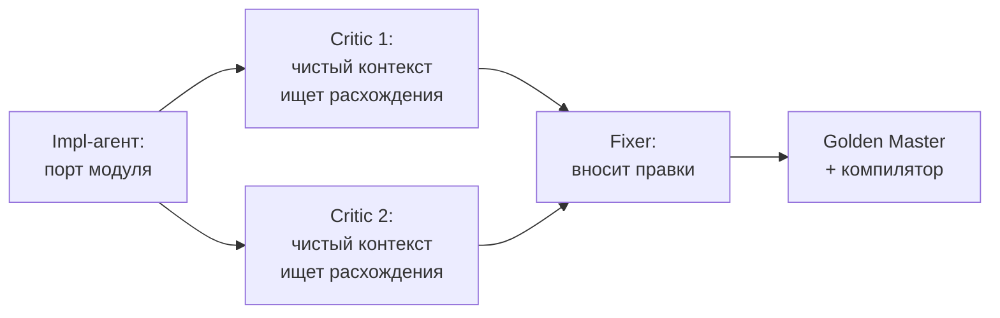
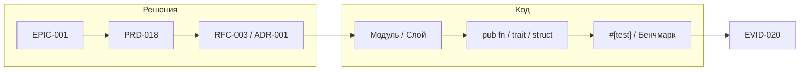
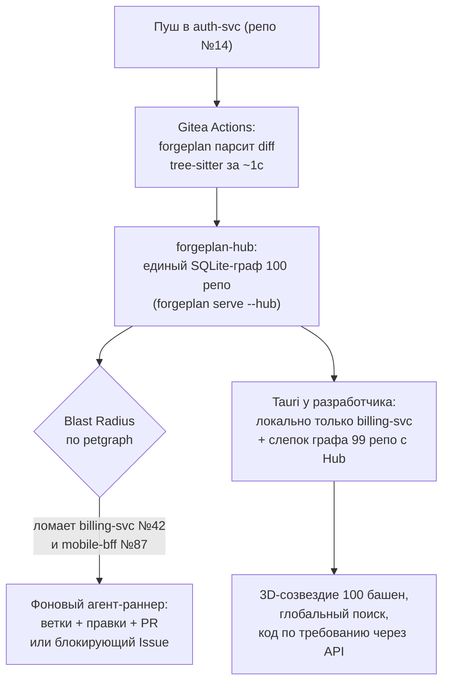

# ForgePlan × Code-Decision Graph: разбор исследования и роадмап

> **Статус: история предложений и актуальное направление проектирования, не утверждённый RFC.** Разделы I–VII сохраняют идеи из переписки, включая неверные утверждения и неподтверждённые оценки. SQL/Rust-примеры здесь не проверенная реализация. Факты проверены в [аудите](forgeplan-reality-audit.md); актуальное требование владельца и направление развития — в части VIII и дополнении к [исходному файлу](dialog.txt).
>
> **Происхождение документа.** Тематическая консолидация первых 1682 строк `dev/dialog.txt`: Референс A, граф решений и кода, хранилище, федерация, web/Tauri, CI, легаси и Bun. §29 и F-31…F-34 добавлены из отдельного сообщения пользователя со стратегическим советом; в первоначальных 1682 строках его нет. Последующее обсуждение и проверка сайта сохранены в дополнении к `dialog.txt` от 2026-11-20. Перегруппировка не заменяет исходную переписку.
>
> **Про опечатки.** Исходные вопросы содержали опечатки/раскладку; расшифровки сохранены в сносках там, где они влияли на ответ («Тибы» → либы/типы, «cancelation json» → `constellation.lock.json`, «tre sitter» → tree-sitter, «Gitea» и т.д.).

## Содержание

- [Часть I. Исследование внешних практик](#часть-i-исследование-внешних-практик)
  - [1. Референс A — продукт](#1-референс-a--продукт)
  - [2. Референс A — под капотом](#2-референс-a--под-капотом)
  - [3. Технологические вердикты](#3-технологические-вердикты)
  - [4. Скрытые фичи Референс A — что забираем](#4-скрытые-фичи-референс-a--что-забираем)
  - [5. Кейс Bun: Zig→Rust на 535k строк](#5-кейс-bun-zigrust-на-535k-строк)
- [Часть II. Целевая архитектура](#часть-ii-целевая-архитектура)
  - [6. Code-Decision Graph](#6-code-decision-graph)
  - [7. Усиление семи команд ForgePlan](#7-усиление-семи-команд-forgeplan)
  - [8. SOLID: Ports & Adapters](#8-solid-ports--adapters)
  - [9. Схема SQLite и гибридный поиск](#9-схема-sqlite-и-гибридный-поиск)
  - [10. Связывание артефакт ↔ код](#10-связывание-артефакт--код)
  - [11. Структура монорепозитория](#11-структура-монорепозитория)
- [Часть III. Федерация (Constellation 0.39+)](#часть-iii-федерация-constellation-039)
  - [12. Что даёт федерация](#12-что-даёт-федерация)
  - [13. Аудит 0.39 и чинка фундамента](#13-аудит-039-и-чинка-фундамента)
  - [14. ScopedId, ATTACH, порт федерации](#14-scopedid-attach-порт-федерации)
  - [15. constellation.lock.json](#15-constellationlockjson)
  - [16. Constellation Hub + Gitea/Forgejo (100+ репо)](#16-constellation-hub--giteaforgejo-100-репо)
  - [17. Режим «мульти-папка» (3–10 репо, без сервера)](#17-режим-мульти-папка-310-репо-без-сервера)
- [Часть IV. Поверхности](#часть-iv-поверхности)
  - [18. @forgeplan/web: шестой режим 3D Stack](#18-forgeplanweb-шестой-режим-3d-stack)
  - [19. Tauri Desktop](#19-tauri-desktop)
  - [20. ИИ-помощник в Tauri](#20-ии-помощник-в-tauri)
  - [21. MCP-инструменты и Capability Packs](#21-mcp-инструменты-и-capability-packs)
- [Часть V. Конвейеры](#часть-v-конвейеры)
  - [22. CI/CD: 4 стадии + 4 доработки](#22-cicd-4-стадии--4-доработки)
  - [23. Strangler Fig Engine](#23-strangler-fig-engine)
  - [24. Алгоритм legacy_extraction_plan](#24-алгоритм-legacy_extraction_plan)
  - [25. Async Review Triage: автономия без когнитивной перегрузки](#25-async-review-triage-автономия-без-когнитивной-перегрузки)
- [Часть VI. Роадмап и открытые вопросы](#часть-vi-роадмап-и-открытые-вопросы)
  - [26. Сводная дорожная карта](#26-сводная-дорожная-карта)
  - [27. Открытые вопросы из диалога](#27-открытые-вопросы-из-диалога)
  - [28. Caveats: что в исследовании не верифицировано](#28-caveats-что-в-исследовании-не-верифицировано)
  - [29. Стратегический совет: фокус, ловушки, порядок релизов](#29-стратегический-совет-фокус-ловушки-порядок-релизов)
- [Часть VII. Индекс идей и кандидатов в артефакты](#часть-vii-индекс-идей-решений-и-кандидатов-в-артефакты)
  - [A. Намерения и вопросы пользователя · B. Реестр F-01…F-34 · C. Проверяемые тезисы · D. Кандидаты в артефакты · E. Поправки](#часть-vii-индекс-идей-решений-и-кандидатов-в-артефакты)
- [Часть VIII. Актуальное направление: полноценная система, реализуемая поэтапно](#часть-viii-актуальное-направление-полноценная-система-реализуемая-поэтапно)

> **Как читать:** аудит имеет приоритет в проверенных фактах; часть VIII фиксирует последующее изменение продуктового подхода. Ранний совет ограничиться пилотом/адаптером не является пределом целевой архитектуры.

---

# Часть I. Исследование внешних практик

## 1. Референс A — продукт

**Референс A** — локальный open-source инструмент (лицензия MIT) от внешнего разработчика. Детерминированный статический анализатор, строящий граф зависимостей кодовой базы для ИИ-агентов (Claude Code, Cursor, Copilot, Codex, Gemini CLI) и разработчиков. Работает полностью офлайн, без нейросетей — статический парсинг кода. Вырос из более раннего прототипа, ветка 0.12.x, 16 релизов.

### 1.1. Что делает

1. **Строит карту зависимостей репозитория** — все связи между файлами, классами, функциями и модулями. 14 языков и фреймворков: Python, TypeScript/JS, Rust, Go, Java, C#, PHP (+Laravel: Blade, Livewire, Eloquent), Ruby (+Rails), Dart/Flutter, Free Pascal/Lazarus.
2. **Impact Analysis** — точный «радиус поражения» (blast radius) на 1, 2 и более шагов (hops) вглубь.
3. **Интеграция в ИИ-агентов** через MCP и Skills — 14 готовых инструментов.
4. **Архитектурный контроль и PR**: определяет слои (Clean, Hexagonal, Layered, MVC, FSD), проверяет границы импортов; GitHub Action (`CI-интеграция Референса A (v1)`) комментирует PR списком зависимых модулей вне диффа.
5. **Офлайн 3D-карта проекта** — автономный HTML (`ref-a-cli open`), слои в 3D-стеке, blast radius по клику.

### 1.2. Все 14 MCP-инструментов Референс A

| Группа | Инструменты |
|---|---|
| Управление и чтение | `build_graph`, `list_files`, `describe_module`, `read_source`, `search_source` |
| Навигация по символам | `find_definitions`, `find_usages`, `trace_calls` |
| Зависимости и влияние | `analyze_impact`, `list_dependencies`, `list_changes` |
| Архитектура и запросы | `list_layers`, `check_boundaries`, `query_graph` |

Локальный режим `ref-a-cli mcp` — поверх stdio без сетевых портов. Удалённый режим: `ref-a-cli[http]` — HTTPS + `REF_A_HTTP_TOKEN` (≥32 символов) + TLS. Поддерживает монорепо (workspace-пакеты, path aliases, `ref-a-cli compare`), инкрементальную перестройку ~1 с на файл (масштаб FastAPI).

### 1.3. Бенчмарки

**Тест 1: 55 вопросов, агент на Claude Opus 5.5**

| Метрика | Референс A | Обычный поиск |
|---|---|---|
| Полные ответы | 55/55 (0 пропущенных файлов) | 48/55 (12 пропущенных) |
| Лучшее время ответа | 8 с | 41 с |
| Экономия | до $484 на 1000 запросов | — |

Ответ `impact` — до **4233× компактнее** охватываемого исходного кода. Сборка графа FastAPI (1227 файлов) — ровно **2.0 с**.

**Тест 2: точность зависимых файлов (5 вопросов × 3 прогона)**

| Инструмент | Точные списки | Стоимость ответа (до) | Прочитано токенов (до) |
|---|---|---|---|
| Референс A | 15/15 | $0.093 | 34 357 |
| Собственный поиск агента | 13/15 | $0.888 (9.5×) | 758 876 (22.1×) |
| CodeGraph | 11/15 | $1.066 (11.5×) | 1 083 347 (31.5×) |
| OntoIndex | 11/15 | $1.111 (11.9×) | 1 238 220 (36.0×) |
| Graphify | 10/15 | $1.034 (11.1×) | 1 005 092 (29.3×) |

**Независимая верификация графа:** другой открытый репозиторий (22 слоя) — правила dependency-cruiser совпали с графом до единого импорта; публичный репозиторий демо-карты — сторонний резолвер подтвердил 3795/3795 зависимостей. На сервере публичный репозиторий демо-карты (707 модулей) изменение базового сервиса напрямую затрагивает 65 файлов и 281 модуль в пределах 2 хопов.

### 1.4. Периметр безопасности и ограничения

**Гарантии (zero-trust):**

- Полная изоляция от сети: единственная сетевая команда — ручное `ref-a-cli update`; сборка и запросы протестированы в Docker с `--network none`.
- Код только читается, не исполняется (ни сборки, ни тестов — нет срабатывания вредоносных скриптов).
- Нет телеметрии и аккаунтов, нет API-ключей.

**Где НЕ поможет (ограничения статического анализа):**

- Runtime-зависимости: динамический DI, рефлексия, кодогенерация на лету — не попадают в граф. Не заменяет компилятор/LSP.
- Минифицированные и вендорные бандлы исключаются из графа.
- Нестандартная структура папок: слои определяются по именам директорий; при плоской структуре — только догадки, честно помеченные в отчёте.

### 1.5. Реальные задачи, где нужен статический граф кода

- **Безопасный рефакторинг агентами** — точный список зависимых файлов на 2–3 хопа при смене сигнатуры/DTO.
- **Архитектурный гейткипинг** — блок коммита при импорте веб-фреймворка в доменный слой.
- **Аудит PR в CI** — «ты поменял X, зависят Y и Z, но ты их не трогал».
- **Для ForgePlan**: идеальное место — `forgeplan drift` («код изменился, а решение ADR/RFC — нет»).

## 2. Референс A — под капотом

### 2.1. Масштаб и гигиена кода

- Основной код — **Python**: CLI, резолверы импортов для 14 языков/фреймворков, движок запросов, stdio MCP-сервер.
- Плюс: автономный HTML/JS-шаблон офлайн 3D-карты (без сетевых подгрузок), скрипты воспроизводимых бенчмарков (`Dockerfile.benchmark`).
- **Жёсткая гигиена:** сторонний отчёт оценка риска **0/100**; тесты репозитория проверяют, что ни один модуль (кроме изолированного `ref-a-cli add`) не импортирует сетевые библиотеки.
- Точный LOC не посчитан (прямой доступ к файлам репозитория был закрыт для автоматического чтения). Проверить: клонировать из локального реестра источников → `cat pyproject.toml` → `npx cloc .`

### 2.2. Стек библиотек

- **Парсинг:** tree-sitter + пакеты грамматик (`tree-sitter-c-sharp` и др.), докачиваются в `~/.ref-a/parsers/` через `ref-a-cli add`.
- **Конфигурация:** PyYAML.
- **Extras:** `ref-a-cli[dart]` (Dart/Flutter), `ref-a-cli[http]` (HTTPS MCP-сервер).
- **Транспорт MCP:** stdio без сетевых фреймворков.
- Сознательный отказ от Neo4j, векторных БД и LLM-SDK.

### 2.3. Типы данных внутри

- **Хранилище графа:** S-выражения (`.ref-a/index.sexp`) — плоские текстовые факты в стиле Lisp/Scheme; читается встроенным движком `query_graph` и обычным текстовым поиском.
- **Узлы (4 типа):** `modules`, `classes`, `functions`, `types`.
- **Рёбра (5 типов):** `imports`, `references`, `data flows`, `calls`, `architecture layers`. Каждое использование хранит `файл → строка:колонка` и вид обращения (`kind`).

Формат `.sexp` (тот же формат, что использует сам tree-sitter для деревьев и WebAssembly `.wat`):

```lisp
(module "src/auth.rs"
  (defines (fn "verify_token" :line 42))
  (imports "src/crypto.rs"))
```

## 3. Технологические вердикты

### 3.1. Чем заменить .sexp (варианты «покруче» на Rust)

- **`rkyv` / `postcard`** — zero-copy mmap: граф на сотни тысяч узлов открывается за микросекунды без десериализации.
- **`petgraph`** — де-факто стандарт графов в Rust (обходы, циклы, сироты). Альтернатива: встроенный Datalog — `datafrog` (используется внутри rustc/polonius) для транзитивных зависимостей типа `blocked`/`blindspots`.
- **`rusqlite` / SurrealDB (embedded)** — ACID, `WITH RECURSIVE`, FTS и векторный поиск в одном файле.

### 3.2. Можно ли заменить LanceDB на подход Референс A?

**Вердикт диалога: нельзя заменить на .sexp, но можно и нужно выпилить LanceDB в пользу SQLite (FTS5 + sqlite-vec/перебор) + petgraph.**

Боль LanceDB в ForgePlan (по собственным issues репозитория): системный `protobuf-compiler` в CI, тяжёлый транзитивный граф (arrow, datafusion, tantivy, конфликты `lru`), время компиляции и размер бинарника, stale-манифесты в долгоживущем MCP-сервере после внешнего реиндекса (**Issue #305**), дрейф worktree (**Issue #303**). При этом источник правды — `.forgeplan/*.md`, LanceDB — лишь read-проекция (`reindex`/`scan-import`).

Масштаб типичного воркспейса — 50–5 000 артефактов; колоночный движок на десятки миллионов векторов — «из пушки по воробьям».

| Задача в ForgePlan | Референс A (.sexp/граф) | LanceDB (сейчас) | SQLite + petgraph (рекомендация) |
|---|---|---|---|
| Связи EPIC→PRD→RFC→ADR, `blocked`, `blindspots`, каскадное удаление | Идеально (обход в памяти) | Избыточно (табличные сканы) | Идеально (petgraph в ОЗУ или `FOREIGN KEY` + `WITH RECURSIVE`) |
| BM25 + русская морфология («аутентификацией» → «аутентифицировать») | Не работает (подстроки) | Работает (Tantivy FTS) | Отлично (FTS5 + `rust-stemmers` Snowball RU) |
| Семантический поиск (fastembed/векторы) | Не работает | Работает (IVF-PQ) | Идеально для масштаба CLI (sqlite-vec или перебор в памяти) |
| Сборка, размер, конкурентный доступ CLI+MCP | Нулевой вес, но проблемы при одновременной записи | Тяжёлый protoc, вес, stale-манифесты | Один файл `.db` в WAL: CLI пишет — MCP видит в ту же мс |

**Ключевой факт по векторам:** на ~2 000 документов по 384/768 f32 (~3–6 МБ) линейный SIMD dot-product в Rust выполняется < 1 мс со 100% точностью — без ANN/IVF индексов вообще.

### 3.3. Tree-sitter на Rust и выбор языка реализации

**Вердикт: писать сразу на Rust.** Экосистема tree-sitter эталонная именно там: официальный крейт `tree-sitter` (0.27.x) от core-команды, генератор парсеров `tree-sitter-generate` на Rust, грамматики-крейты одной строкой в `Cargo.toml` (`tree-sitter-rust`, `tree-sitter-typescript`, `tree-sitter-python`, `tree-sitter-go`…), инкрементальные правки через `InputEdit` (< 1 мс на файл). Поверх — ast-grep и GitHub stack-graphs (оба на Rust); ast-grep переписал сишный рантайм tree-sitter на чистый Rust: +30% к парсингу, −22% памяти.

| Критерий | Rust (внутри forgeplan-cli) | Python (как у Референс A) |
|---|---|---|
| Многопоточный обход | `rayon` + `ignore` — все ядра, `.gitignore` из коробки | GIL, оверхед IPC/multiprocessing |
| Память на графе | u32-индексы petgraph, интернирование строк (`lasso`/`ustr`) — мегабайты | `dict`/`PyObject` — сотни МБ на монорепо |
| Дистрибуция | Один бинарник: `brew install` / `curl \| sh` | Python нужной версии + uv/pipx + конфликты |
| Интеграция в MCP | Прямой вызов в том же процессе | Подпроцесс + JSON между языками |

**Единственный компромисс Rust:** сложнее писать кастомный резолв импортов (строки, `Node<'tree>` лайфтаймы). Закрывается связкой из 4 крейтов:

1. `ignore` (от автора ripgrep) — параллельный обход с `.gitignore`;
2. `tree-sitter` + декларативные `.scm`-запросы (`tree_sitter::Query`) вместо ручного `if node.kind() == ...` (так делают Zed и Helix);
3. `rayon` — `.par_iter()`; `Parser` не `Sync` → `map_init` (инстанс парсера на поток);
4. `petgraph` + `rusqlite`.

### 3.4. Целевой стек (итоговый выбор)

| Компонент / крейт | Что заменяет / за что отвечает | Почему именно он |
|---|---|---|
| `rusqlite` (bundled + WAL) | Таблицы и манифесты LanceDB | Вшит в бинарник, 0 системных либ; WAL → CLI пишет, MCP читает в ту же мс, без stale-багов |
| SQLite FTS5 + `rust-stemmers` | Полнотекст Tantivy в LanceDB | BM25 из коробки + Snowball (RU/EN) морфология |
| `fastembed` + SIMD cosine / `sqlite-vec` | IVF-PQ в LanceDB | На ≤10–20k чанков — BLOB + перебор < 1 мс, 100% точность без аппроксимации |
| `tree-sitter` + `.scm` | Слепой grep / git diff | Детерминированный AST за мс, вшивается в бинарник |
| `petgraph` | Ручные рекурсивные обходы | Blast radius, циклы, сироты, конфликты для dispatch |
| `ignore` + `rayon` + `blake3` | Последовательный обход | Все ядра + `.gitignore` + skip неизменённых по хешу |

## 4. Скрытые фичи Референс A — что забираем

### 4.1. Шесть механик помимо базового графа

| Фича Референс A | Оригинал | Усиление в ForgePlan (CLI + Web + Tauri) |
|---|---|---|
| `ref-a-cli place` | Стиль репо → куда положить новый код | `forgeplan place`: по активному RFC/ADR — точный путь и шаблон модуля до генерации кода |
| `ref-a-cli align` + `check_boundaries` | Импорты vs стиль слоёв + непроверенные зоны | Авто-аудит ADR: ловит пробои слоёв (как Issue #296 — `undo` полез в `store` в обход сервиса), красные дуги в 3D |
| `ref-a-cli compare` | Пакеты монорепо бок о бок | Constellation Split-View: два микросервиса федерации или два worktree (агент A vs main) на одном экране |
| `list_changes` + PR Audit | Изменённые с ref функции + коммент в PR + доказательства для комплаенса | `forgeplan health --ci`: не только сироты, но и забытые зависимые файлы вне PR + авто-Evidence |
| «Read First» в `analyze_impact` | Топ-2–3 файла для чтения перед фиксом | Топ-3 точки входа в `forgeplan context`: RFC + ровно 3 AST-символа с номерами строк — до 89% экономии токенов |
| `ref-a-cli add` (парсеры по требованию) | Редкие языки без пересборки | WASM-грамматики tree-sitter: Rust/TS/Python/Go вшиты, редкие `.wasm` подгружаются в Tauri/CLI без рекомпиляции |

### 4.2. Шесть механик для распила легаси

1. **Implicit Framework Edges** — связи не только через `import`: Blade/Livewire теги → классы, Eloquent `belongsTo`/`hasMany`, конвенции Rails, Free Pascal. → В ForgePlan: опциональный `FrameworkConventionResolver` (OCP), чтобы `legacy_extraction_plan` не посчитал живой контроллер «мёртвым кодом».
2. **Рёбра `data flows` + `trace_calls`** — сквозной путь вызовов A→B с `line:column` и `kind` (чтение/запись/вызов). → Трассировка HTTP-параметра через 5 слоёв до `INSERT` — готовая цепочка трансформации для Spec.
3. **Честная маркировка слепых зон** — `check_boundaries` возвращает «parts not checked», угаданные слои помечены `guesses`. → Интеграция с R_eff: `eval`/рефлексия/динамический `import()` в вырезаемом модуле → `max_auto_r_eff = 0.55` + ручная верификация шва.
4. **PreToolUse-хук** — перехват `Read`/`Grep` агента (exit code 2 + подсказка), сначала выжимка из графа с диапазонами строк. → Тот же хук в плагине ForgePlan для Claude Code/Cursor и Tauri-помощнике: агент физически не сожжёт контекст на «простынях».
5. **Матрица трудозатрат Day/Week/Month** — из консультационной практики производителя (распил телеком-монолита под 1.5 млн заказов; SOC 2 / ISO 27001: трассировка секретов, доступов, логов, data-flow). Результат — requirement-to-gap mapping с корзинами «1 день / 1 неделя / 1 месяц». → В `ExtractionDossier`: сортировка модулей по 3 корзинам от нестабильности, числа ветвей и IO-портов.
6. **`ref-a-cli compare`** → `forgeplan parity-compare <legacy_node> <new_node>`: сличение старого и нового модулей — все ли контракты и ветвления закрыты в новом репозитории.

### 4.3. Скрытый косяк Референс A на TypeScript и его исправление

По честному признанию автора (разбор 5 публичных репо): на Rust/Python экономия токенов огромная (49k→32k в среднем), на двух TS-репозиториях — около нуля.

| Проблема реального кода | Почему буксует файловый граф | Решение в Rust-ядре ForgePlan |
|---|---|---|
| Barrel-файлы (`index.ts`/`mod.rs`/`__init__.py`) | `export *` делает `index.ts` ложным хабом: правка 1 файла раздувает blast radius на полпроекта | **Symbol-Level Pass-Through**: сквозное разрешение реэкспортов до конкретного символа, пустые прокси-файлы игнорируются |
| Type-only импорты vs runtime-вызовы | `import type { User }` смешивается с реальной зависимостью | Веса рёбер: `TypeReference` (легко в shared-sdk) vs `RuntimeCall` (жёсткая сцепка) |
| Динамика и непроверенные зоны | Только предупреждение текстом в отчёте | Автоблок статуса `Safe to Delete` + понижение R_eff до ручного ревью шва в Tauri |

## 5. Кейс Bun: Zig→Rust на 535k строк

**Факты (май–август 2026, Джарред Самнер):** портировано **535 496 строк** / **1 448 файлов** с Zig на Rust за **11 дней**, один инженер + до **64 параллельных агентов** (4 git worktree × 16 воркеров), ~**$165 000** API-токенов (5.9 млрд input + 72 млрд cached), стабильный релиз **Bun 1.4**. Побочный результат: 128 исправленных багов/утечек, память с 6.7 ГБ до 609 МБ.

### 5.1. «Метод Самнера»: 6 этапов конвейера

1. **PORTING.md до кода** — 600-строчный словарь паттернов Zig→Rust + запрещённые библиотеки (никаких `tokio`, `rayon`, `std::fs` — только собственный event loop). Обкатан на 3 пилотных файлах из 1 448.
2. **Карта разрыва парадигм (LIFETIMES.tsv)** — отдельный воркфлоу обошёл все поля структур и поток управления, сохранил карту лайфтаймов в TSV; критики вычитывали её на противоречия с PORTING.md.
3. **Механический порт 1-в-1** — сознательный отказ от «идиоматичного Rust»: тот же нейминг и поток, пусть даже не компилируется. Смена языка ≠ смена архитектуры.
4. **Adversarial Review: 1 Impl + 2 Critics + 1 Fixer** — никто не коммитит сам: кодер портирует → 2 независимых критика в чистых контекстах ищут расхождения со старым кодом → фиксер правит.
5. **Изоляция в git worktree + бан разрушительных команд** — агенты начали затирать чужое через `git reset --hard`/`stash pop`; Git-деструктив заблокирован, агенты разведены на 4 worktree, закрыто ~16 000 ошибок компилятора.
6. **Языково-независимый судья** — 57 000 тестовых файлов на TypeScript (~1 млн `expect()`): им всё равно, Zig или Rust внутри. Правило — **0 удалённых/пропущенных тестов**.

### 5.2. Четыре ловушки Bun → контрмера в ForgePlan

| Ловушка Bun | Что пошло не так | Контрмера ForgePlan |
|---|---|---|
| Читерство стабами | «Сделай, чтобы компилировалось» → функции заменены `todo!()` | **AST Anti-Stub Gate** в `forgeplan_guard`: блок при `todo!()`/`unimplemented!()`/`pass` или падении числа `business_branches` vs легаси — без вызова LLM |
| Скрытый UB в unsafe | Буквальный порт → ~4% unsafe + баг алиасинга (HiveArray), пропущенный 1 млн тестов и ИИ-ревьюерами; поймал `cargo miri` | Каждый `unsafe`/`eval`/FFI → штраф R_eff + внешние санитайзеры (miri) + карточка в Triage |
| $165 000 на чтение контекста | 5.9 млрд некэшированных токенов на обход файлов и LIFETIMES.tsv | Детерминированный AST-граф: граф структур/вызовов/data-flow за 2 с и $0, агенту — только срез на 2 хопа |
| Нет внешних тестов в обычном легаси | У Bun уже был миллион TS-ассертов; у корпоративного легаси тестов нет | Генератор Golden Master: пары «JSON-вход → JSON-выход» на швах старого кода до старта порта |

### 5.3. Пять доработок из опыта Bun для ForgePlan

- **Автогенерация PORTING.md + матрица ограничений как артефакты**: корневой ADR миграции (запрещённые крейты/либы) + авто-аналог LIFETIMES.tsv — `CONSTRAINTS.json` из SQLite + tree-sitter (сложные типы, транзакции, глобальные состояния), доступный всем агентам через MCP.
- **«Пилот на 3 листьях» (Calibration Sprint)**: `forgeplan migrate --pilot 3` — petgraph выбирает 3 разнотипных листовых файла, прогон показан в Tauri; правка человека дописывается в PORTING-ADR (принцип: «чините процесс и правила ревьюера, а не код руками»).
- **Топология 1 Impl + 2 Critics + 1 Fixer в `forgeplan_dispatch`**: режим `AdversarialLoop`; критики в изолированном контексте (старый исходник + Spec + ADR + новый дифф, без истории оправданий кодера), ищут пропущенные ветки, утечки, заглушки.
- **Git-песочница и worktree-менеджер**: `ConstellationRegistry` сам нарезает изолированные worktree под потоки dispatch; PreToolUse-хук блокирует деструктивные Git-команды воркеров.
- **Две стадии вместо одного шага**: `Stage 1: Behavioral Parity` (структурный 1-в-1 перенос до зелёного Golden Master и R_eff ≥ 0.90) → `Stage 2: Idiomatic Refactor` (чистка unsafe/костылей под защитой тестов и компилятора).



---

# Часть II. Целевая архитектура

## 6. Code-Decision Graph

**Идея:** не клон Референс A внутри CLI, а единый двухслойный граф «Решения ↔ Код» в ядре ForgePlan.

Сейчас ForgePlan связывает смысловые артефакты (Epic → PRD → Spec → RFC → ADR → Evidence), считает R_eff, ведёт агентов через конечный автомат сессии — но код видит «вслепую»: текст и плоские пути. Обычные графы кода знают «кто кого вызывает», но не «почему так решили». Методология хранит замысел и доказательства — но вынуждена верить на слово, что код им соответствует.



Сквозная трассировка: `EPIC-001 → PRD-018 → RFC-003/ADR-001 → [Модуль] → [pub fn] → [#[test]] → EVID-020`.

## 7. Усиление семи команд ForgePlan

### 7.1. `forgeplan drift` + умный `decay`

- **AST-сигнатуры вместо git diff**: хешируются `pub fn`/`struct`/`trait` и рёбра импортов. Правка комментария → дрейфа нет; смена публичного контракта из Spec → тревога.
- **Автоконтроль границ ADR**: правила вида «домен не импортирует HTTP/БД» проверяются по графу при каждом коммите.
- **Детерминированный сброс R_eff**: поменялось тело функции (или вызываемой зависимости) под EVID-016 → актуальность evidence падает, артефакт из `EXPLOIT` (R_eff ≥ 0.7) обратно в `INVESTIGATE` (правило слабого звена `R_eff = min(evidence_scores)`).

### 7.2. `forgeplan_dispatch` без транзитивных конфликтов

Два агента ломают сборку, правя *разные* файлы, если один меняет базовый тип, а второй пишет код на 1–2 хопа выше по графу вызовов. → Пересечение подграфов зависимостей до старта: связанные задачи в один бакет или маркер `Wait` из Hint Contract.

### 7.3. Объективный `route`/`calibrate`

- Правка изолированного листового файла (0 зависимых) → легально `Tactical → Ship`.
- Ядро с 30+ зависимыми модулями или пересечение FPF Bounded Contexts → принудительная эскалация до `Deep`/`Critical` (ADR + цикл 3+ гипотез ADI) до первой строки кода.

### 7.4. Жёсткая верификация `guard`/`activate`

- Машинная проверка «Every pub fn gets a test»: все новые `pub fn` в диффе + входящее ребро от `#[test]`/`describe`/`test_*`.
- Автогенерация черновиков Evidence: контракты Spec и pub fn связаны с прошедшими тестами → CLI собирает фактуру перед `activate`.

### 7.5. «Теневая архитектура» в `blindspots`/`coverage`

Обратная сторона сирот: модули-хабы высокой центральности без единого PRD/RFC/ADR. Для brownfield `forgeplan discover` строит карту Bounded Contexts за 2 с и говорит, что документировать первым.

### 7.6. Реалистичный `estimate`

Обогащение формулы метриками AST: глубина вложенности `if`/`match`, число внешних импортов (coupling), Blast Radius → точный confidence score для Junior/Middle/Senior/Principal/AI.

### 7.7. Дешёвый `context` + Hint Contract

Вместе с активным RFC — точный срез графа: 5 целевых файлов, сигнатуры затронутых функций, порядок чтения → до 85% экономии токенов.

**Сравнение до/после:**

| Этап | Сейчас (без графа кода) | С AST-графом на Rust |
|---|---|---|
| `route`, `calibrate` | Глубина по тексту задачи | Blast Radius до начала правок |
| `dispatch` | Бакеты по совпадению файлов | Защита через граф на 2–3 хопа |
| `context` | Связанные PRD/RFC/ADR | Решения + точные координаты символов (−85% токенов) |
| `guard`, `coverage` | Заполненность полей и линки Evidence | Реальное покрытие pub fn тестами + границы ADR |
| `drift`, `decay` | TTL (`valid_until`), даты, пути | Изменения сигнатур, инвалидация R_eff по функциям |

## 8. SOLID: Ports & Adapters

CLI и 63+ MCP-инструментов не должны знать про SQLite, LanceDB или tree-sitter — паттерн **Ports & Adapters (Hexagonal)**.

### 8.1. Распределение SOLID по модулям

1. **S (SRP):** Парсер только текст→символы/импорты. Хранилище только диск. Граф-движок только пути/радиусы/пересечения. Доменные сервисы (`DriftDetector`, `DispatchPlanner`, `TrustCalculator`) — решения на чистых данных.
2. **O (OCP):** новый язык = новый `LanguageExtractor` + `.scm`-файл, без правок индексатора/БД/MCP.
3. **L (LSP):** `LanceSearchAdapter` (переезд) / `SqliteSearchAdapter` / `InMemoryMockStore` (тесты) взаимозаменяемы по контракту сортировки и фильтрации.
4. **I (ISP):** никакого божественного `Database` на 40 методов — узкие роли: `ArtifactRepository`, `SemanticSearchPort`, `CodeGraphStore`. `forgeplan blocked` просит только граф.
5. **D (DIP):** `forgeplan-core` определяет чистые трейты и доменные типы (`Symbol`, `BlastRadius`, `DriftReport`); `rusqlite`, `tree-sitter`, `lancedb` — во внешнем слое адаптеров, подключаемых в `main.rs`/`mcp serve`.

### 8.2. Код ядра: доменные типы и узкие порты

```rust
use std::path::{Path, PathBuf};

pub type ArtifactId = String; // например, "RFC-003"
pub type SymbolId = String;   // например, "src/auth/jwt.rs::verify_token"

#[derive(Debug, Clone, PartialEq, Eq)]
pub enum SymbolKind {
    Module,
    Struct,
    Trait,
    PublicFn,
    PrivateFn,
    TestFn,
}

#[derive(Debug, Clone)]
pub struct CodeSymbol {
    pub id: SymbolId,
    pub name: String,
    pub kind: SymbolKind,
    pub file_path: PathBuf,
    pub start_line: usize,
    pub end_line: usize,
    /// Хеш сигнатуры (аргументы + возвращаемый тип) для точного forgeplan drift
    pub signature_hash: [u8; 32],
    /// Хеш тела функции для инвалидации Evidence (decay R_eff)
    pub body_hash: [u8; 32],
}

#[derive(Debug, Clone, PartialEq, Eq)]
pub enum CodeRelation {
    Imports,
    Calls,
    Implements,
    Tests, // ребро от #[test] к тестируемой pub fn
}

#[derive(Debug, Clone)]
pub struct CodeEdge {
    pub from: SymbolId,
    pub to: SymbolId,
    pub relation: CodeRelation,
    pub line: usize,
}

// --- УЗКИЕ ПОРТЫ (Interface Segregation) ---

/// Порт 1: Чтение и запись метаданных артефактов (.forgeplan/*.md проекция)
pub trait ArtifactStore: Send + Sync {
    fn upsert_artifact(&self, id: &str, kind: &str, status: &str, r_eff: f32, body: &str) -> anyhow::Result<()>;
    fn link_artifacts(&self, from: &str, to: &str, relation: &str) -> anyhow::Result<()>;
    fn link_artifact_to_symbol(&self, artifact_id: &str, symbol_id: &str) -> anyhow::Result<()>;
}

/// Порт 2: Гибридный поиск (заменяет LanceDB без поломки вызывающего кода!)
pub trait HybridSearchPort: Send + Sync {
    fn index_document(&self, id: &str, stemmed_text: &str, embedding: &[f32]) -> anyhow::Result<()>;
    fn search(&self, query: &str, query_embedding: &[f32], limit: usize) -> anyhow::Result<Vec<(ArtifactId, f32)>>;
}

/// Порт 3: Хранение инкрементального индекса кода
pub trait CodeIndexStore: Send + Sync {
    fn get_file_hash(&self, path: &Path) -> anyhow::Result<Option<[u8; 32]>>;
    fn replace_file_data(
        &self,
        path: &Path,
        file_hash: [u8; 32],
        symbols: &[CodeSymbol],
        edges: &[CodeEdge],
    ) -> anyhow::Result<()>;
    fn remove_deleted_files(&self, existing_paths: &[PathBuf]) -> anyhow::Result<()>;
    fn load_all_edges(&self) -> anyhow::Result<Vec<CodeEdge>>;
}
```

### 8.3. Расширяемый парсер языков (OCP)

```rust
pub struct ExtractedFileGraph {
    pub symbols: Vec<CodeSymbol>,
    pub raw_imports: Vec<String>,
    pub local_edges: Vec<CodeEdge>,
}

/// OCP: Открыт для добавления новых языков, закрыт для модификации ядра
pub trait LanguageExtractor: Send + Sync {
    /// Расширения файлов, например &["rs"] или &["ts", "tsx"]
    fn extensions(&self) -> &'static [&'static str];

    /// Чистая функция: текст исходника -> символы и связи (потокобезопасна для rayon!)
    fn extract(&self, file_path: &Path, source_code: &str) -> anyhow::Result<ExtractedFileGraph>;
}
```

`ExtractorRegistry` = `HashMap<&'static str, Arc<dyn LanguageExtractor>>`. Потоки `ignore`+`rayon` берут экстрактор по расширению, считают `blake3::hash(bytes)`, сверяют с `CodeIndexStore::get_file_hash` — неизменённый файл пропускается за микросекунды.

## 9. Схема SQLite и гибридный поиск

Всё в одном файле `.forgeplan/index.db` (в `.gitignore` — всегда пересобирается из `.md` + исходников).

### 9.1. Прагмы (rusqlite)

```sql
PRAGMA journal_mode = WAL;        -- CLI пишет и MCP читает одновременно без блокировок!
PRAGMA synchronous = NORMAL;      -- Максимальная скорость записи при безопасности данных
PRAGMA foreign_keys = ON;         -- Автоматическая каскадная очистка старых символов файла
PRAGMA busy_timeout = 5000;       -- Защита при параллельной работе сабагентов
```

### 9.2. Таблицы

```sql
-- 1. Артефакты Forgeplan (PRD, RFC, ADR, Spec, Evidence...)
CREATE TABLE IF NOT EXISTS artifacts (
    id TEXT PRIMARY KEY,
    kind TEXT NOT NULL,
    status TEXT NOT NULL,
    r_eff REAL NOT NULL DEFAULT 0.0,
    content_hash BLOB NOT NULL
);

-- 2. Полнотекстовый индекс BM25 (замена Tantivy в LanceDB)
-- Сюда пишем текст, предварительно прогнанный через rust-stemmers (RU + EN)
CREATE VIRTUAL TABLE IF NOT EXISTS artifacts_fts USING fts5(
    artifact_id UNINDEXED,
    title_stemmed,
    body_stemmed,
    tokenize = 'unicode61'
);

-- 3. Векторные эмбеддинги от fastembed (массив little-endian f32)
CREATE TABLE IF NOT EXISTS artifact_embeddings (
    artifact_id TEXT PRIMARY KEY REFERENCES artifacts(id) ON DELETE CASCADE,
    dims INTEGER NOT NULL,
    vector BLOB NOT NULL
);

-- 4. Индекс исходных файлов (инкрементальный парсинг)
CREATE TABLE IF NOT EXISTS code_files (
    path TEXT PRIMARY KEY,
    blake3_hash BLOB NOT NULL,
    indexed_at INTEGER NOT NULL
);

-- 5. AST-символы кода
CREATE TABLE IF NOT EXISTS code_symbols (
    id TEXT PRIMARY KEY,
    file_path TEXT NOT NULL REFERENCES code_files(path) ON DELETE CASCADE,
    name TEXT NOT NULL,
    kind TEXT NOT NULL,
    start_line INTEGER NOT NULL,
    end_line INTEGER NOT NULL,
    signature_hash BLOB NOT NULL,
    body_hash BLOB NOT NULL
);

-- 6. Ребра графа кода (импорты, вызовы, тесты)
CREATE TABLE IF NOT EXISTS code_edges (
    from_symbol TEXT NOT NULL,
    to_symbol TEXT NOT NULL,
    relation TEXT NOT NULL,
    line INTEGER NOT NULL,
    file_path TEXT NOT NULL REFERENCES code_files(path) ON DELETE CASCADE,
    PRIMARY KEY (from_symbol, to_symbol, relation)
);

-- 7. ГЛАВНЫЙ МОСТ: Трассировка Решения <-> Символы кода
CREATE TABLE IF NOT EXISTS decision_code_links (
    artifact_id TEXT NOT NULL REFERENCES artifacts(id) ON DELETE CASCADE,
    symbol_id TEXT NOT NULL REFERENCES code_symbols(id) ON DELETE CASCADE,
    locked_signature_hash BLOB, -- сигнатура на момент активации Spec/RFC
    locked_body_hash BLOB,      -- тело функции на момент создания Evidence
    PRIMARY KEY (artifact_id, symbol_id)
);
```

### 9.3. Гибридный поиск в 15 строк без LanceDB

1. **BM25:** `SELECT artifact_id, bm25(artifacts_fts, 2.0, 1.0) FROM artifacts_fts WHERE artifacts_fts MATCH ? LIMIT 50`.
2. **Семантика:** `artifact_id, vector` (3 000 документов × 384 f32 = 4.5 МБ → `Arc<RwLock<Vec<…>>>` в памяти MCP), скалярное произведение нормализованных векторов:

```rust
fn cosine_sim(a: &[f32], b: &[f32]) -> f32 {
    a.iter().zip(b.iter()).map(|(x, y)| x * y).sum()
}
```

3. **Слияние (Reciprocal Rank Fusion):** `score = 1/(60 + rank_bm25) + 1/(60 + rank_vec)` — стабильнее, точнее и быстрее внешнего колоночного движка.

## 10. Связывание артефакт ↔ код

Три уровня — от автоматического к точному:

1. **Явная привязка в YAML-шапке** (Spec/RFC/ADR/Evidence):

```yaml
---
id: SPEC-012
status: active
code_refs:
  - src/storage/sqlite.rs::SqliteStore::search   # точная привязка к методу
  - src/domain/ports.rs::HybridSearchPort        # привязка к трейту/контракту
layer_rules:
  - forbid_import: { from: "crates/forgeplan-domain/**", to: "rusqlite" }
---
```

2. **Обратная привязка в док-комментариях** — tree-sitter ловит маркер `@forgeplan(SPEC-012, ADR-004)` над функцией → ребро в `decision_code_links`.
3. **Авто-привязка из git-diff при `forgeplan_activate`** — изменённые AST-символы ветки, их текущие `signature_hash`/`body_hash` → `decision_code_links`.

## 11. Структура монорепозитория

```text
forgeplan/
├── crates/
│   ├── forgeplan-domain/      # Чистые типы (Artifact, CodeSymbol, ScopedId, GraphSnapshot) + узкие трейты (Ports)
│   ├── forgeplan-storage/     # SqliteAdapter (WAL, FTS5 + стеммер, fastembed векторы, ATTACH для федерации 0.39)
│   ├── forgeplan-codegraph/   # Tree-sitter + petgraph: impact, place, align, boundaries, compare, list_changes
│   ├── forgeplan-core/        # Доменные сервисы (ConstellationRegistry, Drift, Dispatch, Guard, Trust R_eff)
│   ├── forgeplan-mcp/         # MCP-сервер (динамический root из запроса вместо статики cwd!)
│   ├── forgeplan-cli/         # CLI бинарник + встроенный SSE/HTTP сервер для @forgeplan/web
│   └── forgeplan-desktop/     # Tauri v2 оболочка (src-tauri): линкует forgeplan-core НАПРЯМУЮ в память!
└── packages/
    └── ui-map/                # Общее SvelteKit ядро (2D виды + 3D Stack + Constellation Split-View)
```

---

# Часть III. Федерация (Constellation 0.39+)

## 12. Что даёт федерация

Связка «федерация 0.39 + AST + SQLite» превращает ForgePlan в **кросс-репозиторный радар контрактов и доверия** для микросервисов и полирепозиториев: там, где локальный граф упирается в границу папки, федеративный сшивает `Сервис A ↔ Spec ↔ Сервис B` без слияния баз.

| Задача | Локальный граф (Референс A / 1 репо) | Федерация ForgePlan 0.39 + AST + SQLite |
|---|---|---|
| Blast Radius | Обрывается на внешнем пакете/SDK/HTTP-вызове | Сквозь репозитории через общие Spec, Epic и публичные типы |
| Drift и R_eff | Не видит устаревание решений в соседних командах | Смена сигнатуры у provider подсвечивает drift и понижает R_eff у consumer-сервисов |
| Хранение, worktree | Отдельные `.sexp` в каждой папке | Монтирование соседних `index.db` через `ATTACH` без привязки к cwd |
| Визуализация | Один стек репозитория | «Созвездие»: башни сервисов с мостами контрактов |

### 12.1. Сквозной blast radius и защита контрактов

- Узел **Spec (API-контракт)** — связующее звено между `pub struct`/роутом провайдера и клиентом потребителя.
- **Предупреждение до коммита:** смена сигнатуры в `auth-svc` → `forgeplan impact` показывает RFC, Spec и модули в `billing-svc` и `web-app`, которые сломаются при следующем релизе.
- **Кросс-репозиторный каскад R_eff:** изменение `body_hash` критической функции в базовой библиотеке → внешние интеграционные Evidence помечены к перепроверке.

### 12.2. Координация агентов между репо и worktree

- **Мультирепо-dispatch:** Epic охватывает backend+frontend → оркестратор видит межрепозиторную зависимость и выдаёт агенту фронтенда `Wait`, пока агент бэкенда не зафиксирует `signature_hash` контракта.
- **Изоляция веток/worktree без дублирования:** у каждого дерева свой индекс дельты; MCP переключает/объединяет контекст по пути запроса без перезапуска.
- **3D «Созвездие»:** макро-уровень — кластеры/башни сервисов с агрегированным R_eff и рёбрами общих Epic/Spec/ADR; микро-уровень — drill-down до этажей (Замысел → API → Domain → Тесты) с внешними лучами в соседние репо.

## 13. Аудит 0.39 и чинка фундамента

По публичным аудитам `0.39.0+constellation.s1.1` и операционным гайдам — три узких места, закрываемых новой архитектурой:

- **Issue #303 — замороженный cwd MCP:** `let cwd = std::env::current_dir()?` в `crates/forgeplan-mcp/src/main.rs:11` фиксируется при старте → сабагенты из соседних worktree/узлов федерации пишут проекцию не в свой каталог, а в главный.
- **Issue #298 — недетерминированный обход `.git/`:** `crates/forgeplan-core/src/release_notes.rs` спотыкается на нескольких `.git/` внутри созвездия/монорепо.
- **Issue #296 — прямые вызовы store в обход домена:** `crates/forgeplan-core/src/undo/restore.rs` дёргает `store.create_artifact`/`delete_relation` напрямую; CI тратит время на `protobuf-compiler` и полный ребилд LanceDB через `scan-import`.

**Решение: `ConstellationRegistry`** — потокобезопасный `DashMap<WorkspaceRoot, Arc<WorkspaceContext>>` вместо глобального cwd. Каждый узел/worktree лениво открывает свой `.forgeplan/index.db` в WAL; федеративный запрос монтирует соседей через `ATTACH ... ?mode=ro`. Проблема frozen cwd и тяжёлого scan-import исчезает.

## 14. ScopedId, ATTACH, порт федерации

### 14.1. Глобальная адресация узлов

```rust
/// Уникальный адрес любого артефакта или AST-символа в созвездии (Constellation)
#[derive(Debug, Clone, PartialEq, Eq, Hash)]
pub struct ScopedId {
    pub node_alias: String, // например, "auth-svc" или "local"
    pub entity_id: String,  // "SPEC-012" или "src/jwt.rs::verify"
}
```

Локальные команды — короткие имена (`SPEC-012`); адаптер федерации прозрачно разворачивает в `auth-svc::SPEC-012` при сборке объединённого `petgraph`.

### 14.2. Нулевой оверхед через ATTACH DATABASE (read-only)

```sql
-- Соседний сервис монтируется без копирования файлов и без блокировки его владельца
ATTACH DATABASE 'file:/workspace/auth-service/.forgeplan/index.db?mode=ro' AS peer_auth;
```

- **SRP + безопасность периметра:** каждый репо пишет только в свой `index.db`; соседи читают в WAL + `mode=ro` без шанса повредить чужие данные.
- **Мгновенный федеративный поиск:** `UNION ALL` по FTS5-таблицам примонтированных баз + общий SIMD-проход по векторам.
- **Отдельный порт `FederationGraphPort` (ISP):** drift/impact/`graph --json` не знают, лежат ли соседние репо рядом на диске или подтянуты кэш-манифестом из CI.

## 15. constellation.lock.json

Два файла в `.forgeplan/`:

- **`constellation.toml`** — ручной конфиг связей (где искать соседей локально, откуда брать контракты в CI).
- **`constellation.lock.json`** — автогенерируемый, канонически отсортированный слепок **только публичных границ** (активные Spec/ADR, публичные AST-сигнатуры, blake3-хеши). Приватный код соседей сюда не попадает.

### 15.1. Полная схема

```json
{
  "schema_version": "1.0",
  "constellation_id": "fintech-platform",
  "generated_at": "2026-11-20T01:30:00Z",
  "local_node": "billing-svc",
  "peers": {
    "auth-svc": {
      "git_rev": "a8f3c91d4e2b0019",
      "contract_merkle_root": "blake3:7f83b1657ff1fc53b92dc18148a1d65dfc2d4b1fa3d677284addd200126d9069",
      "r_eff_aggregate": 0.88,
      "exported_artifacts": [
        {
          "id": "SPEC-012",
          "kind": "Spec",
          "status": "active",
          "r_eff": 0.91,
          "title": "JWT Verification & Claims Contract",
          "content_hash": "blake3:3a1f9c02..."
        }
      ],
      "exported_symbols": [
        {
          "symbol_id": "src/jwt/verifier.rs::verify_token",
          "kind": "PublicFn",
          "implements_artifact": "SPEC-012",
          "signature_preview": "pub fn verify_token(token: &str, leeway_sec: u64) -> Result<Claims, AuthError>",
          "signature_hash": "blake3:9c44e10a...",
          "body_hash": "blake3:1102fa8b...",
          "covered_by_tests": true
        }
      ]
    }
  },
  "cross_links": [
    {
      "consumer_symbol": "local::src/middleware/auth.rs::check_bearer",
      "provider_target": "auth-svc::SPEC-012",
      "provider_symbol": "auth-svc::src/jwt/verifier.rs::verify_token",
      "locked_signature_hash": "blake3:9c44e10a...",
      "min_required_r_eff": 0.80
    }
  ]
}
```

### 15.2. Как работает по SOLID без мерж-конфликтов

- **Единый порт `PeerBoundarySource` (LSP + DIP):** движок запрашивает контракты через трейт. В Tauri — `LiveSqlitePeerAdapter` (живые изменения в соседней папке за 1 мс), в CI — `LockfilePeerAdapter` (lock-файл). drift/impact/deploy-gate — 100% общий код.
- **Двухуровневая проверка хешей:** поменяли приватный код → `signature_hash` не меняется, билд спокоен; поменяли аргументы → при `forgeplan federation sync` CI ловит несовпадение с `locked_signature_hash` и блокирует мерж.
- **Каноническая сериализация (`BTreeMap`):** ключи `peers` и `exported_symbols` сортируются лексикографически → чистый читаемый git diff.

## 16. Constellation Hub + Gitea/Forgejo (100+ репо)

На масштабе 100+ репозиториев клонировать всё разработчику не нужно: **легковесный Constellation Hub** + self-hosted Git (Gitea или форк Forgejo). Actions-раннеры и фоновые агенты индексируют централизованно; локальный Tauri держит 1–2 рабочих проекта и подтягивает граф остальных 98 по сети.

| Подход | До 5–10 репозиториев | 100+ репозиториев (Hub + Gitea/Forgejo) |
|---|---|---|
| На диске у разработчика | Все папки рядом (SQLite ATTACH) | 1–2 активных репо; граф остальных 98 — снапшот с сервера |
| Роль Git-платформы | Обычный хостинг | Зеркалирование, вебхуки, OCI/Package Registry, раннеры |
| Actions и агенты | Руками в IDE/Tauri | Фоновые воркеры в Gitea Actions: проверка контрактов, авто-PR в задетых сервисах |

### 16.1. Что дают Gitea/Forgejo

Оба на Go, минимум ресурсов (от 1 ГБ RAM), закрывают 4 задачи:

- **Pull-зеркала любых внешних репо** — GitHub/GitLab/Bitbucket собираются в одном локальном контуре.
- **Доступ к коду без `git clone`:** bare-хранилища + REST API (GetTree/Contents) + свой поисковый индексер. `forgeplan-hub` на Rust с крейтом `gix` индексирует коммиты из bare-репо за миллисекунды без распаковки файлов.
- **Gitea Actions** (с 1.19, совместимы с YAML GitHub Actions через `act_runner`) + **OCI/Generic Registry** — склад скомпилированных слепков графов и `constellation.lock.json`.
- **Gitea vs Forgejo:** API почти идентичны; Gitea — Open Core коммерческой компании, Forgejo — некоммерческий Codeberg, гарантия отсутствия платных фич (но синтаксис воркфлоу постепенно расходится с GitHub Actions).

### 16.2. Цикл от коммита до Tauri



### 16.3. Два режима ИИ-агентов

- **Интерактивный в Tauri (Исследователь/Архитектор):** 3D-созвездие, поиск владельца контракта, симуляция влияния RFC на всю компанию.
- **Автономный в Gitea Actions (Ночной санитар/Ревьюер):** по вебхукам PR и расписанию — межрепозиторный drift, саммари в PR, обновление `constellation.lock.json`, починка типовых поломок контрактов в зависимых репо.

## 17. Режим «мульти-папка» (3–10 репо, без сервера)

Для проектов из 3–10 репо сервер и Gitea не нужны — достаточно `.forgeplan/constellation.toml` в рабочей папке:

```toml
[constellation]
name = "my-saas-rewrite"

[nodes]
legacy_app = { path = "../old-monolith", role = "legacy-source" }
core_api   = { path = "../new-core-api", role = "active" }
web_client = { path = "../new-web-app",  role = "active" }
shared_sdk = { path = "../shared-types", role = "contract-hub" }
```

При открытии папки в Tauri (или `forgeplan mcp`) `ConstellationRegistry` подхватывает все 4 репо через SQLite ATTACH, индексирует старый легаси и новые репозитории в единый `petgraph`.

---

# Часть IV. Поверхности

## 18. @forgeplan/web: шестой режим 3D Stack

**Сейчас:** `@forgeplan/web` v0.3.0 — предсобранное SvelteKit-приложение + CLI (`forgeplan-web init`/`start`) без `npm install` у пользователя; поллинг `forgeplan graph --json` раз в 10 с; 5 проекций (Force, Lanes, Matrix, Radial, Tree) + боковая панель с полным Markdown артефакта. Минус: только «верхний этаж» — связи документов, код невидим.

### 18.1. Что даст связка артефакты + AST

- **Reverse Discovery / онбординг:** клик по тяжёлому модулю → в панели привязанный ADR-004 с историей выбора, отвергнутыми гипотезами ADI и контракт SPEC-012.
- **R_eff Heatmap на коде:** узлы окрашены по скорингу доказательств → «зелёные» EXPLOIT-зоны и «красные» хабы без единого RFC/ADR (Shadow Architecture).
- **Live Drift:** расхождение сигнатуры `pub fn` со Spec или тела после Evidence → ребро артефакт↔модуль пульсирует янтарным/красным.
- **Симулятор Blast Radius:** клик по RFC/файлу → подсветка зависимых на 1–2 хопа + чужих ADR/Spec, которые правка может задеть.
- **Dispatch Live View:** live-подсветка бакетов, заблокированных параллельными сабагентами.

### 18.2. 3D-стек «Замысел → Архитектура → Код → Доказательства»

Шестая вкладка к пяти 2D-режимам (лучше Референс A: там только этажи кода):

| Этаж (сверху вниз) | Что расположено | Интерактив при клике |
|---|---|---|
| 4. Замысел и контракты | Epic, PRD, Problem, Spec, RFC, ADR | Вертикальные лучи вниз ко всем модулям и pub fn реализации |
| 3. Прикладной слой | Точки входа: CLI / HTTP API / MCP Handlers / Services | Импорты на 1–2 хопа (Blast Radius); красным — пробои границ ADR |
| 2. Ядро (Domain & Infra) | Доменные модели, трейты/порты, адаптеры | Плотность связей (размер = сколько зависит) + статус дрейфа сигнатур |
| 1. Фундамент доверия | `#[test]`, бенчмарки, Evidence (R_eff) | Снизу вверх: какие функции реально доказаны, где дыра покрытия |

### 18.3. Рендер без раздувания бандла (оба пути соблюдают SOLID)

Фронтенд просто рендерит расширенный контракт `GraphProjection`:

1. **Нативный для Svelte:** `@threlte/core` (Three.js под Svelte 5) + `InstancedMesh` — полупрозрачные стеклянные этажи, до 10 000 узлов при 60 FPS одним draw-call, реактивность стейта при клике → готовая Side panel.
2. **Прототип за вечер:** `3d-force-graph` — фиксация высоты этажа через `fz` (слои жёстко на своём Y, внутри — физика X/Z), частицы по рёбрам для анимации Blast Radius.

### 18.4. Улучшение транспорта

Поллинг 10 с → **SSE** (Server-Sent Events) или проверка `graph_version_hash`: перерисовка затронутых узлов за ~50 мс в момент правки агентом. Схема `forgeplan graph --json` расширяется секциями `code_nodes`, `code_edges`, `trace_links` — обратно совместимо с текущими 5 видами.

## 19. Tauri Desktop

Переход эталонный: 3D-карта, панели и Constellation пишутся **один раз**, меняется только транспортный адаптер (DIP).

### 19.1. DIP на фронтенде: `ForgeplanDataSource`

- **`WebHttpAdapter`** (браузер `@forgeplan/web` и экспорт в 1 офлайн-HTML, как у Референс A): SSE к локальному `forgeplan serve` или запечённый JSON в автономном HTML для CI-артефактов.
- **`TauriIpcAdapter`** (нативный десктоп): `invoke` из `@tauri-apps/api/core` + бинарные снапшоты графа через `tauri::ipc::Channel` без задержки сериализации.

### 19.2. Эксклюзивные суперсилы Tauri

- **Live File Watcher + Incremental AST:** крейт `notify` слушает Ctrl+S → tree-sitter перепарсивает файл за <2 мс → petgraph пересчитан → push в окно. 3D и R_eff перестраиваются на глазах без поллинга.
- **Клик из 3D-узла в строку редактора:** `code_symbols` хранит `file_path`+`start_line` → deep-link `cursor://file/{path}:{line}` / `vscode://file/{path}:{line}`.
- **Нативный мульти-воркспейс федерации:** перетащил мышкой 3–5 папок микросервисов/worktree → ATTACH `index.db` → межсервисные мосты Spec и живой dispatch в одном 3D.
- **Локальный код-инспектор с AST-подсветкой:** `read_source` без сети — конкретная `pub fn`, привязанные гипотезы ADI и статус покрывающих `#[test]`.

## 20. ИИ-помощник в Tauri

Секрет крутого десктопного ассистента — **Generative/Spatial UI Control**, а не текстовое окошко сбоку. Агент подключается к внутреннему MCP в памяти Tauri (+ любые провайдеры — API или полностью локальные модели для закрытого контура) и получает скиллы двух типов: поисковые (граф/федерация) и визуальные (сцена SvelteKit).

### 20.1. Фичи с максимальным эффектом

- **Двусторонняя связь «Чат ↔ 3D-карта»:** тул `ui_focus_nodes(scoped_ids, mode="blast_radius"|"drift"|"path")`. «Покажи, какие сервисы заденет смена токена в auth-svc» → агент разворачивает созвездие, подсвечивает мост SPEC-012, оставляет только задетую цепочку.
- **Visual Context Pinning:** выделил мышкой кластеры или красную дугу пробоя ADR → хоткей → «Сформируй RFC и план рефакторинга против этой циклической зависимости» — агенту подкладываются AST-сигнатуры и артефакты выделенного.
- **Ролевые пресеты (Personas/Playbooks):** «Онбординг» (экскурсия по этажам и главным ADR), «Архитектурный ревьюер» (слепые зоны: высокая связность + R_eff=0), «Планировщик фичи» (`route` → ADI → `place`, карта показывает, куда лягут файлы).
- **Dry-Run Impact Simulator («Что если?»):** моделирует удаление/изменение контракта в памяти — сколько модулей и чужих репо «покраснеет».

## 21. MCP-инструменты и Capability Packs

> **Ограничение контекстного окна:** >20–25 активных тулов резко снижают точность выбора модели → всего **10 высокоуровневых инструментов** в 3 независимых пакетах (ISP). В headless-CLI/Cursor — A+B, в Tauri-ассистенте — ещё и C.

| MCP-инструмент | Пакет | Что делает |
|---|---|---|
| `code_impact` | A. AST & Код | Blast Radius файла/символа на N хопов + задетые Spec/ADR + топ-3 файла «Read First» (−85% токенов) |
| `code_locate_and_read` | A | Тело/сигнатуру символа по `ScopedId` с номерами строк — без чтения файла целиком |
| `code_place_advisor` | A | По активному RFC/ADR и слоям репо — точный путь и имя модуля для нового кода |
| `code_boundaries_audit` | A | Пробои слоёв из ADR + `pub fn` без покрывающих `#[test]` |
| `constellation_search` | B. Федерация | Гибридный поиск (FTS5 BM25 + fastembed) по всем узлам: Spec, ADR, публичные типы соседей |
| `constellation_drift` | B | Сверка `locked_signature_hash` и `min_required_r_eff` в `cross_links` — все рассинхроны |
| `constellation_simulate` | B | Dry-run: изменение/удаление контракта в памяти petgraph → список сломанных сервисов |
| `ui_viewport_State` | C. Tauri 3D UI | Текущий фокус пользователя: выделенные узлы, этаж, фильтры |
| `ui_camera_focus` | C | Камера к списку `ScopedId` + режим (`blast_radius`, `drift_pulse`, `cross_repo_bridge`) + приглушение остального |
| `ui_open_in_editor` | C | Файл+строка в Cursor/VS Code/Zed или встроенный инспектор Tauri |

### 21.1. Регистрация тулов по DIP

```rust
pub trait UiBridgePort: Send + Sync {
    fn get_selection(&self) -> Vec<ScopedId>;
    fn focus_nodes(&self, nodes: Vec<ScopedId>, highlight_mode: HighlightMode) -> anyhow::Result<()>;
    fn open_editor(&self, file: &Path, line: usize) -> anyhow::Result<()>;
}

/// Сборка реестра MCP-тулов строго по Dependency Inversion:
/// - В CLI / CI: ui_bridge = None (регистрируются только пакеты A и B)
/// - В Tauri Desktop: ui_bridge = Some(Arc::new(TauriWindowAdapter)) (добавляется пакет C)
pub fn build_mcp_registry(
    constellation: Arc<dyn FederationGraphPort>,
    search: Arc<dyn HybridSearchPort>,
    ui_bridge: Option<Arc<dyn UiBridgePort>>,
) -> McpToolRegistry {
    let mut registry = McpToolRegistry::new();
    registry.register_pack(CodeGraphMcpPack::new(constellation.clone()));
    registry.register_pack(ConstellationMcpPack::new(constellation, search));

    if let Some(ui) = ui_bridge {
        registry.register_pack(SpatialUiMcpPack::new(ui));
    }
    registry
}
```

### 21.2. Сохранение 5-маркерного Hint Contract

Каждый инструмент возвращает блок подсказок `Next`/`Wait`/`Fix`:

```json
{
  "broken_contracts": [
    {
      "consumer": "local::src/middleware/auth.rs::check_bearer",
      "provider": "auth-svc::SPEC-012",
      "reason": "Signature hash mismatch (added leeway_sec: u64)"
    }
  ],
  "hint": {
    "marker": "Fix",
    "next_tool": "ui_camera_focus",
    "suggested_args": {
      "nodes": ["local::src/middleware/auth.rs::check_bearer", "auth-svc::SPEC-012"],
      "mode": "cross_repo_bridge"
    },
    "message": "Подсвети сломанный мост на 3D-карте и прочитай новую сигнатуру через code_locate_and_read."
  }
}
```

---

# Часть V. Конвейеры

## 22. CI/CD: 4 стадии + 4 доработки

LLM на этапе коммитов/сборки/деплоя не нужна (дорого и недетерминированно) — работает чистый Rust-анализ.

| Аспект | Tauri Desktop + AI-агент (исследование) | Headless CLI в CI/CD |
|---|---|---|
| Роль | Штурман по коду/артефактам/созвездию | Страж контрактов, слоёв ADR и R_eff без LLM |
| Вывод | Камера, Blast Radius, фильтры, IDE | `exit code != 0`, коммент в Git, авто-Evidence |
| Токены/скорость | Минимум: точные выборки из графа | $0, детерминированно, 1–2 с на раннере |

### 22.1. Четыре стадии

1. **Pre-commit (< 200 мс):** инкрементальная проверка `git diff --staged` по `blake3` → блок при пробое границ ADR (`check_boundaries`) или смене заблокированной сигнатуры Spec.
2. **PR в CI (1–3 с):** `forgeplan ci-check --base origin/main` — полный Blast Radius (включая соседние узлы по манифестам), покрытие новых `pub fn` тестами, компактный коммент в PR + автономный 1-файловый HTML-снапшот 3D-графа (артефакт сборки).
3. **Post-Test Evidence:** после `cargo test`/`vitest` — парсинг JUnit XML/lcov, сопоставление прошедших тестов с узлами AST, автообновление Evidence и R_eff без ручной бюрократии.
4. **Release & Deploy Gate + паспорт федерации:** `forgeplan deploy-gate --min-r-eff 0.8` — ноль открытого drift, ноль блокирующих blindspots на критическом пути. При успехе — публикация **Federation Contract Snapshot** (сигнатуры Spec + хеши версий) для остальных команд без скачивания исходников.

### 22.2. Четыре инженерных доработки

- **`constellation.lock.json` для CI:** команда `forgeplan federation export-contracts` → в Git крошечный JSON только с публичными контрактами (Spec, публичные типы, `signature_hash`); CI одного сервиса проверяет кросс-репозиторный drift без клонирования 10 соседей.
- **ActionBus (CQRS по SOLID):** все мутации — через единый `CommandDispatcher` (пользователь, агент, CLI) → бесплатный журнал действий агента, чистый `forgeplan undo`, мгновенная перерисовка окон.
- **Подписанный Release Provenance Bundle:** криптографический (blake3) слепок релиза — Git SHA + дерево Epic/PRD/ADR + R_eff + граф затронутых модулей = аудиторский паспорт.
- **Защита от галлюцинаций строгими URI:** агент ссылается только каноническими ID `[auth-svc::SPEC-012]` / `[local::src/jwt.rs::verify_token]` → SvelteKit делает кликабельные чипсы (камера к узлу или строка в IDE), несуществующие — подсветка ошибкой.

## 23. Strangler Fig Engine

Цель: максимум пользы на мультирепозиторных проектах (3+ сервисов), больших кросс-сервисных фичах и переписывании легаси — единый центр управления сквозными контрактами и миграцией.

| Сценарий | Как ломается с агентами | Как решает ForgePlan |
|---|---|---|
| 3+ репо (backend, web, sdk, worker) | Агенты правят вразнобой, ломают DTO и API | Единый Constellation Epic + Contract-First гейт через lock.json |
| Большие кросс-сервисные фичи | Промпт «плывёт», забыты граничные случаи | Epic → Spec → RFC, цикл 3+ гипотез ADI, волновой dispatch по графу |
| Переписывание легаси | «Большой взрыв»: переписали с нуля — потеряли скрытые бизнес-правила | Авто-инвентаризация AST, вынос по листьям графа, паритет через R_eff |

### 23.1. Протокол большой кросс-репозиторной фичи (4 шага)

1. **Зонтичный Epic + `constellation_simulate`:** срез по всем репо → какие сервисы затронуть, не нужна ли глубина Deep/Critical (3+ гипотез ADI).
2. **Contract-First Gate:** Spec на стыках репо (API-схемы, события очередей, общие типы) до бизнес-логики; `forgeplan_guard` блокирует кодинг в зависимых сервисах, пока Spec не `active`.
3. **Wave Dispatch:** топологическая сортировка по графу федерации — Волна 1: `shared-contracts`/backend + фиксация `signature_hash` в lock.json; Волна 2: разблокировка (`Wait → Next`) агентов frontend/worker с точными сигнатурами.
4. **Кросс-репозиторная приемка по R_eff:** фича готова, когда интеграционные + локальные `#[test]` во всех 3+ репо поднимают агрегированный R_eff ≥ 0.80 и обнуляют межрепозиторный drift.

### 23.2. Четыре механики для легаси-миграции (Strangler Fig)

- **`forgeplan discover --legacy` (авто-археология):** tree-sitter на недокументированный репо → центральность узлов, скрытые ядра (god-модули), циклы импортов, точки входа → карта Shadow Architecture + черновики Problem/Spec для опасных зон.
- **Leaf-First Extraction:** подграфы-листья с минимальным coupling → план волн миграции («сначала уведомления — 2 связи, затем биллинг-калькулятор — 4»).
- **Мост паритета `replaces_legacy`:** спец-ребро старый↔новый символ даже между разными языками/репо федерации: `new-billing::src/calc.rs::compute_tax --[replaces]--> legacy::billing/tax.py::calc_tax`. Старый узел не удаляется, пока нет Evidence паритета (прогон на одних фикстурах/снапшотах).
- **3D-прогрессбар вытеснения:** Constellation Split-View — слева башня легаси, справа новые сервисы. Цвета узлов легаси: красный `Untracked Legacy` → жёлтый `Migrating` → зелёный `Verified Parity` → серый `Safe to Delete` (нет живых входящих вызовов).

### 23.3. Расширение доменной модели (OCP, всего 3 элемента)

```rust
#[derive(Debug, Clone, PartialEq, Eq)]
pub enum CrossRepoLinkKind {
    /// Обычная зависимость между микросервисами (3+ репо)
    ConsumesContract { locked_sig_hash: [u8; 32] },
    /// Связь переписывания легаси: новый символ заменяет старый
    ReplacesLegacy {
        legacy_symbol: ScopedId,
        parity_verified: bool,
    },
}
```

2. **`legacy_extraction_plan`** — целенаправленный тул: разрез fan-in/fan-out модуля, побочные эффекты (БД/сеть), заготовка SPEC со списком входов/выходов старого кода.
3. **Локальный «мульти-папка» для 3–10 репо** — `constellation.toml` (см. §17).

## 24. Алгоритм legacy_extraction_plan

**Главная ошибка** миграции с ИИ — скормить модели файл на 3 000 строк с «напиши спецификацию»: модель пропустит `if` на 1842-й строке. Алгоритм строго по SRP: сначала чистая математика на Rust препарирует AST, агент подключается только в конце.

### 24.1. Пять фаз пайплайна

1. **Шов и топология (Tarjan SCC + Seam Model):** `tarjan_scc` в petgraph — сильно связные компоненты (циклы); метрика нестабильности Роберта Мартина $I = \frac{C_e}{C_a + C_e}$ ($C_a$ — fan-in, $C_e$ — fan-out) → идеальный Seam по Майклу Фезерсу — граница отреза без разрушения монолита.
2. **Выемка ветвлений и инвариантов (AST Predicate Slicing):** `.scm`-запросы внутрь тел функций — Guard Clauses, `if`/`else`/`match`/`switch`, исключения (`throw`/`raise`/`Err`), магические числа и строковые статусы (`status == 4`, `"PENDING_APPROVAL"`) → скелет таблицы решений с привязкой к строкам.
3. **Детектор побочных эффектов (Impurity Taint Analysis):** прямые SQL, ORM/БД, HTTP, env/глобальный стейт, мутация аргументов, `now()`/`rand()` → автоматически будущие Порты (traits) новой архитектуры.
4. **Smell Radar (bad practices):** God Function, скрытая мутация, проглоченные `catch {}`, хардкод секретов/таймаутов → жёсткие флаги, чтобы агент не скопировал баги в новый сервис.
5. **Контракт Spec + Golden Master Evidence:** JSON-паспорт `ExtractionDossier` → черновик SPEC (FR ≥ числа уникальных AST-ветвлений!) + шаблон Characterization Tests для 100% паритета.

### 24.2. Best practices vs bad practices — зашито в правила `forgeplan-codegraph`

| Уровень | Best Practices (в алгоритм) | Bad Practices (ловим и блокируем) |
|---|---|---|
| Порядок распила | **Leaf-First & Strangler Fig:** стабильные листья ($C_e \to 0$), чистые калькуляторы, фасад-переключатель | **Big Bang & Core-First:** центральный User/Order с 90 входящими связями первым шагом |
| Извлечение правил | **Branch Parity Invariant:** каждый `if`/`match`/`throw` → явный FR или секция Deprecated Bugs | **Blind Bug-for-Bug Copy & LLM Summarization:** копия мёртвого кода или потеря тихих проверок при пересказе |
| Состояние и IO | **Functional Core, Imperative Shell:** чистые формулы отдельно от SQL/HTTP; `now()` и синглтоны — явные параметры | **Anemic/Chatty Microservice:** функция с 15 синхронными SQL в отдельном сервисе по сети |
| Доказательство | **Characterization/Shadow Testing:** одни снапшоты через старый и новый код до R_eff ≥ 0.90 | **Happy-Path Only Tests:** 2 зелёных юнит-теста при удалении 14 нетривиальных веток |

### 24.3. Доменные структуры и порты

```rust
use std::path::PathBuf;

#[derive(Debug, Clone)]
pub enum SideEffectKind {
    DatabaseQuery { raw_hint: String },   // SQL / ORM вызов -> будущий Repository Trait
    NetworkCall { target_hint: String },  // HTTP / gRPC -> будущий Client Port
    GlobalOrEnvRead { key: String },      // ENV / Singleton -> явный Config struct
    NonDeterministicClockOrRand,          // now() / uuid() -> инъекция Clock/IdGen
    MutatesInputParam { param: String },  // Скрытая мутация аргумента по ссылке!
}

#[derive(Debug, Clone)]
pub enum LegacyCodeSmell {
    GodFunction { lines: usize, cyclomatic_complexity: usize },
    SwallowedError { line: usize },               // пустой catch / let _ = ...
    MagicConstantInCondition { value: String, line: usize },
    CyclicDependencyCluster { cycle_nodes: Vec<String> },
    ShotgunSurgeryRisk { incoming_callers: usize }, // слишком высокий fan-in
}

#[derive(Debug, Clone)]
pub struct DecisionBranch {
    pub line: usize,
    pub condition_expr: String, // например: "user.balance < invoice.total && !user.is_vip"
    pub outcome_hint: String,   // "EarlyReturn(Err::InsufficientFunds)"
}

/// Полное рентген-досье легаси-модуля для генерации SPEC и оценки рисков
#[derive(Debug, Clone)]
pub struct ExtractionDossier {
    pub target_scope: String,
    pub instability_index: f32,          // 0.0 (ядро, тяжело трогать) .. 1.0 (лист)
    pub extraction_wave_priority: usize, // Волна 1 = можно пилить хоть сегодня
    pub seam_inputs: Vec<String>,        // Кто вызывает этот кусок снаружи (Fan-In)
    pub required_ports: Vec<SideEffectKind>, // Какие трейты нужно замокать/вынести
    pub business_branches: Vec<DecisionBranch>,
    pub detected_smells: Vec<LegacyCodeSmell>,
}

/// ISP + OCP: Языковому адаптеру нужно реализовать только поиск ветвлений и эффектов в AST
pub trait LegacyAstInspector: Send + Sync {
    fn extract_branches_and_effects(
        &self,
        source: &str,
        symbol_range: (usize, usize),
    ) -> anyhow::Result<(Vec<DecisionBranch>, Vec<SideEffectKind>, Vec<LegacyCodeSmell>)>;
}
```

### 24.4. Декларативный `legacy_rules.scm`

Один файл запросов на язык (концептуально одинаков для Python/TS/Rust):

- **Ветвления:** `(if_statement condition: (_) @branch.cond)`, `(match_arm pattern: (_) @branch.cond)`, ранние выходы `(raise_statement) @branch.err` / `(throw_statement) @branch.err`.
- **Проглоченные ошибки (Bad Practice №1):** пустые `except: pass` (Python) и `catch (e) {}` (JS/TS/Java) → `SwallowedError`.
- **Магические константы:** литералы внутри `==`, `!=`, `>`, `<` в `if` → словарь бизнес-констант для секции доменных типов нового SPEC.

### 24.5. Жёсткий гейт `forgeplan_guard` (защита от потери правил)

1. `legacy_extraction_plan` насчитал в `calc_discount` 9 веток и 2 побочных эффекта.
2. В метаданные SPEC-042 пишется `expected_branch_coverage: 9`.
3. Агент обязан разложить каждую ветку: либо FR-1..FR-7 с привязкой к строкам, либо секция `Deprecated Legacy Quirks` с подтверждением человека.
4. Сумма покрытых < 9 → `forgeplan validate` блокирует кодинг: «Ветка tax.py:148 (`country == 'CH' && vat_exempt`) не описана ни в FR, ни в списке удаляемых багов». **Потерять бизнес-логику физически невозможно.**

### 24.6. Выход тулa для агента/Tauri

```json
{
  "target": "legacy-monolith::billing/discounts.py",
  "metrics": {
    "fan_in_callers": 3,
    "fan_out_deps": 1,
    "instability": 0.25,
    "recommended_wave": 1,
    "verdict": "SAFE_LEAF_CANDIDATE"
  },
  "seam_boundary": {
    "entry_functions": ["apply_promo_code", "calculate_tier_rebate"],
    "suggested_new_ports": [
      "PromoRepository (detected 2 raw SQL SELECTs)",
      "ClockProvider (detected datetime.utcnow() at line 89)"
    ]
  },
  "extracted_business_rules_count": 11,
  "smells_to_fix_not_copy": [
    "MagicConstantInCondition: 'status == 7' at line 112 — уточнить бизнес-имя статуса",
    "SwallowedError: empty 'except Exception: pass' at line 164 — заменить на явный Result",
    "MutatesInputParam: mutates dict 'cart' in-place at line 74 — сделать чистую структуру в новом репо"
  ],
  "draft_artifact_created": "SPEC-051 (status: draft, linked_legacy_branches: 11)",
  "hint": {
    "marker": "Next",
    "next_tool": "artifact_update",
    "message": "Преврати 11 найденных AST-ветвлений в требования FR внутри SPEC-051 и сгенерируй Golden Master фикстуры для 2 точек входа перед переносом в новый репозиторий."
  }
}
```

В Tauri в этот момент: старый узел `discounts.py` в пунктирном кольце («активный шов разреза»), 3 входящих вызова — синие лучи (точки фасада Strangler Fig), в новом репо — призрачный узел будущего модуля, привязанный к SPEC-051.

## 25. Async Review Triage: автономия без когнитивной перегрузки

Классика: любая неоднозначность (eval, `status == 7`, спорный контракт) → `Wait for human`. Ночной CI или 20 модулей подряд — автоматизация мертва. Новая парадигма: **Optimistic Speculative Execution** (оптимистичный проход с карантином риска).

| Ситуация | Блокирующий подход | Autonomous + Deferred Triage |
|---|---|---|
| 100% ясный код + зелёный паритет (R_eff ≥ 0.85) | Approve на каждом шаге | **Zero-Touch Auto-Pass** — вообще не в инбоксе ревью |
| Неясное правило / костыль легаси | Стоп пайплайна, ответ в чате | Агент берёт самую безопасную гипотезу ADI, дописывает код, вешает `ASSUMED_RISK` в очередь |
| Динамика / слепая зона AST (eval, рефлексия, нет экспертизы в языке) | Простыня кода на PHP/Perl человеку | Таблица «Вход → Выход» без сырого кода + изоляция модуля за флагом до подтверждения |

### 25.1. Три правила когнитивной разгрузки (Cognitive Budget UX)

1. **Behavior Cards вместо diff** — с «кодового» на язык входов/последствий: «Если баланс < 0 и включён VIP → старый код молча пропускал оплату (`billing.php:412`). Агент сохранил это. [Сохранить как правило] / [Исправить как баг]».
2. **Бюджет внимания — максимум 5 карточек за сессию.** Приоритет: $\text{ReviewScore} = (1 - R_{\text{eff}}) \times \text{BlastRadius} \times \text{DomainUnfamiliarity}$. Ночная переработка 40 файлов → утром Топ-5 узких мест по опасности; остальные 35 — свёрнутые в «Авто-проверено паритетом (R_eff = 0.94)».
3. **Concrete I/O Examples** — вместо регексов и трёхэтажных SQL: 2–3 живые строки из Golden Master: `Вход: { country: "CH", total: 100 } → Старый: 100 → Новый: 100 ✅`. Валидация смысла за 5 секунд без знания синтаксиса.

### 25.2. Доменный порт

```rust
#[derive(Debug, Clone)]
pub enum AssumptionChoice {
    PreservedLegacyQuirk, // Агент сохранил странное поведение старого кода 1-в-1
    NormalizedToCleanErr, // Агент заменил пустой catch на явную ошибку
    InferredLayerBoundary, // Агент сам выбрал слой для нового модуля
}

#[derive(Debug, Clone)]
pub struct ReviewItem {
    pub id: String,
    pub target: ScopedId,              // Узел в коде или Spec
    pub attention_score: f32,          // (1 - R_eff) * BlastRadius
    pub plain_summary: String,         // Суть без жаргона и кода (до 280 символов!)
    pub agent_assumption: AssumptionChoice,
    pub io_examples: Vec<(String, String)>, // Пары (Пример входа -> Результат)
    pub one_click_alternatives: Vec<String>, // Готовые команды для переигрывания решения
    pub resolved: bool,
}
```

Агент в автоматическом режиме не блокируется на `stdin` — пушит `ReviewItem` в SQLite.

### 25.3. CLI / CI

- **`forgeplan run --autonomous`:** все волны dispatch и extraction без остановки; финальный статус ветки — `READY_FOR_TRIAGE (3 hotspots)` вместо слепого мержа.
- **`forgeplan triage`:** не лог на 5 000 строк, а 3–5 карточек с цветовой кодировкой риска, примерами Вход→Выход и клавишами `[y]` подтвердить / `[r]` переделать по варианту Б / `[o]` открыть строку в IDE.

### 25.4. Tauri UX: «Автопилот и Радар Внимания»

- **Dim Verified Nodes («туман войны»):** кнопка приглушает до 90% прозрачности все узлы с R_eff ≥ 0.85 без расхождений → светятся только 3–4 маячка допущений.
- **«Не мой стек» (Explain Without Code):** переключатель уровня экспертизы (или авто по `git blame`: человек не коммитил в PHP-легаси) → панель показывает блок-схему правила, таблицу примеров и объяснение вместо кода.
- **Re-roll Assumption в 1 клик:** «Считать багом и вычистить» → фоновый агент правит SPEC, переписывает ветку, прогоняет тесты, обновляет R_eff — человек не лезет в код.

---

# Часть VI. Роадмап и открытые вопросы

## 26. Сводная дорожная карта

**Исторические оценки из диалога, не план исполнения.** Сроки в днях, задержки в миллисекундах и последовательность «SQLite обязательно первым» ниже не подтверждены измерениями. Проверка источников изменила рекомендации; см. аудит. Зелёная компиляция и ребро `Tests` сами по себе не доказывают сохранение поведения.


---

### Миграция хранилища и AST-граф (по фазам диалога)

- [ ] **Фаза 1 — Порты (1–2 дня).** Трейты `ArtifactStore` + `HybridSearchPort` в домен; текущий код LanceDB → `LegacyLanceAdapter`. Критерий: тесты зелёные, бизнес-логика не импортирует `lancedb`/`arrow`.
- [ ] **Фаза 2 — SqliteAdapter + удаление LanceDB (2–3 дня).** `rusqlite = { version = "0.32", features = ["bundled", "functions"] }` + `rust-stemmers`; FTS5 + RRF-векторы; `main.rs` → SqliteAdapter. Финал: `lancedb` и `protobuf-compiler` удалены из Cargo.toml и GitHub Actions.
- [ ] **Фаза 3 — Инкрементальный AST-индексатор (3–4 дня).** `tree-sitter` + `ignore` + `rayon` + `blake3`; грамматики Rust/TS/Python; `LanguageExtractor` на `.scm` (pub fn, struct/class, import/use, `#[test]`); `map_init` для парсера на поток.
- [ ] **Фаза 4 — petgraph + усиление команд (3–5 дней).** `drift`+`decay` (locked vs текущие хеши), `guard` (PublicFn → ребро `Tests`), `dispatch` (пересечение подграфов → `Wait`), `context` (точный срез файлов/сигнатур).

### Большая дорожная карта (0.39 → Tauri)

1. **Шаг 1:** Чистка портов + миграция на SQLite WAL. Прямые `store`-вызовы убраны (Issue #296), `ConstellationRegistry` с динамическими путями (Issue #303), `protoc` из CI удалён.
2. **Шаг 2:** Крейт `forgeplan-codegraph` — параллельный индексатор + petgraph: `impact` (топ-3 «Read First»), `place`, `align`/`boundaries`, `compare`, `list_changes`, `legacy_extraction_plan`, Barrel-Unwrapping, веса рёбер TypeReference/RuntimeCall.
3. **Шаг 3:** 3D Stack + Constellation View в `@forgeplan/web` — `ForgeplanDataSource`, `graph --json` v2 (`code_nodes`/`code_edges`/`trace_links`), WebGL-компонент (`@threlte/core` или `3d-force-graph`).
4. **Шаг 4:** `forgeplan-desktop` (Tauri v2) — `packages/ui-map` + `TauriIpcAdapter`, `notify`-вотчер → <2 мс live-ребилд, deep-link в Cursor/VS Code.
5. **Шаг 5:** Конвейеры — CI/CD 4 стадии, `constellation.lock.json` + `export-contracts`, ActionBus, Provenance Bundle, Async Review Triage (`forgeplan run --autonomous` / `forgeplan triage`).
6. **Шаг 6:** Масштабирование — `forgeplan serve --hub` + Gitea/Forgejo для 100+ репо, фоновые CI-агенты, авто-PR в зависимых сервисах.

### Чек-лист инженерного контроля (из диалога)

- **Zero-config:** `cargo build --release` на чистой машине без Си-библиотек, Python, protoc.
- **Пути:** в `code_files` — относительно корня репо, нормализованный POSIX (`src/foo/bar.rs`), одинаково на macOS/Linux/Windows.
- **Транзакционность пакета:** результаты `rayon` → `Vec` → одна транзакция `BEGIN IMMEDIATE … COMMIT` (2 000 файлов: 5 с → ~15 мс).
- **Никакого парсинга мусора:** `ignore::WalkBuilder` пропускает `target/`, `node_modules/`, `.git/`, `.forgeplan/`; файлы >1 МБ скипаются по метаданным до чтения.

## 27. Открытые вопросы из диалога

Вопросы, которые ассистент задавал пользователю и которые остались без ответа (кандидаты на дизайн-сессию):

- Какая из 7 задач усиления — первая киллер-фича релиза (drift+guard, dispatch, context)?
- Как сейчас `.forgeplan/*.md` ссылаются на код — есть поле `files`/`paths` в frontmatter или свободный текст?
- Целевые 2–3 языка для первых грамматик; нужен ли граф вызовов (`trace_calls`) внутри тел функций?
- Какой крейт эмбеддингов стоит рядом с lancedb сейчас (для подгонки сигнатур трейтов)?
- Какая библиотека рендеринга в текущих 5 видах `@forgeplan/web` — чистый `d3-force`/SVG или Canvas?
- Как в 0.39 объявлены узлы федерации — локальные пути в конфиге `.forgeplan/` или экспорт манифестов из Git?
- Gitea/Forgejo как единый сервер разработки — или зеркало+хаб рядом с GitHub/GitLab (вебхуки API vs чтение bare-репо на диске)?
- Не выбрано: код `forgeplan-codegraph` первым — или набор артефактов `.forgeplan/` (EPIC+RFC+ADR) первым?

## 28. Caveats: что в исследовании не верифицировано

Оговорки ассистента из исходного диалога — сохранены как есть, чтобы не принять реконструкцию за факт:

- **LOC и `pyproject.toml` Референс A не проверены** — прямой доступ к файлам внутри GitHub-репозитория был закрыт для автоматического чтения; данные из поисковых индексов, сторонний отчёт и истории `более ранний прототип`.
- **Вложенные разделы A-25 не загружались** — анализ главной страницы; полные таблицы бенчмарков и документация на GitHub не читались напрямую.
- **Детали стека ForgePlan восстановлены** по документации forgeplan.dev, блогу, кейсу на elirum.me и публичным issue — не по чтению исходников.
- **Детали 0.39+constellation** — по публичным аудитам `0.39.0+constellation.s1.1` (в т.ч. фиксации `main.rs:11` и Issue #298/#303), не по прямому чтению ветки.
- **Кейс Bun** — по официальному отчёту блога Bun, аналитике The Pragmatic Engineer, критике Эндрю Келли и пост-релизным разборам.
- Все ответы несли дисклеймер «В ответах ИИ могут быть ошибки» — цифры бенчмарков (4233×, $484, 3795/3795, 535 496 строк и пр.) стоит перепроверить по первоисточнику перед публикацией в артефактах.

### Источники, упомянутые в диалоге

A-25 · A-36 · A-37 · сторонний отчёт безопасности · A-26 (консалтинг: телеком-монолит 1.5M заказов, SOC 2 / ISO 27001) · forgeplan.dev + блог + docs/operations/QUALITY-GATES.md · elirum.me · Issues #296, #298, #303, #305 · crates.io (tree-sitter 0.27.x) · ast-grep + daily.dev (оптимизация рантайма) · Habr (graphlens, stack-graphs) · Reddit r/ClaudeAI (PreToolUse-хук Референс A, экономия токенов; TS-слепота) · pharaoh.so (tree-sitter queries) · Bun blog + The Pragmatic Engineer + Andrew Kelley · `constellation` ветка 0.39.0+s1.1
## 29. Стратегический совет: фокус, ловушки, порядок релизов

Отдельно присланное пользователем резюме предлагает «не строить весь комбайн разом»: догфудинг через миграцию ForgePlan с LanceDB на SQLite и фокус на контрактах и паритете легаси. Ниже сохранены тезисы этого совета, а не принятые решения. Проверка не подтвердила причинную связь TS/barrels, долю рынка 85%, множитель расходов 4×, пересборку за 1–2 секунды и отсутствие конкурентов. Bun подтвердил большой объём cache reads, но не универсальную скидку для ForgePlan. Поправки и альтернативный порядок работ — в аудите.

### 29.1. Четыре ловушки масштаба

- **«15 языков на старте»**: Референс A распылился на 14 языков (включая Pascal) и просел в точности на реальном TypeScript из-за barrel-файлов. Эталонная глубина для 3 языков (Rust, TS/JS, Python) с честным разворотом реэкспортов (`index.ts` / `mod.rs`) закрывает ~85% рынка ИИ-разработки.
- **«3D ради 3D»**: разработчики открывают 3D-граф дважды — показать коллегам и сделать скриншот, а работают в плоских списках и диффах. В Tauri ставка на Triage Inbox (очередь 3–5 карточек риска без кода); 3D-стек — только как интерактивный фильтр Blast Radius.
- **«Свой сервер Gitea слишком рано»**: локальный `constellation.toml` + коммитируемый `constellation.lock.json` бесплатно закрывают 3–15 репо поверх обычного GitHub/GitLab и локальных папок — `forgeplan-hub` и Gitea откладываются.
- **«Дорогой оркестратор по умолчанию»**: пайплайн Bun (1 Impl + 2 Critics + 1 Fixer) сжигает в ~4 раза больше токенов. Включать автоматически только для узлов с высоким Blast Radius или при переносе легаси; простые листовые задачи — по дешёвому треку Tactical.

### 29.2. Скрытые технические нюансы (экономия недель)

- **Версионирование схемы `.forgeplan/index.db` с авто-сбросом**: база SQLite — кэш-проекция `.md`-артефактов и AST; `PRAGMA user_version = 1` — при росте версии файл `.db` просто удаляется и пересобирается за 1–2 секунды, ноль миграций у пользователей.
- **Парсинг битого кода**: во время работы агента файлы половину времени содержат синтаксические ошибки; tree-sitter строит дерево с узлами `ERROR` — `LanguageExtractor` не падает с `Err`, а обновляет чисто распарсившиеся функции, сохраняя прошлый слепок для сломанного блока.
- **Токеномика и Prompt Caching**: в кейсе Bun 92% прочитанных токенов (72 млрд из 78 млрд) — из кэша промпта. `forgeplan context` выдаёт строго детерминированный порядок: неизменяемые ADR и PORTING-правила → Spec → в самом конце меняющиеся AST-куски — до ~90% скидки на токены у Claude/OpenAI.
- **Встроенный бенчмарк с первого дня**: папка `benchmarks/` с 2–3 реальными открытыми репо и скрипт, меряющий «токенов агента без Forgeplan vs с ним» и «сколько зависимых файлов забыл». Твёрдые цифры продают инструмент лучше лозунгов.

### 29.3. Порядок ударов: 4 последовательных релиза

| Релиз | Название | Содержание | Что даёт |
|---|---|---|---|
| **R1** | Ядро и Dogfooding — «прощай, LanceDB» | RFC внутри Forgeplan; узкие SOLID-трейты; `rusqlite` (WAL + FTS5 + rust-stemmers + SIMD-векторы); `ConstellationRegistry` против frozen cwd в `forgeplan-mcp` | лёгкий бинарник без protoc, быстрый CI |
| **R2** | AST-граф и федерация 3+ репо | крейт `forgeplan-codegraph` (tree-sitter + petgraph для Rust/TS/Python), `decision_code_links`, `constellation.lock.json` | хирургический `drift`, проверка покрытия `pub fn` тестами в `guard`, защита межсервисных контрактов |
| **R3** | Конвейер распила легаси (киллер-фича) | `legacy_extraction_plan`, анти-стаб гейт (против `todo!()`), языково-независимые фикстуры паритета, `forgeplan triage` (топ-5 карточек риска) | уникальная фича, которой нет на рынке в готовом виде |
| **R4** | Визуальный контроль | `packages/ui-map` + `ForgeplanDataSource`, вкладка 3D Stack/Constellation, «туман войны» для проверенных узлов (R_eff ≥ 0.85), нативный Tauri с deep-link в Cursor/VS Code | единый UI для web и desktop |

**Продуктовый итог**: на рынке десятки «индексаторов кода для ИИ» и десятки «таск-трекеров для промптов», но нет лёгкого локального инструмента, математически связывающего Замысел (PRD/ADR), Контракт федерации (Spec), реальную структуру кода (AST) и Доказательство паритета (Evidence/R_eff). На этом стыке Forgeplan становится стандартом.

# Часть VII. Индекс идей, решений и кандидатов в артефакты

Реестр из 34 укрупнённых предложений. Он помогает планированию, но не доказывает дословную полноту консолидации. Исходный `dialog.txt` сохранён отдельно; карта его тематических диапазонов приведена в аудите.

## A. Намерения, требования и вопросы пользователя

| # | Намерение или вопрос; не автоматическое утверждение реализации | Где в диалоге |
|---|---|---|
| U1 | Выражено желание отказаться от LanceDB; конкретная замена и миграционный контракт ещё требуют решения | вопрос о замене на .sexp |
| U2 | Задан вопрос, лучше ли писать сразу на Rust; это не утверждение выбранной реализации | «лучше ли писать сразу на rust» |
| U3 | Запрошены SOLID и удобство; набор предложенных трейтов отдельно не утверждён | «и чтобы было по SOLID чтобы перед был прост и удобен» |
| U4 | Есть @forgeplan/web и планируется Tauri-проект — всё реализовать туда | вопрос про web + «мы будем пилить tauri проект» |
| U5 | Максимум пользы на проектах 3+ репозиториев, больших фичах и переписывании легаси | «хочу максимум пользы … 3 и более репозиториев … переписывать легаси» |
| U6 | Автоматический процесс идёт без пользователя, но даёт понимание, где отревьювить; когнитивная нагрузка важна где нет экспертизы — учесть в CLI и Tauri UX | «автоматический процесс … без юзера … где потом отревьювить … когнитивная нагрузка» |
| U7 | Взять подход Bun (агенты, автоматизация) если поможет с перепилом легаси | «изучи то как переписывали bun на rust … может они знают как делать перепил легаси или с языка на язык» |
| U8 | Порядок проектирования: сначала constellation.lock.json, затем набор MCP-тулов | «давай cancelation json сперва продумай а затем набор mcp тулов» |

## B. Реестр предложений ИИ

| ID | Предложение | Раздел |
|---|---|---|
| F-01 | Заменить LanceDB на rusqlite(WAL)+FTS5+rust-stemmers, векторы BLOB + SIMD/ sqlite-vec | §3.2, §9 |
| F-02 | AST-граф кода: tree-sitter + ignore + rayon + blake3 + petgraph (крейт `forgeplan-codegraph`) | §3.3, §8 |
| F-03 | Code-Decision Graph: мост `decision_code_links` (locked_signature_hash, locked_body_hash) | §6, §9.2 |
| F-04 | Усиление 7 команд: drift, dispatch, route/calibrate, guard, blindspots, estimate, context | §7 |
| F-05 | Ports & Adapters: `ArtifactStore`, `HybridSearchPort`, `CodeIndexStore`, `LanguageExtractor` | §8 |
| F-06 | Гибридный поиск: BM25 + косинус + RRF | §9.3 |
| F-07 | Трёхуровневая связь артефакт↔код: `code_refs` frontmatter, `@forgeplan()` doc-tag, авто из diff при activate | §10 |
| F-08 | 3D Stack в @forgeplan/web: 4 этажа + R_eff heatmap + live drift + dispatch view | §18 |
| F-09 | Транспорт SSE / `graph_version_hash` вместо 10-с поллинга | §18.4 |
| F-10 | DIP на фронтенде: `ForgeplanDataSource` (WebHttpAdapter/TauriIpcAdapter) + пакет `packages/ui-map` | §19.1 |
| F-11 | Tauri-эксклюзивы: notify+incremental AST, deep-link в редактор, multi-workspace DnD, AST-инспектор | §19.2 |
| F-12 | ScopedId (`alias::entity_id`) — глобальная адресация | §14.1 |
| F-13 | Федерация через SQLite ATTACH `?mode=ro` + `FederationGraphPort` | §14.2 |
| F-14 | `constellation.toml` + `constellation.lock.json` + `export-contracts` | §15 |
| F-15 | `ConstellationRegistry` (DashMap workspace contexts) против frozen cwd | §13 |
| F-16 | Constellation Hub (`forgeplan serve --hub`) + Gitea/Forgejo + bare-индекс через `gix` | §16 |
| F-17 | 10 MCP-тулов в 3 capability-паках (A: code, B: constellation, C: ui_*) + `UiBridgePort` | §21 |
| F-18 | Фичи Референс A: `place`, `align`, `compare`, `list_changes`, «Read First», wasm-грамматики | §4.1 |
| F-19 | CI/CD: pre-commit, `ci-check`, post-test evidence, `deploy-gate` + snapshot | §22.1 |
| F-20 | ActionBus/CQRS (`CommandDispatcher`) — журнал, undo, синхронизация UI | §22.2 |
| F-21 | Release Provenance Bundle; в исходном предложении ошибочно назван «blake3-подписью»: хеш не удостоверяет автора | §22.2 |
| F-22 | Строгие scoped URI-чипсы против галлюцинаций | §22.2 |
| F-23 | Strangler Fig: `discover --legacy`, Leaf-First, `ReplacesLegacy`, 3D-прогрессбар | §23 |
| F-24 | `legacy_extraction_plan`: 5 фаз, `ExtractionDossier`, `.scm`-правила, гейт `expected_branch_coverage` | §24 |
| F-25 | `FrameworkConventionResolver` (implicit edges), `TypeReference`/`RuntimeCall` веса, Barrel-Unwrapping | §4.2, §4.3 |
| F-26 | Async Review Triage: `ReviewQueuePort`, `ReviewItem`, `forgeplan triage`, Cognitive Lens, re-roll | §25 |
| F-27 | Из Bun: `CONSTRAINTS.json`, `migrate --pilot 3`, `AdversarialLoop`, git-песочница, 2-стадийный порт | §5.3 |
| F-28 | Ролевые пресеты агента (Онбординг/Ревьюер/Планировщик), `ui_focus_nodes`, Visual Pinning, Dry-Run | §20 |
| F-29 | Матрица Day/Week/Month в `ExtractionDossier` | §4.2 |
| F-30 | `parity-compare` legacy↔new | §4.2 |
| F-31 | `PRAGMA user_version` в `index.db` + авто-сброс кэша при смене схемы | §29.2 |
| F-32 | Устойчивость `LanguageExtractor` к `ERROR`-узлам tree-sitter (частичное обновление) | §29.2 |
| F-33 | Детерминированный порядок выдачи `forgeplan context` под prompt caching (ADR → Spec → AST) | §29.2 |
| F-34 | Папка `benchmarks/` с метрикой «токены без/с Forgeplan» + «забытые файлы» | §29.2 |


## C. Проверяемые тезисы и необходимые доказательства

| # | Тезис / вопрос | Результат проверки или следующий критерий |
|---|---|---|
| H-01 | SQLite WAL автоматически исправит устаревшие данные MCP | Неверная гарантия: WAL сохраняет снимок читающей транзакции. Нужны правила открытия, обновления и публикации поколений независимо от СУБД |
| H-02 | Перебор векторов на ≤5k артефактах займёт <1 мс | Не измерено. Проверить реальные размерности, загрузку BLOB, память и p95 полного запроса |
| H-03 | FTS5+rust-stemmers не хуже текущего поиска | Не измерено. Сравнить на RU/EN-запросах, идентификаторах и реальном корпусе; совпадение стеммера не доказывает качество ранжирования |
| H-04 | ATTACH — подходящая основа федерации | Альтернативный дизайн, не обязательное развитие существующего. По умолчанию максимум 10 присоединённых БД; требуются контракт снимков и проверка конкурентного чтения |
| H-05 | Граф сократит расход токенов на 80–85% | Не подтверждено для ForgePlan. Нужны парные задачи одинакового качества, полная стоимость и пропуски; не отношение объёма репозитория к ответу |
| H-06 | Frozen cwd (#303) остаётся открытой проблемой | Issue закрыт 2026-06-02; описание закрытия указывает per-call resolver. Отличать workspace запроса от workspace фонового maintenance |
| H-07 | Число MCP-инструментов доказывает необходимость новых пакетов | Считать зарегистрированные инструменты каждого профиля, а не все `#[tool]` в исходниках. Измерить стоимость схем и ошибки выбора |
| H-08 | Количество требований можно сравнить с количеством веток | Неверный критерий. Требуется соответствие поведения и проверок; число FR не является покрытием ветвей |
| H-09 | Стабильный порядок контекста улучшит prompt caching | Разумная гипотеза; весь префикс запроса должен совпадать. Измерять cache reads/writes и итоговую стоимость, учитывать клиент и модель |
| H-10 | Rust/TS/Python покрывают 85% целевых репозиториев | Нет выборки, число не подтверждено. Выбрать первый язык по реальным пилотам и требуемой точности |

**Уточнение после обсуждения с владельцем:** догфудинг и изменение контракта между репозиториями — проверки большой целевой архитектуры, не замена её маленьким пилотом. Смена СУБД не является обязательным условием каждого такого сценария. Исходную последовательность §29 нельзя считать принятой; актуальное направление — часть VIII.

## D. Кандидаты в артефакты .forgeplan/ (заготовки из диалога)

| Предполагаемый артефакт | Содержание |
|---|---|
| EPIC: «Code-Decision Graph» | вся вертикаль: storage → codegraph → федерация → UI → конвейеры |
| ADR: миграция LanceDB → SQLite | мотивировка §3.2, схема §9, фазы §26 |
| ADR: миграция легаси (PORTING-ADR по образцу Bun) | запрещённые крейты, словарь паттернов, правила ревью |
| RFC: `forgeplan-codegraph` | трейты §8, индексатор, команды §4.1, алгоритм §24 |
| RFC: `packages/ui-map` + `graph --json` v2 | контракт `code_nodes`/`code_edges`/`trace_links`, 3D Stack |
| RFC: `forgeplan-desktop` (Tauri v2) | `TauriIpcAdapter`, notify, deep-link, Constellation Switcher |
| SPEC: `constellation.lock.json` | схема §15.1, правила sync, merkle root |
| SPEC: `legacy_extraction_plan` + `ExtractionDossier` | фазы, `.scm`-правила, `expected_branch_coverage` |
| SPEC: `ReviewItem` + `forgeplan triage` UX | карточки, скоринг внимания, dimming |
| NOTE: ограничения статического анализа | §1.4 — runtime-динамика, слепые зоны, `max_auto_r_eff` |

## E. Поправки после проверки исходников

- **Хранилище и протокол — разные решения.** Текущий production path связан с LanceDB; существующего `StorageDriver` недостаточно для переключения. Но из этого не следует необходимость переписать federation и reconcile с нуля: нужно сохранить контракт поколений, pinned reads, восстановления и происхождения векторов.
- **Embeddings:** штатный resolver поддерживает `bge-m3` / `BAAI/bge-m3`, размерность **1024**. Старые имена в функции выбора dimension не означают поддержку этих моделей.
- **MCP:** full-профиль содержит **76**, отдельный constellation-read — **9** зарегистрированных инструментов. Это не общий каталог из «примерно 86 без профилей».
- **`affected_files` в YAML поддерживается dispatch.** Drift использует body, и именно несовпадение этих путей требует исправления; отсутствие YAML вообще было ошибкой прежнего аудита.
- **Scoped references и snapshot уже есть:** `KEY@qualifier` и `~/.forgeplan/snapshots/<id>.yaml`. Последний отличается от `CURRENT.json`/generations и не является переносимым архивом содержимого репозиториев.
- **#303 и #305 закрыты.** Само наличие fallback `current_dir()` не доказывает frozen-cwd дефект; workspace отдельного запроса и фонового maintenance имеют разные роли.
- **Codegraph и behavioral parity не одно и то же.** Ребро вызова тестом не доказывает выполнение/силу проверки; хеш сигнатуры не доказывает совместимость поведения. `R_eff` не следует представлять вероятностью корректности.
- **Собственное ядро не означает перенос всего Референс A.** Целевое предложение — аналитическое ядро ForgePlan на Rust с переиспользованием парсеров, языковых анализаторов и результатов исполнения. Референс A остаётся источником практик, возможным адаптером и сравнительным эталоном, а не обязательным пределом продукта. Объект сравнения — решённая инженерная задача, не число построенных узлов.

---

*Консолидация начата 2026-11-20. Исходная переписка сохранена в `dev/dialog.txt`. Форматирование и диаграммы — редакционная реконструкция, не дополнительное доказательство. Утверждение прежней версии «смысл и данные сохранены полностью» отозвано: реестр проверяет охват тем, но не доказывает отсутствие потерь каждого нюанса.*

# Часть VIII. Актуальное направление: полноценная система, реализуемая поэтапно

**Требование владельца от 2026-11-20:** сначала продумать зрелое решение для всей задачи, затем делить реализацию на этапы. Не выводить целевую архитектуру из самого дешёвого первого шага. «Позже» не означает «не нужно», а пилот проверяет гипотезу и не подменяет цель. Это правило внесено в `AGENTS.md`; конкретные технические решения ниже ещё требуют своих ADR/RFC/SPEC.

Полное продолжение сохранено **в том же файле, который дал владелец**, [dialog.txt](dialog.txt), после исходных 1682 строк, под заголовком «ПРОДОЛЖЕНИЕ ОБСУЖДЕНИЯ И ВЫВОДЫ — 2026-11-20». Оно содержит 17 разделов:

| Разделы дополнения | Содержание |
|---|---|
| 1–2 | Требование зрелой цели; собственное Rust-ядро, границы понимания программы и переиспользования инструментов |
| 3–4 | Сайт и интерактивная карта Референс A; реальная польза разработчику; PR review plan, JUnit, required tests, provenance, evidence и статус будущих библиотек |
| 5 | Канонические данные, SQLite-проекция, evidence bundles, SCIP, типы графа, поколения и частичный парсинг |
| 6–7 | Синтаксис → семантика → поведение → исполнение → инженерный смысл; шесть уровней проверки тестов |
| 8–10 | Порядок чтения для агента, циклы и ограничения контекста; легаси и parity; фактическая документация без подмены требований |
| 11–12 | Федерация, доставка контрактов, права доступа; CI/CD, защищённая политика и раздельные verdicts |
| 13–14 | 2D/3D, web/Tauri, triage, ролевые режимы; что берём, переиспользуем и отвергаем |
| 15–17 | Семь этапов, критерии проверки пользы, источники и границы выполненной проверки |

**Целевой продукт:** связь PRD/ADR/SPEC → код и поведение → межрепозиторные контракты → реальные проверки → evidence и решение о приёмке. Не только карта импортов, не только поиск тестовых файлов и не «полное понимание любой программы».

**Порядок реализации:** (1) модель фактов/хранения/воспроизводимости; (2) структурный и семантический анализ; (3) связи с артефактами и рабочие запросы; (4) исполнение проверок и качество evidence; (5) федерация и CI; (6) глубокое поведение и миграции; (7) зрелые интерфейсы и командная эксплуатация. Это зависимости, не запрет раннего UI/документации или независимых исследований. У каждого этапа — работающий результат и проверяемый выход, без заглушек.

**Что изменилось после изучения сайта:** Референс A уже не только строит граф. По README action v1.5.0 (A-22) он соединяет review plan с JUnit, обязательными тестами базовой ревизии и JSON evidence. Три отдельные библиотеки (A-23) ещё не опубликованы. Поэтому «никто не связывает код с evidence» больше не допустимое позиционирование; преимущество ForgePlan следует показать на сквозных сценариях решений, федерации и миграций.

**3D остаётся в целевой системе.** Публичная карта демонстрационного репозитория проверена в браузере: выбор DTO показывает 10 прямых / 30 в двух переходах; выбор base service — 65 / 281; переключение на один переход — 65. Это подтверждает взаимодействие карты, не точность независимо построенного графа. В ForgePlan к такому представлению добавляются контракт, причина влияния, версия и состояние проверок; зависимость не обозначается гарантированной поломкой.

Исходный реестр F-01…F-34 сохранён. Дополнение уточняет и расширяет идеи, не означает их реализации или активации артефактов.
