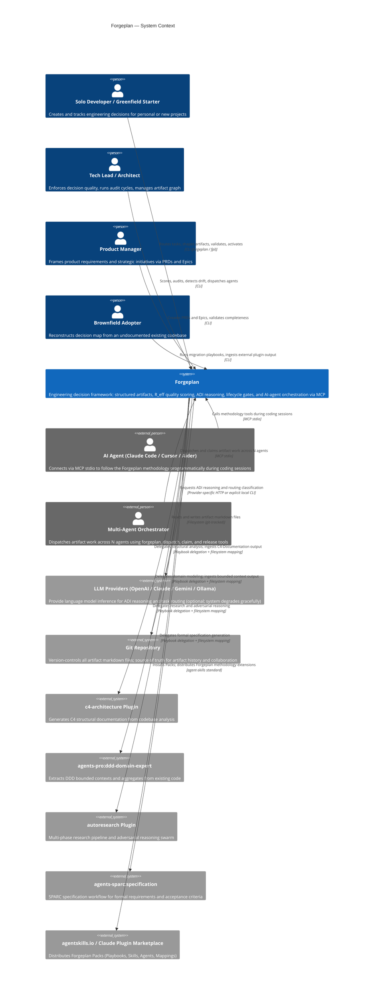

# C4 Context Level: System Context

> Scope: the architecture research baseline was the scoped `c852f40c` build;
> later compatibility changes are distinguished in the [pilot notes (RU)](../operations/CONSTELLATION-PILOT.ru.md).
> User journeys are illustrative, not execution receipts or guarantees that an
> installed plugin, populated model cache or registered tool is ready to run.
> Project FGR heuristics are distinct from upstream FPF's F/ClaimScope/R model.

## System Overview

### Short Description

Forgeplan is a local-first engineering decision framework that guides projects from raw idea to proven implementation through structured, quality-scored artifacts with native AI-agent integration.

### Long Description

Forgeplan is a Rust-based CLI tool and MCP server that brings structure, evidence, and decay-honest quality scoring to engineering decisions. It replaces decisions scattered across Slack threads, emails, and Linear tickets with git-tracked, validated artifacts — PRDs, RFCs, ADRs, Epics, Specs, Evidence, Problems, and Notes — each linked in a dependency graph.

The system solves three interrelated problems: (1) decisions are made but never recorded, making "why did we choose X?" unanswerable six months later; (2) AI agents produce work without a methodological paper trail, making their output shallow and unverifiable; (3) documentation exists in theory but never gets written because the friction is too high.

Forgeplan's core value is its **methodological layer**: the R_eff weakest-link trust formula, FPF trust calculus, ADI (Abduction–Deduction–Induction) reasoning cycles, lifecycle gates, typed inter-artifact links, and evidence decay. Local BGE-M3 inference can run offline after the full model snapshot is cached; weights are not bundled in the binary.

For external structural/domain analyses, Playbooks can delegate to specialized plugins and Mapping files can ingest their outputs. This is an integration design requiring installed delegates and compatible inputs, not a claim that Forgeplan never generates text: its own `generate`/`reason` paths use configured providers.

The system is distributed as a CLI binary (brew, install.sh, source Cargo install) and a stdio MCP server. The scoped `0.39.0+constellation.s1.1` build registers 76 full-profile tools and a separate 9-tool read profile; registration does not prove every tool supports migrated layout (issue #538). These are not counts for the published `0.38.0` release.

### System Scope

**Inside the system boundary:**
- Artifact CRUD with markdown-first storage and LanceDB derived index
- Quality scoring (R_eff, F-G-R), validation gates, and evidence decay
- Task depth routing and artifact pipeline selection
- ADI reasoning prompts requesting 3+ hypotheses (not parser-enforced)
- Lifecycle state machine (draft → active → superseded/deprecated/stale)
- Typed dependency graph with link traversal
- Local semantic search (BGE-M3 on tract, pure-Rust, offline)
- MCP server (stdio transport; full profile plus an optional handle-based read profile)
- Multi-agent dispatch: file-overlap detection, skill-based routing, parallel/serial bucketing
- Playbook runtime for orchestrating external plugin delegations
- Ingest engine for mapping external plugin outputs to forge artifacts
- CLI (`forgeplan`, with optional `fpl` alias)

**Outside the system boundary:**
- LLM inference (delegates to external providers via config)
- Code generation, CI/CD, deployment pipelines
- Project management task tracking (complementary to tools like Orchestra)
- Document generation for structural/domain analysis (delegates to c4-architecture, autoresearch, ddd-domain-expert)
- Team synchronization or notification systems

---

## Personas

### Solo Developer

- **Type**: Human User
- **Description**: An individual engineer or indie developer working on a personal or small-team project who wants to stop losing decisions to chat history.
- **Goals**: Record architectural choices without bureaucratic overhead; answer "why did I do this?" months later; get AI agents to follow a consistent methodology.
- **Key Features Used**: Route, Shape (PRD/ADR/Note), Validate, Score, Activate, Search, MCP integration with Claude Code

### Tech Lead / Architect

- **Type**: Human User
- **Description**: A senior engineer or architect responsible for technical direction on a team, who needs to ensure decisions are reasoned, documented, and traceable.
- **Goals**: Enforce ADI reasoning before irreversible decisions; track R_eff across all active PRDs/RFCs; detect drift between code and decisions; run adversarial audit cycles.
- **Key Features Used**: Route, ADI Reasoning, Spec/RFC/ADR, Score, Coverage, Drift detection, Audit cycle, Multi-agent dispatch

### Product Manager / Product Owner

- **Type**: Human User
- **Description**: A non-technical or semi-technical stakeholder who frames the "what and why" of features and initiatives.
- **Goals**: Capture product requirements with validated completeness; group features into Epics; understand quality readiness before handoff to engineering.
- **Key Features Used**: New PRD, New Epic, Validate, Status dashboard

### Brownfield Adopter

- **Type**: Human User
- **Description**: An engineer or team lead joining an existing codebase (potentially large — tens of thousands of lines) with no prior documentation, who needs to quickly reconstruct the decision map.
- **Goals**: Extract ADRs and bounded contexts from existing code and git history; build an artifact graph from scratch without manual artifact-by-artifact creation; identify undocumented decisions.
- **Key Features Used**: Scan-import, Playbook runtime (brownfield migration playbooks), Ingest engine (c4-to-forge, ddd-to-forge, git-to-forge mappings), Search

### Greenfield Starter

- **Type**: Human User
- **Description**: An engineer or team beginning a new project from a raw idea, who wants to use Forgeplan from day one to shape the project with structure.
- **Goals**: Route the initial idea to the right artifact pipeline; create a validated PRD before writing code; ensure evidence backs every activation.
- **Key Features Used**: Init, Route, Shape (full cycle), Validate, Reason, Evidence, Activate

### AI Agent via MCP (Claude Code / Cursor / Aider)

- **Type**: Programmatic User
- **Description**: An AI coding agent connected to the Forgeplan MCP server over stdio. The agent issues tool calls during a coding session to read context, create artifacts, validate quality, and follow the Shape → Validate → Code → Evidence → Activate methodology without human micro-management.
- **Goals**: Understand which ADRs govern the current code area; follow the correct artifact pipeline for the task depth; detect drift after code changes; stamp agent identity on artifacts it creates or modifies.
- **Key Features Used**: Full-profile MCP tools, including `forgeplan_route`, `forgeplan_new`, `forgeplan_validate`, `forgeplan_reason`, `forgeplan_score`, `forgeplan_activate`, `forgeplan_search`, `forgeplan_drift`, `forgeplan_dispatch`; check layout-specific availability before relying on a tool

### Multi-Agent Orchestrator

- **Type**: Programmatic User
- **Description**: An orchestrating agent (or human-in-the-loop supervisor) that coordinates 2–5 sub-agents sharing one Forgeplan workspace, assigning work to minimize file conflicts and respect dependencies.
- **Goals**: Dispatch a batch of draft artifacts across N agents with no double-work, no merge conflicts, and correct serial/parallel ordering; monitor claims; release stale claims.
- **Key Features Used**: `forgeplan_dispatch`, `forgeplan_claim`, `forgeplan_release`, `forgeplan_claims`

---

## System Features

### Task Routing and Depth Calibration

- **Description**: Recommends task depth and an artifact pipeline. The core Standard pipeline is PRD → RFC; Deep is PRD → Spec → RFC → ADR. `critical` parses as a Deep alias, not a separate core Mode. Routing signals and LLM output are recommendations, not measured correctness probabilities.
- **Users**: Solo Developer, Tech Lead, AI Agent via MCP, Greenfield Starter

### Artifact Lifecycle Management

- **Description**: Authoring and lifecycle operations over supported artifact kinds; the ten-kind MCP creation enum is narrower than the core taxonomy. Persisted states are draft, active, superseded, deprecated and stale. Activation checks validation plus applicable length/evidence-link/stub gates; it does not make active Markdown technically immutable. `renew` and `reopen` are CLI commands, not registered full-profile MCP tools.
- **Users**: All human personas, AI Agent via MCP

### Quality Scoring (R_eff and F-G-R)

- **Description**: Recursive R_eff takes the minimum over eligible own evidence and dependency contributions. Terminal evidence is excluded; draft evidence remains eligible. Congruence and evidence-type penalties apply to unexpired evidence; an expired item contributes 0.1. Flat cached scores and confidence-band points can differ from the recursive report. Product FGR separately computes Formality, Granularity and Reliability on 0–1 scales and combines them by geometric mean; it is not `min(F,G,R)` or a calibrated probability.
- **Users**: Tech Lead, AI Agent via MCP, Multi-Agent Orchestrator

### ADI Reasoning Cycles

- **Description**: Requests 3+ distinct approaches through Abduction → Deduction → Induction via `forgeplan reason <id>` or `forgeplan_reason`. The response parser does not enforce a minimum hypothesis count or prove the hypotheses. Standard+ ADI is a project workflow requirement, not an automatic code-execution gate.
- **Users**: Tech Lead, AI Agent via MCP

### Semantic Search

- **Description**: Local BGE-M3 vector search (1024 dimensions) via the pure-Rust `tract` engine. Requires the `semantic-search` build feature and a cached model. Smart search and forced semantic search have different availability behavior; on migrated workspaces forced semantic search errors without a published profile or eligible vectors.
- **Users**: All personas, AI Agent via MCP

### Typed Dependency Graph

- **Description**: Artifacts are connected through typed links (`informs`, `based_on`, `supersedes`, `contradicts`, `refines`). Graph traversal powers coverage and blocking analysis. `blocks` is not a supported link relation in this CLI contract.
- **Users**: Tech Lead, AI Agent via MCP

### Evidence and Decay Management

- **Description**: EvidencePacks record tests, benchmarks, audits and measurements. `valid_until` is optional; expiry affects scoring and stale reports without automatically rewriting the source lifecycle status. Standalone body fields `verdict` and explicit `congruence_level` prevent fallback to CL0; documented evidence should also name `evidence_type`. Missing fields do not necessarily produce zero: fallback CL0 supporting evidence can score 0.1.
- **Users**: Tech Lead, Solo Developer, AI Agent via MCP

### MCP Server Integration

- **Description**: MCP over stdio with a default writable `full` profile supporting authoring and maintenance, and an additional 9-tool `constellation-read` profile with process-local handles. CLI `validate` works on legacy and migrated Constellation layouts; full MCP `forgeplan_validate` was also exercised successfully there. See the [pilot compatibility notes (RU)](../operations/CONSTELLATION-PILOT.ru.md). Registration alone does not verify every full-profile tool's behavior.
- **Users**: AI Agent via MCP, Multi-Agent Orchestrator

### Multi-Agent Dispatch

- **Description**: Produces advisory agent buckets and a structured serial queue using claims, dependencies, declared-file Jaccard overlap and optional skills. The implementation checks conflicts within each bucket, not across buckets; it does not guarantee conflict-free concurrent execution. File ownership and worktree isolation still belong to the orchestrator.
- **Users**: Multi-Agent Orchestrator, Tech Lead

### Brownfield Migration (Playbook + Ingest)

- **Description**: Declarative Playbooks define multi-step migration strategies that delegate structural analysis, domain modeling, and history mining to specialized plugins. The Ingest engine applies Mapping files to translate plugin outputs (C4-Documentation/, domain-model.md, git log) into draft Forgeplan artifacts with line-level source links.
- **Users**: Brownfield Adopter, Tech Lead

### Health and Drift Monitoring

- **Description**: `forgeplan health` reports decisions missing linked evidence, graph-orphan artifacts and stale/risk signals. `forgeplan coverage` maps decisions to code areas. `forgeplan drift` reports affected files changed since a decision; it does not determine whether the change semantically violates the decision.
- **Users**: Tech Lead, AI Agent via MCP, QA / Reviewer

---

## User Journeys

### Journey 1: Solo Developer Creates First PRD

A solo developer starts a new feature and wants to record their decision trail.

This is an illustrative workflow on a compatible legacy workspace, not an
execution transcript. Use an isolated directory outside parent workspaces;
`init -y` may otherwise find an existing parent. Configure an LLM before `reason`.
Validation findings and activation readiness are separate: activation also checks
length, evidence and stubs. An evidence title alone does not establish a score.

1. **Install**: `brew install ForgePlan/tap/forgeplan` — single binary, no server required
2. **Initialize workspace**: `forgeplan init -y` — creates `.forgeplan/` directory in the project root
3. **Route the task**: `forgeplan route "Add OAuth2 authentication"` — inspect the returned depth and pipeline; security signals can route this example to Deep
4. **Shape the PRD**: `forgeplan new prd "OAuth2 Authentication"` — receives a pre-filled markdown template with required sections
5. **Fill required sections**: Problem, Goals, Non-Goals, Target Users and Functional Requirements, using `forgeplan update <ID> --body @file` under this repository's artifact-writing policy
6. **Validate**: `forgeplan validate PRD-001` — gate checks all MUST sections are present; PASS or error list
7. **Run ADI reasoning**: `forgeplan reason PRD-001` — requests competing approaches from the configured provider; review the actual response
8. **Implement the feature** — writes code following the chosen hypothesis
9. **Record evidence**: `forgeplan new evidence "Authentication verification"`; fill the body with actual observations and structured scoring fields, then `forgeplan link EVID-001 PRD-001` using the returned IDs
10. **Score**: `forgeplan score PRD-001` — inspect the computed report; neither creation nor a test-like title establishes R_eff > 0
11. **Activate**: `forgeplan activate PRD-001` — request draft → active only after the applicable gates and project approval; active body/title updates remain technically possible

### Journey 2: AI Agent via Claude Code MCP

An AI coding agent (Claude Code) handles a sprint, following the Forgeplan methodology through MCP tools.

1. **Connect**: start the chosen MCP build over stdio and inspect `initialize` plus the profile's `tools/list`; select operations compatible with the workspace layout
2. **Check workspace health**: `forgeplan_health` — agent reads blind spots and stale artifacts before starting
3. **Route the task**: `forgeplan_route` with the sprint description — receives depth, artifact pipeline, and reasoning
4. **Read existing context**: `forgeplan_search` to find any existing PRDs/ADRs covering the work area
5. **Create artifact**: `forgeplan_new` with `kind: "prd"` and a title — inspect and fill the created body through the supported update path
6. **Validate**: `forgeplan_validate` — must return PASS before proceeding to code
7. **Reason**: `forgeplan_reason` — generates ADI hypotheses; agent presents options to human for decision
8. **Implement**: writes code; after changes uses `forgeplan_drift` to inspect changed-file signals, not a semantic compliance verdict
9. **Create and link evidence**: `forgeplan_new` (kind=evidence) → `forgeplan_link` with relation=informs
10. **Score and activate**: `forgeplan_score` checks R_eff; `forgeplan_activate` transitions the artifact
11. **Identity**: new/update handlers attempt best-effort `last_modified_by` stamping from MCP client identity; failures are logged, and not every write handler stamps an artifact

### Journey 3: Team Runs Brownfield Migration Audit Cycle

A tech lead joins a 100K-LOC codebase with no prior documentation and needs to build a decision map.

This journey requires installed compatible delegates, real mapping files and
filled artifact sections. A Skill delegation currently emits a trace and reports
success without actually loading the skill. Full MCP ingest validates inputs only; it does not invoke `IngestEngine` or compute a draft plan;
writing ingestion uses the CLI. No complete brownfield run is certified here.

1. **Initialize**: `forgeplan init -y` in the existing repository root
2. **Run health check**: `forgeplan health` — a fresh workspace is empty; this does not scan every code module or prove decision coverage
3. **Inspect plugins**: `forgeplan plugins list` / `forgeplan plugins doctor`; verify the delegates needed by the chosen playbook are available
4. **Select a real playbook**: `forgeplan playbook list`, then inspect its actual steps and prerequisites; command delegates require explicit shell opt-in in addition to execution confirmation
5. **Run structural analysis step**: Playbook delegates to `c4-architecture` — generates `C4-Documentation/` with container and component diagrams
6. **Run domain analysis step**: Playbook delegates to `ddd-domain-expert` — generates bounded context map
7. **Ingest C4 output**: `forgeplan ingest --mapping marketplace/mappings/c4-to-forge.yaml --source C4-Documentation/` — inspect the actual draft kinds; the current C4 mapping favors Notes, not automatically complete ADRs/Epics
8. **Ingest domain model**: use the installed brownfield pack's actual `ddd-to-forge.yaml` file path with `--mapping` and the matching `domain-model.md` source; do not assume a short registry name resolves
9. **Dispatch audit to agents**: `forgeplan dispatch --agents 3` — inspect its advisory buckets and structured serial reasons; resolve cross-agent ownership conflicts
10. **Agents validate and enrich**: use layout-compatible validation, record actual evidence and reason about key ADRs
11. **Tech lead reviews**: run `forgeplan score <ID>` or `forgeplan score --all`; satisfy all activation gates and project approval before activation
12. **Health re-check**: inspect `forgeplan health` and `forgeplan coverage` separately; neither command promises all formerly undocumented modules are now covered

---

## External Systems and Dependencies

### LLM Providers (OpenAI, Anthropic Claude, Google Gemini, Ollama, OpenRouter)

- **Type**: External API / Local service
- **Description**: Optional providers generate reasoning, documents and routing assistance; unavailable providers do not prevent non-LLM operations. Level-0 routing is rule-based. Local FPF vector retrieval uses the embedding engine rather than the text-generation provider.
- **Integration Type**: OpenAI-compatible HTTP for applicable providers, a dedicated Anthropic request path, local Ollama HTTP, or explicitly selected stock local CLI profiles
- **Purpose**: Generate text/ADI and assist routing. A successful provider call is not evidence that its claims are correct.

### LanceDB (Embedded)

- **Type**: Embedded database (co-located, not a network service)
- **Description**: An embedded columnar vector database holding derived artifact records and embeddings. Rebuild the local index from canonical Markdown with `forgeplan reindex`; Constellation publishes versioned generations through `CURRENT.json`. Legacy and migrated layouts are not interchangeable.
- **Integration Type**: In-process library (lancedb Rust crate)
- **Purpose**: Power semantic search across artifacts; serve as a fast query layer over the markdown source of truth (per ADR-003 — markdown is authoritative, LanceDB is derived)

### Git (Local Repository)

- **Type**: Version control system
- **Description**: Version control for canonical artifact Markdown. Derived indexes and local config are not canonical history; keep local config, credentials and model cache out of commits.
- **Integration Type**: Filesystem (git-tracked markdown files); `git log` read for brownfield history mining
- **Purpose**: Provide artifact versioning, collaboration via PRs, and the `git-to-forge` history mining input for brownfield migration

### tract / BGE-M3 Model (Local)

- **Type**: Local ML model; weights downloaded separately
- **Description**: BGE-M3 (1024 dimensions) runs via `tract`. Cache resolution prefers `FORGEPLAN_MODEL_CACHE`, then `~/.forgeplan/models`, with platform/legacy fallback when home is unavailable. `HF_HOME` does not override this cache. Offline use requires a complete compatible snapshot.
- **Integration Type**: In-process Rust inference (`semantic-search` feature), `hf-hub` for model acquisition
- **Purpose**: Enable semantic similarity search across artifacts without external API keys or data egress

### c4-architecture Plugin

- **Type**: External agent plugin (claude-code-workflows marketplace)
- **Description**: A Claude Code plugin that generates C4 model documentation (Context, Container, Component, Code levels) from codebase analysis. Forgeplan integrates with it through the `c4-to-forge.yaml` mapping, ingesting its output into the artifact graph.
- **Integration Type**: Filesystem output mapping (Forgeplan reads `C4-Documentation/` produced by the plugin)
- **Purpose**: Structural architecture analysis for brownfield migration — produces the container and component view that Forgeplan ingests as ADRs and Epics

### autoresearch Plugin

- **Type**: External agent plugin (Karpathy-derived)
- **Description**: A multi-phase research and reasoning pipeline that includes deep research, adversarial reasoning swarms, and goal-capture interviews. Forgeplan delegates document-generation research steps to it via Playbook.
- **Integration Type**: Filesystem output mapping
- **Purpose**: Research synthesis and adversarial reasoning swarm for Critical-depth artifacts; goal capture interview pattern for PRD shaping

### agents-pro:ddd-domain-expert Plugin

- **Type**: External agent plugin (agents-pro marketplace)
- **Description**: An agent that extracts DDD bounded contexts, aggregates, and use cases from existing code. Forgeplan integrates through the `ddd-to-forge.yaml` mapping.
- **Integration Type**: Filesystem output mapping (domain-model.md, bounded-contexts.md)
- **Purpose**: Domain model extraction for brownfield migration — Forgeplan ingests the output as draft PRDs per bounded context

### agents-sparc:specification Plugin

- **Type**: External agent plugin (agents-sparc marketplace)
- **Description**: Implements the SPARC specification workflow — structured requirements capture with acceptance criteria and constraints. Forgeplan delegates Spec artifact content generation to it.
- **Integration Type**: Filesystem output mapping
- **Purpose**: Formal specification generation for API contracts and data models that Forgeplan ingests as Spec artifacts

### agentskills.io / Claude Code Plugin Marketplace

- **Type**: External distribution platform
- **Description**: Marketplaces for distributing Forgeplan Packs (Playbook + Skill + Agent + Mapping bundles). Users install Packs from these marketplaces to extend Forgeplan's playbook capabilities.
- **Integration Type**: Package installation (agent-skills standard, `skills-lock.json`)
- **Purpose**: Distribution channel for Forgeplan methodology Packs and the plugins Forgeplan orchestrates

### Homebrew Tap / install.sh / cargo (Distribution)

- **Type**: Package distribution channels
- **Description**: The three installation paths for the Forgeplan binary. Homebrew provides macOS/Linux formula; install.sh is a curl-pipe script; cargo provides source builds.
- **Integration Type**: Binary distribution
- **Purpose**: Deliver prebuilt binaries through brew/install.sh without a Rust toolchain; Cargo source installation requires the supported toolchain and build prerequisites

---

## System Context Diagram

---

## Related Documentation

- [Constellation Architecture](./constellation.md)
- [Methodology Guide](../methodology/FORGEPLAN-GUIDE.md)
- [Usage by Role](../methodology/USAGE-BY-ROLE.md)
- [Multi-Agent Workflow](../operations/MULTI-AGENT.md)
- [ADR-009: Forgeplan as Orchestrator](../../.forgeplan/adrs/ADR-009-forgeplan-as-orchestrator-playbook-skill-agent-mapping-pack-marketplace-model.md)
- [ADR-003: Markdown as Source of Truth](../../.forgeplan/adrs/ADR-003-markdown-files-as-source-of-truth-lancedb-as-index-layer.md)
