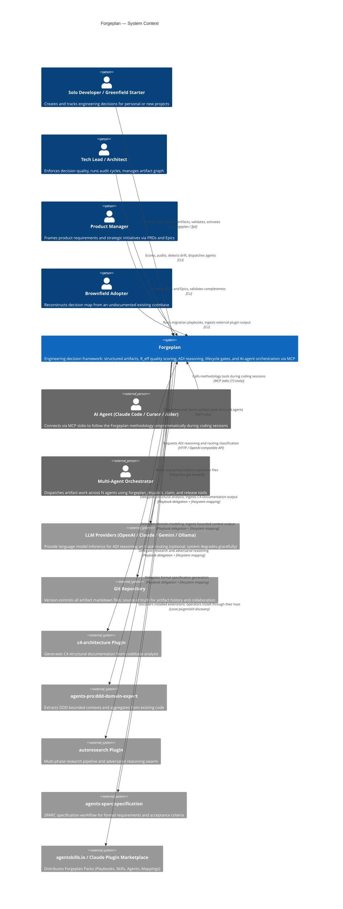

# C4 Context Level: System Context

## System Overview

### Short Description

Forgeplan is a local-first engineering decision framework that guides projects from raw idea to proven implementation through structured, quality-scored artifacts with native AI-agent integration.

### Long Description

Forgeplan is a Rust-based CLI tool and MCP server that brings structure, evidence, and decay-honest quality scoring to engineering decisions. It replaces decisions scattered across Slack threads, emails, and Linear tickets with git-tracked, validated artifacts — PRDs, RFCs, ADRs, Epics, Specs, Evidence, Problems, and Notes — each linked in a dependency graph.

The system solves three interrelated problems: (1) decisions are made but never recorded, making "why did we choose X?" unanswerable six months later; (2) AI agents produce work without a methodological paper trail, making their output shallow and unverifiable; (3) documentation exists in theory but never gets written because the friction is too high.

Forgeplan's core value is its **methodological layer**: the R_eff weakest-link trust formula, FPF trust calculus, ADI (Abduction–Deduction–Induction) reasoning cycles, validation and activation gates, typed inter-artifact links, and evidence decay. Local semantic inference uses BGE-M3 on `tract`; it needs no API key, but the model must first be downloaded (~2.1 GB).

The CLI provides artifact templates and optional LLM-backed generation and reasoning. Playbooks can delegate analysis to separately installed plugins and agents, then CLI mappings can ingest their output. Marketplace skills such as `/smith` guide the host agent's orchestration; they are not autonomous behavior of the core binary.

The system is distributed as a single binary (brew, install.sh, cargo) and a stdio-transport MCP server that any MCP-compatible AI agent (Claude Code, Cursor, Aider, Continue) can connect to through 73 tools.

### System Scope

**Inside the system boundary:**
- Artifact CRUD with markdown-first storage and LanceDB derived index
- Quality scoring (R_eff, F-G-R), validation gates, and evidence decay
- Task depth routing and artifact pipeline selection
- ADI reasoning cycles (3+ hypothesis generation)
- Lifecycle state machine (draft → active → superseded/deprecated/stale)
- Typed dependency graph with link traversal
- Local semantic search (BGE-M3 on tract, pure-Rust, offline)
- MCP server (stdio transport, 73 tools)
- Multi-agent assignment planning: file-overlap detection, optional skill matching, parallel/serial bucketing; the host starts agents
- Playbook runtime for explicit external delegations, with separate confirmation and shell-execution gates
- CLI ingest engine for mapping external outputs to artifacts; MCP ingest only validates inputs and returns a plan
- CLI (82 top-level commands, 103 including nested commands; alias `fpl`)

**Outside the system boundary:**
- LLM inference (delegates to external providers via config)
- Code generation, CI/CD, deployment pipelines
- Project management task tracking (complementary to tools like Orchestra)
- Structural/domain analysis performed by separately installed agents or plugins (not bundled analysis engines)
- Team synchronization or notification systems

---

## Personas

### Solo Developer

- **Type**: Human User
- **Description**: An individual engineer or indie developer working on a personal or small-team project who wants to stop losing decisions to chat history.
- **Goals**: Record architectural choices without bureaucratic overhead; answer "why did I do this?" months later; get AI agents to follow a consistent methodology.
- **Key Features Used**: Route, Shape (PRD/ADR/Note), Validate, Score, Activate, Search, MCP integration with Claude Code

### Tech Lead / Architect

- **Type**: Human User
- **Description**: A senior engineer or architect responsible for technical direction on a team, who needs to ensure decisions are reasoned, documented, and traceable.
- **Goals**: Enforce ADI reasoning before irreversible decisions; track R_eff across all active PRDs/RFCs; detect drift between code and decisions; run adversarial audit cycles.
- **Key Features Used**: Route, ADI Reasoning, Spec/RFC/ADR, Score, Coverage, Drift detection, Audit cycle, Multi-agent dispatch

### Product Manager / Product Owner

- **Type**: Human User
- **Description**: A non-technical or semi-technical stakeholder who frames the "what and why" of features and initiatives.
- **Goals**: Capture product requirements with validated completeness; group features into Epics; understand quality readiness before handoff to engineering.
- **Key Features Used**: New PRD, New Epic, Validate, Status dashboard

### Brownfield Adopter

- **Type**: Human User
- **Description**: An engineer or team lead joining an existing codebase (potentially large — tens of thousands of lines) with no prior documentation, who needs to quickly reconstruct the decision map.
- **Goals**: Extract ADRs and bounded contexts from existing code and git history; build an artifact graph from scratch without manual artifact-by-artifact creation; identify undocumented decisions.
- **Key Features Used**: Scan-import for existing documents, Discover for guided extraction, installed Playbooks and CLI ingest mappings, Search

### Greenfield Starter

- **Type**: Human User
- **Description**: An engineer or team beginning a new project from a raw idea, who wants to use Forgeplan from day one to shape the project with structure.
- **Goals**: Route the initial idea to the right artifact pipeline; create a validated PRD before writing code; ensure evidence backs every activation.
- **Key Features Used**: Init, Route, Shape (full cycle), Validate, Reason, Evidence, Activate

### AI Agent via MCP (Claude Code / Cursor / Aider)

- **Type**: Programmatic User
- **Description**: An AI coding agent connected to the Forgeplan MCP server over stdio. The agent issues tool calls during a coding session to read context, create artifacts, validate quality, and follow the Shape → Validate → Code → Evidence → Activate methodology without human micro-management.
- **Goals**: Understand which ADRs govern the current code area; follow the correct artifact pipeline for the task depth; detect drift after code changes; stamp agent identity on artifacts it creates or modifies.
- **Key Features Used**: All 73 MCP tools — most frequently: `forgeplan_route`, `forgeplan_new`, `forgeplan_validate`, `forgeplan_reason`, `forgeplan_score`, `forgeplan_activate`, `forgeplan_search`, `forgeplan_drift`, `forgeplan_dispatch`

### Multi-Agent Orchestrator

- **Type**: Programmatic User
- **Description**: An orchestrating agent (or human-in-the-loop supervisor) that coordinates 2–5 sub-agents sharing one Forgeplan workspace, assigning work to minimize file conflicts and respect dependencies.
- **Goals**: Plan work across N agents using declared affected files and dependencies; monitor claims and release expired ownership. The plan is advisory, not a guarantee against undeclared overlap or merge conflicts.
- **Key Features Used**: `forgeplan_dispatch`, `forgeplan_claim`, `forgeplan_release`, `forgeplan_claims`

---

## System Features

### Task Routing and Depth Calibration

- **Description**: Analyzes a task description and determines the appropriate work depth (Tactical / Standard / Deep / Critical) and the resulting artifact pipeline (e.g., Note only; ADR; PRD → RFC; Epic → PRD → Spec → RFC → ADR). Prevents over-documenting trivial changes and under-documenting irreversible ones.
- **Users**: Solo Developer, Tech Lead, AI Agent via MCP, Greenfield Starter

### Artifact Lifecycle Management

- **Description**: CRUD for 17 artifact kinds, including six brownfield kinds and lightweight memory. Decision kinds (PRD, Epic, Spec, RFC, ADR) have activation validation and methodology gates. Lifecycle transitions use explicit commands (`activate`, `supersede`, `deprecate`, `renew`, `reopen`); `update --status` cannot substitute for active or terminal transitions.
- **Users**: All human personas, AI Agent via MCP

### Quality Scoring (R_eff and F-G-R)

- **Description**: Computes trust from the minimum score of current evidence (weakest-link). Superseded/deprecated evidence is excluded; draft evidence still counts. Applies congruence-level penalties (CL0–CL3) and expiry (`valid_until` passed → 0.1). F-G-R measures formality, granularity, and reliability independently.
- **Users**: Tech Lead, AI Agent via MCP, Multi-Agent Orchestrator

### ADI Reasoning Cycles

- **Description**: Generates and evaluates 3+ competing hypotheses through Abduction → Deduction → Induction via `forgeplan reason <id>` or `forgeplan_reason`, using a configured LLM provider. This produces analysis for review, not independently verified proof. The methodology requires ADI for Deep and Critical work.
- **Users**: Tech Lead, AI Agent via MCP

### Semantic Search

- **Description**: The CLI performs local vector retrieval using BGE-M3 embeddings (1024 dimensions) on the pure-Rust `tract` engine. It requires a `semantic-search` build and downloaded model weights; first-use model acquisition needs network access. `forgeplan embed` generates or refreshes artifact vectors. In 0.38.0, MCP `forgeplan_search` smart/semantic modes pass no vector scores and do not perform vector retrieval (core #546); embedding artifacts does not complete that missing wiring.
- **Users**: Human CLI users and agents invoking the CLI. MCP agents can use keyword/smart retrieval, but not BGE-M3 vector retrieval through that tool in 0.38.0.

### Typed Dependency Graph

- **Description**: Artifacts are connected through five public relation types: `informs`, `based_on`, `supersedes`, `contradicts`, and `refines`. Structural relations power dependency ordering and blocking analysis; links also support coverage and provenance.
- **Users**: Tech Lead, AI Agent via MCP

### Evidence and Decay Management

- **Description**: EvidencePacks record real tests, benchmarks, measurements, and audits. `valid_until` is optional; expiry affects scores and stale reports, not an automatic write to lifecycle status. Fill `verdict`, `congruence_level`, and `evidence_type` explicitly: missing verdict/CL is treated as weak CL0 evidence (0.1), not a fully trusted result.
- **Users**: Tech Lead, Solo Developer, AI Agent via MCP

### MCP Server Integration

- **Description**: Full MCP server over stdio transport exposing 73 tools to any MCP-compatible AI agent. Tools cover the complete methodology workflow — from routing through activation — plus multi-agent dispatch and identity stamping.
- **Users**: AI Agent via MCP, Multi-Agent Orchestrator

### Multi-Agent Dispatch

- **Description**: Given draft artifacts and N agents, computes assignment buckets and a serial queue using declared affected-file sets, Jaccard overlap, and live claims. It does not launch agents, enforce exclusive file access, or guarantee conflict-free work when file declarations are incomplete.
- **Users**: Multi-Agent Orchestrator, Tech Lead

### Brownfield Migration (Playbook + Ingest)

- **Description**: Installed Playbooks can delegate structural analysis, domain modeling, and history mining. CLI ingest applies Mapping files to external outputs and writes draft artifacts with source references. Mappings and analyzers must exist locally; `forgeplan_ingest` on MCP validates paths and returns a planned response with empty drafts, deferring execution to the CLI.
- **Users**: Brownfield Adopter, Tech Lead

### Health and Drift Monitoring

- **Description**: `forgeplan health` reports blind spots (active decisions without linked evidence), unlinked artifacts, stale decisions, and other graph signals. `forgeplan coverage` maps decisions to declared code areas. `forgeplan drift` flags affected files changed after an active ADR/RFC was created; it does not prove a semantic violation.
- **Users**: Tech Lead, AI Agent via MCP, QA / Reviewer

---

## User Journeys

### Journey 1: Solo Developer Creates First PRD

A solo developer starts a new feature and wants to record their decision trail.

1. **Install**: `brew install ForgePlan/tap/forgeplan` — single binary, no server required
2. **Initialize workspace**: `forgeplan init -y` — creates `.forgeplan/` directory in the project root
3. **Route the task**: `forgeplan route "Add OAuth2 authentication"` — returns a recommended depth and pipeline; inspect the actual result rather than assuming a fixed classification
4. **Shape the PRD**: `forgeplan new prd "OAuth2 Authentication"` — receives a template and artifact ID
5. **Fill required sections**: Problem, Goals, Non-Goals, Target Users, Functional Requirements — submit the complete body with `forgeplan update <ID> --body @/path/to/body.md`
6. **Validate**: `forgeplan validate <ID> --ci` — exit 1 on MUST failures
7. **Run ADI reasoning**: `forgeplan reason <ID>` — requires a configured LLM provider; review the generated hypotheses
8. **Implement the feature** — writes code following the chosen hypothesis
9. **Record evidence**: `forgeplan new evidence "OAuth2 verification results"` — fill actual methods/results and structured evidence fields, then `forgeplan link <EVID-ID> <PRD-ID> --relation informs`
10. **Score**: `forgeplan score <PRD-ID>` — inspect the evidence breakdown and R_eff
11. **Activate**: `forgeplan activate <PRD-ID>` — explicit transition after gates pass; activation is not a filesystem immutability guarantee

### Journey 2: AI Agent via Claude Code MCP

An AI coding agent (Claude Code) handles a sprint, following the Forgeplan methodology through MCP tools.

1. **Connect**: Forgeplan MCP server starts via stdio; Claude Code discovers 73 tools
2. **Check workspace health**: `forgeplan_health` — agent reads blind spots and stale artifacts before starting
3. **Route the task**: `forgeplan_route` with the sprint description — receives depth, artifact pipeline, and reasoning
4. **Read existing context**: `forgeplan_search` to find any existing PRDs/ADRs covering the work area
5. **Create artifact**: `forgeplan_new` with kind=prd — agent receives template; fills sections programmatically
6. **Validate**: `forgeplan_validate` — must return PASS before proceeding to code
7. **Reason**: `forgeplan_reason` — generates ADI hypotheses; agent presents options to human for decision
8. **Implement**: writes code; after changes uses `forgeplan_drift` to identify affected ADR/RFC files for review, not to certify compliance
9. **Create and link evidence**: `forgeplan_new` (kind=evidence) → `forgeplan_link` with relation=informs
10. **Score and activate**: `forgeplan_score` checks R_eff; `forgeplan_activate` transitions the artifact
11. **Record identity**: artifact write handlers best-effort stamp `last_modified_by` and `last_modified_at` from the initialized MCP client identity; missing identity or a stamp failure does not make the operation fail

### Journey 3: Team Runs Brownfield Migration Audit Cycle

A tech lead joins a 100K-LOC codebase with no prior documentation and needs to build a decision map.

1. **Initialize**: `forgeplan init -y` in the existing repository root
2. **Run health check**: `forgeplan health` — an initialized empty workspace is reported as empty, not as a code-coverage audit
3. **Inspect installed analyzers**: `forgeplan plugins list` — discovery reports local plugins; it does not install them
4. **Select a shipped local playbook**: `forgeplan playbook list` and `forgeplan playbook show <name>`; a Forgeplan source checkout includes `brownfield-code` and `brownfield-docs`
5. **Inspect prerequisites and steps**: analyzers, mapping schema, and expected output paths must match core 0.38.0; similarly named local and published-pack mappings are not interchangeable. Dry-run the selected playbook.
6. **Run approved analysis**: `forgeplan playbook run <name> --yes`; command delegations also need `--allow-shell` or trusted workspace configuration
7. **Preview ingestion**: `forgeplan ingest --mapping /path/to/mapping.yaml --source /path/to/output --dry-run` — inspect the actual drafts and source references
8. **Write reviewed drafts**: repeat the CLI ingest command without `--dry-run`; MCP ingest does not perform these writes
9. **Plan agent work**: `forgeplan dispatch --agents 3` — the host reviews the assignment and launches the agents
10. **Agents validate and enrich**: fill artifacts, collect evidence, and review generated ADI analysis on key decisions
11. **Tech lead reviews**: score and explicitly activate completed decisions after checking the evidence
12. **Re-check health and coverage**: use `forgeplan health` and `forgeplan coverage`; compare the declared code coverage rather than assuming every module was covered

---

## External Systems and Dependencies

### LLM Providers (OpenAI, Anthropic Claude, Google Gemini, Ollama, OpenRouter)

- **Type**: External API / Local service
- **Description**: Optional providers for LLM-backed generation and ADI reasoning. Task routing can fall back to rules without an LLM; commands that require an LLM do not become functional merely because it is absent.
- **Integration Type**: Provider-specific HTTP APIs, OpenAI-compatible endpoints, Ollama, or explicitly configured local CLI providers
- **Purpose**: Generate and assess hypotheses and classify tasks. FPF semantic retrieval uses the local embedding model, not an external reasoning provider.

### LanceDB (Embedded)

- **Type**: Embedded database (co-located, not a network service)
- **Description**: A columnar vector database embedded directly in the Forgeplan process. Stores derived records and embeddings. `.forgeplan/lance/` is gitignored; `forgeplan reindex` rebuilds the index from existing workspace markdown. Refresh embeddings separately with `forgeplan embed`.
- **Integration Type**: In-process library (lancedb Rust crate)
- **Purpose**: Power semantic search across artifacts; serve as a fast query layer over the markdown source of truth (per ADR-003 — markdown is authoritative, LanceDB is derived)

### Git (Local Repository)

- **Type**: Version control system
- **Description**: Git tracks artifact markdown and shared `.forgeplan/config.yaml` (environment-variable references, not secrets). Derived indexes, model caches, session/state/lock files, logs, trash, and `secrets.env` remain untracked. Artifact review and collaboration use ordinary Git operations.
- **Integration Type**: Filesystem (git-tracked markdown files); `git log` read for brownfield history mining
- **Purpose**: Provide artifact versioning, collaboration via PRs, and the `git-to-forge` history mining input for brownfield migration

### fastembed / BGE-M3 Model (Local)

- **Type**: Downloaded model weights plus an in-process inference engine
- **Description**: BGE-M3 produces 1024-dimensional vectors on `tract`. Weights are not bundled in the release binary. Cache resolution is `FORGEPLAN_MODEL_CACHE`, then the platform user-cache directory, then `./.fastembed_cache` if no platform cache is available; `HF_HOME` can override Hugging Face storage.
- **Integration Type**: Pure-Rust `tract` inference, behind `semantic-search`
- **Purpose**: Enable semantic similarity search across artifacts without external API keys or data egress

### c4-architecture Plugin

- **Type**: External agent plugin (claude-code-workflows marketplace)
- **Description**: A separately installed plugin that generates C4 documentation from codebase analysis. The Forgeplan checkout's `marketplace/mappings/c4-to-forge.yaml` imports component/code documentation as **Notes**, optionally linked to the mapping's existing Epic target; it does not create ADRs or a new Epic.
- **Integration Type**: Filesystem output mapping over `C4-Documentation/code/` and `C4-Documentation/components/`; inspect and adapt the configured existing-Epic target before use
- **Purpose**: Capture structural observations with source references as Notes for later review and enrichment, not automatically promote them to architectural decisions

The public `forgeplan-brownfield-pack` 1.7.1 at
`b4e8a1b9bfaa4c9c44e6f8dc1039e09fa1b193f7` contains a different
`mappings/c4-to-forge.yaml`. It uses the legacy `mapping_name`,
`source_plugin`, and `mappings` schema, which core 0.38.0 rejects.
Adapt it to the current Mapping schema before CLI ingestion; it is not
a drop-in alternative to the checkout mapping described above.

### autoresearch Plugin

- **Type**: External agent plugin (Karpathy-derived)
- **Description**: A multi-phase research and reasoning pipeline that includes deep research, adversarial reasoning swarms, and goal-capture interviews. Forgeplan delegates document-generation research steps to it via Playbook.
- **Integration Type**: Filesystem output mapping
- **Purpose**: Research synthesis and adversarial reasoning swarm for Critical-depth artifacts; goal capture interview pattern for PRD shaping

### agents-pro:ddd-domain-expert Plugin

- **Type**: External agent plugin (agents-pro marketplace)
- **Description**: An agent that extracts DDD bounded contexts, aggregates, and use cases from existing code. Forgeplan integrates through the `ddd-to-forge.yaml` mapping.
- **Integration Type**: Filesystem output mapping (domain-model.md, bounded-contexts.md)
- **Purpose**: Domain model extraction for brownfield migration — Forgeplan ingests the output as draft PRDs per bounded context

### agents-sparc:specification Plugin

- **Type**: External agent plugin (agents-sparc marketplace)
- **Description**: Implements the SPARC specification workflow — structured requirements capture with acceptance criteria and constraints. Forgeplan delegates Spec artifact content generation to it.
- **Integration Type**: Filesystem output mapping
- **Purpose**: Formal specification generation for API contracts and data models that Forgeplan ingests as Spec artifacts

### agentskills.io / Claude Code Plugin Marketplace

- **Type**: External distribution platform
- **Description**: Marketplaces for distributing Forgeplan Packs (Playbook + Skill + Agent + Mapping bundles). Users install Packs from these marketplaces to extend Forgeplan's playbook capabilities.
- **Integration Type**: Package installation (agent-skills standard, `skills-lock.json`)
- **Purpose**: Distribution channel for Forgeplan methodology Packs and the plugins Forgeplan orchestrates

The external analyzers above describe integration roles, not a bundled
plugin inventory. In the public ForgePlan marketplace snapshot
`b4e8a1b9bfaa4c9c44e6f8dc1039e09fa1b193f7`, `agents-pro:ddd-domain-expert`
and `agents-sparc:specification` are supplied agents. `c4-architecture`
and `autoresearch` are external integrations, not included ForgePlan plugins.

### Homebrew Tap / install.sh / cargo (Distribution)

- **Type**: Package distribution channels
- **Description**: The three installation paths for the Forgeplan binary. Homebrew provides macOS/Linux formula; install.sh is a curl-pipe script; cargo provides source builds.
- **Integration Type**: Binary distribution
- **Purpose**: Deliver the single forgeplan binary to end users without requiring a Rust toolchain

---

## System Context Diagram

---

## Related Documentation

- [Container Documentation](./c4-container.md)
- [Component Documentation](./c4-component.md)
- [Methodology Guide](../methodology/FORGEPLAN-GUIDE.md)
- [Usage by Role](../methodology/USAGE-BY-ROLE.md)
- [Multi-Agent Workflow](../operations/MULTI-AGENT.md)
- [ADR-009: Forgeplan as Orchestrator](../../.forgeplan/adrs/ADR-009-forgeplan-as-orchestrator-playbook-skill-agent-mapping-pack-marketplace-model.md)
- [ADR-003: Markdown as Source of Truth](../../.forgeplan/adrs/ADR-003-markdown-files-as-source-of-truth-lancedb-as-index-layer.md)
