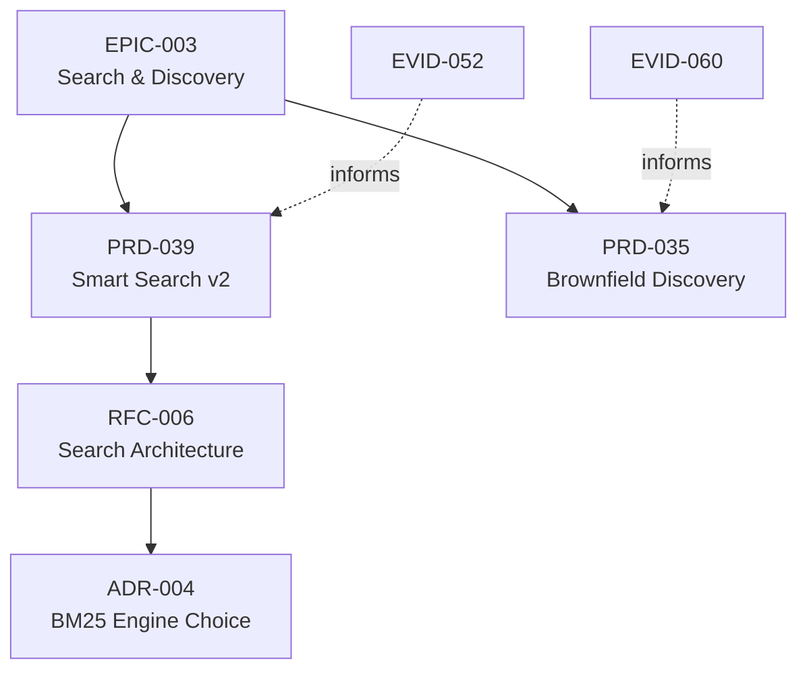

Emit a Mermaid-format dependency graph of all linked artifacts. Unlike
[`tree`](/docs/cli/tree/), which only shows parent/child hierarchy, `graph`
renders typed links such as `informs`, `based_on`, `refines` and `supersedes`,
plus `parent_epic` edges labelled `belongs_to`. Cycles can exist; this is not guaranteed to be a DAG.

`constellation graph` is the separate federated interface.

## When to use

- Paste into a GitHub issue/PR to visualize a proposal's impact
- Embed in an RFC or Epic to show scope
- Feed into `mmdc` (mermaid-cli) to render PNG/SVG
- Detect unexpected cycles or orphan clusters

## Not to use when

- You just need parent/child decomposition → use [`forgeplan tree`](/docs/cli/tree/)
- You need execution order → use [`forgeplan order`](/docs/cli/order/)
- You need a flat list → use [`forgeplan list`](/docs/cli/list/)

## Usage

```text
forgeplan graph [OPTIONS]
```

## Options

```text
      --json     Output as JSON for machine consumption
  -h, --help     Print help
  -V, --version  Print version
```

## Examples

Emit the Mermaid source:

```bash
forgeplan graph
```

Redirect to a file and paste into GitHub:

```bash
forgeplan graph > deps.mmd
```

Render to PNG with mermaid-cli:

```bash
forgeplan graph | sed '/^Next:/d' > deps.mmd
mmdc -i deps.mmd -o deps.png
```

JSON for a custom UI:

```bash
forgeplan graph --json | jq '.edges | length'
```

## Output interpretation

The renderer emits `graph LR`; text stdout can also contain a trailing `Next:` hint.
The following is a hand-authored illustration, not exact command output:

```
graph TD
  EPIC_003[EPIC-003<br/>Search, Discovery]
  PRD_039[PRD-039<br/>BM25 production]
  RFC_004[RFC-004<br/>Layered search]
  EVID_018[EVID-018<br/>Benchmark]
  EPIC_003 --> PRD_039
  PRD_039 --> RFC_004
  EVID_018 -.informs.-> PRD_039
```

Conventions:

| Syntax          | Meaning                                            |
|-----------------|----------------------------------------------------|
| `belongs_to` | Child-to-parent edge from `parent_epic` |
| Typed edge label | Relation recorded on the edge |
| Node identifier | Artifact ID; the renderer does not load title labels |

Styles use artifact kind and hypothesis verification state, not general lifecycle
status. JSON contains `edges` with `from`, `to` and `relation`, plus
`brownfield_only` and `_next_action`; there is no `nodes` array. In this handler
`--brownfield-only` filters Mermaid rendering, not the JSON edge list.

### Example rendered diagram



## How it fits

`graph` is the complete relational view. For different questions:

```
graph   →  all edges              (relational picture)
tree    →  parent/child only       (hierarchy)
order   →  topological walk        (execution)
blocked →  unresolved dependencies (planning)
```

## See also

- [`forgeplan tree`](/docs/cli/tree/) - hierarchy view
- [`forgeplan order`](/docs/cli/order/) - topological order
- [`forgeplan blocked`](/docs/cli/blocked/) - blocking dependencies
- [`forgeplan link`](/docs/cli/link/) - create typed edges

<!-- forgeplan-runtime:start -->
## Captured CLI help

Source: `forgeplan 0.39.0+constellation.s1.1`, `forgeplan graph --help`.

```text
Generate mermaid dependency graph of linked artifacts

Usage: forgeplan graph [OPTIONS]

Options:
      --json             Output as JSON for machine consumption
      --brownfield-only  Issue #287 Phase F: filter edges to brownfield kinds only (UC / GLOS / INV / SCEN / HYP / DM). Pipeline edges (PRD / RFC / ADR / EPIC / SPEC) are dropped from output. Domain-model subgraph clusters are preserved
  -h, --help             Print help
  -V, --version          Print version
```
<!-- forgeplan-runtime:end -->
