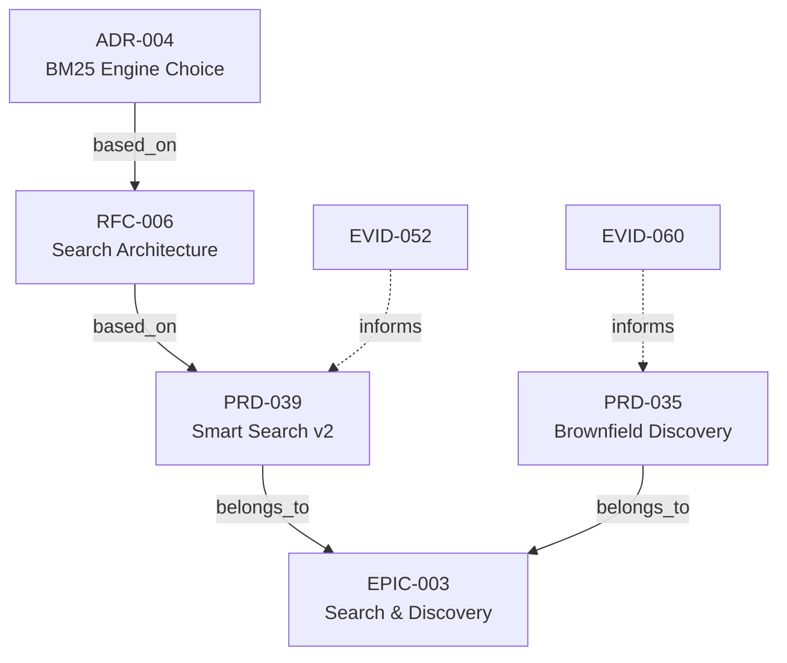

Emit a Mermaid-format dependency graph of all linked artifacts. Unlike
[`tree`](/docs/cli/tree/), which only shows parent/child hierarchy, `graph`
renders every typed link (`informs`, `supersedes`, `based_on`, `refines`, `contradicts`,
etc.) as an edge - the full decision graph; cycles are possible.

## Forgeplan 0.38.0

`--brownfield-only` narrows Mermaid rendering to brownfield artifacts. In 0.38.0 JSON, the flag is echoed as brownfield_only but edges remain the full unfiltered list. There is no nodes array. Text output also includes a non-Mermaid `Next:` line; file examples below remove it. There is no positional artifact ID: inspect one artifact’s links with `get`.

## When to use

- Paste into a GitHub issue/PR to visualize a proposal's impact
- Embed in an RFC or Epic to show scope
- Feed into `mmdc` (mermaid-cli) to render PNG/SVG
- Detect unexpected cycles or orphan clusters

## Not to use when

- You just need parent/child decomposition → use [`forgeplan tree`](/docs/cli/tree/)
- You need execution order → use [`forgeplan order`](/docs/cli/order/)
- You need a flat list → use [`forgeplan list`](/docs/cli/list/)

## Usage

```text
forgeplan graph [OPTIONS]
```

## Options

```text
      --json             Output as JSON for machine consumption
      --brownfield-only  Issue #287 Phase F: filter edges to brownfield kinds only (UC / GLOS / INV / SCEN / HYP / DM). Pipeline edges (PRD / RFC / ADR / EPIC / SPEC) are dropped from output. Domain-model subgraph clusters are preserved
  -h, --help             Print help
  -V, --version          Print version
```

## Examples

Emit the Mermaid source:

```bash
forgeplan graph
```

Redirect to a file and paste into GitHub:

```bash
forgeplan graph | grep -v '^Next:' > deps.mmd
```

Render to PNG with mermaid-cli:

```bash
forgeplan graph | grep -v '^Next:' > deps.mmd && mmdc -i deps.mmd -o deps.png
```

JSON for a custom UI:

```bash
forgeplan graph --json | jq '.edges | length'
```

## Output interpretation

Standard output is Mermaid `graph TD` syntax:

```
graph TD
  EPIC_003[EPIC-003<br/>Search, Discovery]
  PRD_039[PRD-039<br/>BM25 production]
  RFC_004[RFC-004<br/>Layered search]
  EVID_018[EVID-018<br/>Benchmark]
  PRD_039 -->|belongs_to| EPIC_003
  RFC_004 -->|based_on| PRD_039
  EVID_018 -.informs.-> PRD_039
```

Conventions:

| Syntax          | Meaning                                            |
|-----------------|----------------------------------------------------|
| `A --> B` | Child A → parent B for a `belongs_to` relation |
| `A -.informs.-> B` | Typed edge from link frontmatter                |
| `A -.supersedes.-> B` | Lifecycle edge, old ID points to replacement ID       |
| Node label      | `<ID><br/><title>`                                 |

Diagrams below are illustrative; generated node IDs, styles, labels, and edges depend on the workspace. Parent edges use `belongs_to` from child to parent.

With `--json`, the envelope is `{ edges: [{from, to, relation}], brownfield_only, _next_action }` - ready for
Cytoscape, D3, or any graph library.

### Example rendered diagram



## How it fits

`graph` is the complete relational view. For different questions:

```
graph   →  all edges              (relational picture)
tree    →  parent/child only       (hierarchy)
order   →  topological walk        (execution)
blocked →  unresolved dependencies (planning)
```

## See also

- [`forgeplan tree`](/docs/cli/tree/) - hierarchy view
- [`forgeplan order`](/docs/cli/order/) - topological order
- [`forgeplan blocked`](/docs/cli/blocked/) - blocking dependencies
- [`forgeplan link`](/docs/cli/link/) - create typed edges
