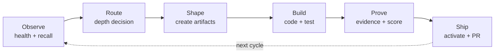

## The Full Cycle

Use this cycle to organize non-trivial work. The CLI stores, validates, and
scores artifacts; an agent host or a human performs implementation, testing,
independent review, and delivery. The public marketplace supplies optional
orchestrators, not extra phases automatically run by the CLI.

```
OBSERVE → ROUTE → SHAPE → BUILD → PROVE → SHIP
```

| Phase | What happens | Commands / integrations |
|-------|-------------|-------------------------|
| **Observe** | Understand current state | `forgeplan health`, optional Hindsight recall |
| **Route** | Suggest depth and pipeline | `forgeplan route "task"`; marketplace `/smith` selects a methodology |
| **Shape** | Fill and validate requirements; independently review planning handoffs | `forgeplan new prd "Title"`, `forgeplan update ID --body @body.md`, `forgeplan validate ID` |
| **Build** | Implement and test in the project's stack | `cargo test`, `pytest`, or the project's test command |
| **Prove** | Record actual checks and review results, link evidence, inspect score | `forgeplan new evidence "Title"`, `forgeplan link`, `forgeplan score ID` |
| **Ship** | Review/activate completion claims, commit, PR, merge | `forgeplan review ID`, `forgeplan activate ID`, Git/hosting tools |



## Phase 0: Observe

Before doing anything - understand what's happening:

```bash
forgeplan status
forgeplan session
forgeplan health
# Also read your task tracker or TODO.md.
```

Hindsight and Orchestra are separate optional integrations, not shell
commands in Forgeplan. For public `fpl-hsmem` 3.7, memory requires an explicit
project `.hindsight.json` with `url`, allowed `banks`, and `defaultBank`;
selected banks must already exist on the server. Hooks default off. Use its
MCP recall tool if configured; do not paste `memory_recall(...)` into a shell.

**Rule**: if health shows blind spots or orphans - **fix them FIRST**, before starting new work.

## Phase 1: Route

Determine the right level of rigor:

```bash
forgeplan route "add payment processing"
```

Level 0 (default) classifies keywords; `--level 1` uses a configured LLM.
Read the returned recommendation rather than assuming a fixed depth or
confidence for a phrase.

| Depth | Typical scope |
|-------|---------------|
| Tactical | Small reversible change; no artifact required, verification still required |
| Standard | PRD → RFC where needed → code → evidence |
| Deep | PRD → Spec → RFC → ADR where needed → code → evidence |
| Critical | Initiative split into Epic/PRDs/Specs/RFCs/ADRs with explicit dependencies |

**Tactical = skip to Build.** Everything else = continue to Shape.

## Phase 2: Shape

Create the right artifacts and fill them:

```bash
# Create artifact
forgeplan new prd "Payment Processing"

# Fill MUST sections: Problem, Goals, Non-Goals, Target Users, FR, Related Artifacts
# Each FR: "[Actor] can [capability]" - no tech names
# Save the complete body in payment-prd-body.md; use the returned ID:
forgeplan update PRD-001 --body @payment-prd-body.md

# Validate
forgeplan validate PRD-001
# Continue only if the actual validator reports 0 MUST errors; fix findings otherwise.
```

### ADI Reasoning (Standard+)

Before coding, examine alternatives. With a configured LLM:

```bash
forgeplan reason PRD-001 --save
```

This generates hypotheses, predictions, and a synthesis; `--save` stores a
linked Note. It does not run the predicted experiments or verify the code.
Without an LLM the command errors; a human can write an explicit ADI record
instead, without claiming an automated run.

ADI is recommended at Standard and required by this methodology at
Deep/Critical. The agent pipeline's planning reviews must pass before the
next phase; a model's confident recommendation is not that review.

## Phase 3: Build

Implement the solution:

```bash
# 1. Create branch
git checkout dev && git pull origin dev
git checkout -b feat/payment-processing

# 2. Implement against requirements and check behavior with tests.
# For enforced test-first work, use the TDD sub-cycle described below.

# 3. Format + lint
cargo fmt && cargo fmt -- --check   # Rust
ruff format && ruff check           # Python
pnpm exec tsc --noEmit              # TypeScript

# 4. Test
cargo test        # Rust
pytest             # Python
pnpm test          # TypeScript
```

### Audit (Standard+)

```text
/audit
```

This is a marketplace skill, not a built-in shell command. Its orchestrator
dispatches independent reviewers for the relevant risks. Keep generator and
verifier in separate contexts, fix blocking/high-severity findings, and rerun
affected checks after the fix. Review evidence must name what was actually
checked; do not invent findings or claim four agents ran when they did not.

## Phase 4: Prove

Create evidence that the solution works:

```bash
forgeplan new evidence "Payment processing verification"
# Save actual results plus the structured fields in payment-evidence.md.
forgeplan update EVID-001 --body @payment-evidence.md
forgeplan link EVID-001 PRD-001 --relation informs
forgeplan score PRD-001
```

Use the IDs returned by `new`; examples assume fresh counters. A supporting
test pack might declare:

```text
verdict: supports
congruence_level: 3
evidence_type: test
```

Use those values only when the observed result supports them. Record commands,
outcomes, context, limits, and verifier identity. For code-change claims,
include actual `base_sha`, `result_sha`, and `changed_paths`; the provenance
gate checks the Git delta, not test correctness, and defaults to `warn`.

:::caution
Missing/unknown verdict or missing congruence declaration fails closed to CL0. A fresh supporting test/measurement pack at CL0 scores 0.1; recursive scoring also deducts 0.1 for benchmark or 0.2 for audit, so those CL0 packs score 0. Expired eligible evidence instead scores 0.1 before verdict/CL/type deductions. CLI `score` takes the minimum of own current evidence and eligible dependency scores after relation penalties. Terminal evidence is excluded; draft evidence still counts. A positive R_eff is not independent proof that a feature works.
:::

## Phase 5: Ship

After actual verification of the completion claim, activate explicitly.
Planning artifacts may already be active because an earlier independent
review froze the inputs for Build; that does not mean implementation shipped.

```bash
# 1. Review + activate
forgeplan activate EVID-001
forgeplan review PRD-001
# Run the next line only if this PRD is still draft; do not reactivate an active plan.
forgeplan activate PRD-001

# 2. Push + PR
git push origin feat/payment-processing
gh pr create --base dev --title "[PRD-001] Payment Processing"

# 3. After merge - sync
git checkout dev && git pull origin dev

# 4. Optionally retain a concise decision/lesson through configured Hindsight MCP.
# Do not use memory_retain(...) as a shell command or copy an invented score.

# 5. Update progress
# - RFC checkboxes: [x]
# - TODO.md: move to Done
```

## Pipeline Types

### Greenfield (new module from scratch)

The public `agents-bmad` plugin is for a **brand-new product or service**,
not any feature that happens to add a new module:

```text
/bmad-init
/bmad <greenfield brief>
```

The walk is Analyst → PM → Architect → Scrum-Master → Dev → QA, with independent
PRD, architecture/RFC, and implementation-readiness gates before code. Run
`/bmad-init` once to configure file classification and enable the blocking
write hook; without its stack configuration the BMAD gate is dormant.

### Brownfield (existing code)

```
Explore → Identify → {
  feature:   PRD → RFC → Build
  bug:       Problem → Fix
  refactor:  Audit → Problem → RFC → Build
  migration: Research → ADR → RFC → Build
}
```

Start with **Explore**. Legacy modernization routes through `/smith` to
Strangler Fig + DDD. A single feature in an existing active system uses
`agents-sparc` instead:

```text
/sparc <one well-scoped feature>
```

SPARC walks Specification → Pseudocode → Architecture → Refinement →
Completion. The main session executes the walk, dispatches phase agents and
independent reviewers, and explicitly activates reviewed artifacts between
phases. It has **no dedicated blocking hook** and no `/sparc-init`; enforcement
is phase ordering. Pseudocode is reviewed at the Architecture gate rather than
frozen as production logic. MICRO scope can omit Pseudocode, not independent
code review.

### TDD inside Build

`agents-tdd` owns plan → RED → independent test validation/freeze → GREEN →
lint, then hands off to the separate code Audit stage.

```text
/tdd-init
/tdd
```

Run `/tdd-init` before the first cycle (and after stack changes). Entry requires
an **active PRD and active SPEC with `#### Scenario` blocks**. A separate
`tdd-test-validator` certifies valid RED: tests compile, execute an assertion,
and fail on that assertion, not on setup/import errors. Only then is the
normalized SPEC hash frozen and GREEN unlocked. The active hook blocks test
edits and SPEC drift during GREEN; missing branch state means TDD is not active,
not that the branch is protected. SPARC Refinement can delegate here when test
immutability matters.

In each pipeline, **generator ≠ verifier**: phase agents produce, independent
contexts review, and the main orchestrator handles activation. Evidence must
carry the review verdict and identity; its mere presence is not a PASS.

### Mixed

Choose by the **task**, not the repository label:

- A brand-new product/service can use BMAD.
- A feature in an active system can use SPARC, even if it adds a new module.
- Legacy modernization starts with exploration and a Strangler-style plan.
- TDD is a Build sub-cycle, not a replacement for product/architecture planning.

The CLI's `phase`/`phase-advance` markers are advisory. They neither enforce
this order nor install the marketplace hooks; claims are coordination signals,
not file-write enforcement.

## Forge-Cycle Command

`/forge-cycle` comes from the public `forgeplan-workflow` plugin. Install it
in a compatible host; CLI installation alone does not provide this command.
Other public packs (`fpl-skills`, `agents-bmad`, `agents-sparc`, `agents-tdd`,
and the relevant specialist agents) supply their own skills and contracts.

```text
/plugin marketplace add ForgePlan/marketplace
/plugin install forgeplan-workflow@ForgePlan-marketplace
/forge-cycle PRD-001
```

The loaded template guides the orchestrator through health/routing, shape,
planning, build, independent audit, fixes, evidence, activation, and delivery.
Tokens such as `/sprint`, `/team-up`, and `/audit` in the template are
**semantic markers**, not automatically chained slash commands. The main
session performs equivalent dispatches and tool calls. Availability, host
permissions, approval gates, and project configuration determine what can run;
do not describe this as unattended automatic execution.

## Scope Lock

| Session type | Do | Don't |
|-------------|-----|-------|
| **Tactical** (concrete task) | Code, test, commit | Don't drift into planning |
| **Strategic** (research, planning) | Research, create artifacts | Don't start coding |

If you notice scope drift → bookmark progress → start a new session of the right type.

## Checklist: Is the Work Done?

- [ ] Artifact filled (MUST sections)
- [ ] Validation PASS
- [ ] ADI recorded (recommended at Standard, required at Deep/Critical)
- [ ] Code implemented
- [ ] Tests pass
- [ ] Format + lint clean
- [ ] Audit: 0 HIGH/CRITICAL
- [ ] Real evidence records checks, limits, verifier identity, and structured fields
- [ ] R_eff inspected against the claim, not treated as a code verifier
- [ ] Required handoffs and completion claim explicitly reviewed and activated
- [ ] PR created and merged
- [ ] Progress updated (RFC checkboxes, TODO.md)
- [ ] Memory retained (if significant)
