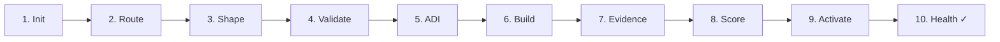

This is the long version of the [Quick Start](/docs/getting-started/quick-start/).
It covers the same workflow with more explanation and recovery examples.
Commands, IDs, confidence values, test counts, timings and output below are
illustrative, not a captured run.

Reading the example can take about 20 minutes; implementing and verifying
the feature is separate work. Without that work, leave the exercise draft
and do not publish the sample evidence or activate a fictional result.

## What you will build

A PRD for a small, real feature: **"Add a `--dry-run` flag to `forgeplan
new` so users can preview what would be created without writing files."**

This is a proposed feature for the exercise. The selected local build's
`new` command does **not** implement `--dry-run`; later smoke commands are
acceptance examples for an implementation, not commands that work today.

It is intentionally small - routing will probably say `Standard`, which
means we hit every step except the Epic/Spec tiers. Perfect training load.



## Prerequisites

- Forgeplan installed (`forgeplan --version`)
- A directory where you can create a workspace (throwaway is fine)
- A configured LLM provider to execute `reason`; HTTP providers use an environment
  key, while supported local CLI providers reuse their own login.

For recorded compatibility coverage and remaining limits, see
[Constellation](/docs/reference/constellation/). This tutorial is not proof
that every lifecycle command works on every workspace layout.

## Step 1 - Initialize the workspace

```bash
mkdir ~/forgeplan-tutorial && cd ~/forgeplan-tutorial
forgeplan init -y
```

You should see:

```
Initialized .forgeplan/ workspace at /Users/you/forgeplan-tutorial/.forgeplan
  Created: prds/, rfcs/, adrs/, evidence/, notes/, problems/, ...
  Created: config.yaml
Ready.
```

Confirm:

```bash
forgeplan health
```

```
Project Health
  Total artifacts: 0
  Blind spots: 0
  Orphans: 0
  Stale: 0
  Status: OK - empty workspace
```

### Error you might hit

`init -y` returns without changing a workspace it finds, including in an
ancestor directory. Check the reported root. Use a different empty directory
for an isolated exercise; do not delete `.forgeplan/` to restart a tutorial.
If a clone needs config repair, follow [Configuration](/docs/getting-started/configuration/).

## Step 2 - Route the task

```bash
forgeplan route "add --dry-run flag to forgeplan new for preview"
```

Expected output:

```
Task: add --dry-run flag to forgeplan new for preview
Depth: Standard
Pipeline: PRD → RFC
Confidence: 82%
Signals:
  + new feature (not a fix)
  + CLI UX surface change
  + multiple possible implementations
Recommendation:
  1. forgeplan new prd "CLI dry-run flag"
  2. Fill MUST sections (Problem, Goals, FR)
  3. forgeplan reason PRD-XXX  (recommended at Standard)
```

If the router says `Tactical`, override and treat it as Standard anyway -
we want to practice the full cycle. See
[Routing & Depth](/docs/methodology/routing/) for the decision tree.

## Step 3 - Shape: create the PRD

```bash
forgeplan new prd "CLI dry-run flag"
```

```
Created: PRD-001 at .forgeplan/prds/PRD-001-cli-dry-run-flag.md
```

Read the created template, then prepare the completed body in `prd-body.md`
outside `.forgeplan/`. Keep the template's required headings:

```markdown
# PRD-001: CLI dry-run flag

## Problem

Users who run `forgeplan new prd "..."` on a shared workspace cannot
preview what files would be created before committing. Mistakes
(wrong title, wrong ID collision) require manual cleanup.

## Goals

- G1: User can see the full file path and content of what `new` would
  create without the files being written to disk
- G2: `--dry-run` output is suitable for piping into review tools
- G3: No change to behavior when the flag is absent

## Non-Goals

- Not a full "simulation mode" - only covers the `new` command
- Not a rollback mechanism - files that were created without `--dry-run`
  stay created

## Target Users

CLI users creating artifacts in shared or production workspaces, and AI
agents that want to preview their output before committing.

## Functional Requirements

- FR1: User can pass `--dry-run` to `forgeplan new <kind> "title"`
- FR2: User can see the exact file path that would be created
- FR3: User can see the templated file content on stdout
- FR4: User can rely on exit code 0 when `--dry-run` would succeed
  and non-zero when validation would fail

## Related Artifacts

This standalone exercise has no parent artifact yet.
```

Apply it with `forgeplan update PRD-001 --body @prd-body.md`.

Notice: no mention of "use clap" or "emit JSON" or any specific
implementation. That is rule 3 - FRs describe capabilities, not
implementations. See [Methodology Overview](/docs/methodology/overview/).

## Step 4 - Validate

```bash
forgeplan validate PRD-001
```

Best case:

```
PRD-001: PASS ✓
  MUST: 0 errors
  SHOULD: 1 warning (density: Problem section is terse)
```

### Errors you will probably hit

**`MUST error: Problem section missing`** - you forgot a required header.
Aliases work: `## Motivation`, `## Background`, `## Problem Statement` all
count as Problem. Add one.

**Implementation-leakage finding** - technology choices in FR/NFR sections
are SHOULD at Standard and MUST at Deep. For example, "Use Redis" describes
implementation; replace it with the capability the user needs.

**Missing Functional Requirements** - the required heading is absent.
Add the section and meaningful `[Actor] can [capability]` requirements;
the heading-existence check alone does not certify the bullets' quality.

**Unmeasurable language** - measurability/adversarial checks may warn about
vague prose. Replace it with testable outcomes; not every such warning is MUST.

Re-run `forgeplan validate PRD-001` after each fix.

## Step 5 - Reason (ADI)

```bash
forgeplan reason PRD-001 --save
```

With a configured provider (and the provider's required credentials), the
LLM is prompted to compare alternatives. An illustrative analysis is:

```
ADI cycle for PRD-001
─────────────────────
Abduction - 3 hypotheses:
  H1: Single --dry-run flag that short-circuits file write
  H2: Separate `forgeplan preview new` command
  H3: Interactive confirmation prompt (y/n before write)

Deduction - predictions per hypothesis:
  H1:
    - Minimal code change, 1 branch in `new` command
    - Reusable: same flag can extend to other write commands
    - No new command surface to document
  H2:
    - Discoverable via `forgeplan --help`
    - Duplicates template rendering logic (or extracts it)
    - Doubles the surface area users must learn
  H3:
    - Forces interactivity, breaks AI-agent usage
    - No way to see output before committing
    - Violates `-y` non-interactive contract

Induction - evidence check:
  H1: supports - aligns with existing flag patterns (e.g. `init -y`)
  H2: weakens - duplication + discoverability win does not offset cost
  H3: refutes - breaks AI agent workflow (see MUST in CLAUDE.md)

Recommendation: H1
Confidence: 0.87
```

Without a configured provider, the CLI returns an error, not a blank
reasoning template. You may write a manual analysis into `prd-body.md`
and apply it with `update`; that is your reasoning, not a successful CLI run.
`--save` stores successful CLI output in a linked Note; without it, output
is printed only. Three alternatives are a prompting heuristic, not proof
of confidence or a parser-enforced minimum.

See [ADI Reasoning](/docs/methodology/adi/) for why this step exists.

### Error

**Missing LLM configuration** - configure a supported provider and its
authentication. HTTP API keys belong in the environment/secrets file named
by `llm.api_key_env`, not inline in `config.yaml`. Or record manual ADI as
described above without claiming that the command ran.

## Step 6 - Build

Implement the chosen approach and write its tests before recording a
successful result. If you only want to practise shaping, stop at draft here.
For a real implementation, run the project's checks, for example:

```bash
cargo test      # or npm test, pytest, go test, ...
cargo fmt
cargo check     # 0 warnings, 0 errors
```

All three must pass before you create evidence claiming they do. If
`cargo check` has warnings, fix them - Forgeplan's own CLAUDE.md rule
is "0 warnings, 0 errors" on every commit.

## Step 7 - Prove: create Evidence

```bash
forgeplan new evidence "CLI dry-run - 8 unit tests pass, flag works end-to-end"
```

```
Created: EVID-001 at .forgeplan/evidence/EVID-001-cli-dry-run....md
```

Prepare `evidence-body.md` outside `.forgeplan/` with actual results.
The following is a sample shape, **not evidence of a run**. Use CL3 only
for matching context; code claims also need real provenance required by the gate:

```markdown
## Structured Fields

verdict: supports
congruence_level: 3
evidence_type: test

## Details

- 8 unit tests pass in `tests/cli_dry_run.rs`
- Manual smoke test: `forgeplan new prd "Test" --dry-run` prints template
  without creating the file
- Verified exit code 0 on success and 1 on template error
```

Only after replacing the sample claims with verified results, apply and link:

```bash
forgeplan update EVID-001 --body @evidence-body.md
forgeplan link EVID-001 PRD-001 --relation informs
```

### The #1 mistake

**Forgetting structured claims.** Missing or unrecognised verdict/CL
declarations fail closed to CL0 with a 0.9 penalty. `evidence_type` has a
separate scoring role; declare all three fields. Correct fields describe
evidence — they do not turn an unrun test into evidence.

## Step 8 - Check the score

```bash
forgeplan score PRD-001
```

Expected:

```
PRD-001: CLI dry-run flag
  R_eff = 1.00 - Adequate
  Evidence:
    EVID-001: supports, CL3, test → score 1.0
```

### What if R_eff = 0.0?

1. `forgeplan list --type evidence` - is EVID-001 in the workspace?
2. `cat .forgeplan/evidence/EVID-001-*.md | grep -E "verdict|congruence_level|evidence_type"`
   - all three fields present?
3. `forgeplan link EVID-001 PRD-001 --relation informs` - was the link created?
4. Read the score breakdown for refutation, CL/type penalties and dependency
   contributions. Missing structured claims commonly give 0.1, not zero.

See [Evidence & R_eff](/docs/methodology/evidence/) for the full formula.

## Step 9 - Activate

```bash
forgeplan review PRD-001
```

```
Reviewing PRD-001...
  Validation: PASS ✓
  Evidence: 1 linked (R_eff = 1.00)
  Status: ready to activate
```

```bash
forgeplan activate PRD-001
```

```
PRD-001: draft → active
  Validation gate: PASS
  R_eff preserved: 1.00
```

If the validation gate fails here, the transition is rejected. The most
common cause is that you edited the PRD after step 4 and introduced a
MUST violation. Re-run `forgeplan validate PRD-001` and fix it.

## Step 10 - Verify

```bash
forgeplan health
```

```
Project Health
  Total artifacts: 3 (PRD-001, EVID-001, saved ADI Note)
  Active: 1
  Draft: 2 (Evidence and Note in this example; evidence need not always stay draft)
  Blind spots: 0
  Orphans: 0
  Stale: 0
  Status: HEALTHY
```

With actual implementation and verified evidence, this closes a traced
decision. Merely reading or copying the worked example does not.

## What you learned

- **Route first.** You did not start coding immediately; you asked
  Forgeplan what depth the task needed.
- **Shape before code.** The PRD captured the `why` and `what` before a
  single line of implementation.
- **Validate early.** The validator caught implementation leakage and
  missing sections before they became habits.
- **Reason with ADI.** You generated alternatives before committing to
  one, which is how you avoid "I wish we had thought of that" moments.
- **Prove with evidence.** R_eff is not a decoration - it is the number
  that tells you whether you should trust your own decision.
- **Activate only when ready.** Gates check declared content, links and
  provenance where configured; they do not establish that code really works.
  Real verification remains necessary before activation.

## Next steps

- Run the full cycle on a real task in your main project
- Read [Methodology Overview](/docs/methodology/overview/) for the 10 rules
- Explore [CLI Reference](/docs/cli/) - every command is documented
- Dive into [Artifact Lifecycle](/docs/methodology/lifecycle/) to learn
  `supersede`, `deprecate`, `renew`, and `reopen`
- Check [Configuration](/docs/getting-started/configuration/) to set up
  an LLM provider for smarter routing and ADI

## Troubleshooting cheat sheet

| Symptom | Cause | Fix |
|---------|-------|-----|
| `MUST error: Problem missing` | No `## Problem` / `## Motivation` section | Add one of the aliases |
| `implementation leakage in FR` | Named a library/tech in a requirement | Rewrite as `[Actor] can [capability]` |
| `R_eff = 0.0` on scored artifact | No eligible evidence, refutation, penalties or dependency contribution | Inspect the score breakdown and record actual supporting evidence; do not relabel contrary evidence |
| `activate` rejected | Validation gate fails after edits | Re-run `validate`, fix MUST errors |
| Missing LLM configuration on `reason` | Provider/authentication unavailable | Configure provider and its environment/login, or record manual reasoning without claiming a CLI run |
| `health` shows blind spot | Active artifact with no linked evidence | Create evidence and `forgeplan link` |
| `stale` warning on fresh artifact | `valid_until` too short | Set realistic 90-180 day expiry |
