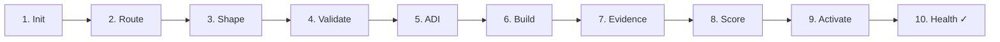

This expands the [Quick Start](/docs/getting-started/quick-start/) with a
complete PRD body, ADI alternatives, evidence fields, and activation gates.
The walkthrough uses a **hypothetical proposal**: add `--dry-run` to
`forgeplan new`. Forgeplan 0.38 does **not** provide that flag on `new`;
this is a requirements-writing exercise, not an instruction to use a shipped
feature.

You can complete Init → Shape → Validate without implementing the proposal.
Keep the PRD draft if you stop there. To continue through implementation
evidence and activation, implement and verify the feature in an appropriate
development checkout; never pretend tests passed to finish the tutorial.

## What you will build

A PRD describing a preview capability, then—only after real work—an evidence
record supporting the claim you actually checked. Standard depth is chosen
for this exercise; router output can differ.



## Prerequisites

- Forgeplan 0.38 installed (`forgeplan --version`).
- A new directory for a disposable workspace.
- For `reason`: a configured LLM provider; HTTP providers use the environment
  variable named by `llm.api_key_env`. Local CLI providers are explicit opt-ins
  using an existing login. See [Configuration](/docs/getting-started/configuration/).
- For implementation steps: a real source checkout and its build/test prerequisites.

## Step 1 - Initialize the workspace

```bash
mkdir ~/forgeplan-tutorial && cd ~/forgeplan-tutorial
forgeplan init -y
```

`init -y` creates `.forgeplan/` with configuration and artifact/index
directories. It does **not** download the embedding model. Inspect the
workspace rather than comparing output to a fixed transcript:

```bash
forgeplan status
forgeplan health
```

An empty workspace has no artifacts or evidence yet. Warnings about project
setup are not evidence that this proposal has been implemented.

### Error you might hit

If `init -y` reports an existing workspace, it reuses it rather than returning
the old “already exists” error. Choose a different directory if you intended
a fresh tutorial. Do not delete `.forgeplan/` to resolve this. `init --force`
is a separate operation that rewrites configuration and should not be used
merely to reset tutorial counters.

## Step 2 - Route the task

```bash
forgeplan route "add --dry-run flag to forgeplan new for preview"
```

The router returns a depth and pipeline recommendation. At default level 0
it uses keyword rules; `--level 1` requires an LLM. No fixed confidence or
exact transcript is promised for this phrase.

If the router says `Tactical`, override and treat it as Standard anyway -
we want to practice the full cycle. See
[Routing & Depth](/docs/methodology/routing/) for the decision tree.

## Step 3 - Shape: create the PRD

```bash
forgeplan new prd "CLI dry-run flag"
```

Use the ID and path printed by `new`. Examples below assume `PRD-001` in a
fresh workspace; substitute your returned ID if different. Save this complete
body as `prd-body.md` **outside** `.forgeplan/`, then apply it with `update`.
Keep the English section headings even if you write the prose in Russian:
the validator's aliases are specific heading names, not automatic translation.

```markdown
# PRD-001: CLI dry-run flag

## Problem

Users who run `forgeplan new prd "..."` on a shared workspace cannot
preview what files would be created before committing. Mistakes
(wrong title, wrong ID collision) require manual cleanup.

## Goals

- G1: User can see the full file path and content of what `new` would
  create without the files being written to disk
- G2: `--dry-run` output is suitable for piping into review tools
- G3: No change to behavior when the flag is absent

## Non-Goals

- Not a full "simulation mode" - only covers the `new` command
- Not a rollback mechanism - files that were created without `--dry-run`
  stay created

## Target Users

CLI users creating artifacts in shared or production workspaces, and AI
agents that want to preview their output before committing.

## Functional Requirements

- [ ] FR-001: User can pass `--dry-run` to `forgeplan new` for a chosen kind and title
- [ ] FR-002: User can see the exact file path that would be created
- [ ] FR-003: User can see the templated file content on stdout
- [ ] FR-004: User can distinguish a successful preview from a validation failure by exit code

## Non-Functional Requirements

The preview must leave artifact files and the index unchanged, measured by
comparing their contents before and after one preview invocation.

## Related Artifacts

None yet. This is the first proposal in a disposable tutorial workspace.
```

Apply the body through the CLI so the file and index agree:

```bash
forgeplan update PRD-001 --body @prd-body.md
```

Notice: no mention of "use clap" or "emit JSON" or any specific
implementation. FRs describe capabilities, not
implementations. See [Methodology Overview](/docs/methodology/overview/).

## Step 4 - Validate

```bash
forgeplan validate PRD-001
```

Inspect the returned findings. A missing required section blocks validation;
SHOULD and COULD findings are not MUST failures. The exact warning count
depends on depth and content.

### Errors you will probably hit

- **Missing Problem / Goals / Non-Goals / Functional Requirements / Related
  Artifacts.** Keep the supported headings. For Problem, accepted aliases
  include `Motivation`, `Background`, and `Problem Statement`.
- **Implementation leakage.** Rewrite technology choices as user capabilities.
  At Standard this rule is SHOULD; at Deep it is MUST.
- **No FR items / format finding.** Use checkboxes such as
  `- [ ] FR-001: User can preview the file path`. The FR-format check is COULD
  in 0.38, not a MUST error.
- **Vague goals.** Replace subjective claims with measurable criteria.
  The general adversarial-vague finding is SHOULD, not a fabricated MUST.

Re-run `forgeplan validate PRD-001` after each fix.

## Step 5 - Reason (ADI)

```bash
forgeplan reason PRD-001
```

With a configured LLM, output might resemble the following **illustrative**
analysis, not a recorded run or guaranteed recommendation:

```
ADI cycle for PRD-001
─────────────────────
Abduction - 3 hypotheses:
  H1: Single --dry-run flag that short-circuits file write
  H2: Separate `forgeplan preview new` command
  H3: Interactive confirmation prompt (y/n before write)

Deduction - predictions per hypothesis:
  H1:
    - Minimal code change, 1 branch in `new` command
    - Reusable: same flag can extend to other write commands
    - No new command surface to document
  H2:
    - Discoverable via `forgeplan --help`
    - Duplicates template rendering logic (or extracts it)
    - Doubles the surface area users must learn
  H3:
    - Forces interactivity, breaks AI-agent usage
    - No way to see output before committing
    - Violates `-y` non-interactive contract

Induction - evidence check:
  H1: supports - aligns with existing flag patterns (e.g. `init -y`)
  H2: weakens - duplication + discoverability win does not offset cost
  H3: refutes - breaks AI agent workflow (see MUST in CLAUDE.md)

Recommendation: H1
Confidence: 0.87
```

Without an LLM, `reason` returns an error; it does not create a template.
You may instead write a clearly attributed manual `## Reasoning` section
in `prd-body.md` and reapply it through `update`. The hypotheses are proposals,
not measurements or independent verification.

See [ADI Reasoning](/docs/methodology/adi/) for why this step exists.

### Error

**`LLM not configured`** — configure a supported provider using the
configuration guide, or keep a manual ADI record. Do not add a secret API key
to an artifact or commit it to project configuration.

## Step 6 - Build

Implement the proposal in the real development repository and test its
acceptance criteria. If you are only learning the artifact CLI, stop here
with a validated **draft**; there is no implementation evidence to record.

For a Rust project, choose the actual project checks, for example:

```bash
cargo test
cargo fmt -- --check
cargo check
```

Record what you really ran and observed, including failures and limits.
Independent review must use a different context from the author. A new
EvidencePack or positive score cannot substitute for those checks.

## Step 7 - Prove: create Evidence

```bash
forgeplan new evidence "CLI preview verification"
```

Use the returned evidence ID (assumed `EVID-001` below). Prepare the complete
body as `evidence-body.md` outside `.forgeplan/`. The following fields are
an example **only for an observed supporting same-context test result**:

```markdown
## Structured Fields

verdict: supports
congruence_level: 3
evidence_type: test

## Details

Record the actual command, source revision, result, checked requirements,
reviewer identity, and limitations. Do not copy an invented test count.
For a code-change claim, include the actual base_sha, result_sha, and
changed_paths so the Git-delta provenance gate can check the claimed change.
```

Do not run a `new --dry-run` smoke check against unmodified 0.38: that flag
is not shipped. Test it only in the checkout where you actually implement it.

```bash
forgeplan update EVID-001 --body @evidence-body.md
```

Link it to the PRD:

```bash
forgeplan link EVID-001 PRD-001 --relation informs
```

### The #1 mistake

**Treating prose or field presence as proof.** Declare `verdict`,
`congruence_level`, and `evidence_type` with values justified by actual
observations. Missing/unknown verdict or absent congruence declaration yields
CL0. A fresh supporting test/measurement pack then scores 0.1; recursive
scoring subtracts another 0.1 for benchmark or 0.2 for audit, yielding 0 at
CL0 for those types. Expired eligible packs instead score 0.1 before these
deductions. Missing type defaults to measurement, not an automatic zero.
The parser does not independently validate the test run.

## Step 8 - Check the score

```bash
forgeplan score PRD-001
```

Inspect the breakdown rather than expecting a fixed transcript or score.
One fresh supporting CL3 test/measurement pack can score 1.0; benchmark and
audit receive type deductions of 0.1 and 0.2. CLI scoring recursively takes
the minimum of own evidence and eligible dependency scores after relation
penalties. Draft evidence counts; terminal packs are excluded. No eligible
own evidence gives an own score of 0.

### What if R_eff = 0.0?

1. `forgeplan list --type evidence` — does your evidence exist?
2. `forgeplan get EVID-001` — are the structured fields present and meaningful?
3. `forgeplan tree PRD-001` — is the evidence linked to this decision?
4. Check for a current `refutes` verdict, lower CL, expiry, or dependencies.
   Do not blindly add a duplicate link or upgrade evidence just to raise a score.

See [Evidence & R_eff](/docs/methodology/evidence/) for the full formula.

## Step 9 - Activate

```bash
forgeplan review PRD-001
```

`review` checks content and methodology gates; it does not run tests. Once
actual evidence supports the claim and review passes:

```bash
forgeplan activate EVID-001
forgeplan activate PRD-001
```

Both transitions are explicit. No automatic activation is required for this
recipe. A draft EvidencePack can participate in scoring before activation;
it is not required to remain draft forever.

If the validation gate fails here, the transition is rejected. The most
common cause is that you edited the PRD after step 4 and introduced a
MUST violation. Re-run `forgeplan validate PRD-001` and fix it.

## Step 10 - Verify

```bash
forgeplan health
```

Read the reported artifact counts, links, blind spots, and risks. Do not
assume a fixed HEALTHY transcript: other workspace findings may remain.
Confirm the recorded decision and evidence with:

```bash
forgeplan get PRD-001
forgeplan get EVID-001
forgeplan score PRD-001
```

If you stopped at shaping, the honest result is a validated draft, not a
completed or shipped feature.

## What you learned

- **Route first.** You did not start coding immediately; you asked
  Forgeplan what depth the task needed.
- **Shape before code.** The PRD captured the `why` and `what` before a
  single line of implementation.
- **Validate early.** The validator reports missing sections and relevant
  content findings before you use the artifact as a handoff.
- **Reason with ADI.** You generated alternatives before committing to
  one, which is how you avoid "I wish we had thought of that" moments.
- **Prove with evidence.** R_eff summarizes declared evidence; inspect its
  source, context, and limits before trusting the decision.
- **Activate only an evidenced claim.** The gates check structure and linked
  evidence, not the truth of test claims or the presence of finished code.

## Next steps

- Run the full cycle on a real task in your main project
- Read [Methodology Overview](/docs/methodology/overview/) for the 10 rules
- Explore [CLI Reference](/docs/cli/) - every command is documented
- Dive into [Artifact Lifecycle](/docs/methodology/lifecycle/) to learn
  `supersede`, `deprecate`, `renew`, and `reopen`
- Check [Configuration](/docs/getting-started/configuration/) to set up
  an LLM provider for smarter routing and ADI

## Troubleshooting cheat sheet

| Symptom | Cause | Fix |
|---------|-------|-----|
| Missing required section | Unsupported or absent heading | Keep supported headings; save through `update --body @file` |
| Implementation leakage | Technology choice in FR | Describe a capability; severity is depth-dependent |
| R_eff = 0 | No eligible evidence, refutation, or dependency result | Inspect the score breakdown and current links |
| R_eff = 0.1 | May be undeclared/CL0 or expired supporting evidence | Inspect verdict, congruence declaration, and expiry; do not inflate fields |
| `activate` rejected | Content or methodology gate failed | Read `review`; correct the claim/body/evidence rather than bypassing |
| `LLM not configured` on `reason` | No configured provider | Configure it or explicitly record manual ADI |
| `new --dry-run` rejected | Not a shipped 0.38 flag | Treat it as the tutorial proposal, not an available command |
| Expiry warning | `valid_until` passed | Reassess the decision; see the lifecycle guide before renewing |
