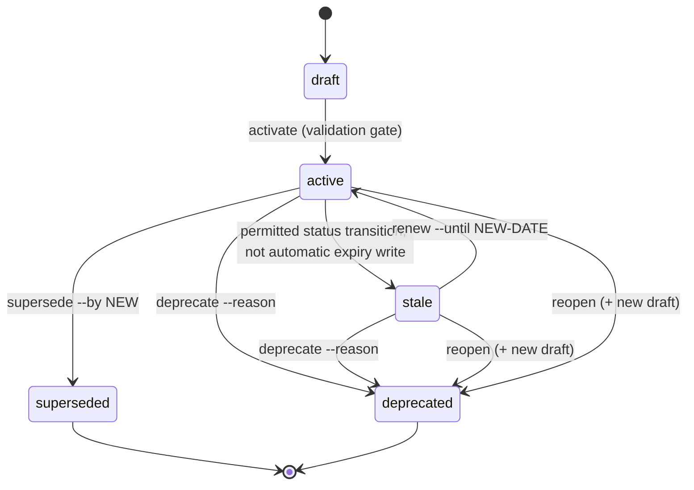

Forgeplan artifacts are not just files - they are **decisions with a lifetime**.
A PRD that was correct six months ago may be wrong today. An ADR that
captured your architecture may be superseded by a better one. Evidence that
justified a choice may expire as the world changes.

Lifecycle v2 was proposed in [ADR-005](#related) against the v0.12-era
baseline. This guide distinguishes that design from current implementation:

1. **Is this artifact still in force?**
2. **If it's gone, what replaced it?**
3. **If it's stale, should we renew it or reopen the decision?**

This guide explains the lifecycle model and four illustrative flows.
They are not recorded production transcripts.

## Why a lifecycle, not just `draft` / `active`?

Early versions of Forgeplan had only two states. That was enough to ship a
PRD, but it was not enough to answer "what happened to PRD-014?" six months
later. You need to distinguish:

- A PRD that was **replaced** by a better one (`superseded`, with a pointer).
- A PRD that was **abandoned** for a reason (`deprecated`, with a reason).
- A PRD that **expired** but may still be correct (`stale`, needs review).
- A PRD that was stale and got **renewed** vs. **re-evaluated from scratch**.

Without those distinctions you end up with a graveyard of "old" artifacts
and no idea which ones are still load-bearing. Lifecycle v2 fixes that.

## State machine



Transitions in plain text:

```
draft → active → superseded   (terminal)
               → deprecated   (terminal)
               → stale → active                 (renew)
                       → deprecated             (deprecate)
                       → deprecated + NEW draft (reopen, lineage)
```

## Each state explained

### `draft`

The initial state of every artifact. `forgeplan new prd "..."` creates a
draft from a template. Drafts can be freely edited.

- **Notes and Problems**: no validation gate - you can activate immediately.
- **PRD, RFC, ADR, Epic, Spec**: MUST rules from the validator must pass
  before activation. Run `forgeplan validate PRD-001` to check.

To move forward:

```bash
forgeplan review PRD-001      # dry-run: is it ready?
forgeplan activate PRD-001    # draft → active
```

### `active`

The artifact is in force. Other artifacts can link to it, `forgeplan health`
counts it as a live decision, and `forgeplan score` computes its R_eff based
on linked evidence.

An active artifact can be superseded, deprecated or reopened into a new draft.
The model also permits `active → stale`, but passing `valid_until` does not
itself persist that transition.

### `superseded` - terminal

The artifact was replaced by a more recent one. You **must** point to the
replacement:

```bash
forgeplan supersede ADR-003 --by ADR-007
```

The old artifact keeps all its history and links, but it's no longer in
force. `forgeplan health` will not flag it as missing evidence - it's done.

### `deprecated` - terminal

The artifact is no longer applicable, and there is no single replacement.
You must give a reason:

```bash
forgeplan deprecate PRD-014 --reason "Feature cut from v1 scope"
```

Use `deprecate` when the decision is retired entirely (e.g. a feature is
cancelled), not when it is replaced by another artifact (use `supersede`
for that).

### `stale`

When `valid_until` passes, expiry detection reports the artifact as overdue
without rewriting its persisted status. An expired file may still say
`status: active`; reading or scoring does not automatically change it to
`stale`. It remains available for reading and linking.

The model permits `active → stale`, but detection is not that mutation.
Inspect the stored status before choosing a lifecycle command.

From `stale` you have three options: `renew`, `deprecate`, or `reopen`.

### `renew` - stale back to active

Use `renew` when the decision is still correct and you just want to extend
its validity window:

```bash
forgeplan renew PRD-005 \
  --reason "Re-validated after Q2 review, still matches product direction" \
  --until 2026-10-01
```

Renewal appends a reason, updates `valid_until` and writes `active`, keeping
the same ID and links. It does not perform a new measurement for you.

The stored-status guard matters: an overdue artifact still stored as
`active` cannot renew through `active → active`. The generic guard also
admits `draft → active`; that is not a reason to use renewal as a substitute
for the normal activation workflow. No automatic expiry-to-status repair
is established by these commands.

### `reopen` - stale/active to a new draft (lineage)

Use `reopen` when the old decision needs to be **re-made from scratch**.
Forgeplan creates a **new draft** linked `based_on` the old artifact,
then deprecates the original. The old content remains historical:

```bash
forgeplan reopen PRD-005 \
  --reason "Underlying assumptions changed after PROB-021 findings"
```

This creates a new draft with lineage while preserving the old decision's
audit trail. The new draft starts with no `valid_until` date; choose and
record an appropriate review date rather than assuming one was generated.

## Why `superseded` and `deprecated` are terminal

Both states are terminal in the **ordinary lifecycle**: there is no normal
status transition back to active. Re-evaluating a decision calls for a new
artifact with explicit lineage.

Operational recovery is different. [`forgeplan restore`](/docs/cli/restore/)
or `forgeplan undo-last` can reverse a recorded delete, supersede or deprecate
using its unconsumed soft-delete receipt. This repairs an accidental
operation; it is not a generic status update or a way to revive any terminal
artifact without a receipt.

This is a deliberate design choice:

- **Auditability.** If a deprecated ADR could silently become active again,
  every linked decision would need to be re-verified. Terminal states mean
  "this decision has left the graph."
- **Lineage.** `reopen` already covers "re-evaluate this decision" - it
  creates a new draft as a clear continuation. Resurrecting the old
  artifact would erase the history of the break.
- **Trust.** When you read a `superseded` PRD, you know exactly what
  happened: it was replaced by the artifact in `--by`. No ambiguity.

Do not use a terminal status as a pause switch. `stale` represents expired
validity and calls for review, not an arbitrary paused state.

## Practical flows

### Flow 1 - Normal PRD lifecycle

The happy path for any Standard+ depth task:

These are illustrative lifecycle commands, not a transcript or proof of
runtime coverage for every tool. See [Constellation](/docs/guides/constellation/)
for recorded compatibility coverage and remaining limits.

```bash
# 1. Shape
forgeplan new prd "Auth System"
# prepare prd-body.md outside .forgeplan/ and fill all MUST sections
forgeplan update PRD-018 --body @prd-body.md

# 2. Validate
forgeplan validate PRD-018
# → PASS (0 MUST errors)

# 3. Implement, verify, then add actual evidence
forgeplan new evidence "Integration tests for auth middleware"
# prepare evidence-body.md with actual results, structured fields and required provenance
forgeplan update EVID-042 --body @evidence-body.md
forgeplan link EVID-042 PRD-018 --relation informs
forgeplan score PRD-018           # R_eff > 0

# 4. Review + activate only after implementation and evidence
forgeplan review PRD-018
forgeplan activate PRD-018        # draft → active
```

Example scenario: a typical feature sprint. The artifact stays `active`
while its decision remains applicable.

### Flow 2 - Replacing an ADR

In this hypothetical example, ADR-003 means "SQLite storage" and ADR-007
its replacement. These example IDs are not the project's real ADR-003
(Markdown source of truth). Capture a new storage decision without rewriting history:

```bash
# 1. Write the new ADR first
forgeplan new adr "LanceDB as primary store"
# fill context, decision, consequences; validate, implement and attach real evidence before activation
forgeplan activate ADR-007

# 2. Supersede the old one, pointing at the replacement
forgeplan supersede ADR-003 --by ADR-007
```

Now `forgeplan list --status active` hides ADR-003, and anyone reading
ADR-003 sees "superseded by ADR-007" at the top. The DAG stays consistent.

### Flow 3 - Renewing a stale PRD

A PRD from six months ago had `valid_until: 2026-04-01`. It's now April 11
and `forgeplan health` flags it as stale:

```bash
forgeplan health
# → Stale: PRD-012 (valid_until 2026-04-01, 10 days ago)
```

You have reviewed the unchanged scope. For this renewal example, assume the
record is already stored as `stale`; the expiry warning above alone does not
establish that precondition. An expired record still stored as `active` fails
the renewal guard:

```bash
forgeplan renew PRD-012 \
  --reason "Re-validated after Q2 planning - scope unchanged" \
  --until 2026-10-01
```

Back to `active`. The reason is recorded in the artifact history so future
readers know **why** you trusted it.

### Flow 4 - Reopening a stale decision

Same starting point: PRD-012 is stale. But this time you find that
PROB-021 uncovered a flawed assumption. The PRD is not just out of date -
it is **wrong in its current form** and needs re-thinking from scratch.

```bash
forgeplan reopen PRD-012 \
  --reason "Assumption about user concurrency invalidated by PROB-021"
```

Result:

- `PRD-012` → `deprecated` (terminal), with the reason recorded.
- `PRD-019` (new draft) is created as the lineage continuation.
- You now shape PRD-019 from scratch, validate, review, activate.

The audit trail is: PRD-012 existed, became stale, was reopened with a
specific reason, and was succeeded by PRD-019. Every reader can reconstruct
that story months later.

## Anti-patterns

Things to avoid - each one breaks an assumption the rest of Forgeplan
makes about the artifact graph.

- **Activating without evidence.** For lifecycle-managed decision kinds,
  the ordinary activation path checks an evidence-link gate as well as
  length, stub and MUST-validation gates. Caller-level provenance policy
  can add checks. A link is not proof that the implementation was tested:
  record actual evidence and inspect the score before trusting the decision.
- **Superseding without `--by`.** The CLI requires `--by` for a reason:
  an orphaned `superseded` status hides **which** artifact took over. Use
  `deprecate --reason "..."` if there is no single replacement.
- **Reopening an active artifact lightly.** Reopen is for changed assumptions.
  Review an unchanged decision rather than recreating it. `renew` uses a
  stored-status transition guard; expiry detection alone does not make an
  active record renewable.
- **Deleting instead of superseding.** Deleting a file loses the history,
  the links, and the audit trail. Always transition through the lifecycle.
  Files are the source of truth (see [ADR-003](#related)), but the state
  transitions are what make them trustworthy over time.
- **Rewriting terminal history.** Preserve a displaced artifact's historical
  content; put a new decision in a linked draft. This is an audit discipline,
  not a claim that activation makes the Markdown technically immutable.
- **Skipping self-link checks.** PROB-019 (self-link guard) was added to
  block `forgeplan link X X` and similar cycles. Don't work around the
  guard - fix the link direction instead.

## DerivedStatus - computed display category

Alongside the stored lifecycle state, an artifact has a **DerivedStatus**
computed from lifecycle, validation and evidence:

```
STUB → SHAPED → VALIDATED → EVIDENCED → ACTIVATED
```

These are the current product's computed display categories, not the
Quint-code `UNDERFRAMED`/`FRAMED`/`EXPLORING`/`COMPARED`/`DECIDED`/`APPLIED`
vocabulary and not extra persisted statuses.

- `STUB` / `SHAPED` use content-heading heuristics.
- `VALIDATED` reflects the supplied validation result.
- `EVIDENCED` needs linked evidence and positive R_eff.
- Stored `active`, `superseded` or `deprecated` maps to `ACTIVATED` first,
  even when evidence is poor. A draft with positive evidence can be `EVIDENCED`.

The display category therefore does not independently certify trust.
Read lifecycle, validation and the evidence breakdown together.

## Related

- **[ADR-005](https://github.com/ForgePlan/forgeplan/blob/c852f40c515085d328f02e4b275edda37279a610/.forgeplan/adrs/ADR-005-lifecycle-v2-stale-status-renew-reopen-terminal-deprecated.md)** - the historical lifecycle-v2 design.
- **[ADR-003](https://github.com/ForgePlan/forgeplan/blob/c852f40c515085d328f02e4b275edda37279a610/.forgeplan/adrs/ADR-003-markdown-files-as-source-of-truth-lancedb-as-index-layer.md)** - Markdown is canonical; LanceDB is derived.
- **PROB-019** - self-link guard, added while hardening the lifecycle transitions.
- **PR #85** - Sprint 1 lifecycle cleanup: canonical transitions and terminal enforcement.

## See also

- [`forgeplan activate`](/docs/cli/activate/) - draft → active (with validation gate)
- [`forgeplan supersede`](/docs/cli/supersede/) - active → superseded, requires `--by`
- [`forgeplan deprecate`](/docs/cli/deprecate/) - active/stale → deprecated, requires `--reason`
- [`forgeplan renew`](/docs/cli/renew/) - stale → active, extends `valid_until`
- [`forgeplan reopen`](/docs/cli/reopen/) - stale/active → deprecated + new draft (lineage)
