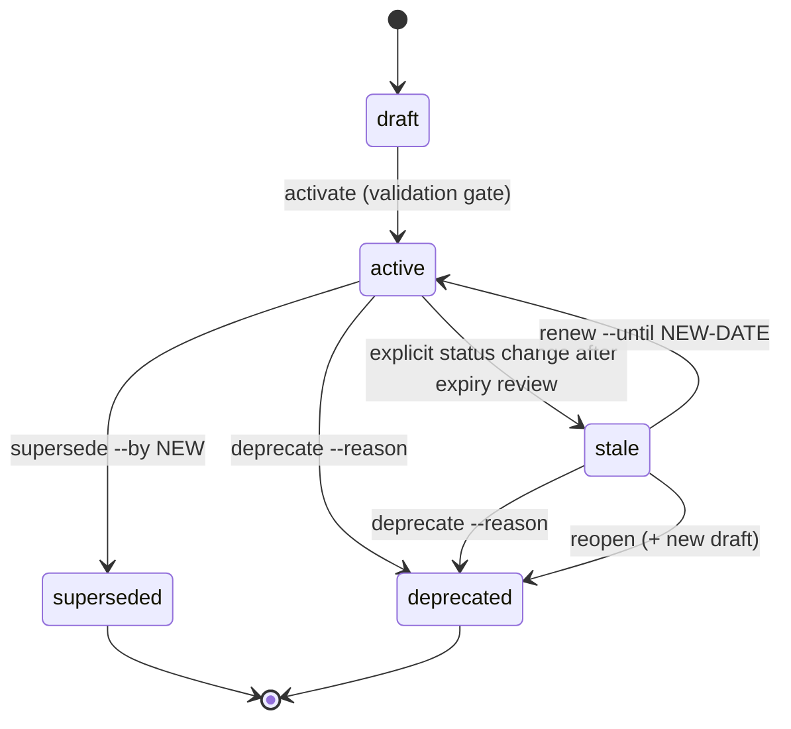

Forgeplan artifacts are files, but they carry **decisions with a lifetime**.
A PRD that was correct six months ago may be wrong today. An ADR that
captured your architecture may be superseded by a better one. Evidence that
justified a choice may expire as the world changes.

Lifecycle v2 (shipped in v0.12 as [ADR-005](#related)) gives every artifact
a well-defined state machine so you can answer three questions at any time:

1. **Is this artifact still in force?**
2. **If it's gone, what replaced it?**
3. **If it's stale, should we renew it or reopen the decision?**

This guide walks through the full state machine, explains terminal states,
and shows four practical flows from real Forgeplan usage.

## Why a lifecycle beyond `draft` / `active`

Early versions of Forgeplan had only two states. That was enough to ship a
PRD, but it was not enough to answer "what happened to PRD-014?" six months
later. You need to distinguish:

- A PRD that was **replaced** by a better one (`superseded`, with a pointer).
- A PRD that was **abandoned** for a reason (`deprecated`, with a reason).
- A PRD that **expired** but may still be correct (`stale`, needs review).
- A PRD that was stale and got **renewed** vs. **re-evaluated from scratch**.

Without those distinctions you end up with a graveyard of "old" artifacts
and no idea which ones are still load-bearing. Lifecycle v2 fixes that.

## State machine



The diagram describes stored lifecycle states, not a background scheduler.
In 0.38, `stale`/`health` detect expired `valid_until` dates but do not
automatically rewrite `status: active` to `stale`. Check the stored status
with `forgeplan get ID` before choosing a transition.

Transitions in plain text:

```
draft → active → superseded   (terminal)
               → deprecated   (terminal)
               → stale → active                 (renew)
                       → deprecated             (deprecate)
                       → deprecated + NEW draft (reopen, lineage)
```

## Each state explained

### `draft`

The initial state of every artifact. `forgeplan new prd "..."` creates a
draft from a template. Drafts can be freely edited.

- **Notes and Problems**: no validation gate - you can activate immediately.
- **PRD, RFC, ADR, Epic, Spec**: MUST validation rules plus body-length,
  filled-template, and linked-evidence gates must pass before normal activation.
  `validate` checks content; `review` also reports methodology gates.

To move forward:

```bash
forgeplan review PRD-001      # dry-run: is it ready?
forgeplan activate PRD-001    # draft → active
```

### `active`

The artifact is in force. Other artifacts can link to it, `forgeplan health`
counts it as a live decision, and `forgeplan score` computes its R_eff based
on linked evidence.

An active artifact can be superseded, deprecated, or explicitly marked stale
after review. Expiry reports alone do not perform the last transition.

### `superseded` - terminal

The artifact was replaced by a more recent one. You **must** point to the
replacement:

```bash
forgeplan supersede ADR-003 --by ADR-007
```

The old artifact keeps all its history and links, but it's no longer in
force. `forgeplan health` will not flag it as missing evidence - it's done.

### `deprecated` - terminal

The artifact is no longer applicable, and there is no single replacement.
You must give a reason:

```bash
forgeplan deprecate PRD-014 --reason "Feature cut from v1 scope"
```

Use `deprecate` when the decision is retired entirely (e.g. a feature is
cancelled), not when it is replaced by another artifact (use `supersede`
for that).

### `stale`

An expired `valid_until` date is reported by `forgeplan stale` and
`forgeplan health`. The artifact remains readable and linkable. Expiry is
not an automatic stored-status transition in 0.38.

If a previously active decision needs the stale lifecycle, explicitly mark it
after inspecting the expiry and current status:

```bash
forgeplan get PRD-005
forgeplan update PRD-005 --status stale
```

Do not use `update --status` to bypass activation or retire evidence:
`active`, `superseded`, and `deprecated` are rejected targets. Use the
corresponding lifecycle commands instead.

From `stale` you have three options: `renew`, `deprecate`, or `reopen`.

### `renew` - stale back to active

Use `renew` when the decision is still correct and you just want to extend
its validity window:

```bash
forgeplan renew PRD-005 \
  --reason "Re-validated after Q2 review, still matches product direction" \
  --until 2027-10-01
```

The artifact returns to `active` with the same ID and links, a new
`valid_until`, and an appended Renewal section. `renew` checks stored status:
it is not an extension command for an already-`active` record merely listed
as expired. First review and mark that record stale as shown above.

:::caution[Renewal defect in 0.38]
The intended use is `stale → active` after a real review. The implementation
also accepts `draft → active` through a generic transition check, without
running `activate`'s validation, filled-template, or evidence gates. It checks
the date format but does not require a future date; `active → active` remains
rejected. This is a defect tracked in [#547](https://github.com/ForgePlan/forgeplan/issues/547),
not a supported activation workflow. **Never use `renew` to activate a draft**:
use `review`/`activate` and their gates. For renewal, review a genuinely stale
decision and choose a future date.
:::

### `reopen` - stale/active to a new draft (lineage)

Use `reopen` when the old decision needs to be **re-made from scratch**.
The original artifact moves to `deprecated` (terminal), and Forgeplan
creates a **new draft** linked as its lineage continuation:

```bash
forgeplan reopen PRD-005 \
  --reason "Underlying assumptions changed after PROB-021 findings"
```

This gives you a new draft with lineage and no inherited evidence links
(`valid_until` is unset), while preserving the earlier record. Fill its body
and establish fresh evidence before activating it.

## Why `superseded` and `deprecated` are terminal

Both states are final in the **normal transition graph**: `activate` and
`reopen` do not resurrect them. Create a fresh artifact for a new decision.

0.38 also provides receipt-based recovery of an accidental destructive operation:
`forgeplan restore ID` or `forgeplan undo-last` uses an unconsumed receipt
in `.forgeplan/trash/` (default TTL 30 days). A receipt can reverse delete,
deprecate or supersede when its identity and recovery checks allow it.
The MCP deprecate/supersede handlers capture receipts; the same-named CLI
commands do not. `undo-last` means the newest available receipt, not necessarily
the last CLI operation. Inspect which operation and artifact it will reverse.

This is bounded recovery, not normal reactivation. Verify the Markdown
frontmatter against the API afterward: [#296](https://github.com/ForgePlan/forgeplan/issues/296)
tracks a 0.38 gap where `projection_restored: true` can coexist with an old
Markdown status. A successful response alone is not proof that both agree.

The terminal-state policy has a separate purpose:

- **Auditability.** If a deprecated ADR could silently become active again,
  every linked decision would need to be re-verified. Terminal states mean
  "this decision has left the graph."
- **Lineage.** `reopen` already covers "re-evaluate this decision" - it
  creates a new draft as a clear continuation. Resurrecting the old
  artifact would erase the history of the break.
- **Trust.** When you read a `superseded` PRD, you know exactly what
  happened: it was replaced by the artifact in `--by`. No ambiguity.

Do not use a far-future date to simulate a paused state: expiry and lifecycle
status serve different purposes. Record the review result and choose a real
renewal, retirement, or reopening transition.

## Practical flows

### Flow 1 - Normal PRD lifecycle

The following IDs illustrate an existing workspace; use those returned by
`new` in your project.

```bash
# 1. Shape and validate
forgeplan new prd "Auth System"
# Prepare auth-prd-body.md with the full completed body.
forgeplan update PRD-018 --body @auth-prd-body.md
forgeplan validate PRD-018

# 2. Perform the implementation or review actually required by this decision.
# Do not claim tests or independent review that did not happen.
forgeplan new evidence "Auth middleware verification"
# Save actual results plus verdict, congruence_level, evidence_type in auth-evidence.md.
forgeplan update EVID-042 --body @auth-evidence.md
forgeplan link EVID-042 PRD-018 --relation informs
forgeplan score PRD-018

# 3. Review, then explicitly activate
forgeplan activate EVID-042
forgeplan review PRD-018
forgeplan activate PRD-018
```

For an implementation-completion claim, evidence must follow implementation.
For a planning handoff, independent review evidence can justify freezing the
requirements before code (as in the BMAD/SPARC/TDD pipelines). Activation
means the artifact is in force, not that the feature has shipped.

### Flow 2 - Replacing an ADR

You wrote ADR-003 ("SQLite storage") a year ago. Now you are moving to
LanceDB and need to capture the new decision without losing history.

```bash
# 1. Write the new ADR first
forgeplan new adr "LanceDB as primary store"
# Fill the body, validate, and link actual decision/review evidence first.
forgeplan activate ADR-007

# 2. Supersede the old one, pointing at the replacement
forgeplan supersede ADR-003 --by ADR-007
```

Now `forgeplan list --status active` hides ADR-003, and anyone reading
ADR-003 sees "superseded by ADR-007" at the top. The DAG stays consistent.

### Flow 3 - Renewing a stale PRD

Historical date example: a PRD had `valid_until: 2026-04-01`. On April 11,
`forgeplan stale` reports it as expired. Inspect its stored status; if it is
still active, explicitly mark it stale after review:

```bash
forgeplan stale
forgeplan get PRD-012
forgeplan update PRD-012 --status stale
```

You read it. The product direction hasn't changed, the PRD is still
correct, you just forgot to extend the date:

```bash
forgeplan renew PRD-012 \
  --reason "Re-validated after Q2 planning - scope unchanged" \
  --until 2026-10-01
```

Back to `active`. The reason is recorded in the artifact history so future
readers know **why** you trusted it.

### Flow 4 - Reopening a stale decision

Same starting point: PRD-012 is stale. But this time you find that
PROB-021 uncovered a flawed assumption. The PRD is **wrong in its current form** and needs re-thinking from scratch.

```bash
forgeplan reopen PRD-012 \
  --reason "Assumption about user concurrency invalidated by PROB-021"
```

Result:

- `PRD-012` → `deprecated` (terminal), with the reason recorded.
- `PRD-019` (new draft) is created as the lineage continuation.
- Shape PRD-019, validate, gather and link fresh evidence, review, then activate.

The audit trail is: PRD-012 existed, became stale, was reopened with a
specific reason, and was succeeded by PRD-019. Every reader can reconstruct
that story months later.

## Anti-patterns

Things to avoid - each one breaks an assumption the rest of Forgeplan
makes about the artifact graph.

- **Activating without evidence.** Normal activation of PRD/RFC/ADR/Epic/Spec
  checks for linked evidence. This is a structural gate, not an independent
  check that the recorded tests ran or the conclusion is correct. Fill an
  honest EvidencePack and inspect `score`; do not use `--force` to hide a gap.
- **Superseding without `--by`.** The CLI requires `--by` for a reason:
  an orphaned `superseded` status hides **which** artifact took over. Use
  `deprecate --reason "..."` if there is no single replacement.
- **Reopening an active artifact lightly.** `reopen` is for changed underlying
  assumptions. If the decision is still correct but needs a fresh date, review
  it, explicitly mark it stale, then renew; do not use renewal to skip activation.
- **Deleting instead of superseding.** Deleting a file loses the history,
  the links, and the audit trail. Always transition through the lifecycle.
  Files are the source of truth (see [ADR-003](#related)), but the state
  transitions are what make them trustworthy over time.
- **Editing a terminal artifact as a new decision.** Preserve retired records
  for history; create a new draft and link it. Use receipt-based recovery only
  to undo an accidental operation, not as a substitute for a successor.
- **Skipping self-link checks.** PROB-019 (self-link guard) was added to
  block `forgeplan link X X` and similar cycles. Don't work around the
  guard - fix the link direction instead.

## Evidence lifecycle and R_eff

For a decision, CLI `score` uses a recursive weakest-link calculation: the
minimum of its own current evidence scores and eligible dependency scores
after relation penalties. `superseded`/`deprecated` evidence is excluded;
draft evidence still counts. No eligible own evidence gives an own score of
0. A current unexpired `refutes` pack can still reduce the result to 0.
Retiring a pack requires a real successor or reason, not a raw status edit.

Declare `verdict`, `congruence_level`, and `evidence_type` in the body and
record actual observations. Missing/unknown verdict or missing congruence
declaration fails closed to CL0. A **fresh supporting test/measurement** pack
at CL0 scores 0.1; the recursive engine additionally deducts 0.1 for benchmark
and 0.2 for audit, so a fresh supporting CL0 pack of either type scores 0.
Expired eligible evidence instead scores 0.1 **before** verdict, CL, and type
deductions. Dependency propagation can still lower the decision's final score;
expiry does not force every expired decision to score 0.1.

For code-change claims, `base_sha`, `result_sha`, and `changed_paths` can be
checked against Git at activation. The configurable provenance gate defaults
to `warn`, not `block`, and does not run tests or judge code quality.

## DerivedStatus - quality, orthogonal to lifecycle

Forgeplan 0.38 computes **DerivedStatus** from content, validation, evidence,
and lifecycle status; it is not a separately stored state:

```text
STUB → SHAPED → VALIDATED → EVIDENCED → ACTIVATED
```

These labels are not the older Quint-code `UNDERFRAMED`/`APPLIED` sequence.
For a draft, positive linked evidence can produce `EVIDENCED`, validation can
produce `VALIDATED`, and required headings can produce `SHAPED`. Stored
`active`, `superseded`, or `deprecated` yields `ACTIVATED` first, regardless
of present evidence quality. Thus this label is **not** a reliability score.

Lifecycle answers whether a decision is in force; `score`, evidence freshness,
and health findings describe how well it is supported. An active artifact can
still be at risk even when DerivedStatus says `ACTIVATED`.

## Related

- **[ADR-005](https://github.com/ForgePlan/forgeplan/blob/main/.forgeplan/adrs/ADR-005-lifecycle-v2.md)** - the decision record introducing lifecycle v2.
- **[ADR-003](https://github.com/ForgePlan/forgeplan/blob/main/.forgeplan/adrs/ADR-003-markdown-source-of-truth.md)** - markdown files are the source of truth, LanceDB is a derived index.
- **PROB-019** - self-link guard, added while hardening the lifecycle transitions.
- **PR #85** - Sprint 1 lifecycle cleanup: canonical transitions and terminal enforcement.

## See also

- [`forgeplan activate`](/docs/cli/activate/) - draft → active (with validation gate)
- [`forgeplan supersede`](/docs/cli/supersede/) - active → superseded, requires `--by`
- [`forgeplan deprecate`](/docs/cli/deprecate/) - active/stale → deprecated, requires `--reason`
- [`forgeplan renew`](/docs/cli/renew/) - stale → active, extends `valid_until`
- [`forgeplan reopen`](/docs/cli/reopen/) - stale/active → deprecated + new draft (lineage)
