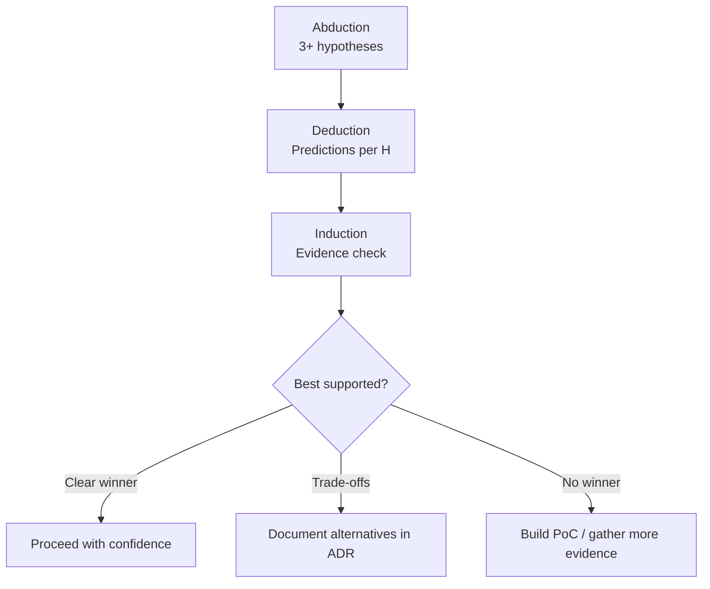

## Why This Matters

The most expensive bugs are not code bugs. They are architecture bugs. Choosing the wrong database, the wrong communication pattern, or the wrong auth strategy costs weeks or months to fix. And the root cause is almost always the same: the team went with their first idea without seriously considering alternatives.

ADI (Abduction → Deduction → Induction) structures the comparison of alternatives: generate options, derive testable consequences, then assess evidence and remaining unknowns. Some evidence requires a prototype or experiment; the command does not perform those experiments for you.

## Why ADI?

Most architecture decisions are made on gut feeling. ADI forces you to generate alternatives, test predictions, and reach justified conclusions.

The baseline methodology **requires** ADI for Deep/Critical and **recommends** it for Standard. The published `/forge-cycle` and `agents-pro:guardian` are stricter: **Standard+** requires linked ADI Evidence with at least three hypotheses. This is a marketplace workflow gate, not an automatic CLI activation check.

## The Three Phases

### 1. Abduction: "What could work?"

Generate **3+ hypotheses** that could solve the problem. Force yourself to think of alternatives beyond your first idea. The goal is to break anchoring bias: the tendency to lock onto the first solution that comes to mind.

```bash
forgeplan reason PRD-001
```

Illustrative hypotheses (not captured command output):
```
Hypothesis 1: JWT tokens with refresh rotation
Hypothesis 2: Session-based auth with Redis
Hypothesis 3: OAuth2 delegation to external provider
```

Three genuinely distinct hypotheses help expose alternatives to the familiar choice. Their count alone establishes neither independence nor correctness; check assumptions and missing evidence rather than treating agreement as proof.

### 2. Deduction: "What should be true?"

For each hypothesis, derive **2-3 testable predictions**. If this approach works, what measurable outcomes would we see? This is where hand-waving gets exposed: if you cannot state concrete predictions, you do not understand the approach well enough.

```
H1 predictions:
  - Token validation < 1ms (no DB call)
  - Rotation rejects reuse of a consumed refresh token in a replay test
  - Validation nodes can scale without shared per-request session state

H2 predictions:
  - Session lookup < 5ms (Redis)
  - Server restart doesn't lose sessions
  - Losing the session store interrupts authentication unless failover works

H3 predictions:
  - Delegation reduces, but does not eliminate, internal auth code
  - External dependency for critical path
  - User experience depends on third-party uptime
```

Good predictions are specific and falsifiable. "It will be fast" is not a prediction. "Token validation under 1ms without database calls" is something you can measure.

### 3. Induction: "Does evidence support it?"

Check predictions against available evidence. The table below is an illustrative comparison, not a measured security result; attach real logs and sources before recording these verdicts:

| Hypothesis | Verdict | Evidence |
|-----------|---------|----------|
| H1: JWT | **supports**, if observed | Validation benchmark meets target; replay test rejects consumed refresh tokens |
| H2: Redis | **weakens**, if observed | Failover experiment misses the required availability target |
| H3: OAuth2 | **supports**, if observed | Integration meets the required flows; provider dependency remains a risk |

The comparison becomes evidence-based only after those checks run. Record what remains unknown, distinguish predictions from observations, and explain why the chosen trade-offs meet the requirements.



### From ADI to Decision

Once you have scored the hypotheses, the path forward usually becomes clear:

- **One option best supported by relevant evidence**: proceed with its assumptions and limits recorded
- **Two viable options with different trade-offs**: document both in an ADR, pick the one that aligns with your priorities
- **No clear winner**: you need more evidence. Run a PoC, benchmark, or consult an expert before committing

## The Command

```bash
# Run ADI reasoning on an artifact
forgeplan reason PRD-001

# With FPF knowledge base context
forgeplan reason PRD-001 --fpf --save
```

`reason` requires a configured LLM provider in `.forgeplan/config.yaml::llm`. HTTP providers use the configured API-key environment variable; local CLI providers require their installed stock CLI and existing login and are explicit personal-development opt-ins, not shared/production/CI profiles. Calls consume the provider's service or subscription. For a non-Forgeplan project, supply its architecture in `.forgeplan/prompts/architecture.md`; the CLI otherwise uses a Forgeplan-specific default.

Without `--save`, CLI reasoning is printed, not persisted. `--save` creates a linked **Note**, not an EvidencePack and not an update to the original artifact. `--json` exposes structured ADI when parsing succeeds, with a raw-analysis fallback otherwise. Inspect the actual hypotheses: the prompt asks for 3+, but parsing is not a guarantee of three valid alternatives.

MCP `forgeplan_reason` accepts `id` and optional `workspace`, not CLI `--save`/`--fpf` or a custom `prompt` parameter. Its result contains `analysis` and provider/model metadata; it does not persist the analysis automatically. The orchestrator must explicitly create, fill, and link an EvidencePack when the workflow requires ADI evidence. A saved Note does not satisfy guardian's linked-ADI-Evidence requirement.

The CLI `--fpf` flag looks up relevant indexed FPF sections and adds them to the prompt when available. Populate the knowledge base through `forgeplan fpf ingest`; absent sections produce a message and reasoning continues without them. Enrichment is context, not an independent verifier.

ADI maps directly onto FPF sections **B.3 (Trust Calculus)** and
**B.5 (Abduction / Deduction / Induction)**, the reasoning backbone of
the First Principles Framework. You can browse these sections from the CLI:

```bash
forgeplan fpf section B.5       # Full text of the ADI cycle definition
forgeplan fpf search "abduction hypothesis"
```

## When to Use

| Depth | ADI Required? |
|-------|--------------|
| Tactical | No |
| Standard | Recommended |
| Deep | **Mandatory** |
| Critical | **Mandatory + review** |

These are baseline depth recommendations. In the published `/forge-cycle`, ADI Evidence is mandatory already at **Standard**. `/gate-check` has a narrower structural ADI check at **Deep/Critical**: at least one linked EVID body must carry three `### Hypothesis` sections. `guardian` additionally blocks Standard+ activation without linked ADI Evidence. The author/orchestrator records the alternatives; the reviewer checks them; the orchestrator alone activates.

:::caution
Calling `reason`, saving a Note, or advancing the advisory artifact phase to `adi` does not by itself satisfy those gates. Neither generated reasoning nor a high R_eff proves that experiments ran.
:::

## A Real-World ADI Example

**Illustrative task**: Choose an embedded database for project artifacts (structured data + vector embeddings). This is a worked comparison, not a historical benchmark report.

**Abduction** (3 hypotheses):
1. SQLite + separate vector index (FAISS)
2. LanceDB (tables + vectors in one engine)
3. PostgreSQL with pgvector extension

**Deduction** (predictions per hypothesis):

H1 (SQLite + FAISS):
- Mature ecosystem, decades of stability
- Two separate systems to maintain and keep in sync
- Vector index must be rebuilt on schema changes

H2 (LanceDB):
- Single engine for structured + vector queries
- Younger project, API stability uncertain
- Data in open Lance format (migratable)

H3 (PostgreSQL + pgvector):
- Requires running a server process
- Conflicts with "local-first, single binary" requirement
- Strong production track record

**Induction** (evidence check):
- H3 eliminated: requires server, violates local-first constraint
- H1 vs H2: benchmark both on the required data volume, query mix, and environment; record the measured results and justify CL. Compare this with the cost of maintaining a separate vector index.
- Conditional decision: H2 (LanceDB) if the measurements meet the contract and single-engine maintenance outweighs ecosystem risk. Record those conditions in the ADR; the open format provides a migration option, not a guarantee of cheap migration.

## Common Mistakes

- **Generating fake hypotheses.** If your three hypotheses are "the right answer", "a strawman", and "another strawman", you are not doing ADI. You are rationalizing a decision you already made. Each hypothesis should be a genuine contender.
- **Skipping Deduction.** Going straight from "here are three options" to "I pick this one" bypasses the most valuable step. Deduction forces you to articulate what success looks like for each option, which is where hidden assumptions surface.
- **Using ADI for Tactical tasks.** If the fix is a one-line change, ADI is overhead. Reserve it for decisions where being wrong is expensive.
- **Not recording ADI.** Use CLI `--save` for a linked Note, or explicitly record and link ADI Evidence for the marketplace gate. A plain CLI/MCP `reason` call does not store a durable evidence record.
- **Treating ADI as a one-time event.** If new evidence emerges after your initial ADI (e.g., a benchmark shows unexpected results), re-run it. ADI is not a ceremony. It is a thinking tool you use whenever you need clarity.

## Related

- [CLI: forgeplan reason](/docs/cli/reason/), [forgeplan fpf](/docs/cli/fpf/), [forgeplan fpf-search](/docs/cli/fpf-search/)
- [FPF Knowledge Base guide](/docs/guides/fpf/) - how the B.3/B.5 context works
- [Evidence & R_eff](/docs/methodology/evidence/) - what Induction consumes
- [Routing & Depth](/docs/methodology/routing/) - where ADI becomes mandatory
