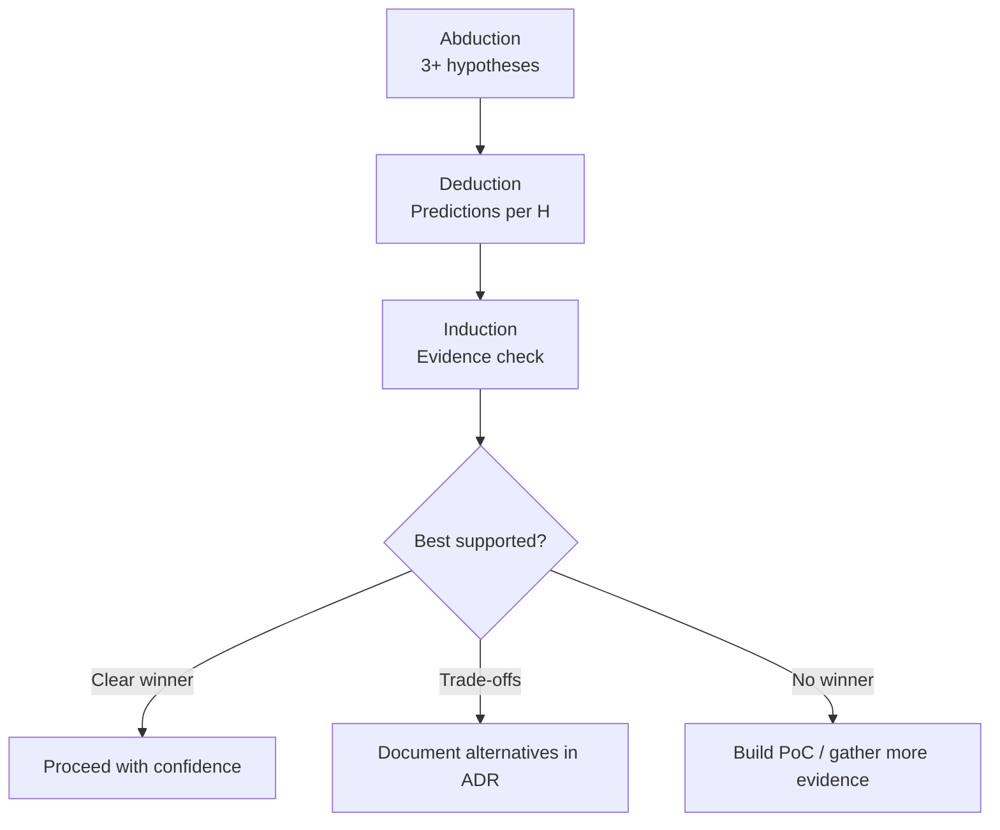

## Why This Matters

Choosing a database, communication pattern or authentication strategy without
comparing alternatives can make later corrections expensive. Anchoring on
the first plausible approach is one failure mode ADI helps expose.

ADI (Abduction -> Deduction -> Induction) generates options, derives
predictions and compares them with evidence before implementation.
It is a reasoning discipline, not a measured guarantee of time saved.

## Why ADI?

ADI makes the alternatives, testable predictions and grounds for a decision explicit.

**Required** for Deep and Critical depth. **Recommended** for Standard.

## The Three Phases

### 1. Abduction -- "What could work?"

Generate **3+ hypotheses** that could solve the problem. Not just your first idea -- force yourself to think of alternatives. The goal is to break anchoring bias: the tendency to lock onto the first solution that comes to mind.

Three is ForgePlan's prompting heuristic, not a universal FPF threshold
or a parser-enforced minimum. FPF B.5.2 asks for a serious rival unless its
absence is justified. Do not manufacture straw alternatives to meet a count.

```bash
forgeplan reason PRD-001
```

Example output:
```
Hypothesis 1: JWT tokens with refresh rotation
Hypothesis 2: Session-based auth with Redis
Hypothesis 3: OAuth2 delegation to external provider
```

The extra alternatives help challenge familiarity and anchoring.
Agreement among model-generated options is not independent corroboration
or a calibrated confidence probability.

### 2. Deduction -- "What should be true?"

For each hypothesis, derive **2-3 testable predictions**. If this approach works, what measurable outcomes would we see? This is where hand-waving gets exposed -- if you cannot state concrete predictions, you do not understand the approach well enough.

The authentication example below contains hypotheses and illustrative
latency targets, not security guarantees or measured benchmarks:

```
H1 predictions:
  - Token validation < 1ms (no DB call)
  - Refresh-token replay is detected under the tested rotation design
  - Local validation may reduce shared-store load; test scaling and revocation

H2 predictions:
  - Session lookup < 5ms (Redis)
  - Sessions survive restart only with the required persistence configuration
  - A non-replicated session store is a possible single point of failure

H3 predictions:
  - Less credential handling internally; callbacks and token validation remain
  - External dependency for critical path
  - User experience depends on third-party uptime
```

Good predictions are specific and falsifiable. "It will be fast" is not a prediction. "Token validation under 1ms without database calls" is -- you can measure it.

### 3. Induction -- "Does evidence support it?"

Compare predictions with actual evidence. The following verdict table is
illustrative, including its 0.3ms figure; it is not a benchmark receipt or
an OWASP endorsement of this whole design:

| Hypothesis | Verdict | Evidence |
|-----------|---------|----------|
| H1: JWT | **supports** | Assumed 0.3ms validation result; rotation still needs security verification |
| H2: Redis | **weakens** | Extra infrastructure; outage risk depends on replication/failover |
| H3: OAuth2 | **supports** | Delegates some credential handling; integration and provider risks remain |

At this point, the decision is no longer gut feeling -- it is an informed comparison. You might still choose H1, but now you know the trade-offs and you have evidence to back it up. Six months from now, when someone asks "why JWT?", the ADI output answers the question.



### From ADI to Decision

Once you have scored the hypotheses, the path forward usually becomes clear:

- **Several options remain plausible**: compare their independent evidence and choose against the recorded criteria, not model agreement
- **Two viable options with different trade-offs**: document both in an ADR, pick the one that aligns with your priorities
- **No clear winner**: you need more evidence. Run a PoC, benchmark, or consult an expert before committing

## The Command

```bash
# Run ADI reasoning on an artifact
forgeplan reason PRD-001 --save

# With FPF knowledge base context
forgeplan reason PRD-001 --fpf --save
```

`reason` requires a configured LLM. `--save` creates a linked Note; without it,
the CLI prints the analysis only. `--fpf` requests retrieved FPF context;
on a migrated Constellation workspace this CLI path currently proceeds
without that retired-table context. A successful LLM response is not proof
that its predictions have been measured.

ADI follows FPF **B.5** (reasoning cycle); **B.3** discusses trust calculus.
ForgePlan's three-option prompt and numeric evidence heuristics are local
adaptations, not universal numerical rules of the current FPF edition.
Browse the installed corpus (whose edition may differ from current upstream):

```bash
forgeplan fpf section B.5       # Full text of the ADI cycle definition
forgeplan fpf search "abduction hypothesis"
```

## When to Use

| Depth | ADI Required? |
|-------|--------------|
| Tactical | No |
| Standard | Recommended |
| Deep | **Mandatory** |
| Critical | **Mandatory + review** |

For **Standard** depth, ADI is recommended but not enforced. If you have two clear approaches and a quick comparison is enough, an informal ADI (even just a mental exercise) is fine. For **Deep** and **Critical**, skipping ADI is a methodology violation because the cost of a wrong decision is too high to leave to intuition.

:::caution
Skipping ADI on Deep/Critical depth is a methodology violation. The review process expects evidence of structured reasoning before activation.
:::

## Reported database comparison (not independently verified)

**Task**: Choose an embedded database for storing project artifacts (structured data + vector embeddings).

The original narrative below has no linked measurement receipt here.
Its benchmark, CL assignment and time-saving claim remain unverified;
read it as an example of comparison structure, not a current product benchmark.

**Abduction** (3 hypotheses):
1. SQLite + separate vector index (FAISS)
2. LanceDB (tables + vectors in one engine)
3. PostgreSQL with pgvector extension

**Deduction** (predictions per hypothesis):

H1 (SQLite + FAISS):
- Mature ecosystem, decades of stability
- Two separate systems to maintain and keep in sync
- Vector index must be rebuilt on schema changes

H2 (LanceDB):
- Single engine for structured + vector queries
- Younger project, API stability uncertain
- Data in open Lance format (migratable)

H3 (PostgreSQL + pgvector):
- Requires running a server process
- Conflicts with "local-first, single binary" requirement
- Strong production track record

**Induction** (evidence check):
- H3 eliminated: requires server, violates local-first constraint
- H1 vs H2: the original narrative reports 10K artifact queries in <100ms and assigns CL2, without a linked run. SQLite is mature, but synchronizing two systems is a maintenance trade-off to evaluate.
- Decision: H2 (LanceDB) -- single engine simplicity outweighs ecosystem maturity risk; open data format provides migration escape hatch

The original account says the analysis took 15 minutes and saved weeks of
potential rework. Neither duration nor counterfactual saving is established
by evidence on this page.

## Common Mistakes

- **Generating fake hypotheses.** If your three hypotheses are "the right answer", "a strawman", and "another strawman", you are not doing ADI -- you are rationalizing a decision you already made. Each hypothesis should be a genuine contender.
- **Skipping Deduction.** Going straight from "here are three options" to "I pick this one" bypasses the most valuable step. Deduction forces you to articulate what success looks like for each option, which is where hidden assumptions surface.
- **Using ADI for Tactical tasks.** If the fix is a one-line change, ADI is overhead. Reserve it for decisions where being wrong is expensive.
- **Not recording the ADI output.** Preserve reasoning with `forgeplan reason PRD-001 --save` (linked Note), or apply a documented manual analysis through `update`. Plain `reason` does not save it automatically.
- **Treating ADI as a one-time event.** If new evidence emerges after your initial ADI (e.g., a benchmark shows unexpected results), re-run it. ADI is not a ceremony -- it is a thinking tool you use whenever you need clarity.

## Related

- [CLI: forgeplan reason](/docs/cli/reason/), [forgeplan fpf](/docs/cli/fpf/), [forgeplan fpf-search](/docs/cli/fpf-search/)
- [FPF Knowledge Base guide](/docs/guides/fpf/) - how the B.3/B.5 context works
- [Evidence & R_eff](/docs/methodology/evidence/) - what Induction consumes
- [Routing & Depth](/docs/methodology/routing/) - where ADI becomes mandatory
