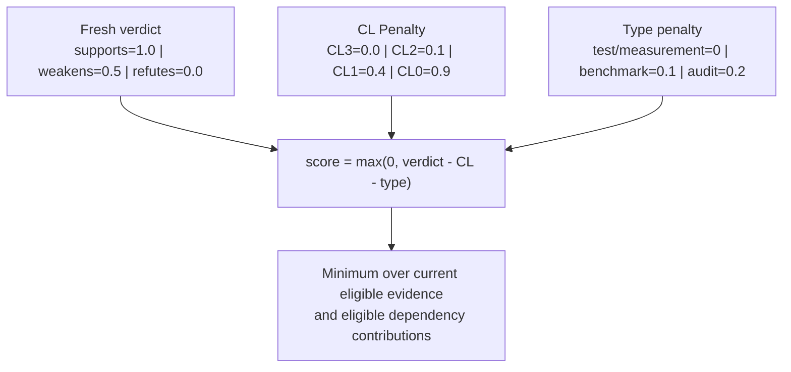

## Why This Matters

When a decision is challenged, its evidence should make the reasoning
inspectable instead of relying solely on the authority of its author.

Evidence-based decision making replaces "trust me" with "here is the data." It is not about bureaucracy -- it is about knowing which of your decisions are solid and which are standing on untested assumptions. Forgeplan's R_eff score gives you a single number that answers: **how much should I trust this decision?**

A low score is useful because it points you to evidence and dependencies
that need review; inspect the breakdown to locate the reason.

## The Principle

**Trust claims need inspectable evidence.**

R_eff is a product heuristic over declared evidence, not a calibrated
probability that a decision is correct. A high score cannot certify an
unmeasured claim or detect every missing assumption.

## R_eff Formula

```
R_eff = min(current eligible evidence scores, eligible dependency contributions)
```

**Not average -- minimum.** Your decision is only as strong as your weakest evidence. Three strong proofs + one untested assumption = untested decision.



This design choice is deliberate. Averaging would let strong evidence mask weak spots. Imagine a bridge: if three pillars are solid but one is cracked, you do not average the pillar strength. You fix the cracked one.

## Evidence Score Calculation

```
fresh_recursive_evidence_score = max(0, verdict_score - CL_penalty - type_modifier)
```

This is the recursive engine used by the explicit `score` report. Type
modifiers are 0 for `test`/`measurement`, 0.1 for `benchmark`, 0.2 for `audit`.
An expired item returns 0.1 before that arithmetic, even if its verdict is
`refutes`. Eligible `based_on`/`informs` dependency contributions incur 0.1;
`refines`/`depends_on` incur 0. The engine skips draft/terminal dependencies
and evidence-exempt Note/Memory dependencies. A leaf EvidencePack can score
from its own structured fields.

The flat `r_eff`/`raw_evidence_score`, captured `r_eff_score`, CLI evidence
breakdown and `r_eff_ci.point` omit type modifiers and recursion, so those
fields can differ from the recursive result. The confidence band is also
a heuristic, not a statistical confidence interval. None of these is
`min(F,G,R)` or a literal universal algorithm from current upstream FPF.

### Verdict Scores

| Verdict | Score | Meaning |
|---------|-------|---------|
| `supports` | 1.0 | Evidence confirms the decision |
| `weakens` | 0.5 | Evidence raises concerns |
| `refutes` | 0.0 | Evidence contradicts the decision |

### Congruence Level Penalties

How close is the evidence to your actual context? Evidence from your own project is worth more than evidence from a blog post.

| Level | Penalty | Example |
|-------|---------|---------|
| **CL3** | 0.0 | Benchmark run in this project, unit test in this codebase |
| **CL2** | 0.1 | PoC in a related module, test in a sibling project |
| **CL1** | 0.4 | External documentation, someone else's blog post, conference talk |
| **CL0** | 0.9 | Stack Overflow answer from a different language/context, opposing domain |

**Why this matters**: A blog post saying "Redis is fast" (CL1, penalty 0.4) is worth far less than your own benchmark showing Redis handles your workload (CL3, penalty 0.0). The penalty system forces you to value direct evidence over hearsay.

### A Worked Example

Illustrative data, not a captured benchmark: suppose you gather these three
packs for a LanceDB storage decision, with no lowering dependency contribution:

1. **A hypothetical benchmark on 10K records**: supports at CL2, `benchmark` -> recursive score = 1.0 - 0.1 - 0.1 = **0.8**
2. **LanceDB Rust SDK documentation**: supports at CL1, `measurement` -> score = 1.0 - 0.4 = **0.6**
3. **An unverified production concern**: weakens at CL1, `measurement` -> score = 0.5 - 0.4 = **0.1**

```
R_eff = min(0.8, 0.6, 0.1) = 0.1 -- AT RISK
```

Adding a stronger pack cannot raise an unchanged minimum while the weak
eligible pack remains. Re-verify the concern, link the replacement evidence
and preserve the old pack through justified lifecycle displacement. Do not
delete or relabel inconvenient evidence merely to improve the number.

## Which packs participate in the min

Only **current** eligible evidence enters the minimum: terminal `superseded`
and `deprecated` packs remain history but are excluded; draft evidence counts.
A fresh eligible `refutes` pack contributes zero. Expired items instead
contribute 0.1 under the current implementation, regardless of verdict.

The honest way to clear a stale weak pack is displacement, not deletion or verdict editing: link the re-verification pack, then `forgeplan supersede <old> --by <new>`. If *all* linked packs are terminal, the artifact degrades to "no active evidence" (R_eff 0.0) — recovery requires the replacement pack to be linked, not merely to exist. A refutes/weakens pack terminated *without* a successor is flagged by the `unbacked_displacement` anomaly.

## Evidence Decay

Evidence may have an expiry date in `valid_until`; without a date, this
scorer does not expire it. When the date passes:

- The evidence is **not deleted**; expiry detection reports it without changing persisted status.
- Its score becomes **0.1**, not a gradual decline toward the date.
- `forgeplan stale` detects overdue dates where that command supports the workspace layout.
- `renew` updates the date/reason under its stored-status guard; it does not gather new evidence. An expired record still stored as `active` cannot take `active → active` renewal.

Decay exists because the world changes. Your benchmark from six months ago was run on a different version of the library, different hardware, different data volume. Stale evidence is not worthless -- it tells you something was true once. But it should not give you full confidence in the present.

## Creating Evidence

The command/output example is illustrative. Use actual results and the IDs
returned by your workspace, not the sample's measurements or score:

```bash
# Create evidence pack
forgeplan new evidence "Auth benchmark -- JWT 2ms, 12 tests pass"
# Prepare evidence-body.md outside .forgeplan/ with actual details and fields below
forgeplan update EVID-001 --body @evidence-body.md

# Link to the decision it supports
forgeplan link EVID-001 PRD-001 --relation informs

# Check the impact
forgeplan score PRD-001
# -> R_eff = 1.00
```

### Required Structured Fields

Every evidence pack MUST contain in its body:

```markdown
## Structured Fields

verdict: supports
congruence_level: 3
evidence_type: measurement
```

| Field | Values | Description |
|-------|--------|-------------|
| `verdict` | supports / weakens / refutes | Does this evidence confirm or contradict the decision? |
| `congruence_level` | 0-3 | How close is the evidence context to your actual context? |
| `evidence_type` | measurement / test / benchmark / audit | What kind of evidence is this? |

Missing/unrecognised `verdict` or missing/invalid CL declaration fails closed
to CL0 (0.9 penalty). `evidence_type` has a separate modifier and defaults to
`measurement` in the parser; declaring all three remains the evidence protocol.

### What Makes Good Evidence

- **Tests that pass in CI** -- `evidence_type: test`; CL3 only when the tested context matches the claim, not merely because CI ran.
- **Benchmarks on representative data** -- `evidence_type: benchmark`; CL3 requires matching code, environment and scale. Even CL3 carries the 0.1 benchmark modifier in recursive scoring.
- **PoC in a related module** -- CL2, evidence_type: measurement. Good but not as strong as production evidence.
- **External documentation** -- CL1, evidence_type: measurement. Useful but carries a 0.4 penalty. Supplement with your own testing.

## Trust Thresholds

These are review labels, not lifecycle activation gates or calibrated
probabilities. Passing a numeric threshold does not accept a decision automatically.

| R_eff | Status | Action |
|-------|--------|--------|
| >= 0.5 | Adequate | Decision can be accepted |
| < 0.5 | Needs Review | Add evidence or reconsider |
| < 0.3 | AT RISK | Decision unreliable, re-evaluate |
| 0.0 | Investigate | No eligible evidence, refutation, penalties or dependency effects |

A zero score is not synonymous with an empty evidence set: a fresh refutation
can also produce zero. Inspect evidence, dependency factors and health's
separate blind-spot diagnostics before deciding what to repair.

## Commands

```bash
forgeplan score PRD-001     # Show R_eff + evidence breakdown
forgeplan decay             # Show evidence decay impact
forgeplan blindspots        # Find decisions without evidence
forgeplan health            # Full project health dashboard
```

## Gotchas

- **Forgetting structured claims.** Missing/unrecognised verdict or missing/invalid CL forces CL0. Declare verdict, congruence_level and evidence_type; prose or copied fields alone do not establish a measurement.
- **Over-claiming CL3.** A benchmark you ran once on your laptop is not CL3. CL3 means the evidence was gathered in the same context where the decision will be applied -- same codebase, same environment, same scale.
- **Ignoring "weakens" evidence.** If you find evidence that a chosen approach has problems, record it with `verdict: weakens`. Hiding inconvenient evidence does not make it go away; it just makes your R_eff dishonest.
- **Never refreshing evidence.** Choose an expiry date appropriate to the claim; 90–180 days is an example review cadence, not a built-in default. Re-test before extending it.
- **Linking evidence to the wrong artifact.** Link it to the decision whose claim it actually supports; an Epic can also legitimately need evidence. A relation does not justify evidence irrelevant to that claim.

## Gotchas and migration notes

### PROB-034 (v0.17.2) - multi-line HTML comment trap

The default evidence template ships with a multi-line HTML help comment:

```markdown
<!--
     verdict: supports | weakens | refutes
     congruence_level: 0 | 1 | 2 | 3 (CL3=same context, CL0=opposed)
-->
```

Before v0.17.2, `extract_field` did not track multi-line comment state. The
placeholder line `congruence_level: 0 | 1 | 2 | 3 (CL3=...)` was matched
as if it were a real structured field, the non-numeric value failed to parse,
`explicit_cl` became `None`, and the parser silently defaulted to CL3 (no
penalty). Template-derived evidence since v0.17.0 could have its real CL
shadowed. [PROB-034](https://github.com/ForgePlan/forgeplan/blob/c852f40c515085d328f02e4b275edda37279a610/.forgeplan/problems/PROB-034-multi-line-html-comments-in-evidence-template-shadow-real-structured-fields-critical.md)
records the v0.17.1/v0.17.2 A/B case; it is not a measured census of every pack.

v0.17.2 implements a proper multi-line comment state machine that skips all
lines between `<!--` and `-->`.

**If you have evidence created before v0.17.2**, re-run scoring after upgrade:

```bash
forgeplan score --all
```

Old R_eff values may drop - this is correct. The previous values were silently
wrong. Any evidence that explicitly set `congruence_level` in the Structured
Fields section will now be honored, and low CL values will properly penalize
R_eff.

### SourceTier precedence - conservative `min()` rule

The current scoring parser reads standalone body `source_tier:` and
`congruence_level:` fields, not an arbitrary tag spelling. With both present,
it takes `min(tier_cl, explicit_cl)`; T1/T2/T3 map to CL3/CL2/CL1.
Thus body `source_tier: T1` cannot override explicit `congruence_level: 0`.
Do not assume `forgeplan tag ... source_tier=T1` is the same parser input.

## Related

- [CLI: forgeplan score](/docs/cli/score/), [forgeplan blindspots](/docs/cli/blindspots/), [forgeplan decay](/docs/cli/decay/), [forgeplan health](/docs/cli/health/)
- [CLI: forgeplan new](/docs/cli/new/), [forgeplan link](/docs/cli/link/)
- [Artifact Lifecycle](/docs/methodology/lifecycle/) - stale evidence and renew
- [ADI Reasoning](/docs/methodology/adi/) - induction phase consumes evidence
- [First Artifact Tutorial](/docs/guides/first-artifact/) - creating evidence hands-on
