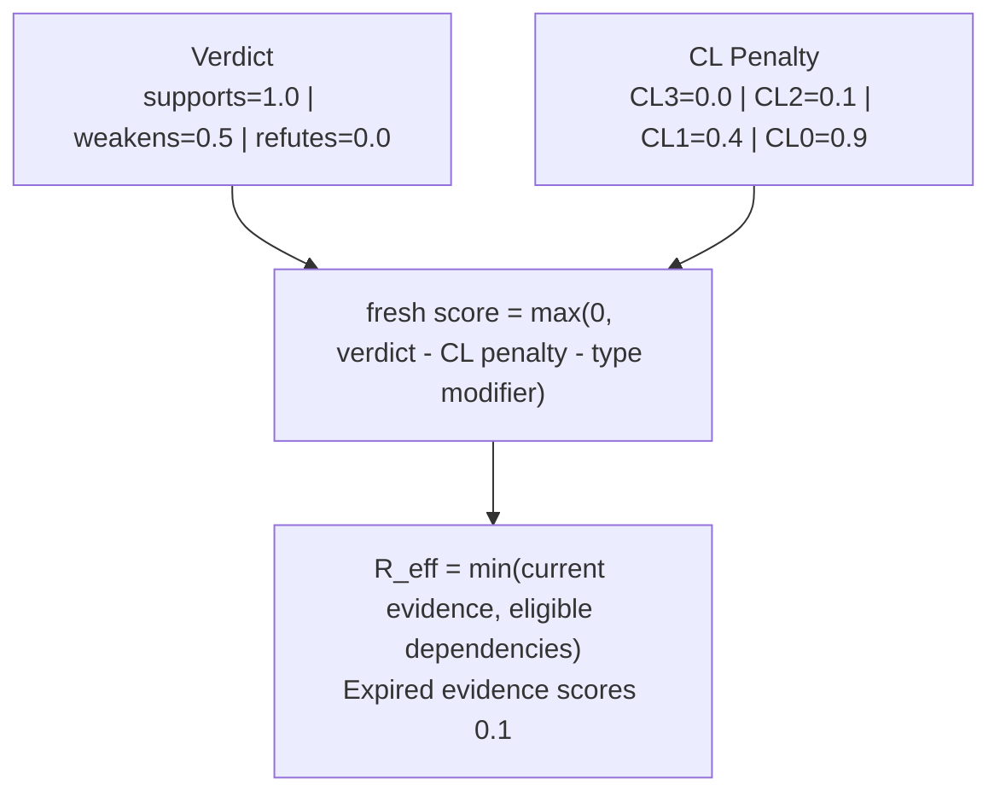

## Why This Matters

Most teams make decisions based on intuition, experience, or authority ("the senior engineer said so"). This works until it does not. When a production incident happens and someone asks "why did we think this would work?", the answer is usually "we just... thought it would."

Evidence-based decision making replaces "trust me" with "here is the data." It is not about bureaucracy. It is about knowing which of your decisions are solid and which are standing on untested assumptions. Forgeplan's R_eff score gives you a single number that answers: **how much should I trust this decision?**

The most valuable insight is not a high score. It is finding a low one. A decision with R_eff = 0.1 tells you exactly where your risk lives, before it becomes a production incident.

## The Principle

**Trust is not a feeling. It's a measurement.**

R_eff summarizes declared evidence and eligible dependencies. It is not a probability of correctness, and the scorer does not independently verify that a claimed test or benchmark actually ran.

## R_eff Formula

```
R_eff = min(own current evidence scores, eligible dependency scores)
```

**Not average. Minimum.** Your decision is only as strong as your weakest evidence. Three strong proofs + one untested assumption = untested decision.



This design choice is deliberate. Averaging would let strong evidence mask weak spots. Imagine a bridge: if three pillars are solid but one is cracked, you do not average the pillar strength. You fix the cracked one.

## Evidence score calculation

```
fresh_evidence_score = max(0, verdict_score - CL_penalty - type_modifier)
expired_evidence_score = 0.1
```

`forgeplan score` and MCP `forgeplan_score` use the recursive engine. Type modifiers are **0.0** for `test` and `measurement`, **0.1** for `benchmark`, and **0.2** for `audit`. The low-level flat `r_eff()` helper omits this modifier; do not mistake that simpler formula for the command's aggregate.

The recursive engine follows outgoing `informs`, `based_on`, `refines`, and legacy `depends_on` dependencies. Draft, superseded, and deprecated dependencies are skipped, as are Note/memory dependencies. This differs from linked **evidence**, where draft packs still participate. Evidence's outgoing `informs`/`based_on` links to the decisions it supports are not treated as dependencies. A leaf EvidencePack scores its own fields; it needs no invented child evidence. Dependency scores are reduced by 0.1 for `informs`/`based_on`, with no relation penalty for `refines`/legacy `depends_on`. Read `weakest_link` and `factors` alongside the aggregate.

**0.38.0 output limitation:** CLI JSON `evidence[].score` and `r_eff_ci.point` use the flat, local calculation, while top-level `r_eff` uses the recursive calculation with type modifiers and dependencies. These values can differ. The interval is a heuristic, not a statistical confidence guarantee; fewer than three current packs is labeled insufficient. Do not average the displayed pack scores to reconstruct `r_eff`.

### Verdict Scores

| Verdict | Score | Meaning |
|---------|-------|---------|
| `supports` | 1.0 | Evidence confirms the decision |
| `weakens` | 0.5 | Evidence raises concerns |
| `refutes` | 0.0 | Evidence contradicts the decision |

### Congruence level penalties

How close is the evidence to your actual context? Evidence from your own project is worth more than evidence from a blog post.

| Level | Penalty | Example |
|-------|---------|---------|
| **CL3** | 0.0 | Benchmark run in this project, unit test in this codebase |
| **CL2** | 0.1 | PoC in a related module, test in a sibling project |
| **CL1** | 0.4 | External documentation, someone else's blog post, conference talk |
| **CL0** | 0.9 | Stack Overflow answer from a different language/context, opposing domain |

**Why this matters**: A blog post saying "Redis is fast" (CL1, penalty 0.4) is worth far less than your own benchmark showing Redis handles your workload (CL3, penalty 0.0). The penalty system forces you to value direct evidence over hearsay.

### A Worked Example

You are deciding whether to use LanceDB for artifact storage. You gather three pieces of evidence:

1. **Your benchmark on 10K records**: `supports`, CL2, `benchmark` → 1.0 - 0.1 - 0.1 = **0.8**
2. **LanceDB Rust SDK documentation**: `supports`, CL1, `measurement` → 1.0 - 0.4 = **0.6**
3. **A Hacker News comment about production use**: `weakens`, CL1, `measurement` → 0.5 - 0.4 = **0.1**

```
R_eff = min(0.8, 0.6, 0.1) = 0.1 (before any weaker dependency)
```

The weak link is the unverified production concern. Investigate it and record a new check. If new evidence displaces an old pack, link the replacement to the decision and use the lifecycle commands below; do not delete or rewrite adverse evidence merely to raise the score.

## Which packs participate in the min

R_eff ranges over the artifact's **current** evidence only. Packs with a terminal lifecycle status (`superseded` or `deprecated`) are excluded from the min and evidence count: a displaced pack stays in the graph as history and remains in the `score` breakdown marked "excluded from min." Draft evidence **does** count. A fresh **active** `refutes` pack still zeroes the score.

Displacement preserves the old result; deletion or verdict editing does not. Link the re-verification pack to the decision, then check the old pack's **saved** lifecycle status:

- **active:** `forgeplan supersede OLD-ID --by NEW-ID`.
- **draft:** a completed, valid pack must first pass `forgeplan activate OLD-ID`; only then can it be superseded. Do not activate an unfinished or unsupported pack merely to change its status.
- **stale:** `supersede` is not an allowed transition. Record the replacement relation with `forgeplan link OLD-ID NEW-ID --relation supersedes`, matching the lifecycle command's old-to-replacement direction, then use `forgeplan deprecate OLD-ID --reason "Replaced by NEW-ID after re-verification"`. The replacement must also have its own `informs` link to the decision.

Expiry alone does not change the saved status. If all linked packs are terminal, the artifact has no current evidence and R_eff is 0.0. A refutes/weakens pack terminated without a successor is flagged by `unbacked_displacement`.

## Evidence Decay

Evidence has a TTL (`valid_until` field). When it expires:

- Evidence is **not deleted**. Expiry is detected from `valid_until`; detection does not itself rewrite lifecycle status.
- The scoring engine returns **0.1** for any expired pack before applying verdict or type penalties. Even an expired `refutes` pack follows this branch; do not describe it as a permanent veto.
- `forgeplan stale` detects expired records.
- Re-run the relevant checks before renewing validity or publishing replacement evidence. `renew` records a reason and date; it does not run those checks. See [Lifecycle](/docs/methodology/lifecycle/#stale-the-forgotten-state) for the explicit status transition.

Decay exists because the world changes. Your benchmark from six months ago was run on a different version of the library, different hardware, different data volume. Stale evidence is not worthless. It tells you something was true once. But it should not give you full confidence in the present.

## Creating Evidence

```bash
# Create evidence pack
forgeplan new evidence "Auth verification results"
# Use the returned ID. EVID-001 below is illustrative.
# First fill a real result record in auth-evidence.md, then update the body:
forgeplan update EVID-001 --body @auth-evidence.md

# Link to the decision it supports
forgeplan link EVID-001 PRD-001 --relation informs

# Check the impact; the result depends on fields, expiry, and dependencies
forgeplan score PRD-001
```

### Required structured fields

Every evidence pack MUST contain in its body:

```markdown
## Structured Fields

verdict: supports
congruence_level: 3
evidence_type: measurement
```

| Field | Values | Description |
|-------|--------|-------------|
| `verdict` | supports / weakens / refutes | Does this evidence confirm or contradict the decision? |
| `congruence_level` | 0-3 | How close is the evidence context to your actual context? |
| `evidence_type` | measurement / test / benchmark / audit | What kind of evidence is this? |

Write standalone `key: value` lines, outside HTML comments and tables, without trailing `#` explanations. The parser takes the first matching field. Missing or unknown `verdict`, or missing both explicit CL and `source_tier`, forces CL0. `verdict: unknown` is not a fourth scored verdict. Missing/unknown `evidence_type` instead defaults to `measurement`; it does **not** itself force CL0. An undeclared supporting measurement normally scores 0.1; type modifiers and other verdicts can lower that further.

For evidence claiming a code change, also record `base_sha`, `result_sha`, and `changed_paths` against the real git delta. The activate-time provenance gate is configured as `integrity.evidence_provenance_gate: warn|block|off` (default `warn`); `--force` bypasses it. Structured fields do not prove that the measurement is genuine.

### What makes good evidence

- **Tests that pass in CI**, CL3, evidence_type: test. The most reliable form because they run in your actual codebase.
- **Benchmarks on your data**, CL3, evidence_type: benchmark. Measures performance in your real context.
- **PoC in a related module**, CL2, evidence_type: measurement. Good but not as strong as production evidence.
- **External documentation**, CL1, evidence_type: measurement. Useful but carries a 0.4 penalty. Supplement with your own testing.

## Trust Thresholds

| R_eff | Status | Action |
|-------|--------|--------|
| >= 0.5 | Adequate display band | Inspect coverage and weakest link before accepting |
| < 0.5 | Needs review | Add evidence or reconsider |
| 0.0 | Zero score | Could mean no current evidence, a refutation, penalties, or a weak dependency |

These bands are not universal activation gates. The core activation gate checks linked evidence and validation, not a numerical R_eff threshold. Published `/gate-check` defaults treat score floors as `should`; structural `must` failures block. `blindspots` identifies missing evidence links, not every possible cause of a zero score.

## Commands

```bash
forgeplan score PRD-001     # Show R_eff + evidence breakdown
forgeplan decay             # Show evidence decay impact
forgeplan blindspots        # Find decisions without evidence
forgeplan health            # Full project health dashboard
```

## Gotchas

- **Forgetting or corrupting fields.** Use exact supported values; absent `evidence_type` and absent `verdict` have different fallback behavior.
- **Over-claiming CL3.** Match the context of the claim: a unit test can be CL3 for local function behavior, but a laptop benchmark is not production-scale evidence.
- **Ignoring "weakens" evidence.** If you find evidence that a chosen approach has problems, record it with `verdict: weakens`. Hiding inconvenient evidence does not make it go away; it just makes your R_eff dishonest.
- **Never refreshing evidence.** Benchmarks and test results have shelf lives. Set `valid_until` to 90-180 days and address stale evidence when `forgeplan health` flags it.
- **Linking evidence to the wrong artifact.** Evidence should be linked to the decision it supports, not to the Epic or to an unrelated PRD. A mislinked evidence pack provides no R_eff benefit.

Reviewer verdicts such as **PASS / CONCERNS / BLOCKER** belong in the review narrative. They are not values for the scoring field `verdict`, which accepts only `supports / weakens / refutes`. Record both when the marketplace workflow needs them.

## Gotchas and migration notes

### PROB-034 (v0.17.2) - multi-line HTML comment trap

The default evidence template ships with a multi-line HTML help comment:

```markdown
<!--
     verdict: supports | weakens | refutes
     congruence_level: 0 | 1 | 2 | 3 (CL3=same context, CL0=opposed)
-->
```

Before v0.17.2, `extract_field` did not track multi-line comment state. The
placeholder line `congruence_level: 0 | 1 | 2 | 3 (CL3=...)` was matched
as if it were a real structured field, the non-numeric value failed to parse,
`explicit_cl` became `None`, and the parser silently defaulted to CL3 (no
penalty). This meant **every evidence artifact created via the default template
since v0.17.0 had its real `congruence_level` shadowed** - R_eff was
artificially inflated across the workspace.

v0.17.2 implements a proper multi-line comment state machine that skips all
lines between `<!--` and `-->`.

**If you have evidence created before v0.17.2**, re-run scoring after upgrade:

```bash
forgeplan score --all
```

Old R_eff values may drop - this is correct. The previous values were silently
wrong. Any evidence that explicitly set `congruence_level` in the Structured
Fields section will now be honored, and low CL values will properly penalize
R_eff.

### SourceTier precedence - conservative `min()` rule

The scorer reads `source_tier: T1` / `T2` / `T3` as a standalone **body field**, mapping to CL3 / CL2 / CL1. If an explicit `congruence_level` is also present, it uses `min(tier_cl, explicit_cl)` — the more conservative value.

For example, body fields `source_tier: T1` and `congruence_level: 0` remain CL0. An ordinary frontmatter tag such as `source_tier=T1` is not this scoring field. Source tier supplies context, not a replacement for a declared verdict or independently verified results.

## Related

- [CLI: forgeplan score](/docs/cli/score/), [forgeplan blindspots](/docs/cli/blindspots/), [forgeplan decay](/docs/cli/decay/), [forgeplan health](/docs/cli/health/)
- [CLI: forgeplan new](/docs/cli/new/), [forgeplan link](/docs/cli/link/)
- [Artifact Lifecycle](/docs/methodology/lifecycle/) - stale evidence and renew
- [ADI Reasoning](/docs/methodology/adi/) - induction phase consumes evidence
- [First Artifact Tutorial](/docs/guides/first-artifact/) - creating evidence hands-on
