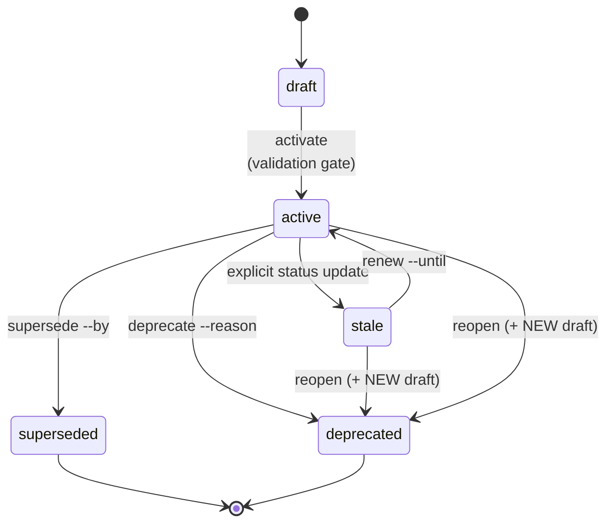

## Why This Matters

Artifacts are not static documents that you write once and forget. They evolve: a draft PRD becomes a validated plan, an active decision eventually gets replaced by a better one. Without clear lifecycle management, you end up with zombie documents (outdated specs that nobody trusts but nobody deletes), active decisions that were never actually validated, and stale evidence that gives false confidence.

The lifecycle model gives every artifact a clear status so you always know: is this current? Is this validated? Has this been replaced? Should I still trust this?

## State Machine



**Terminal states** (`superseded`, `deprecated`) have no ordinary lifecycle transitions out. To reconsider a decision, create a fresh artifact; `reopen` accepts active/stale sources, not terminal ones.

Separate recovery operations, `restore` and `undo-last`, can reverse a mistaken supersede/deprecate using an unconsumed trash receipt (default retention 30 days). That is recovery of an operation, not normal reactivation of an old decision.

In 0.38 the MCP deprecate/supersede handlers capture those receipts, but the CLI commands with the same names do not. `undo-last` selects the newest available receipt, which may belong to an older operation; inspect its identity rather than assuming it reverses the last CLI command. After recovery, compare the API status with the Markdown frontmatter: the known [projection-sync gap](https://github.com/ForgePlan/forgeplan/issues/296) can leave them different even when `projection_restored` is true.

The state machine is not a universal write guard in 0.38: raw `update --status` does not validate every current/target pair and can reset a terminal record ([#550](https://github.com/ForgePlan/forgeplan/issues/550)). Do not use that implementation gap instead of `reopen` or receipt-backed recovery.

## States

| State | Meaning | Can transition to |
|-------|---------|-------------------|
| **draft** | Work in progress | active |
| **active** | Activated for use; strength of evidence must be checked separately | superseded, deprecated, stale; reopen creates a new draft |
| **stale** | Stored marker for a decision needing re-evaluation; expiry is also reported independently | active (renew), deprecated (reopen/deprecate) |
| **superseded** | Replaced by newer artifact | *(terminal)* |
| **deprecated** | No longer relevant | *(terminal)* |

New artifacts start as **draft**. For PRD/RFC/ADR/Epic/Spec, normal activation requires validation and methodology gates. There is no general automatic promotion. An explicit link option can activate only a complete draft **Evidence** source: CLI `--auto-activate-complete`, MCP `auto_activate_source_if_complete: true` (off by default). It does not activate the supported decision.

## Lifecycle Commands

```bash
# Validate before activating
forgeplan review PRD-001
# -> Review PASSED -- ready to activate

# Activate (draft -> active)
forgeplan activate PRD-001
# -> Validation gate checks MUST rules

# Supersede (active -> superseded)
forgeplan supersede PRD-001 --by PRD-002
# -> Records supersession: PRD-001 is replaced by PRD-002

# Deprecate (active/stale -> deprecated)
forgeplan deprecate PRD-001 --reason "No longer needed"

# Renew (stale -> active)
forgeplan renew PRD-001 --reason "Re-validated" --until 2026-12-31

# Reopen (active/stale -> deprecated + NEW draft)
forgeplan reopen PRD-001 --reason "Needs major revision"
# -> PRD-001 deprecated, new draft created (e.g., PRD-NNN)
```

### When to use each transition

**Activate** after satisfying the workflow's evidence and review requirements. The core command checks MUST validation, body length (at least 100 trimmed bytes), stub content, and a linked-evidence condition for PRD/RFC/ADR/Epic/Spec. It does not run your code or tests, require guardian, or impose an R_eff > 0 threshold. `--force` can bypass these gates, but not the lifecycle transition guard; report any bypass explicitly.

**Supersede** when a better version exists. Your original auth PRD (PRD-001) called for basic JWT. Six months later, requirements changed and you wrote PRD-002 with OAuth2 federation. Supersede PRD-001 with PRD-002 so anyone looking at the old one is redirected to the new one.

**Deprecate** when the artifact is no longer relevant at all. The feature was cancelled, the module was removed, or the context changed so much that the decision does not apply anymore.

**Renew** when a stale artifact is still valid. Your ADR chose LanceDB a year ago and it expired. You re-evaluated and LanceDB is still the right choice. Renew it with a new expiration date.

**Reopen** when an active or stale artifact needs a major rethink. It deprecates the old record and creates a new same-kind draft with a `Lineage` section and a `based_on` link to the original. It does not copy the full old body; fill the new draft before using it.

## Terminal States

**Superseded** and **deprecated** are terminal in the ordinary state machine:

- Superseded: use the replacement artifact.
- Deprecated: create a fresh artifact if the subject becomes relevant again. `reopen` does not accept a deprecated source.

### Why terminal means terminal

An old decision does not become current again through `activate` or `renew`. If the retirement itself was a mistake, use receipt-backed recovery; otherwise write a new decision with its own rationale. Do not use raw metadata writes to evade lifecycle history.

**Example**: You chose JWT (ADR-001), then switched to sessions (ADR-002, supersedes ADR-001). A year later, you want JWT again. Do not reactivate ADR-001. Create ADR-003 that supersedes ADR-002; this preserves the full decision history: JWT then Sessions then JWT-again, with reasons documented at each step.

## Validation Gates

PRD, RFC, ADR, Epic, Spec require validation before activation:

```bash
forgeplan validate PRD-001
# Checks applicable rules for this kind and depth.
# Missing MUST sections and stub content can block.
# SHOULD findings are recommendations, not activation failures.
```

Kinds outside PRD/RFC/ADR/Epic/Spec, including Notes, Problems, and Evidence, skip these full activation gates. Hypotheses use their own promotion state machine instead. A Note is a prose artifact, not a key-value memory slot; do not assume `new note` or `reason --save` automatically sets a 90-day TTL.

### What validation actually checks

Validation applies rules by artifact kind and depth. It checks required sections and can report content heuristics such as implementation leakage, vague requirements, and filler. The severity of the applicable rule decides whether a finding blocks. It does not prove requirements are achievable, run examples, or establish semantic traceability for you.

`review` adds the lifecycle gates and build-on-draft warnings to validation. Successful `validate` alone is not equivalent to a successful `review` or activation.

The published marketplace adds separate responsibilities. `/gate-check` reads thresholds from project `quality-gates.yaml` over shipped defaults, with structural `must` failures blocking and score floors advisory. `guardian` reviews the full chain and returns PASS / CONCERNS / BLOCKER; the orchestrator fixes concerns or halts on a blocker and performs activation after PASS. These are agent-workflow policies, not hidden steps in the CLI.

## Stale: the forgotten state

Expiry and stored lifecycle status are distinct. `forgeplan stale` finds expired `valid_until` dates without rewriting status. Evidence scoring applies expiry directly, even if the stored status still says `active`. Expiry means a claim needs re-evaluation, not that it has been disproved.

**Example**: An ADR choosing LanceDB has a `valid_until` date 180 days after review. Once the date passes, expiry reporting finds it; the saved status may still be active. Re-evaluate the decision and evidence rather than silently assuming they remain valid.

```bash
# Find all stale artifacts
forgeplan stale

# After re-checking an expired record that is still stored as active:
forgeplan update ADR-001 --status stale
forgeplan renew ADR-001 --reason "Re-evaluated, still best option" --until 2027-06-30

# Or acknowledge it needs rethinking
forgeplan reopen ADR-001 --reason "New alternatives available, needs fresh evaluation"
```

`renew` records the reason, changes validity, and returns to active; it does not gather evidence. `update --status active|superseded|deprecated` is rejected — use the dedicated verbs. The explicit active → stale update above is not automatic expiry.

**0.38 limitation:** `renew` uses a generic transition check, so it also accepts a draft without the checks performed by `activate`. It validates the date format but does not require a future date ([#547](https://github.com/ForgePlan/forgeplan/issues/547)). Use it only for a reviewed stale record with an appropriate future validity date, never as an activation shortcut. An already-active record still fails the active → active transition.

Do not confuse three independent states:

- **Lifecycle status** — draft / active / stale / superseded / deprecated.
- **Artifact phase** — shape / validate / adi / code / test / audit / evidence / done, read through `phase`; advisory and not a lock or gate.
- **Session phase** — idle / routing / shaping / coding / evidence / pr, read through `session` and checked through MCP `forgeplan_guard(target_session_phase=...)`.

A claim is also a coordination signal with a TTL, not an enforcement lock on every write. The published cycle advances artifact phase markers, but the orchestrator still has to execute and gate the actual work.

The derived display status is separate again: **STUB → SHAPED → VALIDATED → EVIDENCED → ACTIVATED**. It is computed, not stored. `ACTIVATED` also covers superseded/deprecated records, so it must not be read as "currently approved."

## Common Mistakes

- **Confusing activation with implementation proof.** Follow the project's review and evidence policy; an `active` flag by itself proves neither that code exists nor that it works.
- **Never superseding, only creating new artifacts.** If ADR-002 replaces ADR-001 but you do not mark the supersession, both appear active and nobody knows which is current.
- **Ignoring stale warnings.** When `forgeplan health` reports stale artifacts, address them. Stale evidence means your R_eff scores are silently degrading to 0.1.
- **Treating draft as "done enough."** Fill the artifact or record why the work was abandoned. Do not delete substantive decision history merely to make health look green.
- **Forgetting `valid_until` on ADRs.** Every architecture decision has a shelf life. Set realistic expiration dates (90-180 days) so stale detection works.

## Related

- [Lifecycle v2 deep-dive](/docs/guides/lifecycle-v2/) - full state machine walkthrough with four real-world flows
- [CLI: review](/docs/cli/review/), [activate](/docs/cli/activate/), [supersede](/docs/cli/supersede/), [deprecate](/docs/cli/deprecate/), [renew](/docs/cli/renew/), [reopen](/docs/cli/reopen/), [stale](/docs/cli/stale/)
- [Evidence & R_eff](/docs/methodology/evidence/) - why stale evidence degrades trust scores
- [Routing & Depth](/docs/methodology/routing/) - validation gates differ by depth
