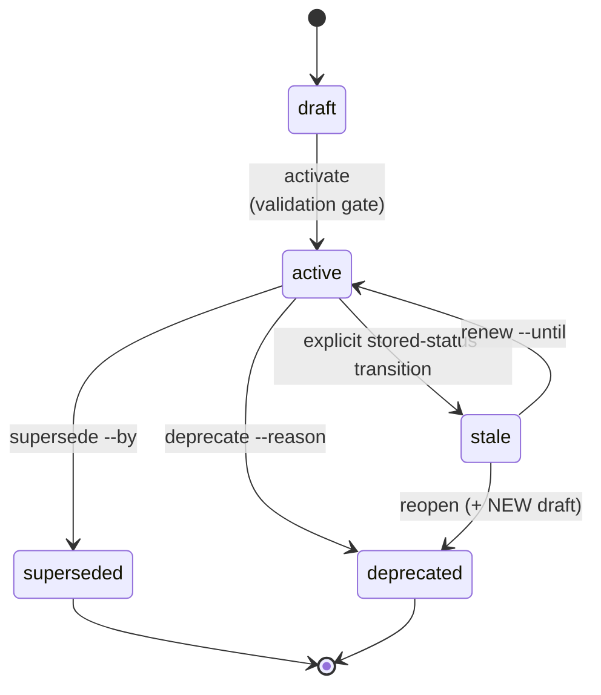

## Why This Matters

Artifacts are not static documents that you write once and forget. They evolve: a draft PRD becomes a validated plan, an active decision eventually gets replaced by a better one. Without clear lifecycle management, you end up with zombie documents -- outdated specs that nobody trusts but nobody deletes, active decisions that were never actually validated, and stale evidence that gives false confidence.

The lifecycle model gives every artifact a clear status so you always know: is this current? Is this validated? Has this been replaced? Should I still trust this?

## State Machine



This is the persisted-status model. Date-expiry detection reports overdue
artifacts without rewriting `status: active` to `stale`. Reopen also accepts
a stored `active` artifact and creates a new draft before deprecating the old.

**Terminal states** have no outgoing ordinary lifecycle transitions.
Re-evaluation creates a new artifact with lineage. Receipt-based recovery
through [`restore`](/docs/cli/restore/) or `undo-last` is a separate mechanism
for reversing a recorded accidental operation.

## States

| State | Meaning | Can transition to |
|-------|---------|-------------------|
| **draft** | Work in progress, not validated | active |
| **active** | Validated, in use | superseded, deprecated, stale |
| **stale** | expired `valid_until` | active (renew), deprecated (reopen) |
| **superseded** | Replaced by newer artifact | *(terminal)* |
| **deprecated** | No longer relevant | *(terminal)* |

Every artifact starts as **draft**. It stays there until you explicitly validate and activate it. This is intentional -- there is no automatic promotion. You have to earn the "active" status by passing validation gates.

## Lifecycle Commands

The commands below illustrate lifecycle semantics, not runtime coverage for
every tool. Registration in `tools/list` alone does not prove runtime
acceptance. See [Constellation](/docs/guides/constellation/) for recorded
compatibility coverage and remaining limits.

```bash
# Validate before activating
forgeplan review PRD-001
# -> Review PASSED -- ready to activate

# Activate (draft -> active)
forgeplan activate PRD-001
# -> Validation gate checks MUST rules

# Supersede (active -> superseded)
forgeplan supersede PRD-001 --by PRD-002
# -> Creates link: PRD-002 supersedes PRD-001

# Deprecate (active/stale -> deprecated)
forgeplan deprecate PRD-001 --reason "No longer needed"

# Renew (stale -> active)
forgeplan renew PRD-001 --reason "Re-validated" --until 2026-12-31

# Reopen (stale -> deprecated + NEW draft)
forgeplan reopen PRD-001 --reason "Needs major revision"
# -> PRD-001 deprecated, new draft created (e.g., PRD-NNN)
```

### When to Use Each Transition

**Activate** when the artifact is validated, in use, and backed by the
required implementation and evidence. Approval to start work and successful
schema validation alone are not activation readiness.

**Supersede** when a better version exists. Your original auth PRD (PRD-001) called for basic JWT. Six months later, requirements changed and you wrote PRD-002 with OAuth2 federation. Supersede PRD-001 with PRD-002 so anyone looking at the old one is redirected to the new one.

**Deprecate** when the artifact is no longer relevant at all. The feature was cancelled, the module was removed, or the context changed so much that the decision does not apply anymore.

**Renew** when a stale artifact is still valid. Your ADR chose LanceDB a year ago and it expired. You re-evaluated and LanceDB is still the right choice. Renew it with a new expiration date.

`renew` checks the stored status, not merely membership in `stale` output.
An expired record still stored as `active` cannot pass active→active through
that guard. The generic guard also admits draft→active; neither fact makes
date-only renewal proof of re-verification.

**Reopen** when an active or stale artifact needs a major rethink. It creates
a new draft with lineage and deprecates the original.

## Terminal States

**Superseded** and **deprecated** are terminal in normal status transitions.

- Superseded: use the replacement artifact.
- Deprecated: create a new artifact if the decision needs to be made again.

### Recovery is not reactivation

For an accidental delete, supersede, or deprecate, `restore`/`undo-last` can
consume a matching soft-delete receipt and reverse its recorded operation.
Without such a receipt, changing a terminal status back is not the ordinary
lifecycle. Changed requirements call for a new decision, not recovery.

**Example**: You chose JWT (ADR-001), then switched to sessions (ADR-002, supersedes ADR-001). A year later, you want JWT again. Do not reactivate ADR-001. Create ADR-003 that supersedes ADR-002 -- this preserves the full decision history: JWT then Sessions then JWT-again, with reasons documented at each step.

## Validation Gates

PRD, RFC, ADR, Epic, Spec require validation before activation:

```bash
forgeplan validate PRD-001
# Runs applicable kind/depth rules; not every rule applies to every artifact:
# - MUST sections present (Problem, Goals, FR...)
# - No implementation leakage in requirements
# - Information density (no filler)
# - Measurability (SMART criteria)
```

Notes and Problems skip the ordinary activation validation gate. Notes are
quick captures, but the current `new` path does not automatically assign a
90-day expiry. Set an explicit `valid_until` date when expiry is wanted.

### What Validation Actually Checks

Validation includes content heuristics as well as schema checks. Severity
depends on kind and depth; warnings are not necessarily blocking MUST errors,
and passing the validator is not proof of semantic correctness.

- **Information density**: filler phrases like "it is important to note that" are flagged. Every sentence should carry meaning.
- **Implementation leakage**: naming specific frameworks or libraries in requirements (e.g., "Use Redis for caching") gets flagged. Requirements describe capabilities, not implementations.
- **Measurability**: vague requirements can produce findings. Concrete targets such as "API response time < 200ms at p95 under 1000 RPS" are testable, but the validator does not exercise that workload.
- **Traceability**: requirements should trace back to goals, and goals should trace back to the problem statement.

## Stale: The Forgotten State

When `valid_until` expires, detection reports the artifact as overdue; it
does not automatically persist a new status. Expiry means the review date
passed, not that the decision is proven wrong.

**Example**: an ADR has a calendar `valid_until` date chosen 180 days after
creation. Once that date passes, reassess the decision before extending it.
The field is a date, not the literal duration `180 days`.

```bash
# Find all stale artifacts
forgeplan stale

# Only if the stored status permits renewal; stale detection alone is insufficient
forgeplan renew ADR-001 --reason "Re-evaluated, still best option" --until 2027-06-30

# Or acknowledge it needs rethinking
forgeplan reopen ADR-001 --reason "New alternatives available, needs fresh evaluation"
```

## Common Mistakes

- **Activating a PRD before writing any code.** Active means "validated and in use." If the code does not exist yet, the PRD is not in use -- it is still a plan. Keep it in draft until implementation begins and evidence exists.
- **Never superseding, only creating new artifacts.** If ADR-002 replaces ADR-001 but you do not mark the supersession, both appear active and nobody knows which is current.
- **Ignoring stale warnings.** An expired eligible evidence item contributes `0.1` when scored. The artifact's aggregate also depends on other evidence/dependencies; expiry is a step change, not gradual decay or a universal final score of `0.1`.
- **Treating a draft as already active.** A complete, validated artifact can intentionally remain draft while implementation, evidence or approval is pending. Do not activate merely to clear a dashboard warning.
- **Forgetting `valid_until` on ADRs.** Every architecture decision has a shelf life. Set realistic expiration dates (90-180 days) so stale detection works.

## Related

- [Lifecycle v2 deep-dive](/docs/guides/lifecycle-v2/) - full state machine walkthrough with four real-world flows
- [CLI: review](/docs/cli/review/), [activate](/docs/cli/activate/), [supersede](/docs/cli/supersede/), [deprecate](/docs/cli/deprecate/), [renew](/docs/cli/renew/), [reopen](/docs/cli/reopen/), [stale](/docs/cli/stale/)
- [Evidence & R_eff](/docs/methodology/evidence/) - why stale evidence degrades trust scores
- [Routing & Depth](/docs/methodology/routing/) - validation gates differ by depth
