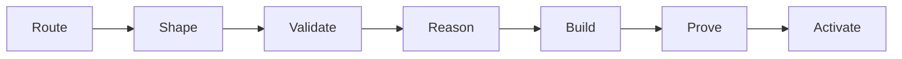

## Why This Matters

Every engineering team accumulates debt that is invisible: not in code, in its decisions. You pick a database, choose an auth strategy, design an API surface. Six months later, someone asks "why did we do it this way?" and nobody remembers. The Slack thread is buried. The Google Doc is stale. The person who made the call left the company.

The problem is not documentation. Teams lose knowledge. And it compounds: teams repeat the same mistakes, relitigate the same debates, and build on assumptions nobody can verify.

Forgeplan exists to make decisions traceable, verifiable, and durable.

## The Problem

Decisions are scattered across Slack threads, Google Docs, and someone's memory. PRDs nobody reads. RFCs without follow-up. Architecture choices made on gut feeling.

**Forgeplan makes you think before coding.** Instead of "open IDE -> write code -> deploy", you get:

```
Route -> Shape -> Validate -> Reason -> Build -> Prove -> Activate
```



For example, suppose your team chooses JWT for authentication. Six months later, a security audit asks why you chose JWT over session-based auth. The ADR should explain the reasoning, linked Evidence should record the actual checks, and the PRD should trace the requirements. Forgeplan preserves those records; it does not establish that the decision is correct merely because the records exist.

## What Forgeplan Is NOT

- **Not Jira.** Not a project management tool.
- **Not a task tracker.** Not for daily standups.
- **Not a code generator.** AI assists, you decide.

Forgeplan is a **structured knowledge base for engineering decisions**: local-first, git-native, single binary. Think of it as a lab notebook for engineering: you record what you tried, why, and what the results were.

## Core Principles

### 1. Pipeline is a guideline, not bureaucracy
Don't create all 10 artifact types for every task. Tactical depth = just code. Deep depth = full pipeline. If the answer is obvious and reversible, skip the paperwork. A one-line bug fix does not need a PRD.

### 2. Every requirement: "[Actor] can [capability]"
No implementation leakage in PRDs. Describe WHAT, not HOW. Write "User can persist and query structured data with ACID guarantees", not "Use PostgreSQL for storage." The moment you name a technology in a requirement, you have closed off alternatives before evaluating them.

### 3. Child references parent
PRD -> Epic, RFC -> PRD, ADR -> RFC. Always traceable upward. This means if you read any artifact, you can follow the links up to understand the full context of why it exists.

### 4. Supersede, don't delete
Use `forgeplan supersede OLD-ID --by NEW-ID` to retire an active artifact in favor of its replacement. Do not set terminal statuses through `update --status`. History records what changed and why.

### 5. R_eff = min(evidence)
Trust uses the weakest link, not an average. `forgeplan score` combines current evidence with eligible transitive dependencies. Terminal evidence is excluded, draft evidence still counts, and evidence type and expiry affect the result. An unrecorded assumption is not automatically discovered by the formula; record and investigate it. See [Evidence & R_eff](/docs/methodology/evidence/).

## The Full Cycle

```
1. Route:    forgeplan route "your task" -> determines depth
2. Shape:    forgeplan new prd "Title" -> create artifact
3. Validate: forgeplan validate PRD-XXX -> quality gates
4. Reason:   forgeplan reason PRD-XXX --save -> linked ADI Note (LLM required)
5. Build:    write code, test every pub fn
6. Prove:    forgeplan new evidence -> link -> score
7. Activate: forgeplan activate PRD-XXX
```

**Methodology completion for Standard+ implementation work** means filled and validated artifacts, recorded implementation checks, linked evidence, an understood score, and explicit activation. This is a workflow policy, not a claim that `activate` runs your tests or proves R_eff > 0. Tactical work can have no artifact. The published `/forge-cycle` additionally requires linked ADI Evidence and reviewer gates at Standard+.

## Common Mistakes

- **Creating artifacts for everything.** A button color change does not need a PRD. Use `forgeplan route` to determine the right level of rigor; most tasks are Tactical and need zero documentation.
- **Leaving PRD stubs.** Creating an empty PRD and moving on to code means you now have a stub that clutters your project health. Either fill it immediately or do not create it.
- **Confusing an active plan with a delivered feature.** A PRD or RFC can be activated before implementation: its evidence supports the requirements or design. Activation does not prove that code is complete or tests passed. R_eff = 0 calls for checking the evidence; it does not mean every planning artifact must already have an implementation.
- **Skipping structured reasoning.** The baseline recommends ADI at Standard and requires it at Deep/Critical. The published `/forge-cycle` and `guardian` are stricter: they require linked ADI Evidence with at least three hypotheses at Standard+.
- **Treating the pipeline as a checklist.** The pipeline is a thinking tool. Going through the motions mechanically (create PRD, check; create RFC, check) without actually reasoning through each step defeats the purpose.

## 10 Artifact Types

These are the ten main workflow types. The core also supports Memory and six brownfield types (UseCase, Glossary, Invariant, Scenario, Hypothesis, DomainModel); this table is not the full runtime enum.

| Type | Question it answers | When to use |
|------|-------------------|-------------|
| **PRD** | What & why? | Feature planning |
| **RFC** | How to build? | Architecture proposal |
| **ADR** | Why this way? | Decision record |
| **Epic** | What's the big picture? | Multi-PRD initiative |
| **Spec** | What's the contract? | API/data models |
| **Problem** | What's the signal? | Bug, risk, observation |
| **Evidence** | Does it work? | Test results, benchmarks |
| **Solution** | Which option? | 2-3 variant comparison |
| **Note** | Quick decision | Lightweight prose record; not a key-value entry |
| **Refresh** | Still valid? | Record reconciliation and cycle closure; required at Deep/Critical in the published workflow |

Use the types the task needs. The core router suggests PRD → RFC for Standard and PRD → Spec → RFC → ADR for Deep/Critical. The published methodology adds SOL before design and REFRESH at cycle close for Deep/Critical; the CLI does not create these nodes automatically.

## When not to create an artifact

Not every task deserves structure. Here is a quick guide:

- **Bug fix in one file**: just fix it. Maybe a Note if the root cause was surprising.
- **Obvious refactoring**: no behavior change, no artifact needed.
- **Internal tooling tweak**: if only you use it and it is easily reversible, skip.
- **Anything where the answer is obvious**: do not document what does not need explaining.

The litmus test: "Will someone (including future me) ever ask why this decision was made?" If yes, create an artifact. If no, just ship.

## The 10 Rules (at a glance)

The rest of the methodology expands on ten rules. Each has its own doc; this list is the index.

1. **Route before you code** - [Routing & Depth](/docs/methodology/routing/)
2. **Shape → Validate → ADI → Code → Evidence → Activate** - full cycle, not a checklist
3. **`[Actor] can [capability]`** - no implementation leakage in PRD FRs
4. **Child references parent** - PRD→Epic, RFC→PRD, ADR→RFC
5. **Supersede, don't delete** - [Lifecycle](/docs/methodology/lifecycle/)
6. **Quality gates by depth** — in the published cycle, `/gate-check` before build at Standard+, post-build at Deep+, and `guardian` before activation
7. **Session start: `health` and configured memory** — recall is optional and separate from the artifact store
8. **Evidence before completion** — examine R_eff and the weakest link; activation alone is not proof — [Evidence & R_eff](/docs/methodology/evidence/)
9. **ADI is mandatory on Deep+** - [ADI Reasoning](/docs/methodology/adi/)
10. **Stale = re-validate, don't ignore** - set `valid_until` on every ADR

## Tooling

The CLI and MCP server provide artifact operations; they do not run a team of coding agents for you. `forgeplan setup-skill` installs the bundled `/forge` instructions for Claude Code, not the full marketplace harness.

The public marketplace supplies separate packages:

- **`forgeplan-workflow`** provides `/forge-cycle` and the methodology skill. The main session interprets the workflow and calls tools; slash-command markers inside the template are not automatically executed.
- **`fpl-skills` 1.75.1** provides `/smith`, `/gate-check`, `/wrap`, and other workflow skills. Smith reads project state and returns a Plan; the orchestrator dispatches and executes it.
- **`agents-pro`** provides `smith`, authors, reviewers, and `guardian`. Guardian reads the full evidence chain and returns PASS / CONCERNS / BLOCKER; the orchestrator, not guardian, activates.

These are distinct from the CLI's `session` state and the advisory per-artifact `phase` marker. Installing `/forge` does not install the other plugins or enforce every marketplace policy. See the [Marketplace Overview](/docs/marketplace/overview/).

Cross-session memory is also separate. CLI `remember "text"` stores categorized memory records and `recall "query"` searches them; neither is a key-value API. Notes are artifact records. **`fpl-hsmem` 3.7.0** connects to Hindsight only after project opt-in through `.hindsight.json` with explicit `url`, `banks`, and `defaultBank`, using banks that already exist on the server. Recall retrieves relevant facts; mental models synthesize recurring questions. Hooks default off, and the client's BankGate is not server authorization.

## Next Steps

- [Quick Start](/docs/getting-started/quick-start/) - first artifact in 10 minutes
- [First Artifact Tutorial](/docs/guides/first-artifact/) - hands-on 20-minute walkthrough
- [Routing & Depth](/docs/methodology/routing/) - how to choose the right level
- [Artifact Lifecycle](/docs/methodology/lifecycle/) - draft → active → terminal
- [Evidence & R_eff Scoring](/docs/methodology/evidence/) - how trust is measured
- [ADI Reasoning](/docs/methodology/adi/) - structured thinking before building
- [CLI Reference](/docs/cli/) - every command documented
- [FPF Framework Guide](/docs/guides/fpf/) - the reasoning backbone
