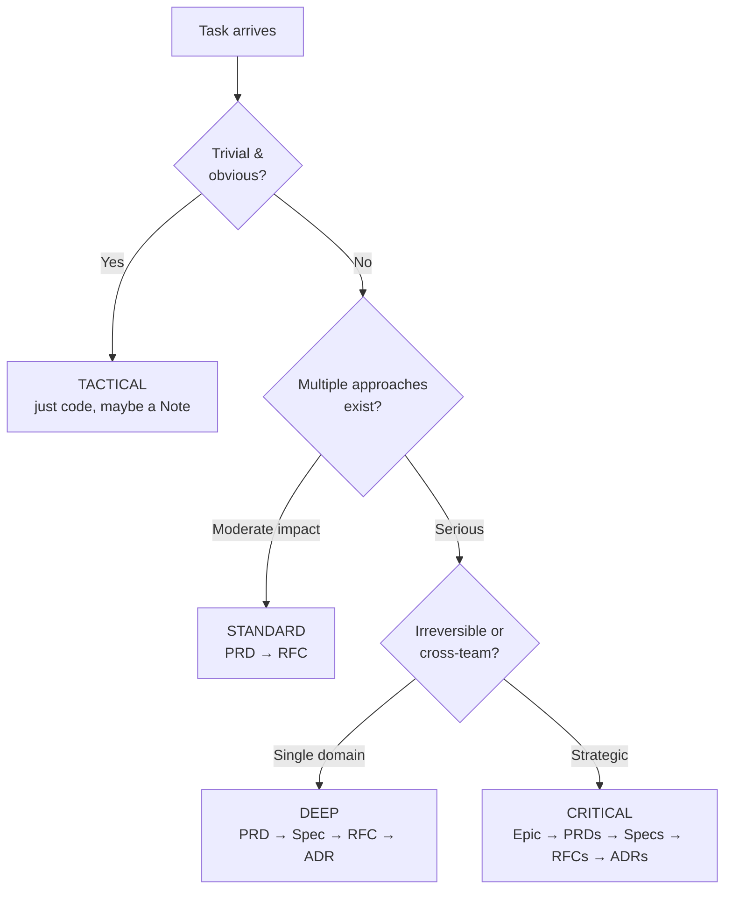

## Why This Matters

Not every task deserves the same level of rigor. A typo fix and a payment system redesign are fundamentally different -- treating them the same way either buries you in paperwork for trivial changes or leaves critical decisions undocumented. Routing solves this by asking one question upfront: **how much can go wrong?**

Getting the depth right saves real time. Over-engineering a simple fix with a full PRD-Spec-RFC-ADR pipeline wastes hours. Under-documenting an irreversible architecture choice means you will relitigate it in three months when nobody remembers why.

## Overview

Before writing any code, Forgeplan determines the **depth** -- how much structure your decision needs.

The output values below are illustrative, not captured measurements.
Router confidence is a heuristic/model assessment, not a measured probability
of correctness. Time ranges are planning heuristics, not effort guarantees.

```bash
forgeplan route "add payment system"
# -> Depth: Deep
# -> Pipeline: PRD -> Spec -> RFC -> ADR
# -> Confidence: 92%
```

## Four Depth Levels

| Level | When | Artifacts | Time |
|-------|------|-----------|------|
| **Tactical** | Quick fix, 1 file, easily reversible | Note or nothing | Minutes |
| **Standard** | Feature 1-3 days, multiple approaches | PRD -> RFC | Hours |
| **Deep** | New module, 1-2 weeks, irreversible | PRD -> Spec -> RFC -> ADR | Days |
| **Critical** | Cross-team, strategic initiative | Epic -> PRD[] -> Spec[] -> RFC[] -> ADR[] | Weeks |

Critical is a methodology-level strategic category. The current core parses
`critical` as `Deep` and displays Deep/Critical; its generated pipeline is
PRD → Spec → RFC → ADR, not an automatically expanded Epic hierarchy.

### Real-World Examples

**Tactical**: Fixing a parsing bug where a closing `---` in YAML frontmatter is not detected. One file, one test, ship it. No artifact needed.

**Standard**: Adding a JSON export format with moderate impact and several
approaches. Create a PRD for requirements and an RFC for the design.
Authentication changes may instead trigger Deep because of their security impact.

**Deep**: Building a new payment processing module. It touches user financial data, involves third-party integrations, and a wrong choice in payment provider is expensive to reverse. Full pipeline: PRD, Spec for API contracts, RFC for architecture, ADR for the Stripe-vs-PayPal decision.

**Critical**: Migrating a monolith to microservices. Multiple teams involved, months of work, affects the entire system. Epic to group everything, multiple PRDs for each service boundary, Specs for inter-service contracts, RFCs for migration strategy, ADRs for every major decision.

## Decision Tree

The routing decision boils down to two questions asked in sequence:



Use the triviality question to avoid unnecessary paperwork. No measured
60–70% task distribution is established here; choose rigor by actual risk.

## Auto-Escalation Triggers

These are methodology escalation guidelines, not a guarantee that every
natural-language description triggers the corresponding runtime rule:

| Trigger | Minimum Level |
|---------|---------------|
| Hard to roll back (>2 weeks impact) | Standard+ |
| Affects multiple teams | Standard+ |
| Problem unclear, needs research | Standard+ |
| Security or compliance requirements | Deep+ |
| Affects public API | Deep+ |
| Touches user data | Deep+ |
| Roadmap-level decision | Critical |

:::tip
**When uncertain, investigate the higher-risk interpretation.** Escalating
adds review cost; it does not itself make a decision safe. Do not skip
required Deep artifacts or gates merely because the router is advisory.
:::

For example, a caching change that affects user-visible consistency needs
a deeper assessment. Describe that context explicitly; the keyword router
cannot infer every consequence from "add a caching layer".

## The Route Command

```bash
# Smart routing -- LLM if configured, keywords otherwise
forgeplan route "add OAuth2 authentication"
```

Illustrative output sketch, not a captured CLI transcript:

```
Task: add OAuth2 authentication
Depth: Deep
Pipeline: PRD → Spec → RFC → ADR
Confidence: 88%
Signals:
  + security keyword (auth)
  + affects public API (authentication flow)
  + irreversible choice (provider lock-in)
Recommendation:
  1. forgeplan new prd "OAuth2 Authentication"
  2. Fill MUST sections (Problem, Goals, FR)
  3. forgeplan reason PRD-XXX  # ADI mandatory for Deep
```

The router analyzes keywords (security, API, migration) and scope indicators
to suggest the right depth. If you disagree, you make the judgment call --
the route is a recommendation, not an enforcement.

### Smart Routing v2: Three Levels

Forgeplan's router (PRD-020) runs up to three layers, falling back
gracefully if later layers are unavailable:

| Level | Engine | When it runs | Cost |
|-------|--------|-------------|------|
| **L0** | Keyword/scope rules | Forced with `--level 0`; fallback when LLM routing is unavailable | No LLM call |
| **L1** | LLM classifier | Configured LLM in auto mode, or `--level 1` | Provider call |
| **L2** | Additional ADI reasoning | Handler accepts `--level 2`; auto mode can escalate a Deep L1 result | Additional provider call |

Captured help describes levels 0/1 and a keyword default, while the current
handler auto-selects LLM when available and accepts level 2. It passes no
ingested KB context to that routing call. `route` has no `--fpf` option;
`--fpf` belongs to `reason`. Without usable LLM configuration, routing falls
back to L0. No 70% coverage or millisecond latency guarantee is established.

### What the Router Looks For

The router checks for specific signals that indicate complexity:

- **Security keywords** (auth, encryption, credentials) push toward Deep+
- **Data keywords** (migration, schema, user data) push toward Deep+
- **Scope indicators** differ: cross-team signals can require Standard, while public API or irreversibility can require Deep. Critical is not a separate core enum value.
- **Simplicity indicators** (fix, typo, rename, bump) keep it Tactical

If the router says Tactical but the consequences justify Standard or Deep,
record the reason and choose more rigor. The suggestion does not know all
project context.

## Gotchas

- **"Add a new CLI command" often routes as Tactical** when it should be Standard. If the command introduces new behavior or API surface, override to Standard.
- **Refactoring can be deceptively deep.** A "simple refactor" that changes module boundaries or public interfaces is Standard or Deep, not Tactical.
- **Do not route after you have already started coding.** Route first. If you skipped routing and realize mid-implementation that this is more complex than expected, stop and create the appropriate artifacts before continuing.
- **The router does not know your codebase history.** It cannot tell that "add caching" is trivial in one project and a week-long effort in another. You provide the context it lacks.
- **Beware the "it's just a small change" trap.** Database schema changes, public API modifications, and authentication flows are never small -- even if the code diff is. Route based on consequences, not lines of code.

## Related

- [CLI: forgeplan route](/docs/cli/route/)
- [ADI Reasoning](/docs/methodology/adi/) - mandatory for Deep/Critical
- [Artifact Lifecycle](/docs/methodology/lifecycle/) - validation gates differ by depth
- [Quick Start](/docs/getting-started/quick-start/) - see routing in the full cycle
