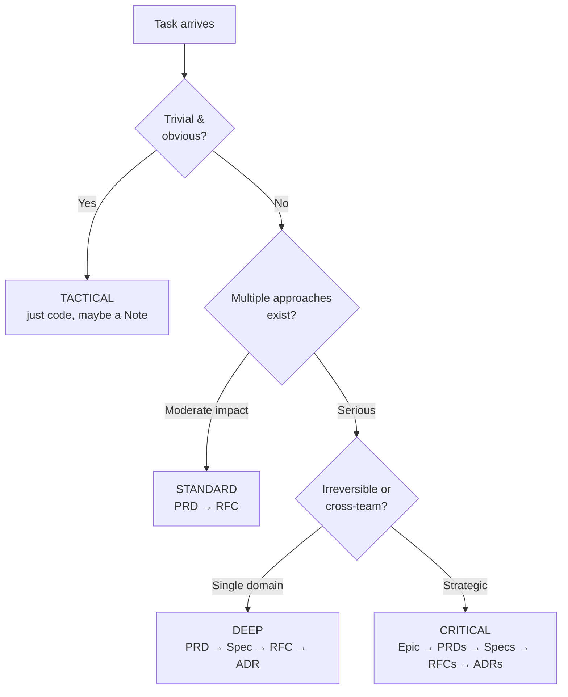

## Why This Matters

Not every task deserves the same level of rigor. A typo fix and a payment system redesign are fundamentally different. Treating them the same way either buries you in paperwork for trivial changes or leaves critical decisions undocumented. Routing solves this by asking one question upfront: **how much can go wrong?**

Getting the depth right saves real time. Over-engineering a simple fix with a full PRD-Spec-RFC-ADR pipeline wastes hours. Under-documenting an irreversible architecture choice means you will relitigate it in three months when nobody remembers why.

## Overview

Before coding, use `route` to recommend depth and an artifact pipeline. The recommendation is not a source-code permission gate or a replacement for project judgment.

```bash
forgeplan route "add a new payment module with a public API" --level 0
# Keyword routing is offline; inspect matched signals, depth, and pipeline.
```

## Four depth levels

| Level | When | Artifacts | Time |
|-------|------|-----------|------|
| **Tactical** | Quick fix, 1 file, easily reversible | Note or nothing | Minutes |
| **Standard** | Feature 1-3 days, multiple approaches | PRD -> RFC | Hours |
| **Deep** | New module, 1-2 weeks, irreversible | PRD -> Spec -> RFC -> ADR | Days |
| **Critical** | Cross-team, strategic initiative | Epic -> PRD[] -> Spec[] -> RFC[] -> ADR[] | Weeks |

This table describes methodology, not four distinct runtime modes. In 0.38.0, core `Mode` stores `note`, `tactical`, `standard`, and `deep`; Critical is normalized to Deep and displayed as **Deep/Critical**. The core pipeline is empty for Tactical, PRD → RFC for Standard, and PRD → Spec → RFC → ADR for Deep/Critical. It does not automatically add Epic arrays, SOL, or REFRESH.

The published workflow adds **SOL** between PRD and design, and **REFRESH** after reconciliation, at Deep/Critical. `/gate-check` has separate `deep` and `critical` policy thresholds, so an orchestrator must preserve the intended tier explicitly; do not assume the collapsed core label selects the Critical policy for you.

### Real-World Examples

**Tactical**: Fixing a parsing bug where a closing `---` in YAML frontmatter is not detected. One file, one test, ship it. No artifact needed.

**Standard**: Adding a reversible internal reporting feature with several approaches. Create a PRD for requirements and an RFC for design. Authentication is not a Standard example for the keyword router: `auth` and `oauth` are Deep triggers.

**Deep**: Building a new payment processing module. It touches user financial data, involves third-party integrations, and a wrong choice in payment provider is expensive to reverse. Full pipeline: PRD, Spec for API contracts, RFC for architecture, ADR for the Stripe-vs-PayPal decision.

**Critical**: Migrating a monolith to microservices. Multiple teams involved, months of work, affects the entire system. Epic to group everything, multiple PRDs for each service boundary, Specs for inter-service contracts, RFCs for migration strategy, ADRs for every major decision.

## Decision Tree

The routing decision boils down to two questions asked in sequence:



Use this as a judgment aid, not the implementation of the router. L0 takes the highest minimum depth among matched signals; no match defaults to Tactical. No measured proportion of your team's work follows from that default.

## Auto-Escalation Triggers

At L0, matching signals impose minimum depths. The rules match English substrings, not a semantic understanding of all languages:

| Example signal | Minimum core depth |
|---|---|
| `security`, `auth`, `oauth`, `compliance` | Deep |
| `breaking change`, `migration`, `deprecat` | Deep |
| `public api`, `api contract`, `openapi` | Deep |
| `strategy`, `roadmap`, `initiative`; `p0`, `critical`, `hotfix` | Deep |
| `cross-team`, `multiple teams`, `cross-service` | Standard |
| `data model`, `schema change`; infrastructure/deployment | Standard |
| `new module`, `new command`, `new feature`; `bug`, `regression`, `redesign` | Standard |

:::tip
Choose depth from consequences and reversibility. A higher tier adds work; it is not automatically safer if the extra checks are irrelevant or skipped. Record a justified override instead of treating keyword confidence as proof.
:::

For example, user-visible cache consistency may justify Deep, but L0 has no generic "touches user data" trigger. Include the actual API, migration, or security consequences in the description and inspect what matched.

## The Route Command

```bash
# Offline, deterministic keyword recommendation
forgeplan route "add OAuth2 authentication" --level 0

# Explicit LLM classification; requires configured provider
forgeplan route "add OAuth2 authentication" --level 1
```

For the offline example, `oauth`/`auth` match the security signal, giving the core Deep/Critical pipeline PRD → Spec → RFC → ADR. The printed confidence summarizes matching rules; it is not a calibrated probability that the route is correct.

Routing does not fill artifacts, run ADI, execute the pipeline, or prove the chosen design. Use actual returned IDs when creating and linking the subsequent records.

The router analyzes keywords (security, API, migration) and scope indicators
to suggest the right depth. If you disagree, you make the judgment call; the route is a recommendation, not an enforcement.

### Smart routing v2: three levels

The CLI implementation supports three routing levels, with fallback when LLM routing is unavailable:

| Level | Engine | Selection |
|---|---|---|
| **L0** | Deterministic keyword and scope rules | `--level 0`; also the fallback without a usable LLM |
| **L1** | Configured LLM classifier, constrained by keyword minimums | `--level 1`; auto mode first attempts this |
| **L2** | LLM reasoning over the routing decision | `--level 2`; auto mode escalates a successful L1 Deep result |

In 0.38.0, help lists L0/L1, while the CLI implementation also accepts L2. **There is no `route --fpf` flag.** The CLI's L2 call supplies no indexed FPF context; do not confuse it with `reason --fpf` on an existing artifact. L2 routing is not the durable ADI Evidence required by the marketplace gates.

Without `--level`, the CLI tries the configured LLM, not invariably L0 as the short help wording suggests. `--explain` is deprecated in favor of `--level 1`. MCP `forgeplan_route` accepts `description` and optional `workspace`, not these CLI flags, and uses L1 with an L0 fallback.

### What the router looks for

The router checks for specific signals that indicate complexity:

- **Security and breaking-change signals** can impose Deep.
- **Data model, new subsystem, bug, and cross-team signals** can impose Standard.
- **No matching signal** defaults to Tactical; it does not establish that the work is simple.

Descriptions in Russian may not match the English L0 triggers. Use explicit technical context and review the result rather than assuming a natural-language classifier ran.

The marketplace's `/smith` and `/smith-plan` answer a different question: which of 14 methodology contexts applies, and which agents and evidence are needed? Smith returns a Plan and does not execute its recommended dispatches or activate artifacts. The main orchestrator does that. `/forge-cycle` then applies Standard+ ADI and review gates, `/gate-check` before build, and guardian before activation. None of these roles is installed by the CLI `route` command.

## Gotchas

- **"New command" matches Standard at L0.** Other wording may not match. Inspect the signal list instead of assuming all CLI changes are Tactical or all are Deep.
- **Refactoring can be deceptively deep.** A "simple refactor" that changes module boundaries or public interfaces is Standard or Deep, not Tactical.
- **Do not route after you have already started coding.** Route first. If you skipped routing and realize mid-implementation that this is more complex than expected, stop and create the appropriate artifacts before continuing.
- **The router does not know your codebase history.** It cannot tell that "add caching" is trivial in one project and a week-long effort in another. You provide the context it lacks.
- **Beware the "it's just a small change" trap.** Database schema changes, public API modifications, and authentication flows are never small, even if the code diff is. Route based on consequences, not lines of code.

## Related

- [CLI: forgeplan route](/docs/cli/route/)
- [ADI Reasoning](/docs/methodology/adi/) - mandatory for Deep/Critical
- [Artifact Lifecycle](/docs/methodology/lifecycle/) - validation gates differ by depth
- [Quick Start](/docs/getting-started/quick-start/) - see routing in the full cycle
