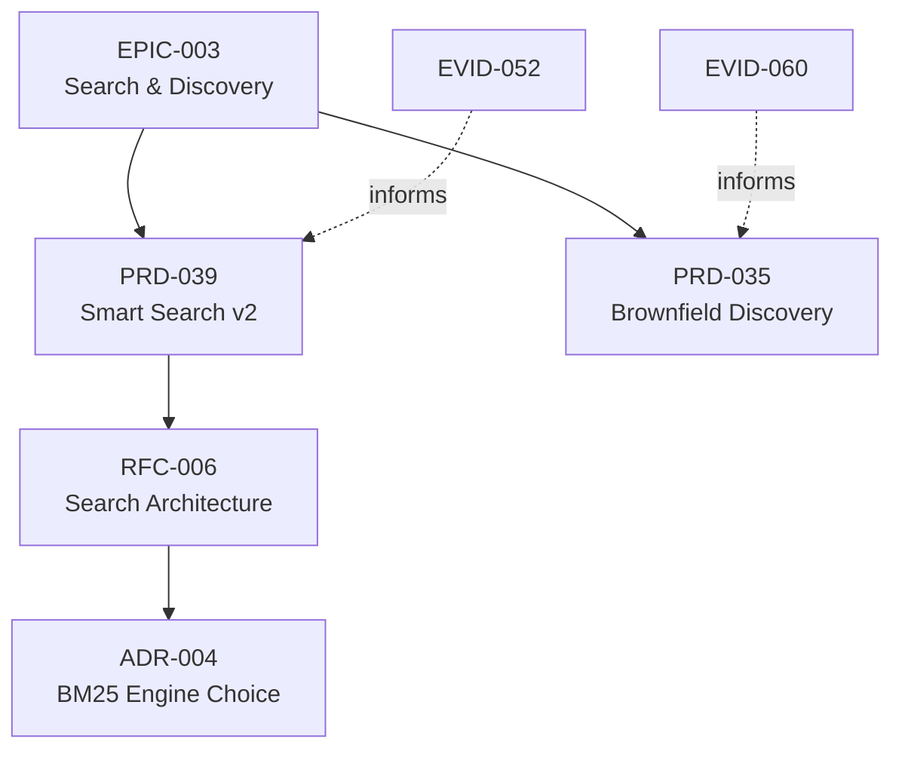

Выводит граф зависимостей всех связанных артефактов в формате Mermaid. В отличие от
[`tree`](/docs/cli/tree/), который показывает только иерархию родитель/потомок, `graph`
показывает типизированные связи `informs`, `based_on`, `refines`, `supersedes`
и `parent_epic` как `belongs_to`. Циклы возможны; DAG не гарантируется.

Отдельный федеративный интерфейс - `constellation graph`.

## Когда использовать

- Вставить в задачу/PR на GitHub для визуализации влияния предложения
- Встроить в RFC или Epic для демонстрации области охвата
- Передать в `mmdc` (mermaid-cli) для рендеринга PNG/SVG
- Обнаружить неожиданные циклы или кластеры сирот (артефактов без связей)

## Когда не использовать

- Вам нужна только декомпозиция родитель/потомок → используйте [`forgeplan tree`](/docs/cli/tree/)
- Вам нужен порядок выполнения → используйте [`forgeplan order`](/docs/cli/order/)
- Вам нужен плоский список → используйте [`forgeplan list`](/docs/cli/list/)

## Использование

```text
forgeplan graph [OPTIONS]
```

## Опции

```text
      --json     Вывод в формате JSON для машинной обработки
  -h, --help     Вывести справку
  -V, --version  Вывести версию
```

## Примеры

Вывести исходный код Mermaid:

```bash
forgeplan graph
```

Перенаправить в файл и вставить в GitHub:

```bash
forgeplan graph > deps.mmd
```

Рендеринг в PNG с помощью mermaid-cli:

```bash
forgeplan graph | sed '/^Next:/d' > deps.mmd
mmdc -i deps.mmd -o deps.png
```

JSON для пользовательского интерфейса:

```bash
forgeplan graph --json | jq '.edges | length'
```

## Интерпретация вывода

Рендерер выводит `graph LR`; в stdout также может быть завершающая подсказка `Next:`.
Ниже ручная иллюстрация, не точный вывод команды:

```
graph TD
  EPIC_003[EPIC-003<br/>Search, Discovery]
  PRD_039[PRD-039<br/>BM25 production]
  RFC_004[RFC-004<br/>Layered search]
  EVID_018[EVID-018<br/>Benchmark]
  EPIC_003 --> PRD_039
  PRD_039 --> RFC_004
  EVID_018 -.informs.-> PRD_039
```

Соглашения:

| Синтаксис          | Значение                                            |
|-----------------|----------------------------------------------------|
| `belongs_to` | Направление от потомка к родителю `parent_epic` |
| Подпись ребра | Записанный тип связи |
| Идентификатор узла | ID артефакта; заголовки рендерер не загружает |

Стили зависят от типа артефакта и состояния гипотезы, не общего lifecycle-статуса.
JSON содержит `edges` с `from`, `to`, `relation`, а также `brownfield_only`
и `_next_action`; массива `nodes` нет. `--brownfield-only` в этом обработчике
фильтрует Mermaid, но не список рёбер JSON.

### Пример отрисованной диаграммы



## Как это работает

`graph` представляет собой полное реляционное представление. Для разных вопросов:

```
graph   →  все рёбра              (реляционная картина)
tree    →  только родитель/потомок (иерархия)
order   →  топологический обход    (выполнение)
blocked →  неразрешённые зависимости (планирование)
```

## См. также

- [`forgeplan tree`](/docs/cli/tree/) - иерархическое представление
- [`forgeplan order`](/docs/cli/order/) - топологический порядок
- [`forgeplan blocked`](/docs/cli/blocked/) - блокирующие зависимости
- [`forgeplan link`](/docs/cli/link/) - создание типизированных рёбер

<!-- forgeplan-runtime:start -->
## Снимок CLI help

Источник: `forgeplan 0.39.0+constellation.s1.1`, `forgeplan graph --help`.

```text
Generate mermaid dependency graph of linked artifacts

Usage: forgeplan graph [OPTIONS]

Options:
      --json             Output as JSON for machine consumption
      --brownfield-only  Issue #287 Phase F: filter edges to brownfield kinds only (UC / GLOS / INV / SCEN / HYP / DM). Pipeline edges (PRD / RFC / ADR / EPIC / SPEC) are dropped from output. Domain-model subgraph clusters are preserved
  -h, --help             Print help
  -V, --version          Print version
```
<!-- forgeplan-runtime:end -->
