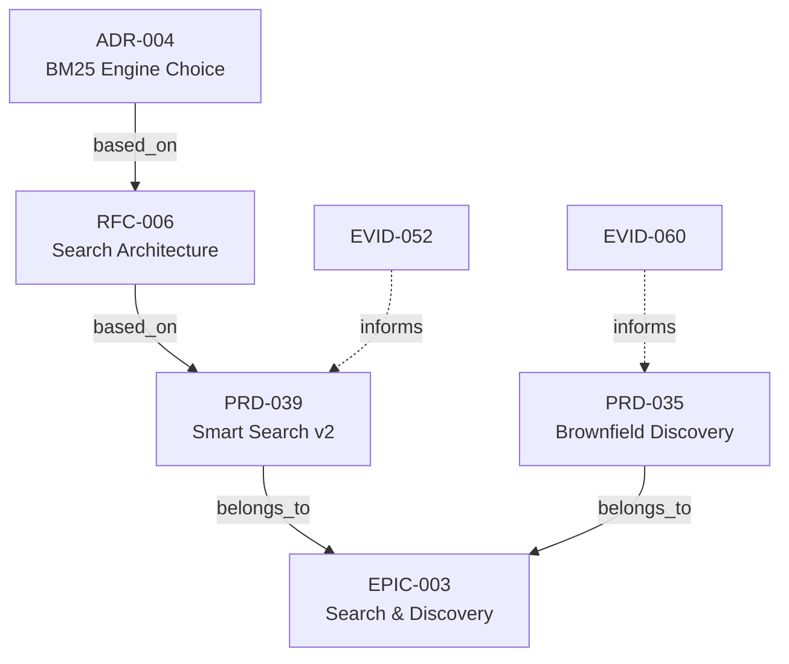

Выводит граф зависимостей всех связанных артефактов в формате Mermaid. В отличие от
[`tree`](/ru/docs/cli/tree/), который показывает только иерархию родитель/потомок, `graph`
отображает каждую типизированную связь (`informs`, `supersedes`, `based_on`, `refines`, `contradicts`
и т.д.) как ребро - полный граф решений; циклы возможны.

## Forgeplan 0.38.0

`--brownfield-only` ограничивает Mermaid-визуализацию brownfield-артефактами. В JSON 0.38.0 флаг только отражается в brownfield_only: массив edges остаётся полным, без фильтрации. Массив nodes отсутствует. Текстовый вывод также содержит строку `Next:`, не являющуюся Mermaid; примеры записи в файл ниже удаляют её. Для графа одного артефакта сначала изучите связи через `get`: позиционного ID у graph нет.

## Когда использовать

- Вставить в задачу/PR на GitHub для визуализации влияния предложения
- Встроить в RFC или Epic для демонстрации области охвата
- Передать в `mmdc` (mermaid-cli) для рендеринга PNG/SVG
- Обнаружить неожиданные циклы или кластеры сирот (артефактов без связей)

## Когда не использовать

- Вам нужна только декомпозиция родитель/потомок → используйте [`forgeplan tree`](/ru/docs/cli/tree/)
- Вам нужен порядок выполнения → используйте [`forgeplan order`](/ru/docs/cli/order/)
- Вам нужен плоский список → используйте [`forgeplan list`](/ru/docs/cli/list/)

## Использование

```text
forgeplan graph [OPTIONS]
```

## Опции

```text
      --json             Output as JSON for machine consumption
      --brownfield-only  Issue #287 Phase F: filter edges to brownfield kinds only (UC / GLOS / INV / SCEN / HYP / DM). Pipeline edges (PRD / RFC / ADR / EPIC / SPEC) are dropped from output. Domain-model subgraph clusters are preserved
  -h, --help             Print help
  -V, --version          Print version
```

## Примеры

Вывести исходный код Mermaid:

```bash
forgeplan graph
```

Перенаправить в файл и вставить в GitHub:

```bash
forgeplan graph | grep -v '^Next:' > deps.mmd
```

Рендеринг в PNG с помощью mermaid-cli:

```bash
forgeplan graph | grep -v '^Next:' > deps.mmd && mmdc -i deps.mmd -o deps.png
```

JSON для пользовательского интерфейса:

```bash
forgeplan graph --json | jq '.edges | length'
```

## Интерпретация вывода

Стандартный вывод - это синтаксис Mermaid `graph TD`:

```
graph TD
  EPIC_003[EPIC-003<br/>Search, Discovery]
  PRD_039[PRD-039<br/>BM25 production]
  RFC_004[RFC-004<br/>Layered search]
  EVID_018[EVID-018<br/>Benchmark]
  PRD_039 -->|belongs_to| EPIC_003
  RFC_004 -->|based_on| PRD_039
  EVID_018 -.informs.-> PRD_039
```

Соглашения:

| Синтаксис          | Значение                                            |
|-----------------|----------------------------------------------------|
| `A --> B` | Потомок A → родитель B для связи `belongs_to` |
| `A -.informs.-> B` | Типизированное ребро из фронтматтера ссылки      |
| `A -.supersedes.-> B` | Ребро жизненного цикла, старый ID указывает на замену |
| Метка узла      | `<ID><br/><title>`                                 |

Диаграммы ниже иллюстративны: ID узлов, стили, подписи и связи зависят от пространства. Связь с родителем — `belongs_to`, от потомка к родителю.

С опцией `--json` оболочка имеет вид `{ edges: [{from, to, relation}], brownfield_only, _next_action }` - готово для
Cytoscape, D3 или любой другой библиотеки графов.

### Пример отрисованной диаграммы



## Как это работает

`graph` представляет собой полное реляционное представление. Для разных вопросов:

```
graph   →  all edges              (relational picture)
tree    →  parent/child only       (hierarchy)
order   →  topological walk        (execution)
blocked →  unresolved dependencies (planning)
```

## См. также

- [`forgeplan tree`](/ru/docs/cli/tree/) - иерархическое представление
- [`forgeplan order`](/ru/docs/cli/order/) - топологический порядок
- [`forgeplan blocked`](/ru/docs/cli/blocked/) - блокирующие зависимости
- [`forgeplan link`](/ru/docs/cli/link/) - создание типизированных рёбер