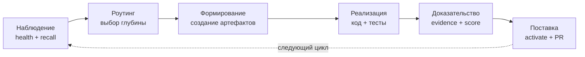

## Полный цикл

Используйте этот цикл для нетривиальной работы. CLI хранит, валидирует и
оценивает артефакты; ИИ-среда или человек выполняет реализацию, тесты,
независимое ревью и поставку. Публичный маркетплейс даёт необязательные
оркестраторы, а не дополнительные фазы, которые CLI запускает автоматически.

```
OBSERVE → ROUTE → SHAPE → BUILD → PROVE → SHIP
```

| Фаза | Что происходит | Команды / интеграции |
|-------|-------------|---------------------|
| **Observe** | Понимание текущего состояния | `forgeplan health`, необязательная память Hindsight |
| **Route** | Рекомендация глубины и конвейера | `forgeplan route "task"`; `/smith` из маркетплейса выбирает методологию |
| **Shape** | Заполнение и валидация требований; независимое ревью передачи плана | `forgeplan new prd "Title"`, `forgeplan update ID --body @body.md`, `forgeplan validate ID` |
| **Build** | Реализация и тестирование в стеке проекта | `cargo test`, `pytest` или команда тестов проекта |
| **Prove** | Запись реальных проверок и ревью, связь доказательств, изучение оценки | `forgeplan new evidence "Title"`, `forgeplan link`, `forgeplan score ID` |
| **Ship** | Ревью/активация утверждений о завершении, коммит, PR, слияние | `forgeplan review ID`, `forgeplan activate ID`, Git и инструменты хостинга |



## Фаза 0: Observe

Прежде чем что-либо делать - поймите, что происходит:

```bash
forgeplan status
forgeplan session
forgeplan health
# Также прочитайте задачи в трекере или TODO.md.
```

Hindsight и Orchestra — отдельные необязательные интеграции, а не shell-команды
Forgeplan. Память публичного `fpl-hsmem` 3.7 требует явного проектного
`.hindsight.json` с `url`, разрешёнными `banks` и `defaultBank`;
выбранные банки должны уже существовать на сервере. Хуки по умолчанию выключены.
Если память настроена, используйте её MCP recall; не вставляйте
`memory_recall(...)` в терминал.

**Правило**: если проверка состояния показывает слепые пятна или сирот - **исправьте их СНАЧАЛА**, прежде чем начинать новую работу.

## Фаза 1: Route

Определите правильный уровень строгости:

```bash
forgeplan route "add payment processing"
```

Уровень 0 по умолчанию классифицирует ключевые слова; `--level 1` использует
настроенный LLM. Прочитайте рекомендацию команды, а не ожидайте фиксированной
глубины и уверенности для одной фразы.

| Глубина | Типичная область |
|---------|------------------|
| Tactical | Небольшая обратимая правка; артефакт не обязателен, проверка обязательна |
| Standard | PRD → RFC по необходимости → код → доказательства |
| Deep | PRD → Spec → RFC → ADR по необходимости → код → доказательства |
| Critical | Инициатива разбита на Epic/PRD/Spec/RFC/ADR с явными зависимостями |

**Тактическая = перейти к Build.** Всё остальное = продолжить к Shape.

## Фаза 2: Shape

Создайте правильные артефакты и заполните их:

```bash
# Создать артефакт
forgeplan new prd "Payment Processing"

# Заполнить ОБЯЗАТЕЛЬНЫЕ разделы: Problem, Goals, Non-Goals, Target Users, FR, Related Artifacts
# Каждое FR: "[Действующее лицо] может [возможность]" - без технических названий
# Сохраните полное тело в payment-prd-body.md; используйте выданный ID:
forgeplan update PRD-001 --body @payment-prd-body.md

# Валидация
forgeplan validate PRD-001
# Продолжайте, только если реальный валидатор сообщает 0 ошибок MUST; иначе исправьте находки.
```

### ADI Reasoning (Standard+)

До кода рассмотрите альтернативы. При настроенном LLM:

```bash
forgeplan reason PRD-001 --save
```

Команда генерирует гипотезы, предсказания и вывод; `--save` сохраняет связанный
Note. Она не проводит предсказанные эксперименты и не проверяет код.
Без LLM команда возвращает ошибку; человек может явно записать ADI вручную,
не выдавая это за автоматический запуск.

ADI рекомендован для Standard и обязателен по этой методологии для
Deep/Critical. Ревью плана в агентном конвейере должно пройти до следующей
фазы; уверенная рекомендация модели не заменяет это ревью.

## Фаза 3: Build

Реализуйте решение:

```bash
# 1. Создать ветку
git checkout dev && git pull origin dev
git checkout -b feat/payment-processing

# 2. Реализуйте требования и проверьте поведение тестами.
# Для принудительного test-first используйте описанный ниже подцикл TDD.

# 3. Форматирование + линтинг
cargo fmt && cargo fmt -- --check   # Rust
ruff format && ruff check           # Python
pnpm exec tsc --noEmit              # TypeScript

# 4. Тестирование
cargo test        # Rust
pytest             # Python
pnpm test          # TypeScript
```

### Audit (Standard+)

```text
/audit
```

Это навык маркетплейса, а не встроенная shell-команда. Оркестратор привлекает
независимых проверяющих по рискам задачи. Разделяйте контексты автора и
проверяющего, исправьте блокирующие/высокоприоритетные находки и повторите
затронутые проверки после исправлений. Доказательства ревью должны называть
реальную область проверки: нельзя выдумывать находки или заявлять о четырёх
агентах, если они не запускались.

## Фаза 4: Prove

Создайте доказательство того, что решение работает:

```bash
forgeplan new evidence "Payment processing verification"
# Сохраните реальные результаты и структурированные поля в payment-evidence.md.
forgeplan update EVID-001 --body @payment-evidence.md
forgeplan link EVID-001 PRD-001 --relation informs
forgeplan score PRD-001
```

Используйте ID из вывода `new`; примеры предполагают новые счётчики.
Поддерживающий пакет тестовых доказательств может содержать:

```text
verdict: supports
congruence_level: 3
evidence_type: test
```

Используйте эти значения только если наблюдения их обосновывают. Запишите
команды, результаты, контекст, ограничения и личность проверяющего. Для
утверждений об изменении кода добавьте реальные `base_sha`, `result_sha`,
`changed_paths`; гейт происхождения проверяет Git-delta, а не корректность
тестов, и по умолчанию работает в режиме `warn`.

:::caution
Отсутствующий/неизвестный verdict или отсутствие декларации конгруэнтности даёт CL0. Свежий поддерживающий пакет test/measurement с CL0 получает 0.1; рекурсивный расчёт также вычитает 0.1 для benchmark и 0.2 для audit, поэтому эти CL0-пакеты получают 0. Истёкшее допустимое доказательство вместо этого получает 0.1 до вычитания штрафов за verdict/CL/тип. CLI `score` берёт минимум собственных текущих доказательств и допустимых оценок зависимостей после штрафов за тип связи. Терминальные доказательства исключаются, черновики учитываются. Положительный R_eff не доказывает независимо, что функция работает.
:::

## Фаза 5: Ship

После реальной проверки утверждения о завершении активируйте его явно.
Артефакты плана могут уже быть активными: раннее независимое ревью фиксирует
входы для Build. Это не означает, что реализация выпущена.

```bash
# 1. Ревью + активация
forgeplan activate EVID-001
forgeplan review PRD-001
# Следующую строку выполняйте только для draft PRD; активный план повторно не активируйте.
forgeplan activate PRD-001

# 2. Пуш + PR
git push origin feat/payment-processing
gh pr create --base dev --title "[PRD-001] Payment Processing"

# 3. После слияния - синхронизация
git checkout dev && git pull origin dev

# 4. При необходимости сохраните краткое решение/урок через настроенный Hindsight MCP.
# Не используйте memory_retain(...) как shell-команду и не копируйте выдуманную оценку.

# 5. Обновить прогресс
# - Чекбоксы RFC: [x]
# - TODO.md: переместить в Выполнено
```

## Типы конвейеров

### Greenfield (новый модуль с нуля)

Публичный плагин `agents-bmad` предназначен для **совершенно нового продукта
или сервиса**, а не любой функции с новым модулем:

```text
/bmad-init
/bmad <greenfield brief>
```

Последовательность — Analyst → PM → Architect → Scrum-Master → Dev → QA.
До кода обязательны независимые гейты PRD, архитектуры/RFC и готовности к
реализации. Выполните `/bmad-init` один раз для классификации файлов и
включения блокирующего хука; без конфигурации стека гейт BMAD не действует.

### Brownfield (существующий код)

```
Explore → Identify → {
  feature:   PRD → RFC → Build
  bug:       Problem → Fix
  refactor:  Audit → Problem → RFC → Build
  migration: Research → ADR → RFC → Build
}
```

Начните с **Explore**. Для модернизации legacy `/smith` выбирает
Strangler Fig + DDD. Для одной функции в существующей активной системе
используйте `agents-sparc`:

```text
/sparc <one well-scoped feature>
```

SPARC проходит Specification → Pseudocode → Architecture → Refinement →
Completion. Главная сессия исполняет последовательность, вызывает агентов фаз
и независимых проверяющих, явно активирует проверенные артефакты между фазами.
**Отдельного блокирующего хука нет**, как и `/sparc-init`; контроль основан
на порядке фаз. Псевдокод проверяется на гейте Architecture, а не фиксируется
как производственная логика. Для MICRO можно опустить Pseudocode, но не
независимое ревью кода.

### TDD внутри Build

`agents-tdd` отвечает за план → RED → независимую проверку/фиксацию тестов →
GREEN → lint, затем передаёт результат в отдельную стадию ревью кода Audit.

```text
/tdd-init
/tdd
```

Выполните `/tdd-init` перед первым циклом и после смены стека. На входе нужны
**активные PRD и SPEC с блоками `#### Scenario`**. Отдельный
`tdd-test-validator` подтверждает корректный RED: тест компилируется, исполняет
assertion и падает на нём, а не на ошибке импорта/настройки. Только затем
фиксируется нормализованный хеш SPEC и открывается GREEN. Активный хук
блокирует правки тестов и дрейф SPEC в GREEN; отсутствие состояния ветки
означает, что TDD не активен, а не что ветка защищена. Refinement в SPARC может
передать работу сюда, когда важна неизменность тестов.

В каждом конвейере **автор ≠ проверяющий**: агенты фаз создают результат,
независимые контексты проверяют, главный оркестратор выполняет активацию.
Доказательство должно содержать вердикт ревью и личность проверяющего;
само наличие Evidence не означает PASS.

### Смешанный

Выбирайте по **задаче**, а не по ярлыку репозитория:

- Новый продукт/сервис может использовать BMAD.
- Функция активной системы может использовать SPARC, даже если добавляет новый модуль.
- Модернизация legacy начинается с изучения и плана по Strangler.
- TDD — подцикл Build, а не замена планированию продукта и архитектуры.

Метки CLI `phase`/`phase-advance` рекомендательные. Они не контролируют
этот порядок и не устанавливают хуки маркетплейса; claims — сигналы
координации, а не блокировка записи файлов.

## Команда Forge-Cycle

`/forge-cycle` поставляется публичным плагином `forgeplan-workflow`.
Установите его в совместимой среде; одной установки CLI недостаточно.
Другие публичные пакеты (`fpl-skills`, `agents-bmad`, `agents-sparc`,
`agents-tdd` и нужные агенты-специалисты) предоставляют свои навыки и контракты.

```text
/plugin marketplace add ForgePlan/marketplace
/plugin install forgeplan-workflow@ForgePlan-marketplace
/forge-cycle PRD-001
```

Загруженный шаблон ведёт оркестратора через health/роутинг, оформление,
планирование, реализацию, независимый аудит, исправления, доказательства,
активацию и поставку. `/sprint`, `/team-up`, `/audit` внутри шаблона —
**смысловые маркеры**, а не автоматически вызываемая цепочка slash-команд.
Главная сессия выполняет эквивалентные вызовы агентов и инструментов.
Что удастся запустить, зависит от доступности, прав среды, согласований
и конфигурации проекта; это не безусловное автономное исполнение.

## Блокировка области

| Тип сессии | Делать | Не делать |
|-------------|-----|-------|
| **Тактическая** (конкретная задача) | Кодировать, тестировать, коммитить | Не отклоняться в планирование |
| **Стратегическая** (исследование, планирование) | Исследовать, создавать артефакты | Не начинать кодировать |

Если вы заметили отклонение от области → сохраните прогресс → начните новую сессию правильного типа.

## Чек-лист: Работа выполнена?

- [ ] Артефакт заполнен (ОБЯЗАТЕЛЬНЫЕ разделы)
- [ ] Валидация УСПЕШНА
- [ ] ADI записан (рекомендован для Standard, обязателен для Deep/Critical)
- [ ] Код реализован
- [ ] Тесты пройдены
- [ ] Форматирование + линтинг чисты
- [ ] Аудит: 0 HIGH/CRITICAL
- [ ] Реальные доказательства содержат проверки, ограничения, проверяющего и структурированные поля
- [ ] R_eff изучен относительно утверждения, а не принят за проверку кода
- [ ] Нужные передачи между фазами и утверждение о завершении явно проверены и активированы
- [ ] PR создан и объединен
- [ ] Прогресс обновлен (чекбоксы RFC, TODO.md)
- [ ] Память сохранена (если значимо)
