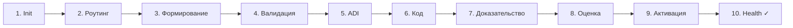

Это расширенная версия [Краткого руководства](/ru/docs/getting-started/quick-start/)
с полным телом PRD, альтернативами ADI, полями доказательств и гейтами активации.
Пример — **гипотетическое предложение** добавить `--dry-run` к
`forgeplan new`. Forgeplan 0.38 **не** предоставляет такой флаг для `new`;
это упражнение по требованиям, а не инструкция к выпущенной функции.

Шаги Init → Shape → Validate можно пройти без реализации предложения.
Если вы остановились здесь, оставьте PRD черновиком. Для перехода к
доказательствам реализации и активации реализуйте и проверьте функцию в
подходящем репозитории разработки; нельзя выдумывать успешные тесты ради
завершения руководства.

## Что вы создадите

PRD с описанием предварительного просмотра, затем — только после реальной
работы — запись доказательств проверенного утверждения. Для упражнения
выбрана глубина Standard; ответ роутера может отличаться.



## Предварительные условия

- Установленный Forgeplan 0.38 (`forgeplan --version`).
- Новый каталог для временного рабочего пространства.
- Для `reason`: настроенный LLM-провайдер; HTTP-провайдеры используют переменную
  окружения из `llm.api_key_env`. Локальные CLI-провайдеры подключаются явно
  и используют существующий вход. См. [Конфигурацию](/ru/docs/getting-started/configuration/).
- Для реализации: реальный репозиторий исходников и его зависимости для сборки/тестов.

## Шаг 1 - Инициализация рабочего пространства

```bash
mkdir ~/forgeplan-tutorial && cd ~/forgeplan-tutorial
forgeplan init -y
```

`init -y` создаёт `.forgeplan/` с конфигурацией и каталогами артефактов/индекса.
Модель эмбеддингов команда **не** загружает. Изучите рабочее пространство,
а не сравнивайте вывод с фиксированным протоколом:

```bash
forgeplan status
forgeplan health
```

В пустом пространстве ещё нет артефактов и доказательств. Предупреждения
о настройке проекта не доказывают, что предложение реализовано.

### Возможная ошибка

Если `init -y` сообщает о существующем пространстве, он использует его, а не
возвращает старую ошибку «already exists». Если нужен новый пример, выберите
другой каталог. Не удаляйте `.forgeplan/` ради этого. `init --force` —
отдельная операция с перезаписью конфигурации, а не способ сбросить счётчики
учебного примера.

## Шаг 2 - Роутинг задачи

```bash
forgeplan route "add --dry-run flag to forgeplan new for preview"
```

Роутер возвращает рекомендацию глубины и конвейера. На уровне 0 по умолчанию
он использует ключевые слова; `--level 1` требует LLM. Для этой фразы
не обещаются фиксированная уверенность или точный протокол вывода.

Если роутер покажет `Tactical`, переопределите и всё равно рассматривайте это
как Standard - мы хотим отработать полный цикл. См. [Роутинг и глубина](/docs/methodology/routing/)
для дерева решений.

## Шаг 3 - Shape: создание PRD

```bash
forgeplan new prd "CLI dry-run flag"
```

Используйте ID и путь из вывода `new`. Далее предполагается `PRD-001`
в новом пространстве; при другом ID замените его в командах. Сохраните полное
тело как `prd-body.md` **вне** `.forgeplan/`, затем примените через `update`.
Английские заголовки сохраняйте и для русского текста: валидатор распознаёт
конкретные псевдонимы заголовков, а не автоматически переводит их.

```markdown
# PRD-001: Флаг CLI dry-run

## Problem

Пользователи, запускающие `forgeplan new prd "..."` в общем рабочем
пространстве, не могут предварительно просмотреть, какие файлы будут
созданы, до коммита. Ошибки (неправильный заголовок, коллизия ID)
требуют ручной очистки.

## Goals

- G1: Пользователь может видеть полный путь к файлу и содержимое того,
  что `new` создаст, без записи файлов на диск
- G2: Вывод `--dry-run` подходит для передачи в инструменты ревью
- G3: Отсутствие изменений в поведении, когда флаг отсутствует

## Non-Goals

- Не полноценный «режим симуляции» - охватывает только команду `new`
- Не механизм отката - файлы, созданные без `--dry-run`, остаются созданными

## Target Users

Пользователи CLI, создающие артефакты в общих или производственных
рабочих пространствах, и агенты ИИ, которые хотят предварительно
просмотреть свой вывод перед коммитом.

## Functional Requirements

- [ ] FR-001: User can pass `--dry-run` to `forgeplan new` for a chosen kind and title
- [ ] FR-002: User can see the exact file path that would be created
- [ ] FR-003: User can see the templated file content on stdout
- [ ] FR-004: User can distinguish a successful preview from a validation failure by exit code

## Non-Functional Requirements

Предварительный просмотр не должен менять файлы артефактов и индекс:
это проверяется сравнением их содержимого до и после одного вызова.

## Related Artifacts

Пока нет. Это первое предложение во временном учебном рабочем пространстве.
```

Примените тело через CLI, чтобы файл и индекс совпадали:

```bash
forgeplan update PRD-001 --body @prd-body.md
```

Пункты FR здесь сохранены на английском для распознаваемого формата
`[Actor] can [capability]`; русский текст остальных разделов допустим.

Обратите внимание: нет упоминаний «использовать clap» или «выводить JSON»
или какой-либо конкретной реализации. Функциональные
требования описывают возможности, а не реализации. См. [Обзор методологии](/docs/methodology/overview/).

## Шаг 4 - Validate

```bash
forgeplan validate PRD-001
```

Изучите находки команды. Отсутствие обязательного раздела блокирует валидацию;
SHOULD и COULD не равны ошибкам MUST. Точное число предупреждений зависит от
глубины и содержимого.

### Ошибки, с которыми вы, вероятно, столкнётесь

- **Нет Problem / Goals / Non-Goals / Functional Requirements / Related
  Artifacts.** Сохраняйте поддерживаемые заголовки. Для Problem допустимы
  `Motivation`, `Background`, `Problem Statement`.
- **Утечка реализации.** Перепишите выбор технологии как возможность
  пользователя. Для Standard правило имеет уровень SHOULD, для Deep — MUST.
- **Нет пунктов FR / неверный формат.** Используйте флажки вроде
  `- [ ] FR-001: User can preview the file path`. Проверка формата FR в 0.38
  имеет уровень COULD, а не MUST.
- **Расплывчатые цели.** Замените субъективные формулировки измеримыми
  критериями. Общее правило adversarial-vague имеет уровень SHOULD,
  а не выдуманный MUST.

Перезапускайте `forgeplan validate PRD-001` после каждого исправления.

## Шаг 5 - Reason (ADI)

```bash
forgeplan reason PRD-001
```

При настроенном LLM вывод может напоминать **иллюстративный** анализ ниже.
Это не записанный запуск и не гарантированная рекомендация:

```
ADI cycle for PRD-001
─────────────────────
Abduction - 3 hypotheses:
  H1: Single --dry-run flag that short-circuits file write
  H2: Separate `forgeplan preview new` command
  H3: Interactive confirmation prompt (y/n before write)

Deduction - predictions per hypothesis:
  H1:
    - Minimal code change, 1 branch in `new` command
    - Reusable: same flag can extend to other write commands
    - No new command surface to document
  H2:
    - Discoverable via `forgeplan --help`
    - Duplicates template rendering logic (or extracts it)
    - Doubles the surface area users must learn
  H3:
    - Forces interactivity, breaks AI-agent usage
    - No way to see output before committing
    - Violates `-y` non-interactive contract

Induction - evidence check:
  H1: supports - aligns with existing flag patterns (e.g. `init -y`)
  H2: weakens - duplication + discoverability win does not offset cost
  H3: refutes - breaks AI agent workflow (see MUST in CLAUDE.md)

Recommendation: H1
Confidence: 0.87
```

Без LLM `reason` возвращает ошибку, а не создаёт шаблон. Можно явно записать
ручной раздел `## Reasoning` в `prd-body.md` и повторно применить через
`update`. Гипотезы — предложения, а не измерения или независимая проверка.

См. [Обоснование ADI](/docs/methodology/adi/), чтобы понять, почему этот шаг существует.

### Ошибка

**`LLM not configured`** — настройте поддерживаемого провайдера по руководству
конфигурации или явно сохраните ручной ADI. Не добавляйте секретный API-ключ
в артефакт и не коммитьте его в конфигурацию проекта.

## Шаг 6 - Build

Реализуйте предложение в настоящем репозитории разработки и проверьте
критерии приёмки. Если вы только изучаете CLI артефактов, остановитесь на
валидированном **черновике**: доказательств реализации пока нет.

Для Rust-проекта выберите реальные проектные проверки, например:

```bash
cargo test
cargo fmt -- --check
cargo check
```

Запишите, что вы действительно запускали и наблюдали, включая ошибки
и ограничения. Независимое ревью должно идти в контексте, отличном от автора.
Новый EvidencePack и положительная оценка не заменяют эти проверки.

## Шаг 7 - Prove: создание Evidence

```bash
forgeplan new evidence "CLI preview verification"
```

Используйте выданный ID доказательства (далее предполагается `EVID-001`).
Подготовьте полное тело `evidence-body.md` вне `.forgeplan/`. Поля ниже —
пример **только для реально наблюдавшегося поддерживающего тестового результата
в том же контексте**:

```markdown
## Structured Fields

verdict: supports
congruence_level: 3
evidence_type: test

## Details

Запишите реальную команду, ревизию исходников, результат, проверенные требования,
личность проверяющего и ограничения. Не копируйте выдуманное количество тестов.
Для утверждения об изменении кода укажите реальные base_sha, result_sha
и changed_paths, чтобы гейт происхождения проверил изменение по Git-delta.
```

Не запускайте smoke `new --dry-run` на неизменённом 0.38: флаг не выпущен.
Проверяйте его только в репозитории, где вы действительно его реализовали.

```bash
forgeplan update EVID-001 --body @evidence-body.md
```

Свяжите его с PRD:

```bash
forgeplan link EVID-001 PRD-001 --relation informs
```

### Ошибка №1

**Принимать прозу или наличие полей за доказательство.** Задавайте `verdict`,
`congruence_level`, `evidence_type` значениями, обоснованными наблюдениями.
Отсутствующий/неизвестный verdict или отсутствие декларации конгруэнтности
даёт CL0. Свежий поддерживающий пакет test/measurement тогда получает 0.1;
рекурсивный расчёт вычитает ещё 0.1 для benchmark и 0.2 для audit, что даёт
0 при CL0 для этих типов. Истёкший допустимый пакет вместо этого получает
0.1 до этих вычитаний. Без типа используется measurement, а не автоматический
ноль. Парсер не проверяет запуск тестов независимо.

## Шаг 8 - Проверка балла

```bash
forgeplan score PRD-001
```

Изучите детализацию, а не ожидайте фиксированного протокола или оценки.
Один свежий поддерживающий CL3-пакет test/measurement может дать 1.0;
для benchmark и audit вычитается 0.1 и 0.2. CLI рекурсивно берёт минимум
собственных доказательств и допустимых оценок зависимостей после штрафов
за тип связи. Черновые доказательства учитываются, терминальные исключаются.
Без допустимых собственных доказательств собственная оценка равна 0.

### Что если R_eff = 0.0?

1. `forgeplan list --type evidence` — существует ли ваше доказательство?
2. `forgeplan get EVID-001` — заданы ли осмысленные структурированные поля?
3. `forgeplan tree PRD-001` — связано ли доказательство с этим решением?
4. Проверьте текущий `refutes`, пониженный CL, срок действия и зависимости.
   Не дублируйте связи и не повышайте поля доказательств только ради оценки.

См. [Доказательства и R_eff](/docs/methodology/evidence/) для полной формулы.

## Шаг 9 - Активация

```bash
forgeplan review PRD-001
```

`review` проверяет содержимое и методологические гейты, но не запускает
тесты. Когда реальные доказательства поддерживают утверждение и ревью пройдено:

```bash
forgeplan activate EVID-001
forgeplan activate PRD-001
```

Оба перехода явные. Для этого рецепта автоактивация не нужна.
Черновой EvidencePack учитывается в оценке до активации, но не обязан
навсегда оставаться черновиком.

Если гейт валидации здесь не проходит, переход отклоняется. Самая
частая причина - вы отредактировали PRD после шага 4 и внесли
нарушение правила MUST. Перезапустите `forgeplan validate PRD-001` и исправьте.

## Шаг 10 - Проверка

```bash
forgeplan health
```

Изучите количество артефактов, связи, слепые пятна и риски. Не ожидайте
фиксированного HEALTHY: в пространстве могут оставаться другие находки.
Проверьте записанные решение и доказательство:

```bash
forgeplan get PRD-001
forgeplan get EVID-001
forgeplan score PRD-001
```

Если вы остановились на оформлении, честный результат — валидированный
черновик, а не завершённая или выпущенная функция.

## Что вы узнали

- **Сначала роутинг.** Вы не начали сразу кодировать - вы спросили
  Forgeplan, какая глубина нужна задаче.
- **Shape до кода.** PRD зафиксировал «зачем» и «что» до
  первой строки реализации.
- **Ранняя валидация.** Валидатор сообщает об отсутствующих разделах и
  проблемах содержимого до использования артефакта для передачи работы.
- **Обоснование через ADI.** Вы сгенерировали альтернативы до принятия
  обязательств, и именно так вы избегаете моментов «жаль, что не подумали об этом».
- **Подтверждение доказательствами.** R_eff обобщает заявленные доказательства;
  изучите их источник, контекст и ограничения, прежде чем доверять решению.
- **Активируйте только обоснованное утверждение.** Гейты проверяют структуру
  и связанные доказательства, а не истинность заявлений о тестах или наличие готового кода.

## Следующие шаги

- Запустите полный цикл на реальной задаче в вашем основном проекте
- Прочитайте [Обзор методологии](/docs/methodology/overview/) для ознакомления с 10 правилами
- Изучите [Справочник CLI](/docs/cli/) - каждая команда задокументирована
- Погрузитесь в [Жизненный цикл артефакта](/docs/methodology/lifecycle/), чтобы узнать
  про `supersede`, `deprecate`, `renew` и `reopen`
- Проверьте [Конфигурацию](/docs/getting-started/configuration/) для настройки
  провайдера LLM для более интеллектуального роутинга и ADI

## Шпаргалка по устранению неполадок

| Симптом | Причина | Исправление |
|---------|---------|-------------|
| Нет обязательного раздела | Заголовок отсутствует или не поддерживается | Сохраните поддерживаемые заголовки; примените через `update --body @file` |
| Утечка реализации | Технология в FR | Опишите возможность; серьёзность зависит от глубины |
| R_eff = 0 | Нет допустимых доказательств, есть опровержение или результат зависимости | Изучите детализацию оценки и текущие связи |
| R_eff = 0.1 | Возможны незадекларированное/CL0 или истёкшее поддерживающее доказательство | Проверьте verdict, декларацию конгруэнтности, срок; не завышайте поля |
| `activate` отклонён | Не пройден гейт содержимого или методологии | Прочитайте `review`; исправьте утверждение/тело/доказательства, а не обходите гейт |
| `LLM not configured` при `reason` | Нет провайдера | Настройте его или явно запишите ручной ADI |
| `new --dry-run` отклонён | В 0.38 этот флаг не выпущен | Это предложение упражнения, а не доступная команда |
| Предупреждение срока | Истёк `valid_until` | Пересмотрите решение; до renew прочитайте руководство жизненного цикла |