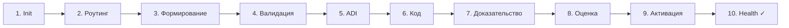

Это расширенная версия [Краткого руководства](/ru/docs/getting-started/quick-start/).
Здесь тот же workflow с подробными объяснениями и восстановлением после ошибок.
Команды, ID, confidence, числа тестов, тайминги и вывод ниже — иллюстрации,
не запись настоящего запуска.

Чтение примера может занять около 20 минут; реализация и проверка функции —
отдельная работа. Без неё оставьте упражнение в draft: не публикуйте учебные
доказательства и не активируйте вымышленный результат.

## Что вы создадите

PRD для небольшой, реальной функции: **«Добавить флаг `--dry-run` к команде
`forgeplan new`, чтобы пользователи могли предварительно просматривать, что будет
создано, без записи файлов.»**

Это предлагаемая функция для упражнения. В выбранной локальной сборке `new`
**не** поддерживает `--dry-run`; последующие smoke-команды — примеры приёмки
реализации, не работающие сегодня команды.

Она намеренно небольшая - роутинг, вероятно, покажет `Standard`, что означает,
что мы пройдём каждый шаг, за исключением уровней Epic/Spec. Идеальная
тренировочная нагрузка.



## Предварительные условия

- Установленный Forgeplan (`forgeplan --version`)
- Каталог, где вы можете создать рабочее пространство (временный подойдёт)
- Настроенный LLM-провайдер для выполнения `reason`: HTTP-провайдеры используют
  ключ из окружения, поддерживаемые локальные CLI — собственный login.

Проверенное покрытие совместимости и оставшиеся ограничения описаны в
[справочнике Constellation](/ru/docs/reference/constellation/). Этот гайд
не доказывает, что все lifecycle-команды работают на любой раскладке workspace.

## Шаг 1 - Инициализация рабочего пространства

```bash
mkdir ~/forgeplan-tutorial && cd ~/forgeplan-tutorial
forgeplan init -y
```

Вы должны увидеть:

```
Initialized .forgeplan/ workspace at /Users/you/forgeplan-tutorial/.forgeplan
  Created: prds/, rfcs/, adrs/, evidence/, notes/, problems/, ...
  Created: config.yaml
Ready.
```

Подтвердите:

```bash
forgeplan health
```

```
Project Health
  Total artifacts: 0
  Blind spots: 0
  Orphans: 0
  Stale: 0
  Status: OK - empty workspace
```

### Возможная ошибка

`init -y` завершается без изменений, если находит workspace, в том числе
у родителя. Проверьте выведенный корень. Для изолированного упражнения
выберите другой пустой каталог; не удаляйте `.forgeplan/` ради перезапуска.
Если клону нужно восстановить config, см.
[конфигурацию](/ru/docs/getting-started/configuration/).

## Шаг 2 - Роутинг задачи

```bash
forgeplan route "add --dry-run flag to forgeplan new for preview"
```

Ожидаемый вывод:

```
Task: add --dry-run flag to forgeplan new for preview
Depth: Standard
Pipeline: PRD → RFC
Confidence: 82%
Signals:
  + new feature (not a fix)
  + CLI UX surface change
  + multiple possible implementations
Recommendation:
  1. forgeplan new prd "CLI dry-run flag"
  2. Fill MUST sections (Problem, Goals, FR)
  3. forgeplan reason PRD-XXX  (recommended at Standard)
```

Если роутер покажет `Tactical`, переопределите и всё равно рассматривайте это
как Standard - мы хотим отработать полный цикл. См. [Роутинг и глубина](/ru/docs/methodology/routing/)
для дерева решений.

## Шаг 3 - Shape: создание PRD

```bash
forgeplan new prd "CLI dry-run flag"
```

```
Created: PRD-001 at .forgeplan/prds/PRD-001-cli-dry-run-flag.md
```

Прочитайте созданный шаблон и подготовьте полное тело в `prd-body.md`
вне `.forgeplan/`. Сохраните обязательные английские заголовки:

```markdown
# PRD-001: Флаг CLI dry-run

## Problem

Пользователи, запускающие `forgeplan new prd "..."` в общем рабочем
пространстве, не могут предварительно просмотреть, какие файлы будут
созданы, до коммита. Ошибки (неправильный заголовок, коллизия ID)
требуют ручной очистки.

## Goals

- G1: Пользователь может видеть полный путь к файлу и содержимое того,
  что `new` создаст, без записи файлов на диск
- G2: Вывод `--dry-run` подходит для передачи в инструменты ревью
- G3: Отсутствие изменений в поведении, когда флаг отсутствует

## Non-Goals

- Не полноценный «режим симуляции» - охватывает только команду `new`
- Не механизм отката - файлы, созданные без `--dry-run`, остаются созданными

## Target Users

Пользователи CLI, создающие артефакты в общих или производственных
рабочих пространствах, и агенты ИИ, которые хотят предварительно
просмотреть свой вывод перед коммитом.

## Functional Requirements

- FR1: Пользователь может передать `--dry-run` команде `forgeplan new <kind> "title"`
- FR2: Пользователь может видеть точный путь к файлу, который будет создан
- FR3: Пользователь может видеть содержимое файла-шаблона в stdout
- FR4: Пользователь может полагаться на код выхода 0 при успешном выполнении
  `--dry-run` и ненулевой код при неудачной валидации

## Related Artifacts

У этого самостоятельного упражнения пока нет родительского артефакта.
```

Примените тело командой `forgeplan update PRD-001 --body @prd-body.md`.

Обратите внимание: нет упоминаний «использовать clap» или «выводить JSON»
или какой-либо конкретной реализации. Это правило 3 - функциональные
требования описывают возможности, а не реализации. См. [Обзор методологии](/ru/docs/methodology/overview/).

## Шаг 4 - Validate

```bash
forgeplan validate PRD-001
```

Лучший случай:

```
PRD-001: PASS ✓
  MUST: 0 errors
  SHOULD: 1 warning (density: Problem section is terse)
```

### Ошибки, с которыми вы, вероятно, столкнётесь

**`MUST error: Problem section missing`** - вы забыли обязательный заголовок.
Работают псевдонимы: `## Motivation`, `## Background`, `## Problem Statement` -
все они считаются Problem. Добавьте один.

**Implementation-leakage finding** — технологии в FR/NFR дают SHOULD для
Standard и MUST для Deep. Например, «Use Redis» описывает реализацию;
замените его возможностью, нужной пользователю.

**Missing Functional Requirements** — нет обязательного заголовка.
Добавьте раздел и содержательные требования `[Действующее лицо] может
[возможность]`: проверка существования заголовка не доказывает качество пунктов.

**Неизмеримая формулировка** — measurability/adversarial checks могут
предупредить о расплывчатом тексте. Замените его проверяемым результатом;
не каждое такое предупреждение имеет уровень MUST.

Перезапускайте `forgeplan validate PRD-001` после каждого исправления.

## Шаг 5 - Reason (ADI)

```bash
forgeplan reason PRD-001 --save
```

При настроенном провайдере и нужной ему аутентификации промпт просит LLM
сравнить альтернативы. Иллюстративный анализ:

```
ADI cycle for PRD-001
─────────────────────
Abduction - 3 hypotheses:
  H1: Single --dry-run flag that short-circuits file write
  H2: Separate `forgeplan preview new` command
  H3: Interactive confirmation prompt (y/n before write)

Deduction - predictions per hypothesis:
  H1:
    - Minimal code change, 1 branch in `new` command
    - Reusable: same flag can extend to other write commands
    - No new command surface to document
  H2:
    - Discoverable via `forgeplan --help`
    - Duplicates template rendering logic (or extracts it)
    - Doubles the surface area users must learn
  H3:
    - Forces interactivity, breaks AI-agent usage
    - No way to see output before committing
    - Violates `-y` non-interactive contract

Induction - evidence check:
  H1: supports - aligns with existing flag patterns (e.g. `init -y`)
  H2: weakens - duplication + discoverability win does not offset cost
  H3: refutes - breaks AI agent workflow (see MUST in CLAUDE.md)

Recommendation: H1
Confidence: 0.87
```

Без настроенного провайдера CLI возвращает ошибку, не пустой шаблон.
Ручной анализ можно записать в `prd-body.md` и применить через `update`;
это ваше рассуждение, не успешный запуск CLI. `--save` сохраняет успешный
вывод CLI в связанной Note; без флага вывод только печатается.
Три альтернативы — эвристика промпта, не доказательство уверенности и не
минимум, который проверяет парсер.

См. [Обоснование ADI](/ru/docs/methodology/adi/), чтобы понять, почему этот шаг существует.

### Ошибка

**Нет LLM configuration** — настройте поддерживаемый провайдер и его
аутентификацию. HTTP API keys хранятся в окружении/secrets file, указанном
в `llm.api_key_env`, не внутри `config.yaml`. Либо запишите ручной ADI
описанным выше способом, не утверждая, что команда выполнилась.

## Шаг 6 - Build

Реализуйте выбранный подход и напишите тесты до записи успешного результата.
Если тренируетесь только оформлять задачу, остановитесь здесь в draft.
Для настоящей реализации запустите проверки проекта, например:

```bash
cargo test      # or npm test, pytest, go test, ...
cargo fmt
cargo check     # 0 warnings, 0 errors
```

Все три должны пройти, прежде чем вы создадите доказательство, утверждающее это.
Если `cargo check` выдаёт предупреждения, исправьте их - собственное правило
Forgeplan CLAUDE.md гласит: «0 предупреждений, 0 ошибок» при каждом коммите.

## Шаг 7 - Prove: создание Evidence

```bash
forgeplan new evidence "CLI dry-run - 8 unit tests pass, flag works end-to-end"
```

```
Created: EVID-001 at .forgeplan/evidence/EVID-001-cli-dry-run....md
```

Подготовьте `evidence-body.md` вне `.forgeplan/` с реальными результатами.
Ниже — пример формы, **не доказательство запуска**. CL3 допустим лишь при
совпадении контекста; code claims также требуют реальных provenance по гейту:

```markdown
## Structured Fields

verdict: supports
congruence_level: 3
evidence_type: test

## Details

- 8 модульных тестов проходят в `tests/cli_dry_run.rs`
- Ручной смоук-тест: `forgeplan new prd "Test" --dry-run` выводит шаблон
  без создания файла
- Проверен код выхода 0 при успехе и 1 при ошибке шаблона
```

Лишь заменив учебные claims проверенными результатами, примените тело и связь:

```bash
forgeplan update EVID-001 --body @evidence-body.md
forgeplan link EVID-001 PRD-001 --relation informs
```

### Ошибка №1

**Пропуск структурированных claims.** При отсутствующем/нераспознанном
verdict/CL используется CL0 со штрафом 0.9. У `evidence_type` отдельная роль
в оценке; указывайте все три поля. Поля описывают доказательство, а не
превращают незапущенный тест в доказательство.

## Шаг 8 - Проверка балла

```bash
forgeplan score PRD-001
```

Ожидаемый результат:

```
PRD-001: CLI dry-run flag
  R_eff = 1.00 - Adequate
  Evidence:
    EVID-001: supports, CL3, test → score 1.0
```

### Что если R_eff = 0.0?

1. `forgeplan list --type evidence` - есть ли EVID-001 в рабочем пространстве?
2. `cat .forgeplan/evidence/EVID-001-*.md | grep -E "verdict|congruence_level|evidence_type"`
   - все три поля присутствуют?
3. `forgeplan link EVID-001 PRD-001 --relation informs` - была ли создана связь?
4. Проверьте детализацию refutes, штрафов CL/type и зависимостей.
   Пропущенные structured claims обычно дают 0.1, не ноль.

См. [Доказательства и R_eff](/ru/docs/methodology/evidence/) для полной формулы.

## Шаг 9 - Активация

```bash
forgeplan review PRD-001
```

```
Reviewing PRD-001...
  Validation: PASS ✓
  Evidence: 1 linked (R_eff = 1.00)
  Status: ready to activate
```

```bash
forgeplan activate PRD-001
```

```
PRD-001: draft → active
  Validation gate: PASS
  R_eff preserved: 1.00
```

Если гейт валидации здесь не проходит, переход отклоняется. Самая
частая причина - вы отредактировали PRD после шага 4 и внесли
нарушение правила MUST. Перезапустите `forgeplan validate PRD-001` и исправьте.

## Шаг 10 - Проверка

```bash
forgeplan health
```

```
Project Health
  Total artifacts: 3 (PRD-001, EVID-001, saved ADI Note)
  Active: 1
  Draft: 2 (Evidence и Note в этом примере; evidence не обязана всегда оставаться draft)
  Blind spots: 0
  Orphans: 0
  Stale: 0
  Status: HEALTHY
```

Настоящая реализация и проверенное evidence замыкают историю решения.
Одно чтение или копирование учебного примера этого не делает.

## Что вы узнали

- **Сначала роутинг.** Вы не начали сразу кодировать - вы спросили
  Forgeplan, какая глубина нужна задаче.
- **Shape до кода.** PRD зафиксировал «зачем» и «что» до
  первой строки реализации.
- **Ранняя валидация.** Валидатор отловил утечку реализации и
  отсутствующие разделы до того, как они стали привычкой.
- **Обоснование через ADI.** Вы сгенерировали альтернативы до принятия
  обязательств, и именно так вы избегаете моментов «жаль, что не подумали об этом».
- **Подтверждение доказательствами.** R_eff - это не украшение, а число,
  которое говорит вам, стоит ли доверять собственному решению.
- **Активация только при готовности.** Гейты проверяют объявленное содержание,
  связи и настроенные provenance, но не доказывают работоспособность кода.
  Настоящие проверки до активации всё равно необходимы.

## Следующие шаги

- Запустите полный цикл на реальной задаче в вашем основном проекте
- Прочитайте [Обзор методологии](/ru/docs/methodology/overview/) для ознакомления с 10 правилами
- Изучите [Справочник CLI](/ru/docs/cli/) - каждая команда задокументирована
- Погрузитесь в [Жизненный цикл артефакта](/ru/docs/methodology/lifecycle/), чтобы узнать
  про `supersede`, `deprecate`, `renew` и `reopen`
- Проверьте [Конфигурацию](/ru/docs/getting-started/configuration/) для настройки
  провайдера LLM для более интеллектуального роутинга и ADI

## Шпаргалка по устранению неполадок

| Симптом | Причина | Исправление |
|---------|---------|-------------|
| `MUST error: Problem missing` | Нет раздела `## Problem` / `## Motivation` | Добавьте один из псевдонимов |
| `implementation leakage in FR` | В требовании указана библиотека/технология | Перепишите как `[Действующее лицо] может [возможность]` |
| `R_eff = 0.0` для оцениваемого артефакта | Нет пригодного evidence, refutes, штрафы или зависимости | Посмотрите детализацию и запишите реальные доказательства; не переименовывайте противоречащие данные |
| `activate` отклонён | Гейт валидации не прошёл после правок | Перезапустите `validate`, исправьте ошибки MUST |
| Нет LLM configuration при `reason` | Провайдер/аутентификация недоступны | Настройте провайдер и окружение/login либо запишите ручное рассуждение без заявления об успешном CLI |
| `health` показывает слепое пятно | Активный артефакт без связанных доказательств | Создайте доказательство и `forgeplan link` |
| Предупреждение `stale` для свежего артефакта | Слишком короткий `valid_until` | Установите реалистичный срок действия 90-180 дней |