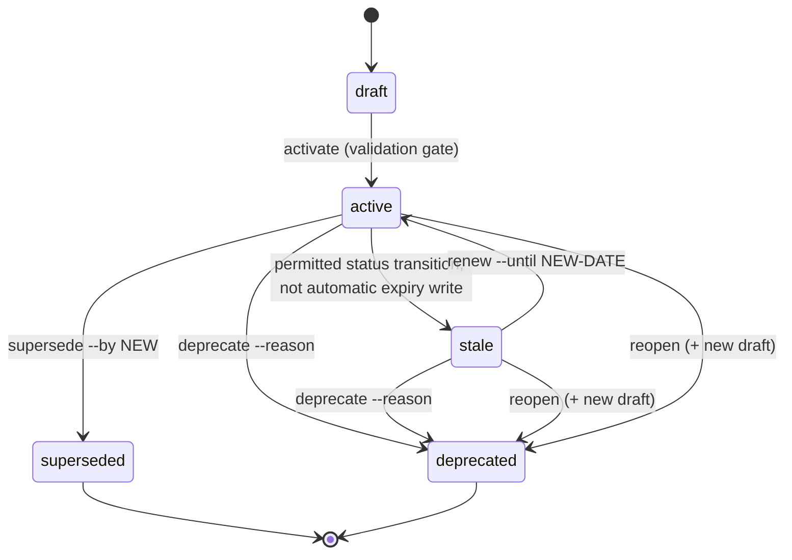

Артефакты Forgeplan - это не просто файлы, это **решения с жизненным циклом**.
PRD, который был верен полгода назад, сегодня может быть ошибочным. ADR,
описывающий вашу архитектуру, может быть замещён более совершенным. Доказательство,
обосновывающее выбор, может утратить актуальность по мере изменения мира.

Жизненный цикл v2 предложен в [ADR-005](#связанные-материалы) на фоне
baseline эпохи v0.12. Ниже различаются тот дизайн и текущая реализация:

1. **Действует ли этот артефакт до сих пор?**
2. **Если он исчез, что его заменило?**
3. **Если он просроченный, следует ли его продлить или переоткрыть решение?**

Гайд объясняет lifecycle-модель и четыре иллюстративных сценария.
Это не записанные production transcripts.

## Почему жизненный цикл, а не просто `draft` / `active`?

Ранние версии Forgeplan имели только два состояния. Этого было достаточно для выпуска
PRD, но недостаточно, чтобы ответить на вопрос "что случилось с PRD-014?" полгода
спустя. Необходимо различать:

- PRD, который был **заменён** более совершенным (`superseded`, с указателем).
- PRD, который был **отменён** по определённой причине (`deprecated`, с указанием причины).
- PRD, который **истёк**, но всё ещё может быть верным (`stale`, требует пересмотра).
- PRD, который был просроченным и был **продлён** против **переоценён с нуля**.

Без этих различий вы получаете кладбище "старых" артефактов и не имеете представления,
какие из них всё ещё несут функциональную нагрузку. Жизненный цикл v2 это исправляет.

## Конечная машина состояний



Переходы в текстовом виде:

```
draft → active → superseded   (terminal)
               → deprecated   (terminal)
               → stale → active                 (renew)
                       → deprecated             (deprecate)
                       → deprecated + NEW draft (reopen, lineage)
```

## Описание каждого состояния

### `draft`

Начальное состояние каждого артефакта. `forgeplan new prd "..."` создаёт
черновик из шаблона. Черновики можно свободно редактировать.

- **Note и Problem**: нет гейта валидации - вы можете активировать немедленно.
- **PRD, RFC, ADR, Epic, Spec**: правила MUST из валидатора должны быть пройдены
  перед активацией. Выполните `forgeplan validate PRD-001`, чтобы проверить.

Чтобы продолжить:

```bash
forgeplan review PRD-001      # dry-run: is it ready?
forgeplan activate PRD-001    # draft → active
```

### `active`

Артефакт действует. Другие артефакты могут ссылаться на него, `forgeplan health`
считает его действующим решением, а `forgeplan score` вычисляет его R_eff на основе
связанных доказательств.

Активный артефакт можно supersede, deprecate или reopen в новый draft.
Модель также допускает `active → stale`, но истечение `valid_until`
само по себе не сохраняет этот переход.

### `superseded` - терминальное

Артефакт был заменён более новым. Вы **должны** указать на замену:

```bash
forgeplan supersede ADR-003 --by ADR-007
```

Старый артефакт сохраняет всю свою историю и связи, но больше не действует.
`forgeplan health` не будет помечать его как артефакт с отсутствующими доказательствами - он завершён.

### `deprecated` - терминальное

Артефакт больше не применим, и нет единой замены.
Вы должны указать причину:

```bash
forgeplan deprecate PRD-014 --reason "Feature cut from v1 scope"
```

Используйте `deprecate`, когда решение полностью отменяется (например, функция
отменяется), а не когда оно заменяется другим артефактом (для этого используйте `supersede`).

### `stale`

После `valid_until` обнаружение просрочки показывает артефакт как overdue,
но не переписывает сохранённый status. Просроченный файл может оставаться
`status: active`: чтение или scoring не меняет его автоматически на `stale`.
Он по-прежнему доступен для чтения и связывания.

Модель разрешает `active → stale`, но обнаружение просрочки не делает этот
переход. Перед lifecycle-командой проверьте сохранённый status.

Из состояния `stale` у вас есть три варианта: `renew`, `deprecate` или `reopen`.

### `renew` - просроченный обратно в активный

Используйте `renew`, когда решение всё ещё верно, и вы просто хотите продлить срок его действия:

```bash
forgeplan renew PRD-005 \
  --reason "Re-validated after Q2 review, still matches product direction" \
  --until 2026-10-01
```

Renew добавляет причину, обновляет `valid_until` и пишет `active`, сохраняя
ID и связи. Новое измерение эта команда за вас не выполняет.

Важен guard сохранённого status: просроченный артефакт со статусом `active`
не проходит renewal как `active → active`. Общий guard также допускает
`draft → active`, но это не повод подменять обычную активацию продлением.
Эти команды не подтверждают автоматическое исправление status по просрочке.

### `reopen` - просроченный/активный в новый черновик (линия наследования)

Используйте `reopen`, когда старое решение необходимо **переделать с нуля**.
Forgeplan создаёт **новый draft** с `based_on` на старый артефакт,
затем делает исходный deprecated. Старое содержимое остаётся историей:

```bash
forgeplan reopen PRD-005 \
  --reason "Underlying assumptions changed after PROB-021 findings"
```

Создаётся новый draft с lineage, а история старого решения сохраняется.
У нового draft нет даты `valid_until`: выберите и зафиксируйте подходящую
дату пересмотра, не предполагайте, что её сгенерировали.

## Почему `superseded` и `deprecated` являются терминальными

Оба состояния терминальны в **обычном lifecycle**: нормального перехода
обратно в active нет. Для пересмотра решения нужен новый артефакт с явной
историей наследования.

Восстановление после ошибочной операции - другой механизм.
[`forgeplan restore`](/ru/docs/cli/restore/) или `forgeplan undo-last`
отменяет записанный delete, supersede или deprecate через неиспользованный
soft-delete receipt. Это исправление случайной операции, не обычная смена
статуса и не способ вернуть любой terminal-артефакт без receipt.

Это преднамеренный выбор дизайна:

- **Аудируемость.** Если бы отменённый ADR мог незаметно снова стать активным,
  каждое связанное решение потребовало бы повторной проверки. Терминальные состояния
  означают: "это решение покинуло граф".
- **Происхождение.** `reopen` уже охватывает "переоценку этого решения" - он
  создаёт новый черновик как чёткое продолжение. Воскрешение старого
  артефакта стёрло бы историю разрыва.
- **Доверие.** Когда вы читаете `superseded` PRD, вы точно знаете, что произошло:
  он был заменён артефактом, указанным в `--by`. Никакой двусмысленности.

Не используйте terminal-статус как паузу. `stale` означает истёкший срок
действия и необходимость пересмотра, а не произвольную приостановку.

## Практические сценарии

### Сценарий 1 - Нормальный жизненный цикл PRD

Типичный сценарий для любой задачи глубины Standard+:

Это иллюстративные lifecycle-команды, а не записанный прогон или доказательство
проверки каждого инструмента. Проверенное покрытие совместимости и оставшиеся
ограничения описаны в [гайде Constellation](/ru/docs/guides/constellation/).

```bash
# 1. Shape
forgeplan new prd "Auth System"
# подготовьте prd-body.md вне .forgeplan/ со всеми MUST-разделами
forgeplan update PRD-018 --body @prd-body.md

# 2. Validate
forgeplan validate PRD-018
# → PASS (0 ошибок MUST)

# 3. Реализуйте, проверьте, затем добавьте настоящее evidence
forgeplan new evidence "Integration tests for auth middleware"
# подготовьте evidence-body.md с результатами, structured fields и нужными provenance
forgeplan update EVID-042 --body @evidence-body.md
forgeplan link EVID-042 PRD-018 --relation informs
forgeplan score PRD-018           # R_eff > 0

# 4. Ревью + активация после реализации и evidence
forgeplan review PRD-018
forgeplan activate PRD-018        # draft → active
```

Типичный сценарий: обычный спринт для функции на 1-3 дня. Артефакт остаётся
в `active` столько, сколько актуально его решение.

### Сценарий 2 - Замещение ADR

В этом условном примере ADR-003 означает «Хранилище на SQLite», ADR-007 —
его замену. Это не настоящий ADR-003 проекта о Markdown source of truth.
Зафиксируйте новое решение о хранилище, не переписывая историю:

```bash
# 1. Сначала напишите новый ADR
forgeplan new adr "LanceDB as primary store"
# заполните контекст, решение, последствия; валидируйте, реализуйте и добавьте реальное evidence до активации
forgeplan activate ADR-007

# 2. Заместите старый, указав на замену
forgeplan supersede ADR-003 --by ADR-007
```

Теперь `forgeplan list --status active` скрывает ADR-003, и любой читающий
ADR-003 видит "superseded by ADR-007" в заголовке. DAG остаётся согласованным.

### Сценарий 3 - Продление просроченного PRD

PRD полугодовой давности имел `valid_until: 2026-04-01`. Сейчас 11 апреля,
и `forgeplan health` помечает его как просроченный:

```bash
forgeplan health
# → Stale: PRD-012 (valid_until 2026-04-01, 10 days ago)
```

Вы пересмотрели неизменившийся scope. Для примера renewal предположим,
что запись уже хранится как `stale`: предупреждение о просрочке выше
само по себе этого не устанавливает. Просроченная запись со status
`active` не пройдёт renewal guard:

```bash
forgeplan renew PRD-012 \
  --reason "Re-validated after Q2 planning - scope unchanged" \
  --until 2026-10-01
```

Снова `active`. Причина записана в истории артефакта, чтобы будущие
читатели знали, **почему** вы ему доверяете.

### Сценарий 4 - Переоткрытие просроченного решения

Та же отправная точка: PRD-012 просрочен. Но на этот раз вы обнаружили, что
PROB-021 выявила ошибочное допущение. PRD не просто устарел -
он **неверен в текущем виде** и требует переосмысления с нуля.

```bash
forgeplan reopen PRD-012 \
  --reason "Assumption about user concurrency invalidated by PROB-021"
```

Результат:

- `PRD-012` → `deprecated` (терминальное), с записанной причиной.
- `PRD-019` (новый черновик) создан как продолжение по линии наследования.
- Теперь вы оформляете PRD-019 с нуля, валидируете, проверяете, активируете.

Журнал аудита: PRD-012 существовал, стал просроченным, был переоткрыт с
указанием конкретной причины и заменён PRD-019. Любой читатель сможет
восстановить эту историю спустя месяцы.

## Антипаттерны

Вещи, которых следует избегать - каждый из них нарушает допущение,
на котором основан остальной Forgeplan.

- **Активация без доказательств.** Для lifecycle-managed решений обычная
  активация проверяет evidence-link gate, длину, stub и MUST-валидацию.
  Политика provenance вызывающего пути может добавлять проверки.
  Сама связь не доказывает тестирование реализации: запишите настоящее
  evidence и проверьте score до того, как доверять решению.
- **Замещение без `--by`.** CLI требует `--by` не просто так:
  осиротевший статус `superseded` скрывает, **какой** артефакт его заменил. Используйте
  `deprecate --reason "..."`, если единой замены нет.
- **Легкомысленное переоткрытие active-артефакта.** Reopen нужен при изменении
  допущений. Неизменившееся решение пересмотрите, а не создавайте заново.
  `renew` использует guard сохранённого status; обнаружение просрочки
  само по себе не делает active-запись пригодной для продления.
- **Удаление вместо замещения.** Удаление файла теряет историю,
  связи и журнал аудита. Всегда выполняйте переход через жизненный цикл.
  Файлы являются источником истины (см. [ADR-003](#связанные-материалы)), но именно
  переходы состояний делают их надёжными со временем.
- **Переписывание terminal-истории.** Сохраните исторический текст вытесненного
  артефакта, а новое решение оформите связанным draft. Это правило аудита,
  не заявление, что активация делает Markdown технически неизменяемым.
- **Обход проверки самоссылок.** PROB-019 (защита от самоссылок) была добавлена для
  блокировки `forgeplan link X X` и подобных циклов. Не обходите
  защиту - исправьте направление связи.

## DerivedStatus - вычисляемая категория отображения

Помимо сохранённого lifecycle status, у артефакта есть **DerivedStatus**,
вычисляемый по lifecycle, validation и evidence:

```
STUB → SHAPED → VALIDATED → EVIDENCED → ACTIVATED
```

Это вычисляемые категории текущего продукта, не словарь Quint-code
`UNDERFRAMED`/`FRAMED`/`EXPLORING`/`COMPARED`/`DECIDED`/`APPLIED` и не
дополнительные сохранённые статусы.

- `STUB` / `SHAPED` используют эвристики заголовков.
- `VALIDATED` отражает переданный результат валидации.
- `EVIDENCED` требует связанное evidence и положительный R_eff.
- Сохранённые `active`, `superseded`, `deprecated` сначала дают `ACTIVATED`,
  даже при слабом evidence. Draft с положительным evidence может быть `EVIDENCED`.

Категория не удостоверяет доверие независимо от других данных.
Смотрите lifecycle, validation и детализацию evidence вместе.

## Связанные материалы

- **[ADR-005](https://github.com/ForgePlan/forgeplan/blob/c852f40c515085d328f02e4b275edda37279a610/.forgeplan/adrs/ADR-005-lifecycle-v2-stale-status-renew-reopen-terminal-deprecated.md)** - исторический дизайн lifecycle v2.
- **[ADR-003](https://github.com/ForgePlan/forgeplan/blob/c852f40c515085d328f02e4b275edda37279a610/.forgeplan/adrs/ADR-003-markdown-files-as-source-of-truth-lancedb-as-index-layer.md)** - Markdown каноничен, LanceDB — производный индекс.
- **PROB-019** - защита от самоссылок, добавленная при укреплении переходов жизненного цикла.
- **PR #85** - Sprint 1: очистка жизненного цикла: канонические переходы и принудительное соблюдение терминальности.

## См. также

- [`forgeplan activate`](/ru/docs/cli/activate/) - draft → active с validation gate
- [`forgeplan supersede`](/ru/docs/cli/supersede/) - active → superseded, требует `--by`
- [`forgeplan deprecate`](/ru/docs/cli/deprecate/) - active/stale → deprecated, требует `--reason`
- [`forgeplan renew`](/ru/docs/cli/renew/) - stale → active, продлевает `valid_until`
- [`forgeplan reopen`](/ru/docs/cli/reopen/) - stale/active → deprecated и новый draft