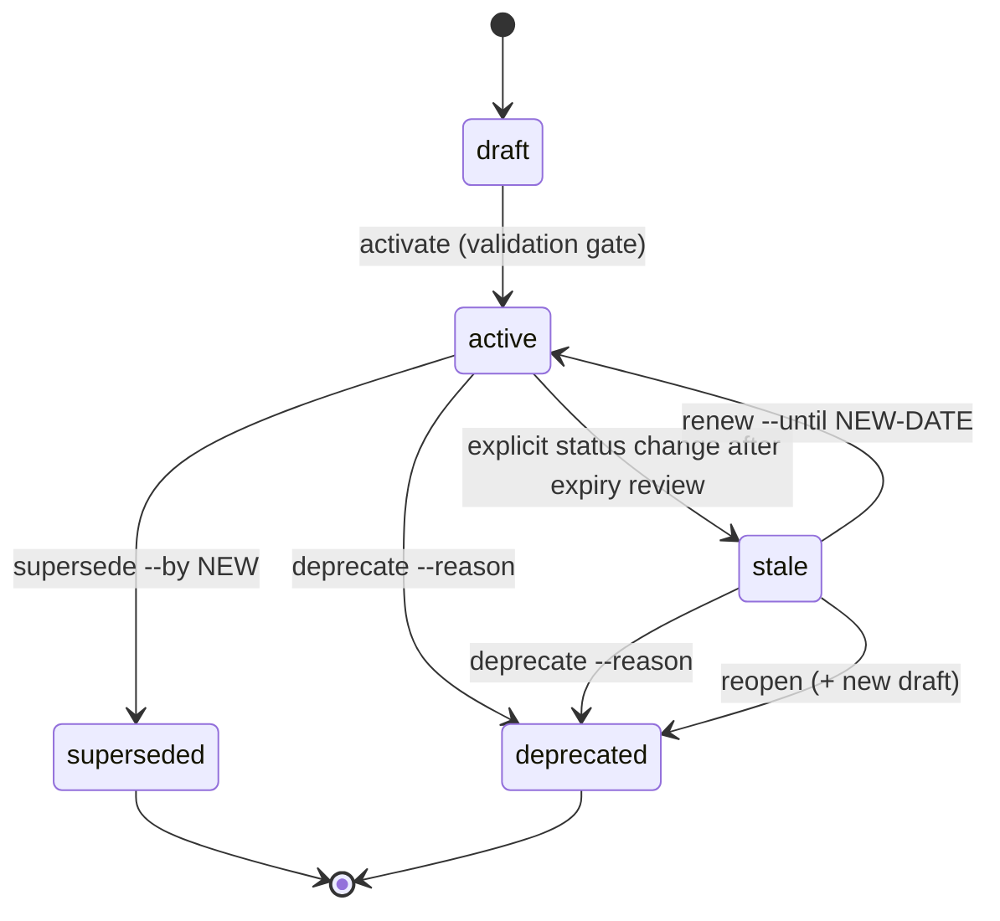

Артефакты Forgeplan - это **решения с жизненным циклом**.
PRD, который был верен полгода назад, сегодня может быть ошибочным. ADR,
описывающий вашу архитектуру, может быть замещён более совершенным. Доказательство,
обосновывающее выбор, может утратить актуальность по мере изменения мира.

Жизненный цикл v2 (выпущенный в версии v0.12 как [ADR-005](#связанные-материалы)) предоставляет каждому артефакту
чётко определённую конечную машину состояний, чтобы вы могли в любой момент ответить на три вопроса:

1. **Действует ли этот артефакт до сих пор?**
2. **Если он исчез, что его заменило?**
3. **Если он просроченный, следует ли его продлить или переоткрыть решение?**

Это руководство описывает полную конечную машину состояний, объясняет терминальные состояния
и демонстрирует четыре практических сценария из реального использования Forgeplan.

## Зачем нужен полный жизненный цикл, а не два состояния `draft` / `active`?

Ранние версии Forgeplan имели только два состояния. Этого было достаточно для выпуска
PRD, но недостаточно, чтобы ответить на вопрос "что случилось с PRD-014?" полгода
спустя. Необходимо различать:

- PRD, который был **заменён** более совершенным (`superseded`, с указателем).
- PRD, который был **отменён** по определённой причине (`deprecated`, с указанием причины).
- PRD, который **истёк**, но всё ещё может быть верным (`stale`, требует пересмотра).
- PRD, который был просроченным и был **продлён** против **переоценён с нуля**.

Без этих различий вы получаете кладбище "старых" артефактов и не имеете представления,
какие из них всё ещё несут функциональную нагрузку. Жизненный цикл v2 это исправляет.

## Конечная машина состояний



Диаграмма описывает сохранённые состояния, а не фоновый планировщик.
В 0.38 `stale`/`health` обнаруживают истёкший `valid_until`, но не меняют
`status: active` на `stale` автоматически. Перед переходом проверьте
сохранённый статус через `forgeplan get ID`.

Переходы в текстовом виде:

```
draft → active → superseded   (terminal)
               → deprecated   (terminal)
               → stale → active                 (renew)
                       → deprecated             (deprecate)
                       → deprecated + NEW draft (reopen, lineage)
```

## Описание каждого состояния

### `draft`

Начальное состояние каждого артефакта. `forgeplan new prd "..."` создаёт
черновик из шаблона. Черновики можно свободно редактировать.

- **Note и Problem**: нет гейта валидации - вы можете активировать немедленно.
- **PRD, RFC, ADR, Epic, Spec**: перед обычной активацией должны пройти правила
  MUST, проверки длины тела, заполнения шаблона и наличия связанных доказательств.
  `validate` проверяет содержимое; `review` также показывает методологические гейты.

Чтобы продолжить:

```bash
forgeplan review PRD-001      # dry-run: is it ready?
forgeplan activate PRD-001    # draft → active
```

### `active`

Артефакт действует. Другие артефакты могут ссылаться на него, `forgeplan health`
считает его действующим решением, а `forgeplan score` вычисляет его R_eff по
связанным доказательствам.

Активный артефакт можно заместить, вывести из действия или явно пометить
`stale` после пересмотра. Отчёты о сроке действия сами этот переход не выполняют.

### `superseded` - терминальное

Артефакт был заменён более новым. Вы **должны** указать на замену:

```bash
forgeplan supersede ADR-003 --by ADR-007
```

Старый артефакт сохраняет всю свою историю и связи, но больше не действует.
`forgeplan health` не будет помечать его как артефакт с отсутствующими доказательствами - он завершён.

### `deprecated` - терминальное

Артефакт больше не применим, и нет единой замены.
Вы должны указать причину:

```bash
forgeplan deprecate PRD-014 --reason "Feature cut from v1 scope"
```

Используйте `deprecate`, когда решение полностью отменяется (например, функция
отменяется), а не когда оно заменяется другим артефактом (для этого используйте `supersede`).

### `stale`

Истёкший `valid_until` отражается в отчётах `forgeplan stale` и
`forgeplan health`. Артефакт остаётся доступным для чтения и связывания.
В 0.38 истечение срока не меняет сохранённый статус автоматически.

Если ранее активному решению нужен жизненный цикл stale, явно пометьте его
после проверки срока действия и текущего статуса:

```bash
forgeplan get PRD-005
forgeplan update PRD-005 --status stale
```

Не обходите активацию и вывод доказательств из действия через `update --status`:
значения `active`, `superseded`, `deprecated` запрещены. Для них используйте
соответствующие команды жизненного цикла.

Из состояния `stale` у вас есть три варианта: `renew`, `deprecate` или `reopen`.

### `renew` - просроченный обратно в активный

Используйте `renew`, когда решение всё ещё верно, и вы просто хотите продлить срок его действия:

```bash
forgeplan renew PRD-005 \
  --reason "Re-validated after Q2 review, still matches product direction" \
  --until 2027-10-01
```

Артефакт возвращается в `active` с тем же ID и связями, новой датой
`valid_until` и добавленным разделом Renewal. `renew` проверяет сохранённый
статус: он не продлевает уже `active` запись только потому, что она попала
в отчёт об истечении срока. Сначала пересмотрите и пометьте её stale, как показано выше.

:::caution[Дефект продления в 0.38]
Назначение команды — переход `stale → active` после реального пересмотра.
Но реализация через общую проверку переходов допускает и `draft → active`,
не выполняя гейты валидации, заполнения шаблона и доказательств из `activate`.
Проверяется формат даты, но не то, что дата находится в будущем;
`active → active` по-прежнему отклоняется. Это дефект
[#547](https://github.com/ForgePlan/forgeplan/issues/547), а не поддерживаемый
способ активации. **Не активируйте черновик через `renew`**: используйте
`review`/`activate` с их гейтами. Для продления пересмотрите действительно
просроченное решение и выберите будущую дату.
:::

### `reopen` - просроченный/активный в новый черновик (линия наследования)

Используйте `reopen`, когда старое решение необходимо **переделать с нуля**.
Исходный артефакт переходит в `deprecated` (терминальное), и Forgeplan создаёт
**новый черновик**, связанный как его продолжение по линии наследования:

```bash
forgeplan reopen PRD-005 \
  --reason "Underlying assumptions changed after PROB-021 findings"
```

Вы получаете новый черновик с происхождением и без унаследованных связей
доказательств (`valid_until` не задан). Предыдущая запись сохраняется.
Заполните новое тело и соберите свежие доказательства до активации.

## Почему `superseded` и `deprecated` никуда не ведут

Оба состояния конечны в **обычном графе переходов**: `activate` и `reopen`
не возвращают их к жизни. Для нового решения создайте свежий артефакт.

В 0.38 есть восстановление случайной разрушительной операции по квитанции:
`forgeplan restore ID` или `forgeplan undo-last` использует неиспользованную
квитанцию в `.forgeplan/trash/` (TTL по умолчанию 30 дней). Она позволяет отменить
delete, deprecate или supersede, если это допускают проверки идентичности и восстановления.
MCP-обработчики deprecate/supersede сохраняют квитанции, одноимённые команды CLI нет.
`undo-last` выбирает последнюю доступную квитанцию, не обязательно последнюю
CLI-операцию. Проверьте, какую операцию и над каким артефактом он отменит.

Это ограниченное восстановление, а не обычная повторная активация. Сверьте
frontmatter Markdown со статусом API: [#296](https://github.com/ForgePlan/forgeplan/issues/296)
описывает расхождение в 0.38, при котором `projection_restored: true` не означает,
что статус файла уже обновлён. Одного успешного ответа для такой проверки мало.

У правила терминальных состояний другая задача:

- **Аудируемость.** Если бы отменённый ADR мог незаметно снова стать активным,
  каждое связанное решение потребовало бы повторной проверки. Терминальные состояния
  означают: "это решение покинуло граф".
- **Происхождение.** `reopen` уже охватывает "переоценку этого решения" - он
  создаёт новый черновик как чёткое продолжение. Воскрешение старого
  артефакта стёрло бы историю разрыва.
- **Доверие.** Когда вы читаете `superseded` PRD, вы точно знаете, что произошло:
  он был заменён артефактом, указанным в `--by`. Никакой двусмысленности.

Не имитируйте приостановку датой в далёком будущем: срок действия и статус
решают разные задачи. Запишите результат пересмотра и выберите продление,
вывод из действия или переоткрытие.

## Практические сценарии

### Сценарий 1 - Нормальный жизненный цикл PRD

ID ниже иллюстрируют существующее рабочее пространство; в своём проекте
используйте значения из вывода `new`.

```bash
# 1. Формирование и валидация
forgeplan new prd "Auth System"
# Подготовьте auth-prd-body.md с полным заполненным телом.
forgeplan update PRD-018 --body @auth-prd-body.md
forgeplan validate PRD-018

# 2. Выполните реализацию или ревью, которые нужны для этого решения.
# Не заявляйте о тестах или независимом ревью, которых не было.
forgeplan new evidence "Auth middleware verification"
# Запишите реальные результаты и verdict, congruence_level, evidence_type в auth-evidence.md.
forgeplan update EVID-042 --body @auth-evidence.md
forgeplan link EVID-042 PRD-018 --relation informs
forgeplan score PRD-018

# 3. Проверка и явная активация
forgeplan activate EVID-042
forgeplan review PRD-018
forgeplan activate PRD-018
```

Если утверждение — о завершённой реализации, доказательства следуют за кодом.
Для передачи плана независимое ревью может обосновать фиксацию требований до
кода, как в BMAD/SPARC/TDD. Активация означает, что артефакт действует,
а не что функция уже выпущена.

### Сценарий 2 - Замещение ADR

Вы написали ADR-003 ("Хранилище на SQLite") год назад. Теперь вы переходите на
LanceDB и хотите зафиксировать новое решение без потери истории.

```bash
# 1. Сначала напишите новый ADR
forgeplan new adr "LanceDB as primary store"
# Сначала заполните тело, валидируйте и свяжите реальные доказательства решения/ревью.
forgeplan activate ADR-007

# 2. Заместите старый, указав на замену
forgeplan supersede ADR-003 --by ADR-007
```

Теперь `forgeplan list --status active` скрывает ADR-003, и любой читающий
ADR-003 видит "superseded by ADR-007" в заголовке. DAG остаётся согласованным.

### Сценарий 3 - Продление просроченного PRD

Исторический пример: у PRD был `valid_until: 2026-04-01`. 11 апреля
`forgeplan stale` сообщает об истечении срока. Проверьте сохранённый статус;
если он ещё active, явно пометьте запись stale после пересмотра:

```bash
forgeplan stale
forgeplan get PRD-012
forgeplan update PRD-012 --status stale
```

Вы перечитали его. Направление продукта не изменилось, PRD по-прежнему
корректен, вы просто забыли продлить дату:

```bash
forgeplan renew PRD-012 \
  --reason "Re-validated after Q2 planning - scope unchanged" \
  --until 2026-10-01
```

Снова `active`. Причина записана в истории артефакта, чтобы будущие
читатели знали, **почему** вы ему доверяете.

### Сценарий 4 - Переоткрытие просроченного решения

Та же отправная точка: PRD-012 просрочен. Но на этот раз вы обнаружили, что
PROB-021 выявила ошибочное допущение. PRD устарел по-настоящему -
он **неверен в текущем виде** и требует переосмысления с нуля.

```bash
forgeplan reopen PRD-012 \
  --reason "Assumption about user concurrency invalidated by PROB-021"
```

Результат:

- `PRD-012` → `deprecated` (терминальное), с записанной причиной.
- `PRD-019` (новый черновик) создан как продолжение по линии наследования.
- Оформите PRD-019, валидируйте, соберите и свяжите свежие доказательства, проведите ревью и активируйте.

Журнал аудита: PRD-012 существовал, стал просроченным, был переоткрыт с
указанием конкретной причины и заменён PRD-019. Любой читатель сможет
восстановить эту историю спустя месяцы.

## Антипаттерны

Вещи, которых следует избегать - каждый из них нарушает допущение,
на котором основан остальной Forgeplan.

- **Активация без доказательств.** Обычная активация PRD/RFC/ADR/Epic/Spec
  проверяет наличие связанных доказательств. Это структурный гейт, а не
  независимая проверка запуска тестов или правильности вывода. Заполните
  честный EvidencePack и изучите `score`; не скрывайте пробел через `--force`.
- **Замещение без `--by`.** CLI требует `--by` не на пустом месте:
  осиротевший статус `superseded` скрывает, **какой** артефакт его заменил. Используйте
  `deprecate --reason "..."`, если единой замены нет.
- **Легкомысленное переоткрытие активного артефакта.** `reopen` нужен при изменении
  базовых допущений. Если решение верно, но нужна свежая дата, пересмотрите его,
  явно пометьте stale и затем продлите; не обходите активацию через продление.
- **Удаление вместо замещения.** Удаление файла теряет историю,
  связи и журнал аудита. Всегда выполняйте переход через жизненный цикл.
  Файлы хранят всю правду (см. [ADR-003](#связанные-материалы)), но именно
  переходы состояний делают их надёжными со временем.
- **Правка терминального артефакта как нового решения.** Сохраняйте выведенные
  из действия записи для истории; создайте новый черновик и свяжите его.
  Восстановление по квитанции нужно для случайной операции, а не вместо преемника.
- **Обход проверки самоссылок.** PROB-019 (защита от самоссылок) была добавлена для
  блокировки `forgeplan link X X` и подобных циклов. Не обходите
  защиту - исправьте направление связи.

## Жизненный цикл доказательств и R_eff

Для решения CLI `score` использует рекурсивный принцип слабого звена:
минимум собственных текущих доказательств и допустимых оценок зависимостей
после штрафов за тип связи. Доказательства `superseded`/`deprecated`
исключаются, черновики учитываются. Без допустимых собственных доказательств
собственная оценка равна 0. Текущий неистёкший пакет `refutes` по-прежнему
может обнулить результат. Выводить пакет из действия нужно с реальным
преемником или причиной, а не ручной правкой статуса.

Укажите `verdict`, `congruence_level`, `evidence_type` в теле и запишите реальные
наблюдения. Отсутствующий/неизвестный verdict или отсутствие декларации
конгруэнтности даёт CL0. **Свежий поддерживающий пакет test/measurement**
с CL0 оценивается в 0.1; рекурсивный расчёт дополнительно вычитает 0.1 для
benchmark и 0.2 для audit, поэтому свежие поддерживающие CL0-пакеты этих
типов получают 0. Истёкшее допустимое доказательство вместо этого получает
0.1 **до** вычитания штрафов за verdict, CL и тип. Зависимости могут
дополнительно снизить итог решения; истечение срока не задаёт каждому
просроченному решению оценку 0.1.

Для утверждений об изменении кода `base_sha`, `result_sha`, `changed_paths`
могут проверяться по Git при активации. По умолчанию гейт происхождения
настроен на `warn`, а не `block`; он не запускает тесты и не оценивает качество кода.

## DerivedStatus - качество, ортогональное жизненному циклу

Forgeplan 0.38 вычисляет **DerivedStatus** по содержимому, валидации,
доказательствам и статусу жизненного цикла. Отдельно он не хранится:

```text
STUB → SHAPED → VALIDATED → EVIDENCED → ACTIVATED
```

Это не старая последовательность Quint-code `UNDERFRAMED`/`APPLIED`.
Для черновика связанные доказательства с положительным R_eff дают `EVIDENCED`,
валидация может дать `VALIDATED`, а обязательные заголовки — `SHAPED`.
Сохранённый `active`, `superseded` или `deprecated` первым даёт `ACTIVATED`
независимо от текущего качества доказательств. Поэтому эта метка —
**не** оценка надёжности.

Жизненный цикл показывает, действует ли решение; `score`, свежесть доказательств
и находки health — насколько оно обосновано. Активный артефакт может оставаться
под риском даже с DerivedStatus `ACTIVATED`.

## Связанные материалы

- **[ADR-005](https://github.com/ForgePlan/forgeplan/blob/main/.forgeplan/adrs/ADR-005-lifecycle-v2.md)** - запись решения, вводящая жизненный цикл v2.
- **[ADR-003](https://github.com/ForgePlan/forgeplan/blob/main/.forgeplan/adrs/ADR-003-markdown-source-of-truth.md)** - markdown-файлы хранят всю правду, LanceDB - производный индекс.
- **PROB-019** - защита от самоссылок, добавленная при укреплении переходов жизненного цикла.
- **PR #85** - Sprint 1: очистка жизненного цикла: канонические переходы и принудительное соблюдение терминальности.

## См. также

- [`forgeplan activate`](/docs/cli/activate/) - draft → active (с гейтом валидации)
- [`forgeplan supersede`](/docs/cli/supersede/) - active → superseded, требует `--by`
- [`forgeplan deprecate`](/docs/cli/deprecate/) - active/stale → deprecated, требует `--reason`
- [`forgeplan renew`](/docs/cli/renew/) - stale → active, продлевает `valid_until`
- [`forgeplan reopen`](/docs/cli/reopen/) - stale/active → deprecated + новый черновик (линия наследования)