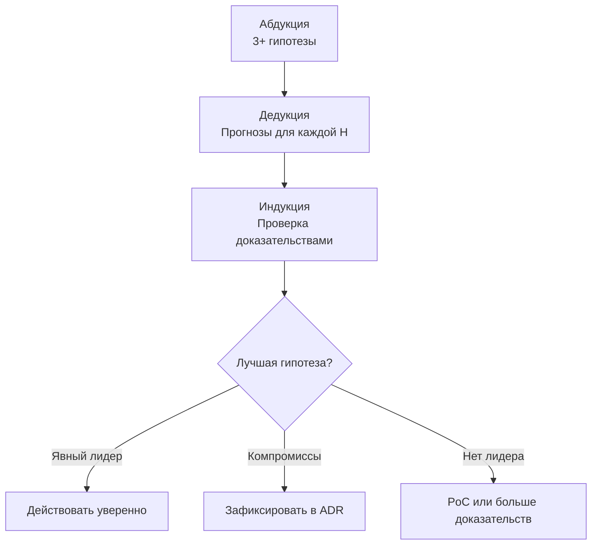

## Почему это важно

Самые дорогие ошибки - это не баги в коде, а промахи в архитектуре. Неверный выбор базы данных, сломанная схема взаимодействия сервисов или ошибочная стратегия аутентификации обходятся в недели или месяцы исправления. Первопричина почти всегда одна и та же: команда схватилась за первую пришедшую в голову идею и не стала всерьёз разбирать альтернативы.

ADI (Абдукция -> Дедукция -> Индукция) - структурированный подход, который эту ловушку закрывает. Он заставляет вас сгенерировать несколько вариантов, предсказать их последствия и проверить эти предсказания по доказательствам - всё до того, как написана первая строка кода. Десять минут ADI могут сэкономить десять дней переделок.

## Почему ADI?

Большинство архитектурных решений опираются на интуицию. ADI заставляет вас сгенерировать альтернативы, проверить предсказания и прийти к обоснованным выводам.

**Обязательно** для глубины Deep и Critical. **Рекомендуется** для Standard.

## Три фазы

### 1. Абдукция - "Что могло бы сработать?"

Сгенерируйте **3+ гипотезы**, которые могли бы решить проблему. Не просто ваша первая идея - заставьте себя подумать об альтернативах. Цель состоит в том, чтобы преодолеть эффект привязки: склонность фиксироваться на первом пришедшем в голову решении.

```bash
forgeplan reason PRD-001
```

Пример вывода:
```
Hypothesis 1: JWT tokens with refresh rotation
Hypothesis 2: Session-based auth with Redis
Hypothesis 3: OAuth2 delegation to external provider
```

Почему три? Потому что первая идея обычно опирается на знакомство, а не на пригодность. Вторая чаще всего - очевидная альтернатива. Третья - там появляются креативные варианты. Если все три сходятся к одному ответу, у вас высокая уверенность. Если расходятся - у вас появляются важные компромиссы для оценки.

### 2. Дедукция - "Что должно быть правдой?"

Для каждой гипотезы выведите **2-3 проверяемых предсказания**. Если этот подход сработает, какие измеримые результаты мы увидим? Именно здесь проявляется неясность - если вы не можете сформулировать конкретные предсказания, вы недостаточно хорошо понимаете подход.

```
H1 predictions:
  - Token validation < 1ms (no DB call)
  - Refresh rotation prevents token theft
  - Stateless = horizontal scaling works

H2 predictions:
  - Session lookup < 5ms (Redis)
  - Server restart doesn't lose sessions
  - Session store becomes single point of failure

H3 predictions:
  - Zero auth code to maintain internally
  - External dependency for critical path
  - User experience depends on third-party uptime
```

Хорошие предсказания конкретны и фальсифицируемы. "`Это будет быстро`" - это не предсказание. "`Валидация токена менее 1 мс без вызовов базы данных`" - это предсказание, его можно измерить.

### 3. Индукция - "Подтверждают ли это доказательства?"

Проверьте предсказания на основе доступных доказательств. Оцените каждую гипотезу:

| Гипотеза | Вердикт | Доказательство |
|-----------|---------|----------|
| H1: JWT | **поддерживает** | Бенчмарк: валидация 0.3 мс, OWASP рекомендует ротацию |
| H2: Redis | **ослабляет** | Redis добавляет сложность инфраструктуры, хранилище сессий становится SPOF |
| H3: OAuth2 | **поддерживает** | Делегирует риск аутентификации, но добавляет внешнюю зависимость |

На этом этапе решение перестаёт быть интуитивным и становится информированным сравнением. Вы всё ещё можете выбрать H1, но теперь знаете компромиссы и имеете доказательства в его поддержку. Через полгода, когда кто-то спросит "почему JWT?", вывод ADI ответит на этот вопрос.



### От ADI к решению

Как только вы оценили гипотезы, дальнейший путь обычно становится ясным:

- **Все гипотезы сходятся**: высокая уверенность, продолжайте с самым сильным вариантом
- **Два жизнеспособных варианта с разными компромиссами**: задокументируйте оба в ADR, выберите тот, который соответствует вашим приоритетам
- **Нет явного победителя**: вам нужно больше доказательств. Запустите PoC, проведите бенчмарк или проконсультируйтесь с экспертом, прежде чем принимать обязательства.

## Команда

```bash
# Выполнить рассуждение ADI для артефакта
forgeplan reason PRD-001

# С контекстом базы знаний FPF
forgeplan reason PRD-001 --fpf
```

Флаг `--fpf` обогащает запрос соответствующими концепциями фреймворка FPF из базы знаний. Это полезно для решений, которые включают Trust Calculus, ограниченную рациональность или компромиссы между исследованием и эксплуатацией.

ADI напрямую соответствует разделам FPF **B.3 (Trust Calculus)** и **B.5 (Абдукция / Дедукция / Индукция)** - это основа рассуждений First Principles Framework. Вы можете просмотреть эти разделы из CLI:

```bash
forgeplan fpf section B.5       # Полный текст определения цикла ADI
forgeplan fpf search "abduction hypothesis"
```

## Когда использовать

| Глубина | ADI обязателен? |
|-------|--------------|
| Тактическая | Нет |
| Стандартная | Рекомендуется |
| Глубокая | **Обязательно** |
| Критическая | **Обязательно + ревью** |

Для глубины **Standard** ADI рекомендуется, но строго не обязателен. Если у вас есть два чётких подхода и хватает быстрого сравнения, неформальный ADI (даже мысленное упражнение) вполне приемлем. Для **Deep** и **Critical** пропуск ADI нарушает методологию, потому что цена неправильного решения слишком высока, чтобы опираться на интуицию.

:::caution
Пропуск ADI на глубине Deep/Critical нарушает методологию. Процесс ревью ожидает доказательств структурированного рассуждения перед активацией.
:::

## Пример ADI из реального мира

**Задача**: Выбрать встраиваемую базу данных для хранения артефактов проекта (структурированные данные + векторные эмбеддинги).

**Абдукция** (3 гипотезы):
1. SQLite + отдельный векторный индекс (FAISS)
2. LanceDB (таблицы + векторы в одном движке)
3. PostgreSQL с расширением pgvector

**Дедукция** (предсказания для каждой гипотезы):

H1 (SQLite + FAISS):
- Зрелая экосистема, десятилетия стабильности
- Две отдельные системы для поддержки и синхронизации
- Векторный индекс должен быть перестроен при изменениях схемы

H2 (LanceDB):
- Единый движок для структурированных и векторных запросов
- Более молодой проект, стабильность API неопределённа
- Данные в открытом формате Lance (с возможностью миграции)

H3 (PostgreSQL + pgvector):
- Требует запуска серверного процесса
- Конфликтует с требованием "local-first, single binary"
- Надёжный опыт использования в продакшене

**Индукция** (проверка доказательств):
- H3 исключена: требует сервера, нарушает ограничение local-first
- H1 против H2: бенчмарк LanceDB показывает 10 тыс. запросов артефактов менее чем за 100 мс (CL2). SQLite проверен, но синхронизация двух систем создаёт нагрузку на поддержку.
- Решение: H2 (LanceDB) - простота единого движка перевешивает риск зрелости экосистемы; открытый формат данных предоставляет запасной путь для миграции.

Весь этот анализ занял 15 минут и сэкономил недели потенциальных переделок, если бы был сделан неправильный выбор.

## Распространённые ошибки

- **Генерация фальшивых гипотез.** Если ваши три гипотезы - это "правильный ответ", "соломенное чучело" и "ещё одно соломенное чучело", вы не используете ADI - вы рационализируете уже принятое решение. Каждая гипотеза должна быть подлинным претендентом.
- **Пропуск Дедукции.** Переход напрямую от "вот три варианта" к "я выбираю этот" обходит самый ценный шаг. Дедукция заставляет вас чётко сформулировать, как выглядит успех для каждого варианта, и именно здесь всплывают скрытые предположения.
- **Использование ADI для тактических задач.** Если исправление сводится к изменению одной строки, ADI здесь лишний. Приберегите его для решений, где цена ошибки высока.
- **Не записывать вывод ADI.** Рассуждение ценно только тогда, когда оно зафиксировано. Когда вы запускаете `forgeplan reason`, вывод сохраняется вместе с артефактом. Не делайте ADI в уме и не пропускайте команду.
- **Отношение к ADI как к одноразовому событию.** Если после вашего первоначального ADI появляются новые доказательства (например, бенчмарк показывает неожиданные результаты), запустите его снова. ADI - рабочий инструмент мышления, а не ритуал, который проходят один раз; используйте его всякий раз, когда нужна ясность.

## Связанные материалы

- [CLI: forgeplan reason](/docs/cli/reason/), [forgeplan fpf](/docs/cli/fpf/), [forgeplan fpf-search](/docs/cli/fpf-search/)
- [Руководство по базе знаний FPF](/docs/guides/fpf/) - как работает контекст B.3/B.5
- [Доказательства и R_eff](/docs/methodology/evidence/) - что потребляет Индукция
- [Роутинг и Глубина](/docs/methodology/routing/) - где ADI становится обязательным
