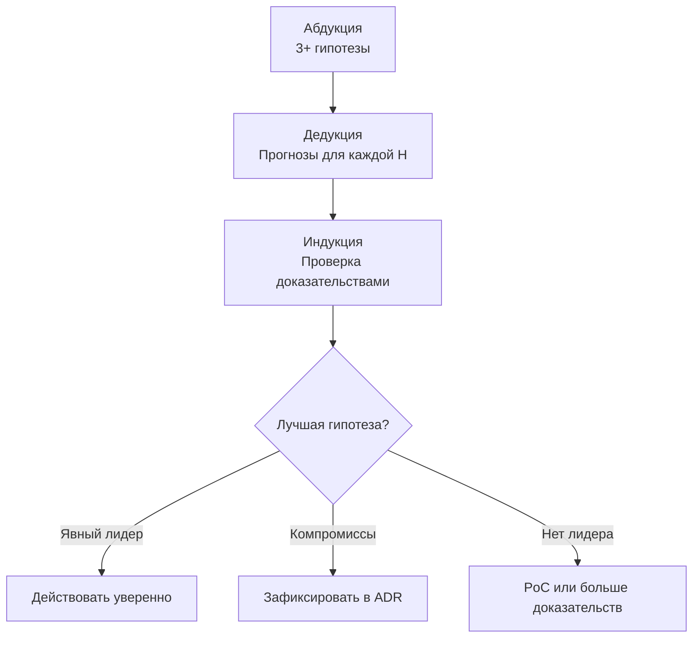

## Почему это важно

Самые дорогие ошибки - это не баги в коде, а промахи в архитектуре. Неверный выбор базы данных, сломанная схема взаимодействия сервисов или ошибочная стратегия аутентификации обходятся в недели или месяцы исправления. Первопричина почти всегда одна и та же: команда схватилась за первую пришедшую в голову идею и не стала всерьёз разбирать альтернативы.

ADI (Абдукция → Дедукция → Индукция) структурирует сравнение альтернатив: сформулируйте варианты, выведите проверяемые следствия, затем оцените доказательства и оставшиеся неизвестные. Для части доказательств нужен прототип или эксперимент; команда не выполняет эти эксперименты за вас.

## Почему ADI?

Большинство архитектурных решений опираются на интуицию. ADI заставляет вас сгенерировать альтернативы, проверить предсказания и прийти к обоснованным выводам.

Базовая методология **требует** ADI на Deep/Critical и **рекомендует** на Standard. Опубликованные `/forge-cycle` и `agents-pro:guardian` строже: на **Standard+** нужен связанный ADI Evidence с минимум тремя гипотезами. Это гейт процесса marketplace, а не автоматическая проверка активации CLI.

## Три фазы

### 1. Абдукция - "Что могло бы сработать?"

Сгенерируйте **3+ гипотезы**, которые могли бы решить проблему. Не просто ваша первая идея - заставьте себя подумать об альтернативах. Цель состоит в том, чтобы преодолеть эффект привязки: склонность фиксироваться на первом пришедшем в голову решении.

```bash
forgeplan reason PRD-001
```

Иллюстративные гипотезы, не сохранённый вывод команды:
```
Hypothesis 1: JWT tokens with refresh rotation
Hypothesis 2: Session-based auth with Redis
Hypothesis 3: OAuth2 delegation to external provider
```

Три действительно разных гипотезы помогают увидеть альтернативы привычному выбору. Само количество не доказывает независимость или правильность вариантов; проверяйте допущения и недостающие доказательства, а не считайте согласие доказательством.

### 2. Дедукция - "Что должно быть правдой?"

Для каждой гипотезы выведите **2-3 проверяемых предсказания**. Если этот подход сработает, какие измеримые результаты мы увидим? Именно здесь проявляется неясность - если вы не можете сформулировать конкретные предсказания, вы недостаточно хорошо понимаете подход.

```
H1 predictions:
  - Token validation < 1ms (no DB call)
  - Rotation rejects reuse of a consumed refresh token in a replay test
  - Validation nodes can scale without shared per-request session state

H2 predictions:
  - Session lookup < 5ms (Redis)
  - Server restart doesn't lose sessions
  - Losing the session store interrupts authentication unless failover works

H3 predictions:
  - Delegation reduces, but does not eliminate, internal auth code
  - External dependency for critical path
  - User experience depends on third-party uptime
```

Хорошие предсказания конкретны и фальсифицируемы. "`Это будет быстро`" - это не предсказание. "`Валидация токена менее 1 мс без вызовов базы данных`" - это предсказание, его можно измерить.

### 3. Индукция - "Подтверждают ли это доказательства?"

Проверьте предсказания по доступным доказательствам. Таблица ниже — иллюстрация, не измеренный результат проверки безопасности. Приложите реальные логи и источники, прежде чем фиксировать эти вердикты:

| Гипотеза | Вердикт | Доказательство |
|-----------|---------|----------|
| H1: JWT | **supports**, если подтверждено | Бенчмарк укладывается в цель; проверка повторного использования refresh-токена отклоняет запрос |
| H2: Redis | **weakens**, если подтверждено | Эксперимент с переключением не выполняет требование доступности |
| H3: OAuth2 | **supports**, если подтверждено | Интеграция покрывает нужные сценарии; зависимость от провайдера остаётся риском |

Сравнение опирается на доказательства только после выполнения проверок. Запишите неизвестное, отделите предсказания от наблюдений и объясните, почему выбранные компромиссы соответствуют требованиям.



### От ADI к решению

Как только вы оценили гипотезы, дальнейший путь обычно становится ясным:

- **Один вариант лучше подтверждён релевантными доказательствами**: продолжайте, записав его допущения и ограничения
- **Два жизнеспособных варианта с разными компромиссами**: задокументируйте оба в ADR, выберите тот, который соответствует вашим приоритетам
- **Нет явного победителя**: вам нужно больше доказательств. Запустите PoC, проведите бенчмарк или проконсультируйтесь с экспертом, прежде чем принимать обязательства.

## Команда

```bash
# Выполнить рассуждение ADI для артефакта
forgeplan reason PRD-001

# С контекстом базы знаний FPF
forgeplan reason PRD-001 --fpf --save
```

`reason` требует LLM-провайдера в `.forgeplan/config.yaml::llm`. HTTP-провайдеры используют настроенную переменную окружения с API-ключом; локальные CLI-провайдеры требуют установленный штатный CLI и существующий вход в него. Это явная опция для личной разработки, не профиль для общего окружения, продакшена или CI. Вызовы расходуют сервис или подписку провайдера. Для проекта, отличного от Forgeplan, укажите его архитектуру в `.forgeplan/prompts/architecture.md`; иначе CLI использует описание архитектуры Forgeplan по умолчанию.

Без `--save` CLI печатает рассуждение, но не сохраняет. `--save` создаёт связанную **Note**, не EvidencePack и не правку исходного артефакта. `--json` выдаёт структурированный ADI при успешном разборе, иначе — исходный текст анализа. Изучите реальные гипотезы: запрос требует 3+, но разбор не гарантирует три корректные альтернативы.

MCP `forgeplan_reason` принимает `id` и необязательный `workspace`, а не CLI-флаги `--save`/`--fpf` или произвольный `prompt`. Результат содержит `analysis` и сведения о провайдере/модели; автоматически анализ не сохраняется. Если процесс требует ADI Evidence, оркестратор должен явно создать, заполнить и связать EvidencePack. Сохранённая Note не выполняет требование guardian о связанном ADI Evidence.

CLI-флаг `--fpf` ищет релевантные индексированные разделы FPF и добавляет их к запросу, если они доступны. Загрузите базу через `forgeplan fpf ingest`; при отсутствии разделов команда сообщает об этом и продолжает рассуждение без них. Дополнительный контекст не является независимой проверкой.

ADI напрямую соответствует разделам FPF **B.3 (Trust Calculus)** и **B.5 (Абдукция / Дедукция / Индукция)** - это основа рассуждений First Principles Framework. Вы можете просмотреть эти разделы из CLI:

```bash
forgeplan fpf section B.5       # Полный текст определения цикла ADI
forgeplan fpf search "abduction hypothesis"
```

## Когда использовать

| Глубина | ADI обязателен? |
|-------|--------------|
| Тактическая | Нет |
| Стандартная | Рекомендуется |
| Глубокая | **Обязательно** |
| Критическая | **Обязательно + ревью** |

Это базовые рекомендации по глубине. В опубликованном `/forge-cycle` ADI Evidence обязателен уже на **Standard**. У `/gate-check` более узкая структурная проверка на **Deep/Critical**: хотя бы один связанный EVID должен содержать три раздела `### Hypothesis`. `guardian` дополнительно блокирует Standard+ без связанного ADI Evidence. Автор/оркестратор записывает альтернативы, ревьюер проверяет их, активирует только оркестратор.

:::caution
Сам вызов `reason`, сохранение Note или перевод рекомендательного маркера фазы в `adi` не выполняют эти гейты. Ни сгенерированное рассуждение, ни высокий R_eff не доказывают, что эксперименты запускались.
:::

## Пример ADI из реального мира

**Иллюстративная задача**: выбрать встраиваемую базу данных для артефактов проекта (структурированные данные + векторные эмбеддинги). Это пример сравнения, не исторический отчёт о бенчмарке.

**Абдукция** (3 гипотезы):
1. SQLite + отдельный векторный индекс (FAISS)
2. LanceDB (таблицы + векторы в одном движке)
3. PostgreSQL с расширением pgvector

**Дедукция** (предсказания для каждой гипотезы):

H1 (SQLite + FAISS):
- Зрелая экосистема, десятилетия стабильности
- Две отдельные системы для поддержки и синхронизации
- Векторный индекс должен быть перестроен при изменениях схемы

H2 (LanceDB):
- Единый движок для структурированных и векторных запросов
- Более молодой проект, стабильность API неопределённа
- Данные в открытом формате Lance (с возможностью миграции)

H3 (PostgreSQL + pgvector):
- Требует запуска серверного процесса
- Конфликтует с требованием "local-first, single binary"
- Надёжный опыт использования в продакшене

**Индукция** (проверка доказательств):
- H3 исключена: требует сервера, нарушает ограничение local-first
- H1 против H2: проведите бенчмарки на нужном объёме, наборе запросов и окружении; запишите результаты и обоснуйте CL. Сопоставьте их со стоимостью поддержки отдельного векторного индекса.
- Условное решение: H2 (LanceDB), если измерения соответствуют контракту, а обслуживание одного движка перевешивает риск зрелости экосистемы. Запишите условия в ADR; открытый формат даёт возможность миграции, а не гарантию её дешевизны.

## Распространённые ошибки

- **Генерация фальшивых гипотез.** Если ваши три гипотезы - это "правильный ответ", "соломенное чучело" и "ещё одно соломенное чучело", вы не используете ADI - вы рационализируете уже принятое решение. Каждая гипотеза должна быть подлинным претендентом.
- **Пропуск Дедукции.** Переход напрямую от "вот три варианта" к "я выбираю этот" обходит самый ценный шаг. Дедукция заставляет вас чётко сформулировать, как выглядит успех для каждого варианта, и именно здесь всплывают скрытые предположения.
- **Использование ADI для тактических задач.** Если исправление сводится к изменению одной строки, ADI здесь лишний. Приберегите его для решений, где цена ошибки высока.
- **Не записывать ADI.** CLI `--save` создаёт связанную Note; для гейта marketplace явно запишите и свяжите ADI Evidence. Обычный CLI/MCP-вызов `reason` не сохраняет долговечную запись доказательства.
- **Отношение к ADI как к одноразовому событию.** Если после вашего первоначального ADI появляются новые доказательства (например, бенчмарк показывает неожиданные результаты), запустите его снова. ADI - рабочий инструмент мышления, а не ритуал, который проходят один раз; используйте его всякий раз, когда нужна ясность.

## Связанные материалы

- [CLI: forgeplan reason](/docs/cli/reason/), [forgeplan fpf](/docs/cli/fpf/), [forgeplan fpf-search](/docs/cli/fpf-search/)
- [Руководство по базе знаний FPF](/docs/guides/fpf/) - как работает контекст B.3/B.5
- [Доказательства и R_eff](/docs/methodology/evidence/) - что потребляет Индукция
- [Роутинг и Глубина](/docs/methodology/routing/) - где ADI становится обязательным
