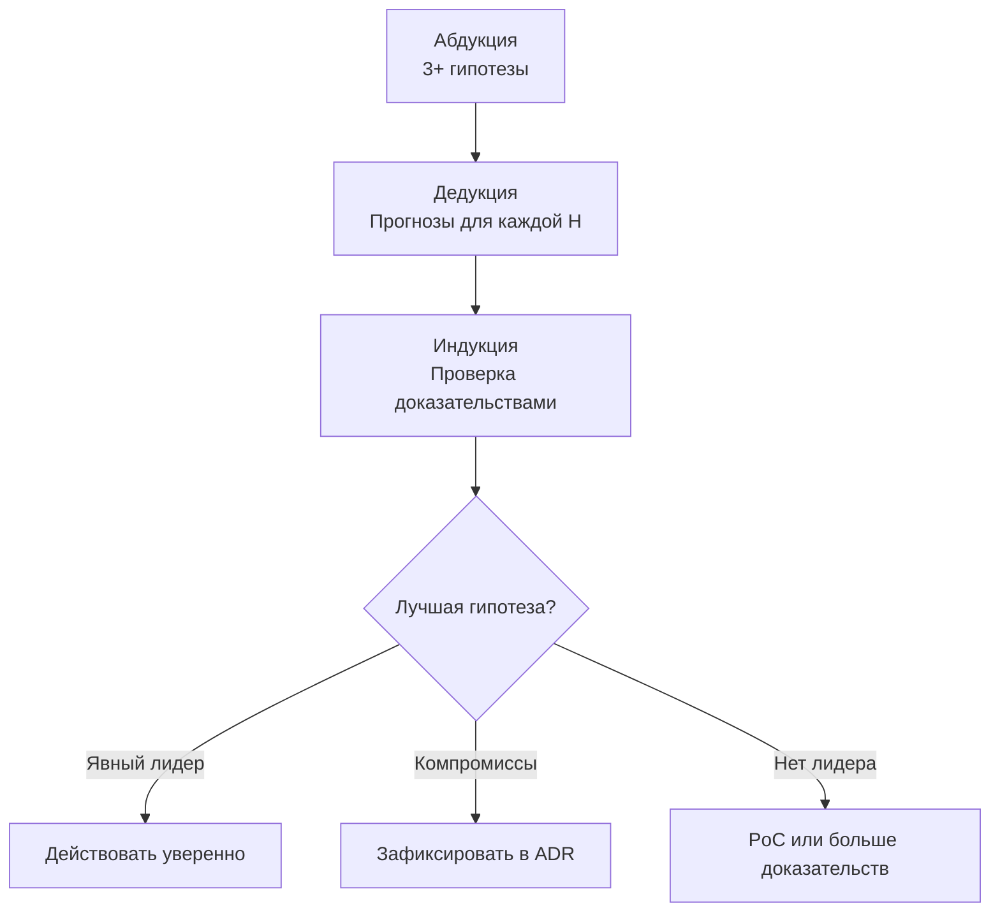

## Почему это важно

Выбор базы данных, схемы взаимодействия или стратегии аутентификации без
сравнения альтернатив может сделать исправления дорогими. Привязка к первому
правдоподобному подходу — одна из ошибок, которые помогает обнаружить ADI.

ADI (Абдукция -> Дедукция -> Индукция) предлагает варианты, выводит
предсказания и сравнивает их с доказательствами до реализации.
Это дисциплина рассуждения, не измеренная гарантия экономии времени.

## Почему ADI?

ADI делает альтернативы, проверяемые предсказания и основания решения явными.

**Обязательно** для глубины Deep и Critical. **Рекомендуется** для Standard.

## Три фазы

### 1. Абдукция - "Что могло бы сработать?"

Сгенерируйте **3+ гипотезы**, которые могли бы решить проблему. Не просто ваша первая идея - заставьте себя подумать об альтернативах. Цель состоит в том, чтобы преодолеть эффект привязки: склонность фиксироваться на первом пришедшем в голову решении.

Три — эвристика промпта ForgePlan, не универсальный порог FPF и не минимум,
проверяемый парсером. FPF B.5.2 требует серьёзную альтернативу, если её
отсутствие не обосновано. Не выдумывайте слабые варианты ради количества.

```bash
forgeplan reason PRD-001
```

Пример вывода:
```
Hypothesis 1: JWT tokens with refresh rotation
Hypothesis 2: Session-based auth with Redis
Hypothesis 3: OAuth2 delegation to external provider
```

Дополнительные варианты помогают проверить привычный ответ и эффект привязки.
Согласие вариантов, сгенерированных моделью, не является независимым
подтверждением или калиброванной вероятностью уверенности.

### 2. Дедукция - "Что должно быть правдой?"

Для каждой гипотезы выведите **2-3 проверяемых предсказания**. Если этот подход сработает, какие измеримые результаты мы увидим? Именно здесь проявляется неясность - если вы не можете сформулировать конкретные предсказания, вы недостаточно хорошо понимаете подход.

Пример аутентификации ниже содержит гипотезы и учебные цели задержки,
не гарантии безопасности или измеренные бенчмарки:

```
H1 predictions:
  - Token validation < 1ms (no DB call)
  - Refresh-token replay is detected under the tested rotation design
  - Local validation may reduce shared-store load; test scaling and revocation

H2 predictions:
  - Session lookup < 5ms (Redis)
  - Sessions survive restart only with the required persistence configuration
  - A non-replicated session store is a possible single point of failure

H3 predictions:
  - Less credential handling internally; callbacks and token validation remain
  - External dependency for critical path
  - User experience depends on third-party uptime
```

Хорошие предсказания конкретны и фальсифицируемы. "`Это будет быстро`" - это не предсказание. "`Валидация токена менее 1 мс без вызовов базы данных`" - это предсказание, его можно измерить.

### 3. Индукция - "Подтверждают ли это доказательства?"

Сравните предсказания с настоящими доказательствами. Таблица ниже —
иллюстрация, включая 0.3ms: это не benchmark receipt и не одобрение
всего дизайна со стороны OWASP:

| Гипотеза | Вердикт | Доказательство |
|-----------|---------|----------|
| H1: JWT | **supports** | Условный результат валидации 0.3ms; ротации ещё нужна security-проверка |
| H2: Redis | **weakens** | Дополнительная инфраструктура; риск отказа зависит от replication/failover |
| H3: OAuth2 | **supports** | Передаёт часть credential handling; риски интеграции и провайдера остаются |

На этом этапе решение больше не является интуитивным - это информированное сравнение. Вы всё ещё можете выбрать H1, но теперь вы знаете компромиссы и у вас есть доказательства в его поддержку. Через шесть месяцев, когда кто-то спросит "почему JWT?", вывод ADI ответит на этот вопрос.



### От ADI к решению

Как только вы оценили гипотезы, дальнейший путь обычно становится ясным:

- **Несколько вариантов правдоподобны**: сравните их независимые доказательства и выбирайте по записанным критериям, не по согласию модели
- **Два жизнеспособных варианта с разными компромиссами**: задокументируйте оба в ADR, выберите тот, который соответствует вашим приоритетам
- **Нет явного победителя**: вам нужно больше доказательств. Запустите PoC, проведите бенчмарк или проконсультируйтесь с экспертом, прежде чем принимать обязательства.

## Команда

```bash
# Выполнить рассуждение ADI для артефакта
forgeplan reason PRD-001 --save

# С контекстом базы знаний FPF
forgeplan reason PRD-001 --fpf --save
```

`reason` требует настроенную LLM. `--save` создаёт связанную Note; без него
CLI только печатает анализ. `--fpf` запрашивает найденный FPF-контекст;
на migrated Constellation workspace этот CLI-путь пока продолжает работу
без контекста retired table. Успешный LLM-ответ не доказывает измерение предсказаний.

ADI следует FPF **B.5** (цикл рассуждений); **B.3** описывает trust calculus.
Промпт с тремя вариантами и численные evidence-эвристики ForgePlan —
локальная адаптация, не универсальные численные правила текущей редакции FPF.
Просматривайте установленный корпус, редакция которого может отличаться от upstream:

```bash
forgeplan fpf section B.5       # Полный текст определения цикла ADI
forgeplan fpf search "abduction hypothesis"
```

## Когда использовать

| Глубина | ADI обязателен? |
|-------|--------------|
| Тактическая | Нет |
| Стандартная | Рекомендуется |
| Глубокая | **Обязательно** |
| Критическая | **Обязательно + ревью** |

Для глубины **Standard** ADI рекомендуется, но не является обязательным. Если у вас есть два чётких подхода и быстрого сравнения достаточно, неформальный ADI (даже просто мысленное упражнение) вполне приемлем. Для **Deep** и **Critical** пропуск ADI является нарушением методологии, потому что стоимость неправильного решения слишком высока, чтобы полагаться на интуицию.

:::caution
Пропуск ADI для глубины Deep/Critical является нарушением методологии. Процесс ревью ожидает доказательств структурированного рассуждения перед активацией.
:::

## Рассказ о выборе базы данных (независимо не проверен)

**Задача**: Выбрать встраиваемую базу данных для хранения артефактов проекта (структурированные данные + векторные эмбеддинги).

У исходного рассказа ниже нет связанного measurement receipt.
Бенчмарк, назначенный CL и экономия времени остаются неподтверждёнными;
это пример структуры сравнения, не текущий бенчмарк продукта.

**Абдукция** (3 гипотезы):
1. SQLite + отдельный векторный индекс (FAISS)
2. LanceDB (таблицы + векторы в одном движке)
3. PostgreSQL с расширением pgvector

**Дедукция** (предсказания для каждой гипотезы):

H1 (SQLite + FAISS):
- Зрелая экосистема, десятилетия стабильности
- Две отдельные системы для поддержки и синхронизации
- Векторный индекс должен быть перестроен при изменениях схемы

H2 (LanceDB):
- Единый движок для структурированных и векторных запросов
- Более молодой проект, стабильность API неопределённа
- Данные в открытом формате Lance (с возможностью миграции)

H3 (PostgreSQL + pgvector):
- Требует запуска серверного процесса
- Конфликтует с требованием "local-first, single binary"
- Надёжный опыт использования в продакшене

**Индукция** (проверка доказательств):
- H3 исключена: требует сервера, нарушает ограничение local-first
- H1 против H2: исходный рассказ заявляет 10K запросов артефактов за <100ms и назначает CL2 без ссылки на запуск. SQLite зрелый, но синхронизация двух систем — отдельный компромисс для оценки.
- Решение: H2 (LanceDB) - простота единого движка перевешивает риск зрелости экосистемы; открытый формат данных предоставляет запасной путь для миграции.

Исходный рассказ говорит о 15 минутах анализа и неделях сэкономленных
переделок. Ни длительность, ни такая контрфактическая экономия не
подтверждены доказательствами на этой странице.

## Распространённые ошибки

- **Генерация фальшивых гипотез.** Если ваши три гипотезы - это "правильный ответ", "соломенное чучело" и "ещё одно соломенное чучело", вы не используете ADI - вы рационализируете уже принятое решение. Каждая гипотеза должна быть подлинным претендентом.
- **Пропуск Дедукции.** Переход напрямую от "вот три варианта" к "я выбираю этот" обходит самый ценный шаг. Дедукция заставляет вас чётко сформулировать, как выглядит успех для каждого варианта, и именно здесь всплывают скрытые предположения.
- **Использование ADI для тактических задач.** Если исправление - это изменение одной строки, ADI является избыточным. Приберегите его для решений, где ошибка обходится дорого.
- **Не записывать вывод ADI.** Сохраните рассуждение через `forgeplan reason PRD-001 --save` (связанная Note) либо примените документированный ручной анализ через `update`. Обычный `reason` не сохраняет его автоматически.
- **Отношение к ADI как к одноразовому событию.** Если после вашего первоначального ADI появляются новые доказательства (например, бенчмарк показывает неожиданные результаты), запустите его снова. ADI - это не церемония, это инструмент мышления, который вы используете всякий раз, когда вам нужна ясность.

## Связанные материалы

- [CLI: forgeplan reason](/ru/docs/cli/reason/), [forgeplan fpf](/ru/docs/cli/fpf/), [forgeplan fpf-search](/ru/docs/cli/fpf-search/)
- [Руководство по базе знаний FPF](/ru/docs/guides/fpf/) - как работает контекст B.3/B.5
- [Доказательства и R_eff](/ru/docs/methodology/evidence/) - что потребляет Индукция
- [Роутинг и Глубина](/ru/docs/methodology/routing/) - где ADI становится обязательным
