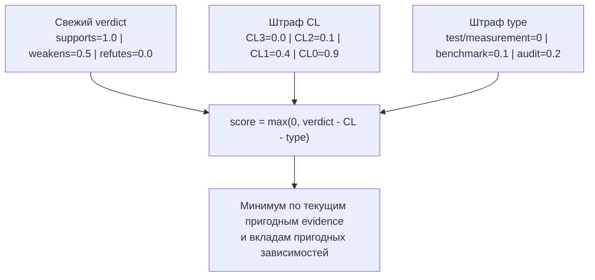

## Почему это важно

Когда решение ставят под вопрос, evidence должно позволять проверить
рассуждение, не полагаясь только на авторитет автора.

Принятие решений, основанных на доказательствах, заменяет «поверьте мне» на «вот данные». Речь идёт не о бюрократии, а о том, чтобы знать, какие из ваших решений надёжны, а какие основаны на непроверенных предположениях. Показатель R_eff в Forgeplan даёт вам одно число, которое отвечает на вопрос: **насколько я должен доверять этому решению?**

Низкая оценка полезна тем, что указывает на evidence и зависимости для
пересмотра. Чтобы понять причину, смотрите детализацию.

## Принцип

**Утверждения о доверии требуют проверяемых доказательств.**

R_eff — эвристика продукта по объявленным данным, не калиброванная
вероятность правильности решения. Высокий балл не удостоверяет
неизмеренный claim и не обнаруживает все пропущенные допущения.

## Формула R_eff

```
R_eff = min(current eligible evidence scores, eligible dependency contributions)
```

**Не среднее, а минимум.** Ваше решение настолько сильно, насколько сильно ваше слабое доказательство. Три сильных доказательства + одно непроверенное предположение = непроверенное решение.



Этот выбор дизайна преднамерен. Усреднение позволило бы сильным доказательствам маскировать слабые места. Представьте мост: если три опоры прочны, но одна треснула, вы не усредняете прочность опор. Вы чините треснувшую.

## Расчёт оценки доказательства

```
fresh_recursive_evidence_score = max(0, verdict_score - CL_penalty - type_modifier)
```

Так работает рекурсивный движок явного `score` report. Type modifiers:
`test`/`measurement` — 0, `benchmark` — 0.1, `audit` — 0.2. Просроченный item
возвращает 0.1 до этой арифметики, даже с `refutes`. Вклад пригодной зависимости
`based_on`/`informs` получает штраф 0.1, `refines`/`depends_on` — 0.
Движок пропускает draft/terminal зависимости и не требующие evidence Note/Memory.
Листовой EvidencePack может оцениваться по собственным structured fields.

Плоские `r_eff`/`raw_evidence_score`, captured `r_eff_score`, детализация
evidence CLI и `r_eff_ci.point` не учитывают type modifiers и рекурсию:
эти поля могут отличаться от рекурсивного результата. Confidence band —
тоже эвристика, не статистический доверительный интервал. Ни одна из этих
формул не является `min(F,G,R)` или универсальным алгоритмом текущего upstream FPF.

### Оценки вердиктов

| Вердикт | Оценка | Значение |
|---------|-------|---------|
| `supports` | 1.0 | Доказательство подтверждает решение |
| `weakens` | 0.5 | Доказательство вызывает опасения |
| `refutes` | 0.0 | Доказательство противоречит решению |

### Штрафы за уровень конгруэнтности

Насколько доказательство близко к вашему реальному контексту? Доказательство из вашего собственного проекта стоит больше, чем доказательство из поста в блоге.

| Уровень | Штраф | Пример |
|-------|---------|---------|
| **CL3** | 0.0 | Запуск бенчмарка в этом проекте, модульный тест в этой кодовой базе |
| **CL2** | 0.1 | PoC в связанном модуле, тест в соседнем проекте |
| **CL1** | 0.4 | Внешняя документация, чужой пост в блоге, выступление на конференции |
| **CL0** | 0.9 | Ответ со Stack Overflow из другого языка/контекста, противоположная область |

**Почему это важно**: Пост в блоге, утверждающий «Redis быстрый» (CL1, штраф 0.4), стоит гораздо меньше, чем ваш собственный бенчмарк, показывающий, что Redis справляется с вашей рабочей нагрузкой (CL3, штраф 0.0). Система штрафов заставляет вас ценить прямые доказательства выше слухов.

### Рабочий пример

Учебные данные, не записанный benchmark: предположим, для выбора LanceDB
собраны три пакета, а зависимости не снижают результат:

1. **Условный benchmark на 10K записей**: supports, CL2, `benchmark` -> рекурсивная оценка = 1.0 - 0.1 - 0.1 = **0.8**
2. **Документация LanceDB Rust SDK**: supports, CL1, `measurement` -> оценка = 1.0 - 0.4 = **0.6**
3. **Непроверенное опасение о production**: weakens, CL1, `measurement` -> оценка = 0.5 - 0.4 = **0.1**

```
R_eff = min(0.8, 0.6, 0.1) = 0.1 -- В ЗОНЕ РИСКА
```

Добавление сильного пакета не повышает неизменившийся минимум, пока слабый
пригодный пакет остаётся. Перепроверьте опасение, свяжите заменяющее evidence
и сохраните старый пакет через обоснованное lifecycle-вытеснение.
Не удаляйте и не переименовывайте неудобные данные ради числа.

## Какие пакеты участвуют в min

В min входит **текущее** пригодное evidence: terminal `superseded` и
`deprecated` остаются историей, но исключаются; draft evidence считается.
Свежий пригодный `refutes` даёт ноль. Просроченные items вместо этого дают
0.1 в текущей реализации независимо от verdict.

Честный способ убрать устаревший слабый пакет — вытеснение, а не удаление или правка вердикта: слинкуйте пакет ре-верификации и выполните `forgeplan supersede <старый> --by <новый>`. Если *вся* связанная эвиденция терминальна — артефакт деградирует к «no active evidence» (R_eff 0.0): для восстановления пакет-замена должен быть слинкован, а не просто существовать. Refutes/weakens-пакет, закрытый *без* наследника, помечается аномалией `unbacked_displacement`.

## Устаревание доказательств

У evidence может быть дата окончания срока `valid_until`; без неё scorer
его не просрочивает. После даты:

- Evidence **не удаляется**; обнаружение просрочки не меняет сохранённый status.
- Оценка становится **0.1**, без постепенного падения перед датой.
- `forgeplan stale` находит overdue dates там, где команда поддерживает раскладку workspace.
- `renew` меняет дату/причину с guard сохранённого status, но не собирает новых данных. Просроченная запись со status `active` не проходит renewal как `active → active`.

Устаревание существует, потому что мир меняется. Ваш бенчмарк полугодовой давности был запущен на другой версии библиотеки, другом оборудовании, другом объёме данных. Просроченное доказательство не бесполезно - оно говорит вам, что что-то было правдой когда-то. Но оно не должно давать вам полной уверенности в настоящем.

## Создание доказательств

Пример команд/вывода иллюстративен. Используйте реальные результаты и ID
вашего workspace, не учебные измерения и score:

```bash
# Создать EvidencePack
forgeplan new evidence "Auth benchmark -- JWT 2ms, 12 tests pass"
# Подготовьте evidence-body.md вне .forgeplan/ с реальными деталями и полями ниже
forgeplan update EVID-001 --body @evidence-body.md

# Привязать к решению, которое оно поддерживает
forgeplan link EVID-001 PRD-001 --relation informs

# Проверить влияние
forgeplan score PRD-001
# -> R_eff = 1.00
```

### Обязательные структурированные поля

Каждый EvidencePack ДОЛЖЕН содержать в своём теле:

```markdown
## Structured Fields

verdict: supports
congruence_level: 3
evidence_type: measurement
```

| Поле | Значения | Описание |
|-------|--------|-------------|
| `verdict` | supports / weakens / refutes | Это доказательство подтверждает или противоречит решению? |
| `congruence_level` | 0-3 | Насколько контекст доказательства близок к вашему реальному контексту? |
| `evidence_type` | measurement / test / benchmark / audit | Какой это тип доказательства? |

Отсутствующий/нераспознанный `verdict` или отсутствующий/некорректный CL
даёт CL0 (штраф 0.9). У `evidence_type` отдельный modifier и parser-default
`measurement`; evidence-протокол всё равно требует объявить все три поля.

### Что делает доказательство хорошим

- **Тесты, прошедшие в CI** — `evidence_type: test`; CL3 требует совпадения проверенного контекста с claim, не просто запуска CI.
- **Бенчмарки на репрезентативных данных** — `evidence_type: benchmark`; CL3 требует совпадения кода, среды и масштаба. Даже CL3 получает штраф benchmark 0.1 в рекурсивной оценке.
-   **PoC в связанном модуле** - CL2, `evidence_type: measurement`. Хорошо, но не так сильно, как продакшн-доказательство.
-   **Внешняя документация** - CL1, `evidence_type: measurement`. Полезна, но несёт штраф 0.4. Дополняйте собственным тестированием.

## Пороги доверия

Это метки для review, не lifecycle gates и не калиброванные вероятности.
Порог score не принимает решение автоматически.

| R_eff | Статус | Действие |
|-------|--------|--------|
| >= 0.5 | Адекватно | Решение может быть принято |
| < 0.5 | Требует проверки | Добавьте доказательства или пересмотрите |
| < 0.3 | В ЗОНЕ РИСКА | Решение ненадёжно, переоцените |
| 0.0 | Разобраться | Нет пригодного evidence, refutes, штрафы или влияние зависимостей |

Нулевой score не равнозначен пустому evidence: свежий refutes тоже даёт
ноль. Посмотрите evidence, факторы зависимостей и отдельную диагностику
blind spots в health перед выбором исправления.

## Команды

```bash
forgeplan score PRD-001     # Показать R_eff + детализацию доказательств
forgeplan decay             # Показать влияние устаревания доказательств
forgeplan blindspots        # Найти решения без доказательств
forgeplan health            # Полная панель состояния проекта
```

## Подводные камни

- **Пропуск structured claims.** Отсутствующий/нераспознанный verdict или отсутствующий/некорректный CL даёт CL0. Объявляйте verdict, congruence_level и evidence_type; проза или скопированные поля сами по себе не доказывают измерение.
-   **Преувеличение CL3.** Бенчмарк, который вы однажды запустили на своём ноутбуке, не является CL3. CL3 означает, что доказательство было собрано в том же контексте, где будет применяться решение - та же кодовая база, та же среда, тот же масштаб.
-   **Игнорирование доказательств, которые "ослабляют".** Если вы нашли доказательства того, что выбранный подход имеет проблемы, запишите их с `verdict: weakens`. Сокрытие неудобных доказательств не заставит их исчезнуть; это просто сделает ваш R_eff нечестным.
- **Отсутствие обновлений evidence.** Выбирайте дату по характеру claim; 90–180 дней — пример периода пересмотра, не встроенный default. Перед продлением проведите проверку.
- **Связь не с тем артефактом.** Связывайте evidence с решением, чей claim оно подтверждает; Epic тоже может обоснованно требовать evidence. Связь не оправдывает данные, не относящиеся к claim.

## Подводные камни и примечания по миграции

### PROB-034 (v0.17.2) - ловушка многострочного HTML-комментария

Шаблон доказательства по умолчанию поставляется с многострочным HTML-комментарием справки:

```markdown
<!--
     verdict: supports | weakens | refutes
     congruence_level: 0 | 1 | 2 | 3 (CL3=same context, CL0=opposed)
-->
```

До версии v0.17.2 `extract_field` не отслеживал состояние многострочного комментария.
Строка-заполнитель `congruence_level: 0 | 1 | 2 | 3 (CL3=...)`
сопоставлялась так, как если бы это было реальное структурированное поле,
нечисловое значение не удавалось разобрать, `explicit_cl` становилось `None`,
и парсер молча выбирал CL3 (без штрафа). В evidence из шаблона начиная с
v0.17.0 реальный CL мог быть затенён.
[PROB-034](https://github.com/ForgePlan/forgeplan/blob/c852f40c515085d328f02e4b275edda37279a610/.forgeplan/problems/PROB-034-multi-line-html-comments-in-evidence-template-shadow-real-structured-fields-critical.md)
сохраняет A/B случай v0.17.1/v0.17.2, не измеренную перепись всех пакетов.

v0.17.2 реализует правильный конечный автомат состояния многострочного комментария,
который пропускает все строки между `<!--` и `-->`.

**Если у вас есть доказательства, созданные до v0.17.2**, повторно запустите
оценку после обновления:

```bash
forgeplan score --all
```

Старые значения R_eff могут упасть - это правильно. Предыдущие значения были
молчаливо неверными. Любое доказательство, которое явно устанавливало
`congruence_level` в разделе Structured Fields, теперь будет учитываться,
и низкие значения CL будут правильно штрафовать R_eff.

### Приоритет SourceTier - консервативное правило `min()`

Текущий scoring parser читает отдельные строки `source_tier:` и
`congruence_level:` в теле, не произвольное написание тега. При наличии обоих
берётся `min(tier_cl, explicit_cl)`; T1/T2/T3 соответствуют CL3/CL2/CL1.
Поэтому body `source_tier: T1` не отменяет явный `congruence_level: 0`.
Не считайте `forgeplan tag ... source_tier=T1` тем же входом парсера.

## Связанные материалы

- [CLI: forgeplan score](/ru/docs/cli/score/), [forgeplan blindspots](/ru/docs/cli/blindspots/), [forgeplan decay](/ru/docs/cli/decay/), [forgeplan health](/ru/docs/cli/health/)
- [CLI: forgeplan new](/ru/docs/cli/new/), [forgeplan link](/ru/docs/cli/link/)
- [Жизненный цикл артефакта](/ru/docs/methodology/lifecycle/) - просроченные доказательства и продление
- [Рассуждения ADI](/ru/docs/methodology/adi/) - фаза индукции потребляет доказательства
- [Руководство по первому артефакту](/ru/docs/guides/first-artifact/) - создание доказательств на практике
