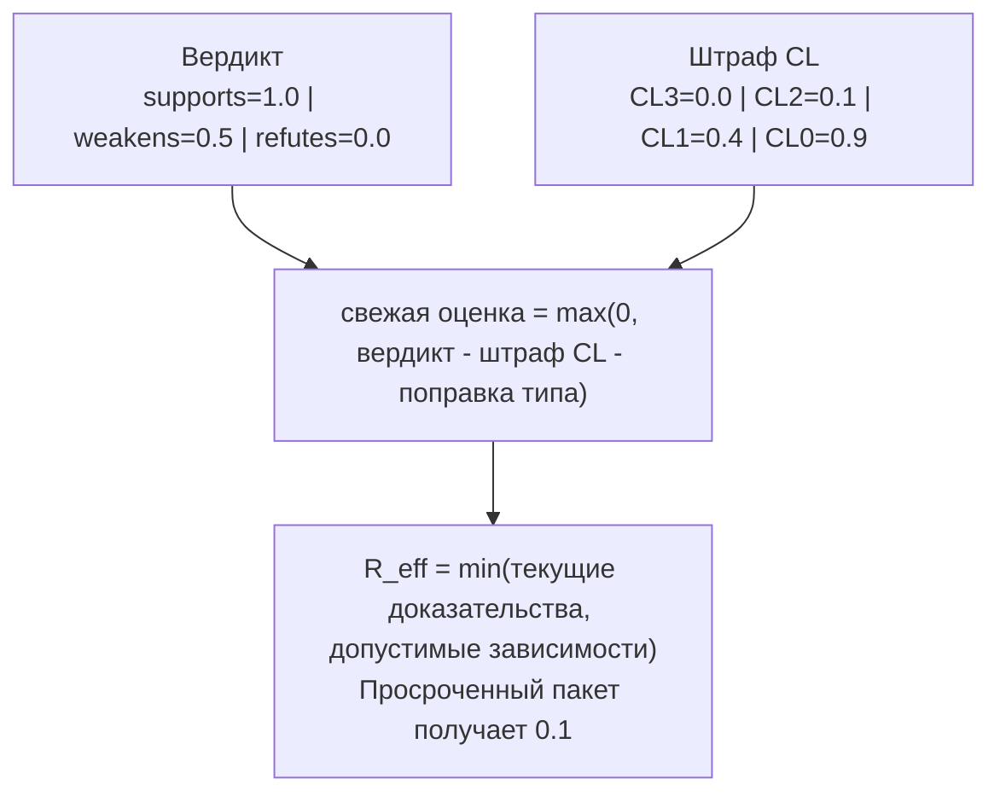

## Почему это важно

Большинство команд принимают решения, основываясь на интуиции, опыте или авторитете («так сказал старший инженер»). Это работает до тех пор, пока не перестаёт. Когда происходит инцидент на производстве и кто-то спрашивает: «Почему мы думали, что это сработает?», ответ обычно звучит так: «Мы просто... думали, что сработает».

Принятие решений, основанных на доказательствах, заменяет «поверьте мне» на «вот данные». Речь идёт не о бюрократии, а о том, чтобы знать, какие из ваших решений надёжны, а какие основаны на непроверенных предположениях. Показатель R_eff в Forgeplan даёт вам одно число, которое отвечает на вопрос: **насколько я должен доверять этому решению?**

Самое ценное не высокий балл, а обнаружение низкого. Решение с R_eff = 0.1 точно указывает на то, где находится ваш риск, прежде чем он превратится в производственный инцидент.

## Принцип

**Доверие - это не чувство. Это измерение.**

R_eff обобщает заявленные доказательства и допустимые зависимости. Это не вероятность правильности решения; вычисление оценки не проверяет независимо, запускались ли заявленные тесты и замеры.

## Формула R_eff

```
R_eff = min(own current evidence scores, eligible dependency scores)
```

**Не среднее, а минимум.** Ваше решение настолько сильно, насколько сильно ваше слабое доказательство. Три сильных доказательства + одно непроверенное предположение = непроверенное решение.



Этот выбор дизайна преднамерен. Усреднение позволило бы сильным доказательствам маскировать слабые места. Представьте мост: если три опоры прочны, но одна треснула, вы не усредняете прочность опор. Вы чините треснувшую.

## Расчёт оценки доказательства

```
fresh_evidence_score = max(0, verdict_score - CL_penalty - type_modifier)
expired_evidence_score = 0.1
```

`forgeplan score` и MCP `forgeplan_score` используют рекурсивный расчёт. Поправки типа — **0.0** для `test` и `measurement`, **0.1** для `benchmark`, **0.2** для `audit`. Низкоуровневая функция `r_eff()` для плоского списка не учитывает эту поправку; её упрощённая формула не описывает итог команды.

Рекурсивный расчёт проходит по исходящим зависимостям `informs`, `based_on`, `refines` и прежнему `depends_on`. Зависимости в статусах draft, superseded и deprecated пропускаются, как и зависимости Note/memory. Это отличается от связанных **доказательств**, где draft-пакеты учитываются. Исходящие `informs`/`based_on` от Evidence к поддерживаемому решению зависимостями не считаются. Листовой EvidencePack оценивается по собственным полям; выдумывать дочерние доказательства не нужно. Оценка зависимости уменьшается на 0.1 для `informs`/`based_on`; для `refines`/прежнего `depends_on` штрафа связи нет. Вместе с итогом читайте `weakest_link` и `factors`.

**Ограничение вывода 0.38.0:** CLI JSON `evidence[].score` и `r_eff_ci.point` используют плоский локальный расчёт, а верхнеуровневый `r_eff` — рекурсивный, с поправками типов и зависимостями. Значения могут различаться. Интервал эвристический, не статистическая гарантия; меньше трёх текущих пакетов помечается как недостаточное количество. Не усредняйте показанные оценки пакетов для восстановления `r_eff`.

### Оценки вердиктов

| Вердикт | Оценка | Значение |
|---------|-------|---------|
| `supports` | 1.0 | Доказательство подтверждает решение |
| `weakens` | 0.5 | Доказательство вызывает опасения |
| `refutes` | 0.0 | Доказательство противоречит решению |

### Штрафы за уровень конгруэнтности

Насколько доказательство близко к вашему реальному контексту? Доказательство из вашего собственного проекта стоит больше, чем доказательство из поста в блоге.

| Уровень | Штраф | Пример |
|-------|---------|---------|
| **CL3** | 0.0 | Запуск бенчмарка в этом проекте, модульный тест в этой кодовой базе |
| **CL2** | 0.1 | PoC в связанном модуле, тест в соседнем проекте |
| **CL1** | 0.4 | Внешняя документация, чужой пост в блоге, выступление на конференции |
| **CL0** | 0.9 | Ответ со Stack Overflow из другого языка/контекста, противоположная область |

**Почему это важно**: Пост в блоге, утверждающий «Redis быстрый» (CL1, штраф 0.4), стоит гораздо меньше, чем ваш собственный бенчмарк, показывающий, что Redis справляется с вашей рабочей нагрузкой (CL3, штраф 0.0). Система штрафов заставляет вас ценить прямые доказательства выше слухов.

### Рабочий пример

Вы решаете, использовать ли LanceDB для хранения артефактов. Вы собираете три доказательства:

1. **Бенчмарк на 10K записей**: `supports`, CL2, `benchmark` → 1.0 - 0.1 - 0.1 = **0.8**
2. **Документация LanceDB Rust SDK**: `supports`, CL1, `measurement` → 1.0 - 0.4 = **0.6**
3. **Комментарий Hacker News о работе в продакшене**: `weakens`, CL1, `measurement` → 0.5 - 0.4 = **0.1**

```
R_eff = min(0.8, 0.6, 0.1) = 0.1 (до учёта более слабой зависимости)
```

Непроверенная проблема работы в продакшене — слабое звено. Исследуйте её и зафиксируйте новую проверку. Если новое доказательство вытесняет старый пакет, свяжите замену с решением и используйте команды жизненного цикла ниже; не удаляйте и не переписывайте неудобные доказательства ради повышения оценки.

## Какие пакеты участвуют в min

R_eff учитывает только **текущие** доказательства артефакта. Пакеты с терминальным статусом (`superseded` или `deprecated`) исключаются из min и количества доказательств. Они остаются историей в графе и выводятся в детализации `score` с пометкой «excluded from min». Draft-пакеты **учитываются**. Свежий **активный** пакет с `refutes` по-прежнему обнуляет оценку.

При замене старый результат остаётся в истории. Не удаляйте пакет и не меняйте его вердикт ради повышения оценки. Свяжите пакет повторной проверки с решением и проверьте **сохранённый** статус старого пакета:

- **active:** `forgeplan supersede OLD-ID --by NEW-ID`.
- **draft:** заполненный и валидный пакет сначала должен пройти `forgeplan activate OLD-ID`. После этого его можно заменить через `supersede`. Не активируйте незаполненный или неподтверждённый пакет ради смены статуса.
- **stale:** переход через `supersede` не поддерживается. Сохраните связь командой `forgeplan link OLD-ID NEW-ID --relation supersedes`: команда жизненного цикла тоже направляет её от старого пакета к замене. Затем выполните `forgeplan deprecate OLD-ID --reason "Replaced by NEW-ID after re-verification"`. У нового пакета также должна быть собственная связь `informs` с решением.

Просрочка сама по себе не меняет сохранённый статус. Если все связанные пакеты терминальны, текущих доказательств нет и R_eff равен 0.0. Закрытый без наследника пакет refutes/weakens отмечается аномалией `unbacked_displacement`.

## Устаревание доказательств

Доказательства имеют TTL (поле `valid_until`). Когда срок действия истекает:

- Доказательство **не удаляется**. Просрочка определяется по `valid_until`; её обнаружение само по себе не переписывает статус жизненного цикла.
- Расчёт возвращает **0.1** для любого просроченного пакета до штрафов за вердикт и тип. Даже просроченный `refutes` попадает в эту ветку; не описывайте его как бессрочный запрет.
- `forgeplan stale` находит просроченные записи.
- Прежде чем продлевать срок или публиковать замену, повторите соответствующие проверки. `renew` записывает причину и дату, но не запускает проверки. Явный переход статуса описан в разделе [Жизненный цикл](/ru/docs/methodology/lifecycle/).

Устаревание существует, потому что мир меняется. Ваш бенчмарк полугодовой давности был запущен на другой версии библиотеки, другом оборудовании, другом объёме данных. Просроченное доказательство не бесполезно - оно говорит вам, что что-то было правдой когда-то. Но оно не должно давать вам полной уверенности в настоящем.

## Создание доказательств

```bash
# Создать EvidencePack
forgeplan new evidence "Auth verification results"
# Используйте выданный ID. EVID-001 ниже — пример.
# Сначала запишите реальные результаты в auth-evidence.md, затем обновите тело:
forgeplan update EVID-001 --body @auth-evidence.md

# Связать с поддерживаемым решением
forgeplan link EVID-001 PRD-001 --relation informs

# Результат зависит от полей, срока действия и зависимостей
forgeplan score PRD-001
```

### Обязательные структурированные поля

Каждый EvidencePack ДОЛЖЕН содержать в своём теле:

```markdown
## Structured Fields

verdict: supports
congruence_level: 3
evidence_type: measurement
```

| Поле | Значения | Описание |
|-------|--------|-------------|
| `verdict` | supports / weakens / refutes | Это доказательство подтверждает или противоречит решению? |
| `congruence_level` | 0-3 | Насколько контекст доказательства близок к вашему реальному контексту? |
| `evidence_type` | measurement / test / benchmark / audit | Какой это тип доказательства? |

Записывайте отдельные строки `key: value` вне HTML-комментариев и таблиц, без пояснений `#` в конце строки. Парсер берёт первое совпадение. Отсутствующий или неизвестный `verdict`, а также отсутствие одновременно явного CL и `source_tier` приводят к CL0. `verdict: unknown` не является четвёртым оцениваемым вердиктом. Отсутствующий/неизвестный `evidence_type` даёт `measurement`, а **не** CL0. Незаявленное подтверждающее измерение обычно получает 0.1; поправка типа и другие вердикты могут снизить результат ещё сильнее.

Если доказательство заявляет изменение кода, также укажите `base_sha`, `result_sha` и `changed_paths` по реальной разнице git. Проверка происхождения при активации настраивается как `integrity.evidence_provenance_gate: warn|block|off` (по умолчанию `warn`); `--force` её обходит. Структурированные поля не доказывают подлинность измерения.

### Что делает доказательство хорошим

-   **Тесты, которые проходят в CI** - CL3, `evidence_type: test`. Самая надёжная форма, потому что они запускаются в вашей реальной кодовой базе.
-   **Бенчмарки на ваших данных** - CL3, `evidence_type: benchmark`. Измеряет производительность в вашем реальном контексте.
-   **PoC в связанном модуле** - CL2, `evidence_type: measurement`. Хорошо, но не так сильно, как продакшн-доказательство.
-   **Внешняя документация** - CL1, `evidence_type: measurement`. Полезна, но несёт штраф 0.4. Дополняйте собственным тестированием.

## Пороги доверия

| R_eff | Статус | Действие |
|-------|--------|--------|
| >= 0.5 | Диапазон Adequate | До принятия изучите покрытие и слабое звено |
| < 0.5 | Требует проверки | Добавьте доказательства или пересмотрите |
| 0.0 | Нулевая оценка | Возможны отсутствие текущих доказательств, опровержение, штрафы или слабая зависимость |

Эти диапазоны не являются универсальными гейтами активации. Ядро проверяет связь с доказательством и валидацию, а не числовой порог R_eff. В опубликованных настройках `/gate-check` пороги оценки относятся к `should`; блокируют структурные нарушения `must`. `blindspots` ищет отсутствие связей с доказательствами, а не все причины нулевой оценки.

## Команды

```bash
forgeplan score PRD-001     # Показать R_eff + детализацию доказательств
forgeplan decay             # Показать влияние устаревания доказательств
forgeplan blindspots        # Найти решения без доказательств
forgeplan health            # Полная панель состояния проекта
```

## Подводные камни

- **Пропуск или повреждение полей.** Используйте точные поддерживаемые значения; отсутствие `evidence_type` и отсутствие `verdict` обрабатываются по-разному.
- **Завышение CL3.** Сопоставляйте контекст с утверждением: модульный тест может быть CL3 для поведения локальной функции, но замер на ноутбуке не подтверждает производственный масштаб.
-   **Игнорирование доказательств, которые "ослабляют".** Если вы нашли доказательства того, что выбранный подход имеет проблемы, запишите их с `verdict: weakens`. Сокрытие неудобных доказательств не заставит их исчезнуть; это просто сделает ваш R_eff нечестным.
-   **Никогда не обновляете доказательства.** Бенчмарки и результаты тестов имеют срок годности. Установите `valid_until` на 90-180 дней и устраняйте просроченные доказательства, когда `forgeplan health` их помечает.
-   **Привязка доказательств к неправильному артефакту.** Доказательства должны быть привязаны к решению, которое они поддерживают, а не к Epic или к несвязанному PRD. Неправильно привязанный EvidencePack не даёт преимуществ R_eff.

Вердикты ревью **PASS / CONCERNS / BLOCKER** записываются в тексте ревью. Это не значения поля оценки `verdict`, которое принимает только `supports / weakens / refutes`. Если процесс marketplace требует оба вердикта, записывайте их раздельно.

## Подводные камни и примечания по миграции

### PROB-034 (v0.17.2) - ловушка многострочного HTML-комментария

Шаблон доказательства по умолчанию поставляется с многострочным HTML-комментарием справки:

```markdown
<!--
     verdict: supports | weakens | refutes
     congruence_level: 0 | 1 | 2 | 3 (CL3=same context, CL0=opposed)
-->
```

До версии v0.17.2 `extract_field` не отслеживал состояние многострочного комментария.
Строка-заполнитель `congruence_level: 0 | 1 | 2 | 3 (CL3=...)`
сопоставлялась так, как если бы это было реальное структурированное поле,
нечисловое значение не удавалось разобрать, `explicit_cl` становилось `None`,
и парсер молча устанавливал значение по умолчанию CL3 (без штрафа). Это означало,
что **каждый артефакт доказательства, созданный с помощью шаблона по умолчанию
начиная с v0.17.0, имел затенённый реальный `congruence_level`** - R_eff
был искусственно завышен во всём рабочем пространстве.

v0.17.2 реализует правильный конечный автомат состояния многострочного комментария,
который пропускает все строки между `<!--` и `-->`.

**Если у вас есть доказательства, созданные до v0.17.2**, повторно запустите
оценку после обновления:

```bash
forgeplan score --all
```

Старые значения R_eff могут упасть - это правильно. Предыдущие значения были
молчаливо неверными. Любое доказательство, которое явно устанавливало
`congruence_level` в разделе Structured Fields, теперь будет учитываться,
и низкие значения CL будут правильно штрафовать R_eff.

### Приоритет SourceTier - консервативное правило `min()`

Расчёт читает `source_tier: T1` / `T2` / `T3` как отдельное **поле тела**, соответствующее CL3 / CL2 / CL1. Если также указан явный `congruence_level`, берётся `min(tier_cl, explicit_cl)` — более консервативное значение.

Например, поля тела `source_tier: T1` и `congruence_level: 0` сохраняют CL0. Обычный тег frontmatter вроде `source_tier=T1` не является этим полем оценки. Уровень источника задаёт контекст, но не заменяет заявленный вердикт и независимо проверенные результаты.

## Связанные материалы

-   [CLI: forgeplan score](/docs/cli/score/), [forgeplan blindspots](/docs/cli/blindspots/), [forgeplan decay](/docs/cli/decay/), [forgeplan health](/docs/cli/health/)
-   [CLI: forgeplan new](/docs/cli/new/), [forgeplan link](/docs/cli/link/)
-   [Жизненный цикл артефакта](/docs/methodology/lifecycle/) - просроченные доказательства и продление
-   [Рассуждения ADI](/docs/methodology/adi/) - фаза индукции потребляет доказательства
-   [Руководство по первому артефакту](/docs/guides/first-artifact/) - создание доказательств на практике
