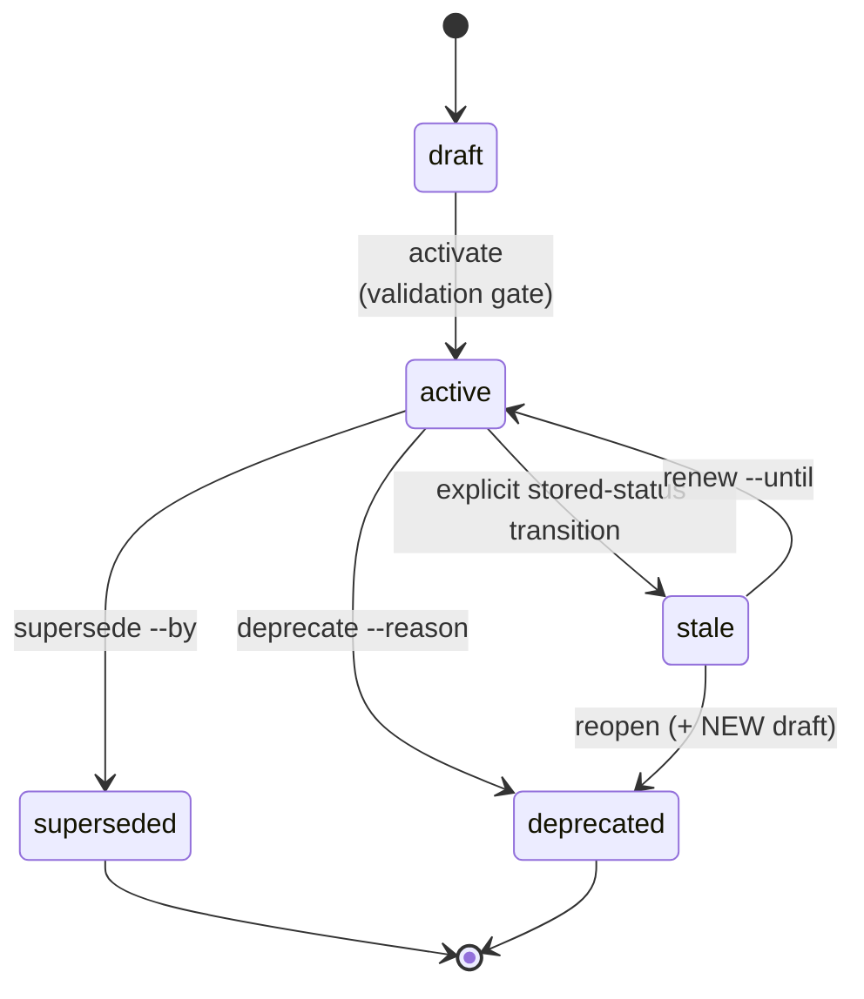

## Почему это важно

Артефакты - это не статические документы, которые вы пишете один раз и забываете. Они развиваются: черновик PRD становится валидированным планом, активное решение в конечном итоге замещается лучшим. Без чёткого управления жизненным циклом вы получаете «зомби-документы» - устаревшие спецификации, которым никто не доверяет, но никто не удаляет; активные решения, которые так и не были валидированы; и просроченные доказательства, создающие ложное чувство уверенности.

Модель жизненного цикла присваивает каждому артефакту чёткий статус, чтобы вы всегда знали: актуален ли он? Валидирован ли он? Был ли он замещён? Стоит ли ему доверять?

## Конечный автомат



Это модель сохранённых статусов. Поиск истёкших дат сообщает о просрочке,
но не меняет `status: active` на `stale`. Reopen также принимает сохранённый
`active`, создаёт новый черновик и отменяет старый артефакт.

**Терминальные состояния** не имеют исходящих обычных lifecycle-переходов.
Для пересмотра создают новый артефакт с историей наследования.
Восстановление через receipt командами [`restore`](/ru/docs/cli/restore/)
или `undo-last` - отдельный механизм отмены записанной ошибочной операции.

## Состояния

| Состояние | Значение | Может перейти в |
|---|---|---|
| **черновик** | В работе, не валидирован | активный |
| **активный** | Валидирован, используется | замещённый, устаревший, просроченный |
| **просроченный** | истёк срок `valid_until` | активный (продлить), устаревший (переоткрыть) |
| **замещённый** | Замещён новым артефактом | *(терминальное)* |
| **устаревший** | Больше не актуален | *(терминальное)* |

Каждый артефакт начинается как **черновик**. Он остаётся в этом состоянии, пока вы явно не валидируете и не активируете его. Это сделано намеренно - автоматического повышения статуса нет. Вы должны заслужить статус «активный», пройдя гейты валидации.

## Команды жизненного цикла

Команды ниже иллюстрируют жизненный цикл, а не проверку каждого инструмента.
Одной регистрации в `tools/list` недостаточно для подтверждения работы.
Проверенное покрытие совместимости и оставшиеся ограничения описаны в
[гайде Constellation](/ru/docs/guides/constellation/).

```bash
# Валидация перед активацией
forgeplan review PRD-001
# -> Проверка ПРОЙДЕНА - готово к активации

# Активация (черновик -> активный)
forgeplan activate PRD-001
# -> Гейт валидации проверяет правила MUST

# Замещение (активный -> замещённый)
forgeplan supersede PRD-001 --by PRD-002
# -> Создаёт ссылку: PRD-002 замещает PRD-001

# Отмена (активный/просроченный -> устаревший)
forgeplan deprecate PRD-001 --reason "Больше не нужен"

# Продление (просроченный -> активный)
forgeplan renew PRD-001 --reason "Повторно валидирован" --until 2026-12-31

# Переоткрытие (просроченный -> устаревший + НОВЫЙ черновик)
forgeplan reopen PRD-001 --reason "Требует серьёзного пересмотра"
# -> PRD-001 отменён, создан новый черновик (например, PRD-NNN)
```

### Когда использовать каждый переход

**Активируйте**, когда артефакт валидирован, используется и подкреплён
предусмотренными реализацией и доказательствами. Одобрение начала работы
или успешная проверка схемы ещё не означает готовности к активации.

**Замещайте**, когда существует лучшая версия. Ваш исходный PRD по аутентификации (PRD-001) предусматривал базовый JWT. Шесть месяцев спустя требования изменились, и вы написали PRD-002 с федерацией OAuth2. Заместите PRD-001 с помощью PRD-002, чтобы любой, кто обращается к старому, перенаправлялся на новый.

**Отменяйте**, когда артефакт больше не актуален. Функция была отменена, модуль удалён, или контекст изменился настолько, что решение больше не применимо.

**Продлевайте**, когда просроченный артефакт всё ещё действителен. Ваш ADR выбрал LanceDB год назад, и его срок действия истёк. Вы переоценили, и LanceDB по-прежнему является правильным выбором. Продлите его с новой датой истечения срока действия.

`renew` проверяет сохранённый статус, не только попадание в вывод `stale`.
Просроченный артефакт со статусом `active` не проходит active→active через
этот guard. Общий guard также допускает draft→active; ни это, ни продление
одной даты не доказывает повторной проверки.

**Переоткрывайте**, когда active или stale артефакт требует пересмотра.
Команда создаёт новый черновик с lineage и отменяет исходный артефакт.

## Терминальные состояния

**Superseded** и **deprecated** терминальны в обычных переходах статуса.

- Superseded: используйте замещающий артефакт.
- Deprecated: если решение нужно принять заново, создайте новый артефакт.

### Восстановление не означает повторную активацию

Для ошибочных delete, supersede или deprecate `restore`/`undo-last` может
использовать подходящий soft-delete receipt и отменить записанную операцию.
Без receipt возврат terminal-статуса не является обычным lifecycle.
Изменившиеся требования требуют нового решения, не recovery.

**Пример**: Вы выбрали JWT (ADR-001), затем перешли на сессии (ADR-002, замещает ADR-001). Год спустя вы снова хотите использовать JWT. Не активируйте ADR-001 повторно. Создайте ADR-003, который замещает ADR-002 - это сохранит полную историю решений: JWT, затем Сессии, затем снова JWT, с задокументированными причинами на каждом шаге.

## Гейты валидации

PRD, RFC, ADR, Epic, Spec требуют валидации перед активацией:

```bash
forgeplan validate PRD-001
# Применяет правила kind/depth; не каждое правило относится к каждому артефакту:
# - Присутствие разделов MUST (Problem, Goals, FR...)
# - Отсутствие утечки реализации в требованиях
# - Плотность информации (без «воды»)
# - Измеримость (критерии SMART)
```

Note и Problem пропускают обычный activation validation gate. Note — быстрая
запись, но текущий путь `new` не назначает автоматический срок 90 дней.
Если срок нужен, задайте явную дату `valid_until`.

### Что на самом деле проверяет валидация

Валидация сочетает схему и эвристики содержимого. Severity зависит от kind
и depth; предупреждение не обязательно является блокирующей MUST-ошибкой.
Успешная валидация не доказывает смысловую корректность.

- **Плотность информации**: фразы-«заполнители», такие как «важно отметить, что», помечаются. Каждое предложение должно нести смысл.
- **Утечка реализации**: упоминание конкретных фреймворков или библиотек в требованиях (например, «Использовать Redis для кеширования») помечается. Требования описывают возможности, а не реализации.
- **Измеримость**: расплывчатое требование может дать finding. Цель вроде «API response time < 200 мс на p95 при 1000 RPS» проверяема, но валидатор не выполняет этот нагрузочный тест.
- **Прослеживаемость**: требования должны прослеживаться до целей, а цели - до формулировки проблемы.

## Просроченный: забытое состояние

Когда `valid_until` истекает, detection сообщает о просрочке, но не сохраняет
автоматически новый статус. Это означает, что прошла дата пересмотра,
не доказывает ошибочности решения.

**Пример**: ADR имеет календарную дату `valid_until`, выбранную через 180 дней
после создания. После неё нужно пересмотреть решение до продления.
Поле хранит дату, не буквальную длительность `180 days`.

```bash
# Найти все просроченные артефакты
forgeplan stale

# Только если сохранённый статус допускает renew; вывода stale недостаточно
forgeplan renew ADR-001 --reason "Переоценено, по-прежнему лучший вариант" --until 2027-06-30

# Или признать, что требуется переосмысление
forgeplan reopen ADR-001 --reason "Доступны новые альтернативы, требуется свежая оценка"
```

## Распространённые ошибки

- **Активация PRD до написания какого-либо кода.** «Активный» означает «валидирован и используется». Если код ещё не существует, PRD не используется - это всё ещё план. Держите его в черновике, пока не начнётся реализация и не появятся доказательства.
- **Никогда не замещать, только создавать новые артефакты.** Если ADR-002 заменяет ADR-001, но вы не отмечаете замещение, оба артефакта кажутся активными, и никто не знает, какой из них актуален.
- **Игнорирование просрочки.** Просроченный eligible evidence item даёт `0.1` при расчёте. Итог артефакта зависит и от других evidence/dependencies; это скачок после expiry, не плавное угасание и не универсальный итог `0.1`.
- **Отношение к draft как к active.** Полный валидированный артефакт может намеренно оставаться draft до реализации, evidence или одобрения. Не активируйте его только ради исчезновения предупреждения.
- **Забывать `valid_until` для ADR.** Каждое архитектурное решение имеет срок годности. Установите реалистичные даты истечения срока действия (90-180 дней), чтобы обнаружение просроченных артефактов работало.

## Связанные материалы

- [Жизненный цикл v2](/ru/docs/guides/lifecycle-v2/) - подробные сценарии
- [review](/ru/docs/cli/review/), [activate](/ru/docs/cli/activate/), [supersede](/ru/docs/cli/supersede/), [deprecate](/ru/docs/cli/deprecate/), [renew](/ru/docs/cli/renew/), [reopen](/ru/docs/cli/reopen/), [stale](/ru/docs/cli/stale/)
- [Доказательства и R_eff](/ru/docs/methodology/evidence/)
- [Роутинг и глубина](/ru/docs/methodology/routing/)