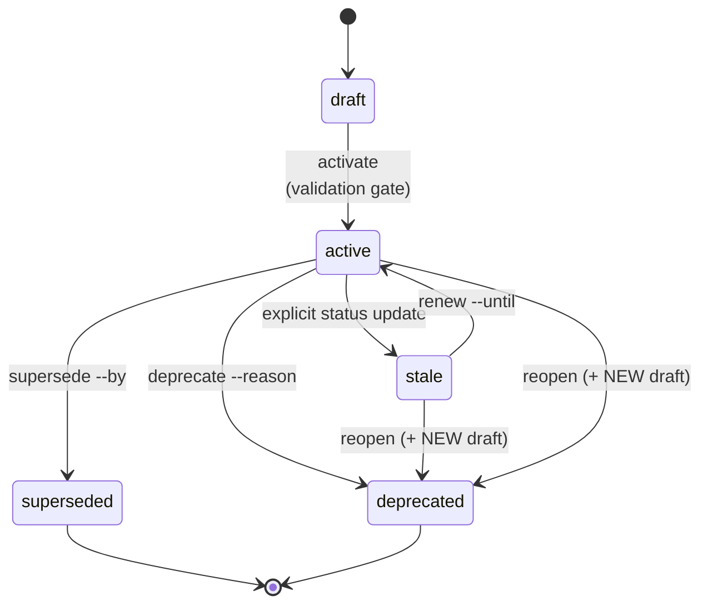

## Почему это важно

Артефакты - это не статические документы, которые вы пишете один раз и забываете. Они развиваются: черновик PRD становится валидированным планом, активное решение в конечном итоге замещается лучшим. Без чёткого управления жизненным циклом вы получаете «зомби-документы» - устаревшие спецификации, которым никто не доверяет, но никто не удаляет; активные решения, которые так и не были валидированы; и просроченные доказательства, создающие ложное чувство уверенности.

Модель жизненного цикла присваивает каждому артефакту чёткий статус, чтобы вы всегда знали: актуален ли он? Валидирован ли он? Был ли он замещён? Стоит ли ему доверять?

## Конечный автомат



**Терминальные состояния** (`superseded`, `deprecated`) не имеют обычных переходов наружу. Для пересмотра решения создайте новый артефакт; `reopen` принимает active/stale, а не терминальные записи.

Отдельные операции восстановления `restore` и `undo-last` могут отменить ошибочное замещение/отмену по неиспользованной квитанции в trash (срок хранения по умолчанию 30 дней). Это восстановление операции, а не обычная повторная активация старого решения.

В 0.38 MCP-обработчики deprecate/supersede сохраняют такие квитанции, а одноимённые команды CLI нет. `undo-last` выбирает последнюю доступную квитанцию, которая может относиться к более ранней операции; проверьте её, а не считайте отменой последней CLI-команды. После восстановления сравните статус API с frontmatter Markdown: из-за известного [расхождения файла и индекса](https://github.com/ForgePlan/forgeplan/issues/296) они могут отличаться даже при `projection_restored: true`.

Машина состояний в 0.38 не защищает каждый путь записи: raw `update --status` проверяет не все пары исходного и целевого статуса и позволяет сбросить терминальную запись ([#550](https://github.com/ForgePlan/forgeplan/issues/550)). Не используйте этот дефект вместо `reopen` или восстановления по квитанции.

## Состояния

| Состояние | Значение | Может перейти в |
|---|---|---|
| **черновик (draft)** | В работе | active |
| **активный (active)** | Активирован для использования; силу доказательств проверяют отдельно | superseded, deprecated, stale; reopen создаёт новый draft |
| **просроченный (stale)** | Сохранённый маркер необходимости переоценки; срок также проверяется независимо | active (renew), deprecated (reopen/deprecate) |
| **замещённый** | Замещён новым артефактом | *(терминальное)* |
| **устаревший** | Больше не актуален | *(терминальное)* |

Новые артефакты создаются как **draft**. Для PRD/RFC/ADR/Epic/Spec штатная активация требует валидации и проверок методологии. Общего автоматического повышения статуса нет. Явная опция связывания может активировать только заполненный draft-источник **Evidence**: CLI `--auto-activate-complete`, MCP `auto_activate_source_if_complete: true` (по умолчанию выключено). Поддерживаемое решение она не активирует.

## Команды жизненного цикла

```bash
# Валидация перед активацией
forgeplan review PRD-001
# -> Проверка ПРОЙДЕНА - готово к активации

# Активация (черновик -> активный)
forgeplan activate PRD-001
# -> Гейт валидации проверяет правила MUST

# Замещение (активный -> замещённый)
forgeplan supersede PRD-001 --by PRD-002
# -> Фиксирует замещение PRD-001 артефактом PRD-002

# Отмена (активный/просроченный -> устаревший)
forgeplan deprecate PRD-001 --reason "Больше не нужен"

# Продление (просроченный -> активный)
forgeplan renew PRD-001 --reason "Повторно валидирован" --until 2026-12-31

# Переоткрытие (active/stale -> deprecated + НОВЫЙ draft)
forgeplan reopen PRD-001 --reason "Требует серьёзного пересмотра"
# -> PRD-001 отменён, создан новый черновик (например, PRD-NNN)
```

### Когда использовать каждый переход

**Активируйте** после выполнения требований процесса к доказательствам и ревью. Для PRD/RFC/ADR/Epic/Spec ядро проверяет MUST-правила, длину тела (минимум 100 байт после обрезки пробелов), заглушки и условие связи с доказательством. Команда не запускает код и тесты, не требует guardian и не устанавливает порог R_eff > 0. `--force` обходит эти гейты, но не проверку допустимости перехода; обход нужно явно указать.

**Замещайте**, когда существует лучшая версия. Ваш исходный PRD по аутентификации (PRD-001) предусматривал базовый JWT. Шесть месяцев спустя требования изменились, и вы написали PRD-002 с федерацией OAuth2. Заместите PRD-001 с помощью PRD-002, чтобы любой, кто обращается к старому, перенаправлялся на новый.

**Отменяйте**, когда артефакт больше не актуален. Функция была отменена, модуль удалён, или контекст изменился настолько, что решение больше не применимо.

**Продлевайте**, когда просроченный артефакт всё ещё действителен. Ваш ADR выбрал LanceDB год назад, и его срок действия истёк. Вы переоценили - LanceDB по-прежнему работает. Продлите его с новой датой истечения срока действия.

**Переоткрывайте**, когда active- или stale-артефакт требует серьёзного пересмотра. Старый получает deprecated, создаётся новый draft того же типа с разделом `Lineage` и связью `based_on` к оригиналу. Полное старое тело не копируется; заполните новый черновик до использования.

## Терминальные состояния

**Superseded** и **deprecated** терминальны в обычном конечном автомате:

- Superseded: используйте заменяющий артефакт.
- Deprecated: если тема снова актуальна, создайте новый артефакт. `reopen` не принимает deprecated-источник.

### Почему терминальное означает терминальное

Старое решение не становится текущим через `activate` или `renew`. Если ошибочна сама операция закрытия, используйте восстановление по квитанции; иначе запишите новое решение с собственной аргументацией. Не обходите историю жизненного цикла прямой правкой метаданных.

**Пример**: Вы выбрали JWT (ADR-001), затем перешли на сессии (ADR-002, замещает ADR-001). Год спустя вы снова хотите использовать JWT. Не активируйте ADR-001 повторно. Создайте ADR-003, который замещает ADR-002 - это сохранит полную историю решений: JWT, затем Сессии, затем снова JWT, с задокументированными причинами на каждом шаге.

## Гейты валидации

PRD, RFC, ADR, Epic, Spec требуют валидации перед активацией:

```bash
forgeplan validate PRD-001
# Проверяет применимые правила для типа и глубины.
# Отсутствующие MUST-разделы и заглушки могут блокировать.
# SHOULD-находки — рекомендации, а не ошибки активации.
```

Типы вне PRD/RFC/ADR/Epic/Spec, в том числе Note, Problem и Evidence, пропускают эти полные гейты активации. Hypothesis использует собственный автомат продвижения. Note — текстовый артефакт, не ячейка памяти ключ-значение; не считайте, что `new note` или `reason --save` автоматически назначает TTL 90 дней.

### Что на самом деле проверяет валидация

Валидация применяет правила по типу и глубине. Она проверяет обязательные разделы и может сообщать об эвристиках качества: утечке реализации, расплывчатых требованиях, лишних фразах. Блокирует ли находка, зависит от уровня соответствующего правила. Валидация не доказывает достижимость требований, не запускает примеры и не устанавливает за вас смысловую прослеживаемость.

`review` добавляет к валидации гейты жизненного цикла и предупреждения о зависимостях от draft. Успешный `validate` сам по себе не равнозначен успешному `review` или активации.

Опубликованный marketplace добавляет отдельные роли. `/gate-check` читает проектный `quality-gates.yaml` поверх поставляемых значений: структурные `must` блокируют, числовые пороги оценки рекомендательны. `guardian` проверяет всю цепочку и возвращает PASS / CONCERNS / BLOCKER. Оркестратор исправляет замечания или останавливается на блокере и активирует после PASS. Это правила работы агентов, а не скрытые шаги CLI.

## Просроченный: забытое состояние

Просрочка и сохранённый статус жизненного цикла различаются. `forgeplan stale` находит истёкшие даты `valid_until`, не переписывая статус. Оценка Evidence учитывает срок напрямую, даже если в записи осталось `active`. Просрочка означает необходимость переоценки, а не опровержение утверждения.

**Пример**: у ADR о выборе LanceDB `valid_until` установлен на 180 дней после ревью. Когда дата проходит, запись появляется в отчёте о просрочке; сохранённый статус может оставаться active. Переоцените решение и доказательства вместо молчаливого допущения об их актуальности.

```bash
# Найти все просроченные артефакты
forgeplan stale

# После повторной проверки просроченной записи со статусом active:
forgeplan update ADR-001 --status stale
forgeplan renew ADR-001 --reason "Переоценено, по-прежнему лучший вариант" --until 2027-06-30

# Или признать, что требуется переосмысление
forgeplan reopen ADR-001 --reason "Доступны новые альтернативы, требуется свежая оценка"
```

`renew` записывает причину, меняет срок и возвращает active, но не собирает доказательства. `update --status active|superseded|deprecated` отклоняется — используйте отдельные команды. Явный переход active → stale выше не является автоматическим следствием просрочки.

**Ограничение 0.38:** `renew` использует общую проверку перехода и поэтому принимает также draft без проверок команды `activate`. Дата проверяется на формат, но не на будущий срок ([#547](https://github.com/ForgePlan/forgeplan/issues/547)). Используйте команду только для перепроверенного stale с подходящей будущей датой, а не как обход активации. Для уже active-записи переход active → active по-прежнему отклоняется.

Не смешивайте три независимых состояния:

- **Статус жизненного цикла** — draft / active / stale / superseded / deprecated.
- **Фаза артефакта** — shape / validate / adi / code / test / audit / evidence / done, читается через `phase`; рекомендательный маркер, не блокировка и не гейт.
- **Фаза сессии** — idle / routing / shaping / coding / evidence / pr, читается через `session`, проверяется MCP `forgeplan_guard(target_session_phase=...)`.

Claim тоже является координационным сигналом с TTL, а не блокировкой каждой записи. Опубликованный цикл двигает маркеры фаз артефакта, но оркестратор всё равно должен выполнить реальную работу и проверки.

Отдельно вычисляется отображаемый статус **STUB → SHAPED → VALIDATED → EVIDENCED → ACTIVATED**. Он не хранится в записи. `ACTIVATED` также включает superseded/deprecated, поэтому не означает «одобрено сейчас».

## Распространённые ошибки

- **Смешение активации с доказательством реализации.** Следуйте требованиям проекта к ревью и доказательствам; флаг `active` сам по себе не доказывает ни наличия кода, ни его работоспособности.
- **Никогда не замещать, только создавать новые артефакты.** Если ADR-002 заменяет ADR-001, но вы не отмечаете замещение, оба артефакта кажутся активными, и никто не знает, какой из них актуален.
- **Игнорирование предупреждений о просроченных артефактах.** Когда `forgeplan health` сообщает о просроченных артефактах, займитесь ими. Просроченные доказательства означают, что ваши показатели R_eff незаметно снижаются до 0.1.
- **Отношение к draft как к «достаточно завершённому».** Заполните артефакт или зафиксируйте причину отказа от работы. Не удаляйте содержательную историю решений ради зелёной сводки состояния.
- **Забывать `valid_until` для ADR.** Каждое архитектурное решение имеет срок годности. Установите реалистичные даты истечения срока действия (90-180 дней), чтобы обнаружение просроченных артефактов работало.

## Связанные материалы

- [Жизненный цикл v2: глубокое погружение](/docs/guides/lifecycle-v2/) - полный обзор конечного автомата с четырьмя реальными сценариями
- [CLI: review](/docs/cli/review/), [activate](/docs/cli/activate/), [supersede](/docs/cli/supersede/), [deprecate](/docs/cli/deprecate/), [renew](/docs/cli/renew/), [reopen](/docs/cli/reopen/), [stale](/docs/cli/stale/)
- [Доказательства и R_eff](/docs/methodology/evidence/) - почему просроченные доказательства снижают показатели доверия
- [Роутинг и глубина](/docs/methodology/routing/) - гейты валидации различаются по глубине