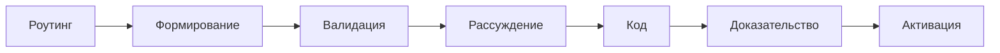

## Почему это важно

Каждая инженерная команда копит долг, которого не видно: не в коде, в решениях. Выбрали базу данных, стратегию аутентификации, спроектировали набор эндпоинтов. Через полгода кто-то спрашивает: «Почему мы сделали именно так?», и никто не помнит. Ветка в Slack утонула. Google Doc устарел. Человек, который принял решение, уволился.

Это не про документацию. Команды **теряют знания**. И долг накапливается: раз за разом обсуждаются те же вопросы, повторяются те же ошибки, всё строится на допущениях, которые никто не проверял.

Forgeplan существует, чтобы сделать решения отслеживаемыми, проверяемыми и долговечными.

## Проблема

Решения валяются в ветках Slack, Google Docs и чьей-то памяти. PRD, которые никто не открывает. RFC, у которых нет продолжения. Архитектурные решения на интуиции.

**Forgeplan заставляет думать до того, как писать код.** Вместо «открыть IDE -> написать код -> развернуть» вы получаете:

```
Route -> Shape -> Validate -> Reason -> Build -> Prove -> Activate
```



Например, команда выбрала JWT для аутентификации. Через полгода аудит безопасности спрашивает: почему JWT, а не сессии? ADR должен объяснять выбор, связанные Evidence — содержать реальные проверки, а PRD — исходные требования. Forgeplan сохраняет эти записи, но само их наличие ещё не доказывает правильность решения.

## Чем Forgeplan не заменяет

- **Не Jira.** Это не инструмент управления проектами.
- **Не трекер задач.** Здесь нет ежедневных стендапов.
- **Не генератор кода.** ИИ помогает, решаете вы.

Forgeplan - **структурированная база знаний для инженерных решений**: работает локально, всё в git, один бинарник. Лабораторный журнал для инженерии: записываете, что пробовали, почему и какие получились результаты.

## Основные принципы

### 1. Конвейер - это руководство, а не бюрократия
Не создавайте все 10 типов артефактов для каждой задачи. Тактическая глубина = только код. Глубокая глубина = полный конвейер. Если ответ очевиден и обратим, пропустите бумажную работу. Исправление ошибки в одной строке не требует PRD.

### 2. Каждое требование: "[Действующее лицо] может [возможность]"
В PRD не должно быть утечки реализации. Пишите ЧТО, а не КАК. «Пользователь сохраняет и запрашивает структурированные данные с гарантиями ACID», а не «Использовать PostgreSQL для хранения». Стоит назвать технологию в требовании, и альтернативы отсекаются до того, как вы их рассмотрели.

### 3. Дочерний артефакт ссылается на родительский
PRD -> Epic, RFC -> PRD, ADR -> RFC. Всегда отслеживается вверх. Это означает, что если вы читаете какой-либо артефакт, вы можете следовать по ссылкам вверх, чтобы понять полный контекст его существования.

### 4. Замещайте, не удаляйте
Используйте `forgeplan supersede OLD-ID --by NEW-ID`, чтобы заменить активный артефакт новым. Не устанавливайте терминальные статусы через `update --status`. История сохраняет, что изменилось и почему.

### 5. R_eff = min(доказательство)
Доверие определяется слабым звеном, а не средним. `forgeplan score` учитывает текущие доказательства и допустимые транзитивные зависимости. Терминальные пакеты исключаются, draft-пакеты учитываются; тип доказательства и срок действия влияют на результат. Формула не обнаруживает незаписанные допущения автоматически — их нужно зафиксировать и проверить. См. [Доказательства и R_eff](/ru/docs/methodology/evidence/).

## Полный цикл

```
1. Route:    forgeplan route "your task" -> determines depth
2. Shape:    forgeplan new prd "Title" -> create artifact
3. Validate: forgeplan validate PRD-XXX -> quality gates
4. Reason:   forgeplan reason PRD-XXX --save -> связанная ADI Note (нужен LLM)
5. Build:    write code, test every pub fn
6. Prove:    forgeplan new evidence -> link -> score
7. Activate: forgeplan activate PRD-XXX
```

**Завершение реализации на Standard+ по методологии** означает заполненные и проверенные артефакты, записанные проверки реализации, связанные доказательства, понятную оценку и явную активацию. Это правило процесса, а не обещание, что `activate` запускает тесты или гарантирует R_eff > 0. У Tactical-задачи артефакта может не быть. Опубликованный `/forge-cycle` дополнительно требует ADI Evidence и ревью на Standard+.

## Распространённые ошибки

- **Создание артефактов для всего.** Изменение цвета кнопки не требует PRD. Используйте `forgeplan route`, чтобы определить нужный уровень строгости: большинство задач относятся к Тактическим и не требуют документации.
- **Оставление заготовок PRD.** Создание пустого PRD и переход к коду означает, что у вас теперь есть заготовка, которая засоряет состояние вашего проекта. Либо заполните его немедленно, либо не создавайте.
- **Путаница между действующим планом и готовой функцией.** PRD или RFC можно активировать до реализации: его доказательства подтверждают требования или проект решения. Активация не доказывает готовность кода и успешный запуск тестов. R_eff = 0 требует проверить доказательства, но не означает, что у каждого планирующего артефакта уже должна быть реализация.
- **Пропуск структурированного рассуждения.** Базовая методология рекомендует ADI на Standard и требует на Deep/Critical. Опубликованные `/forge-cycle` и `guardian` строже: на Standard+ нужен связанный ADI Evidence с минимум тремя гипотезами.
- **Отношение к конвейеру как к чек-листу.** Конвейер - это инструмент мышления. Механическое выполнение действий (создать PRD, отметить; создать RFC, отметить) без фактического осмысления каждого шага сводит на нет цель.

## 10 типов артефактов

Это десять основных типов процесса. Ядро также поддерживает Memory и шесть типов анализа существующих систем (UseCase, Glossary, Invariant, Scenario, Hypothesis, DomainModel); таблица не является полным перечислением runtime.

| Тип | На какой вопрос отвечает | Когда использовать |
|------|-------------------|-------------|
| **PRD** | Что и почему? | Планирование функций |
| **RFC** | Как построить? | Предложение архитектуры |
| **ADR** | Почему именно так? | Запись решения |
| **Epic** | Какова общая картина? | Инициатива, охватывающая несколько PRD |
| **Spec** | Каков контракт? | Модели API/данных |
| **Problem** | Каков сигнал? | Ошибка, риск, наблюдение |
| **Evidence** | Работает ли? | Результаты тестов, бенчмарки |
| **Solution** | Какой вариант? | Сравнение 2-3 вариантов |
| **Note** | Быстрое решение | Краткая текстовая запись, не пара ключ-значение |
| **Refresh** | Ещё актуально? | Фиксация сверки и завершения цикла; обязательна на Deep/Critical в опубликованном процессе |

Используйте нужные задаче типы. Роутер ядра предлагает PRD → RFC для Standard и PRD → Spec → RFC → ADR для Deep/Critical. Опубликованная методология добавляет SOL перед проектированием и REFRESH при завершении Deep/Critical. CLI не создаёт эти узлы автоматически.

## Когда НЕ следует создавать артефакт

Не каждая задача заслуживает структурирования. Вот краткое руководство:

- **Исправление ошибки в одном файле** - просто исправьте. Возможно, Note, если первопричина была неожиданной.
- **Очевидный рефакторинг** - без изменения поведения, артефакт не нужен.
- **Настройка внутреннего инструментария** - если его используете только вы и он легко обратим, пропустите.
- **Всё, где ответ очевиден** - не документируйте то, что не требует объяснений.

Лакмусовая бумажка: «Спросит ли кто-нибудь (включая меня в будущем), почему было принято это решение?» Если да, создайте артефакт. Если нет, просто выпускайте.

## 10 правил (краткий обзор)

Остальная часть методологии раскрывает десять правил. У каждого - свой документ. Дальше идёт оглавление.

1. **Роутинг перед кодированием** - [Роутинг и глубина](/docs/methodology/routing/)
2. **Shape → Validate → ADI → Code → Evidence → Activate** - полный цикл, а не чек-лист
3. **`[Действующее лицо] может [возможность]`** - никакой утечки реализации в функциональных требованиях PRD
4. **Дочерний артефакт ссылается на родительский** - PRD→Epic, RFC→PRD, ADR→RFC
5. **Замещайте, не удаляйте** - [Жизненный цикл](/docs/methodology/lifecycle/)
6. **Гейты качества по глубине** — в опубликованном цикле `/gate-check` перед реализацией на Standard+, после неё на Deep+, `guardian` перед активацией
7. **Начало сессии: `health` и настроенная память** — восстановление памяти необязательно и отделено от хранилища артефактов
8. **Доказательства до завершения** — разберите R_eff и слабое звено; активация сама по себе ничего не доказывает — [Доказательства и R_eff](/ru/docs/methodology/evidence/)
9. **ADI обязателен для Глубоких+ решений** - [Обоснование ADI](/docs/methodology/adi/)
10. **Просроченный = перевалидировать, не игнорировать** - установите `valid_until` для каждого ADR

## Инструментарий

CLI и MCP-сервер выполняют операции с артефактами, а не запускают за вас команду агентов-разработчиков. `forgeplan setup-skill` устанавливает встроенные инструкции `/forge` для Claude Code, но не полный набор инструментов marketplace.

Публичный marketplace поставляет отдельные пакеты:

- **`forgeplan-workflow`** содержит `/forge-cycle` и навык методологии. Основная сессия читает процесс и вызывает инструменты; упомянутые внутри шаблона slash-команды не исполняются автоматически.
- **`fpl-skills` 1.75.1** содержит `/smith`, `/gate-check`, `/wrap` и другие навыки процесса. Smith читает состояние проекта и возвращает Plan; оркестратор запускает агентов и выполняет план.
- **`agents-pro`** содержит `smith`, авторов, ревьюеров и `guardian`. Guardian читает всю цепочку доказательств и возвращает PASS / CONCERNS / BLOCKER; активирует оркестратор, не guardian.

Эти роли не следует смешивать с состоянием CLI `session` и рекомендательным маркером `phase` артефакта. Установка `/forge` не устанавливает остальные плагины и не обеспечивает все правила marketplace. См. [Обзор Marketplace](/ru/docs/marketplace/overview/).

Межсессионная память тоже отделена. CLI `remember "text"` сохраняет записи с категориями, а `recall "query"` ищет их; это не API ключ-значение. Notes — записи артефактов. **`fpl-hsmem` 3.7.0** подключается к Hindsight только после настройки проекта через `.hindsight.json` с явными `url`, `banks` и `defaultBank`; выбранные банки уже должны существовать на сервере. Recall находит релевантные факты, mental models обобщают повторяющиеся вопросы. Хуки по умолчанию выключены, а клиентский BankGate не заменяет серверную авторизацию.

## Следующие шаги

- [Быстрый старт](/docs/getting-started/quick-start/) - первый артефакт за 10 минут
- [Руководство по первому артефакту](/docs/guides/first-artifact/) - практическое пошаговое руководство за 20 минут
- [Роутинг и глубина](/docs/methodology/routing/) - как выбрать правильный уровень
- [Жизненный цикл артефакта](/docs/methodology/lifecycle/) - черновик → активный → завершённый
- [Доказательство и оценка R_eff](/docs/methodology/evidence/) - как измеряется доверие
- [Обоснование ADI](/docs/methodology/adi/) - структурированное мышление перед созданием
- [Справочник CLI](/docs/cli/) - каждая команда документирована
- [Руководство по фреймворку FPF](/docs/guides/fpf/) - основа для обоснования