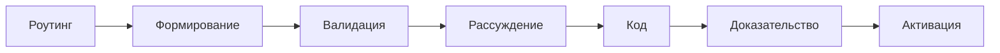

## Почему это важно

Каждая инженерная команда накапливает невидимый долг - не в коде, а в решениях. Вы выбираете базу данных, стратегию аутентификации, проектируете поверхность API. Шесть месяцев спустя кто-то спрашивает: «Почему мы сделали это так?», и никто не помнит. Ветка в Slack потеряна. Google Doc просрочен. Человек, принявший решение, уволился из компании.

Это не проблема документации. Это **проблема потери знаний**. И она усугубляется: команды повторяют одни и те же ошибки, вновь обсуждают одни и те же вопросы и строят на предположениях, которые никто не может проверить.

Forgeplan существует, чтобы сделать решения отслеживаемыми, проверяемыми и долговечными.

## Проблема

Решения разбросаны по веткам Slack, Google Docs и чьей-то памяти. PRD, которые никто не читает. RFC без последующих действий. Архитектурные решения, принятые интуитивно.

**Forgeplan заставляет вас думать перед кодированием.** Вместо «открыть IDE -> написать код -> развернуть» вы получаете:

```
Route -> Shape -> Validate -> Reason -> Build -> Prove -> Activate
```



Представим гипотетический сценарий: команда выбрала JWT, а через полгода
аудит спрашивает почему. Актуальный ADR может объяснить выбор, связанные
Evidence — сохранить реальные проверки, PRD — требования. Само создание
файлов не гарантирует наличия этой цепочки.

## Чем Forgeplan НЕ является

- **Не Jira.** Не инструмент управления проектами.
- **Не трекер задач.** Не для ежедневных стендапов.
- **Не генератор кода.** ИИ помогает, вы решаете.

Forgeplan - это **структурированная база знаний для инженерных решений** - local-first, git-native, single binary. Думайте о нём как о лабораторном журнале для инженерии: вы записываете, что вы пробовали, почему и каковы были результаты.

## Основные принципы

### 1. Конвейер - это руководство, а не бюрократия
Не создавайте все виды артефактов для каждой задачи. Tactical может обойтись
без артефакта; Deep использует полный pipeline. Выбирайте по последствиям
и обратимости, а не только числу изменённых строк.

### 2. Каждое требование: "[Действующее лицо] может [возможность]"
Никакой утечки реализации в PRD. Описывайте ЧТО, а не КАК. Пишите «Пользователь может сохранять и запрашивать структурированные данные с гарантиями ACID» - а не «Использовать PostgreSQL для хранения». В тот момент, когда вы называете технологию в требовании, вы отсекаете альтернативы до их оценки.

### 3. Дочерний артефакт ссылается на родительский
PRD -> Epic, RFC -> PRD, ADR -> RFC. Всегда отслеживается вверх. Это означает, что если вы читаете какой-либо артефакт, вы можете следовать по ссылкам вверх, чтобы понять полный контекст его существования.

### 4. Замещайте, не удаляйте
Старые артефакты получают `status: superseded`. История сохраняется. Когда ваша команда спрашивает: «Разве мы не пробовали этот подход раньше?», замещённый артефакт показывает, что было опробовано, почему от этого отказались и что его заменило.

### 5. R_eff = min(доказательство)
Доверие - это слабое звено. Не среднее - минимум. Одно слепое пятно тянет всё вниз. Если у вас есть три надёжных бенчмарка и одно совершенно непроверенное предположение о производственной нагрузке, надёжность вашего решения равна этому непроверенному предположению.
Scorer агрегирует только представленные evidence и зависимости. Он не
находит недокументированные предположения автоматически. Terminal evidence
исключены; явный score report и captured record fields также используют
разные scoring populations.

## Полный цикл

Это схема методологии, не исполняемый transcript. Подставляйте реальные
возвращённые ID и pipeline выбранной глубины. Проверенное покрытие совместимости
и оставшиеся ограничения описаны в [справочнике Constellation](/ru/docs/reference/constellation/).
Прохождение валидации не равно прохождению activation gates.

```
1. Route:    forgeplan route "your task" -> determines depth
2. Shape:    forgeplan new prd "Title" -> create artifact
3. Validate: forgeplan validate PRD-XXX -> quality gates
4. Reason:   forgeplan reason PRD-XXX -> ADI (рекомендуется Standard; обязателен Deep+)
5. Build:    write code, test every pub fn
6. Prove:    forgeplan new evidence -> link -> score
7. Activate: forgeplan activate PRD-XXX
```

Для закрытия lifecycle-решения нужны полный валидированный артефакт,
предусмотренные evidence/review и осознанная активация. Валидированный план
может намеренно оставаться draft; у Tactical может не быть PRD вообще.
Одного R_eff > 0 недостаточно для доказательства всех activation gates.

## Распространённые ошибки

- **Создавать артефакты для всего.** Низкорисковая смена цвета может не требовать PRD. Выбирайте глубину по последствиям; измеренная доля Tactical-задач не заявляется.
- **Оставление заготовок PRD.** Создание пустого PRD и переход к коду означает, что у вас теперь есть заготовка, которая засоряет состояние вашего проекта. Либо заполните его немедленно, либо не создавайте.
- **Активация без доказательств.** Активный PRD без кода, без тестов и с R_eff = 0 - это ложное обещание. Он сообщает любому, кто читает ваш проект, что это решение валидировано, хотя это не так.
- **Пропускать ADI для Deep.** До кода рассмотрите серьёзные альтернативы. Три подхода — эвристика product prompt против anchoring, не гарантированная длительность и не доказательство корректности.
- **Отношение к конвейеру как к чек-листу.** Конвейер - это инструмент мышления. Механическое выполнение действий (создать PRD, отметить; создать RFC, отметить) без фактического осмысления каждого шага сводит на нет цель.

## Десять распространённых типов артефактов

| Тип | На какой вопрос отвечает | Когда использовать |
|------|-------------------|-------------|
| **PRD** | Что и почему? | Планирование функций |
| **RFC** | Как построить? | Предложение архитектуры |
| **ADR** | Почему именно так? | Запись решения |
| **Epic** | Какова общая картина? | Инициатива, охватывающая несколько PRD |
| **Spec** | Каков контракт? | Модели API/данных |
| **Problem** | Каков сигнал? | Ошибка, риск, наблюдение |
| **Evidence** | Работает ли? | Результаты тестов, бенчмарки |
| **Solution** | Какой вариант? | Сравнение 2-3 вариантов |
| **Note** | Быстрое решение | Микро-решение; 90 дней — рекомендуемый интервал пересмотра, не автоматический runtime expiry |
| **Refresh** | Ещё актуально? | Переоценка просроченного артефакта |

Выбирайте типы под работу, не ради количества. Core также поддерживает
Memory и шесть brownfield kinds (UseCase, Glossary, Invariant, Scenario,
Hypothesis, DomainModel); разные API создания дают разные наборы типов.

## Когда НЕ следует создавать артефакт

Не каждая задача заслуживает структурирования. Вот краткое руководство:

- **Исправление ошибки в одном файле** - просто исправьте. Возможно, Note, если первопричина была неожиданной.
- **Очевидный рефакторинг** - без изменения поведения, артефакт не нужен.
- **Настройка внутреннего инструментария** - если его используете только вы и он легко обратим, пропустите.
- **Всё, где ответ очевиден** - не документируйте то, что не требует объяснений.

Лакмусовая бумажка: «Спросит ли кто-нибудь (включая меня в будущем), почему было принято это решение?» Если да, создайте артефакт. Если нет, просто выпускайте.

## 10 правил (краткий обзор)

Остальная часть методологии раскрывает десять правил. У каждого есть свой документ - этот список является оглавлением.

1. **Роутинг перед кодированием** - [Роутинг и глубина](/ru/docs/methodology/routing/)
2. **Shape → Validate → ADI → Code → Evidence → Activate** - полный цикл, а не чек-лист
3. **`[Действующее лицо] может [возможность]`** - никакой утечки реализации в функциональных требованиях PRD
4. **Дочерний артефакт ссылается на родительский** - PRD→Epic, RFC→PRD, ADR→RFC
5. **Замещайте, не удаляйте** - [Жизненный цикл](/ru/docs/methodology/lifecycle/)
6. **Гейты качества по глубине** - Тактическая = ничего, Стандартная = Гейт верификации, Глубокая+ = Состязательная ревью
7. **Начало сессии: `health` + восстановление из памяти** - сначала исправьте сирот и слепые пятна
8. **Закрытие решения: evidence и осознанная активация** - [Доказательство и оценка R_eff](/ru/docs/methodology/evidence/)
9. **ADI обязателен для Глубоких+ решений** - [Обоснование ADI](/ru/docs/methodology/adi/)
10. **Просроченный = перевалидировать, не игнорировать** - установите `valid_until` для каждого ADR

## Инструментарий

В агентах ИИ-кодирования вся эта методология упакована как навык `/forge`. Установите его с помощью `forgeplan setup-skill` (офлайн, встроен в бинарный файл) или установите полный плагин `forgeplan-workflow` через `/plugin install forgeplan-workflow@ForgePlan-marketplace`. Навык объединяет `route -> new -> validate -> reason -> activate` в одну разговорную команду.

Дополнительные плагины дают аудит (`/audit`), спринты (`/sprint`) и FPF (`/fpf`). [Обзор Marketplace](/ru/docs/marketplace/overview/).

## Следующие шаги

- [Быстрый старт](/ru/docs/getting-started/quick-start/) — первый артефакт
- [Первый артефакт](/ru/docs/guides/first-artifact/) — практическое руководство
- [Роутинг и глубина](/ru/docs/methodology/routing/)
- [Жизненный цикл](/ru/docs/methodology/lifecycle/) — draft → active → terminal
- [Доказательства и R_eff](/ru/docs/methodology/evidence/)
- [ADI](/ru/docs/methodology/adi/)
- [Справочник CLI](/ru/docs/cli/)
- [FPF](/ru/docs/guides/fpf/)