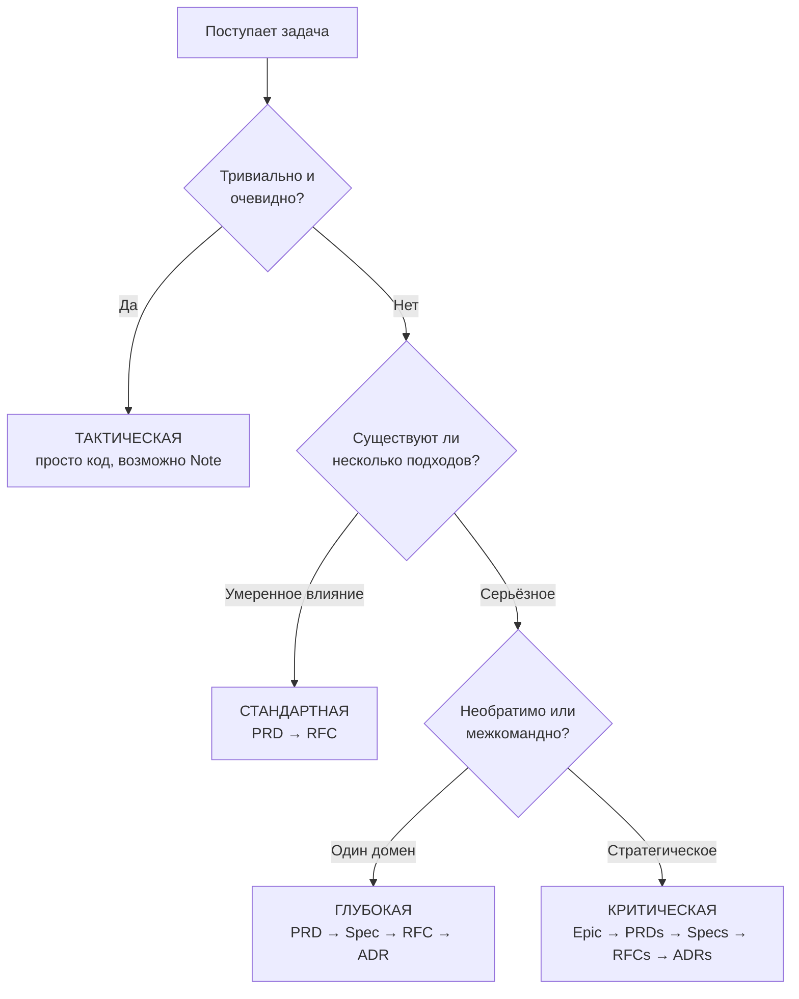

## Почему это важно

Не каждая задача заслуживает одинакового уровня строгости. Исправление опечатки и переработка платёжной системы принципиально различаются - одинаковый подход к ним либо утопит вас в бумажной работе для незначительных изменений, либо оставит критические решения без документации. Роутинг решает эту проблему, задавая один вопрос заранее: **насколько всё может пойти не так?**

Правильное определение глубины экономит реальное время. Избыточное проектирование простого исправления с полным конвейером PRD-Spec-RFC-ADR тратит часы. Недостаточное документирование необратимого архитектурного решения означает, что вы будете пересматривать его через три месяца, когда никто не вспомнит, почему оно было принято.

## Обзор

До написания кода используйте `route`, чтобы получить рекомендацию по глубине и артефактам. Это не гейт разрешения на изменение исходников и не замена оценке контекста проекта.

```bash
forgeplan route "add a new payment module with a public API" --level 0
# Роутинг по ключевым словам работает офлайн; изучите сигналы, глубину и конвейер.
```

## Четыре уровня глубины

| Уровень | Когда | Артефакты | Время |
|---|---|---|---|
| **Тактическая** | Быстрое исправление, 1 файл, легко обратимо | Note или ничего | Минуты |
| **Стандартная** | Функция 1-3 дня, несколько подходов | PRD -> RFC | Часы |
| **Глубокая** | Новый модуль, 1-2 недели, необратимо | PRD -> Spec -> RFC -> ADR | Дни |
| **Критическая** | Межкомандная, стратегическая инициатива | Epic -> PRD[] -> Spec[] -> RFC[] -> ADR[] | Недели |

Таблица описывает методологию, а не четыре разных режима исполнения. В 0.38.0 ядро хранит `Mode` со значениями `note`, `tactical`, `standard`, `deep`; Critical нормализуется в Deep и отображается как **Deep/Critical**. Конвейер ядра пуст для Tactical, равен PRD → RFC для Standard и PRD → Spec → RFC → ADR для Deep/Critical. Массивы Epic, SOL и REFRESH автоматически не добавляются.

Опубликованный процесс добавляет **SOL** между PRD и проектированием, **REFRESH** после итоговой сверки на Deep/Critical. У `/gate-check` есть отдельные пороги политики `deep` и `critical`, поэтому оркестратор должен явно сохранить выбранный уровень. Не считайте, что объединённая метка ядра сама выбирает политику Critical.

### Примеры из реального мира

**Тактическая**: Исправление ошибки парсинга, при которой не обнаруживается закрывающий `---` в YAML frontmatter. Один файл, один тест, выпускаем. Артефакт не требуется.

**Стандартная**: обратимая внутренняя функция отчётности с несколькими подходами. Создайте PRD для требований и RFC для проекта решения. Аутентификация не подходит как пример Standard для роутера по словам: `auth` и `oauth` повышают глубину до Deep.

**Глубокая**: Создание нового модуля обработки платежей. Он затрагивает финансовые данные пользователей, включает сторонние интеграции, и неправильный выбор поставщика платежей дорого обойдётся для отмены. Полный конвейер: PRD, Spec для контрактов API, RFC для архитектуры, ADR для решения Stripe-vs-PayPal.

**Критическая**: Миграция монолита на микросервисы. Задействовано несколько команд, месяцы работы, затрагивает всю систему. Epic для группировки всего, несколько PRD для каждой границы сервиса, Specs для межсервисных контрактов, RFC для стратегии миграции, ADR для каждого крупного решения.

## Дерево решений

Решение о роутинге сводится к двум последовательно задаваемым вопросам:



Это помощь при оценке, а не реализация роутера. L0 берёт наибольшую минимальную глубину среди совпавших сигналов; без совпадений возвращает Tactical. Из этого значения по умолчанию нельзя вывести долю тактической работы вашей команды.

## Триггеры автоэскалации

На L0 совпавшие сигналы задают минимальную глубину. Правила ищут английские подстроки, а не понимают смысл на всех языках:

| Пример сигнала | Минимальная глубина ядра |
|---|---|
| `security`, `auth`, `oauth`, `compliance` | Deep |
| `breaking change`, `migration`, `deprecat` | Deep |
| `public api`, `api contract`, `openapi` | Deep |
| `strategy`, `roadmap`, `initiative`; `p0`, `critical`, `hotfix` | Deep |
| `cross-team`, `multiple teams`, `cross-service` | Standard |
| `data model`, `schema change`; infrastructure/deployment | Standard |
| `new module`, `new command`, `new feature`; `bug`, `regression`, `redesign` | Standard |

:::tip
Выбирайте глубину по последствиям и обратимости. Более высокий уровень добавляет работу, но не становится автоматически безопаснее, если лишние проверки неуместны или пропущены. Зафиксируйте обоснованное отклонение, не считайте уверенность по словам доказательством.
:::

Например, согласованность видимых пользователю данных кеша может требовать Deep, но у L0 нет общего триггера «затрагивает пользовательские данные». Опишите реальные последствия для API, миграции или безопасности и посмотрите, что совпало.

## Команда Route

```bash
# Офлайн-рекомендация по детерминированным правилам
forgeplan route "add OAuth2 authentication" --level 0

# Явная классификация LLM; нужен настроенный провайдер
forgeplan route "add OAuth2 authentication" --level 1
```

В офлайн-примере `oauth`/`auth` совпадают с сигналом безопасности и дают конвейер ядра Deep/Critical: PRD → Spec → RFC → ADR. Печатная уверенность обобщает совпавшие правила; это не калиброванная вероятность правильности маршрута.

Роутинг не заполняет артефакты, не запускает ADI, не исполняет конвейер и не доказывает выбранный проект решения. Для дальнейшего создания и связывания используйте реально выданные ID.

Маршрутизатор анализирует ключевые слова (безопасность, API, миграция) и индикаторы области действия, чтобы предложить правильную глубину. Если вы не согласны, вы принимаете решение - маршрут только рекомендует, а не принуждает.

### Интеллектуальный роутинг v2: Три уровня

Реализация CLI поддерживает три уровня и откат при недоступности роутинга LLM:

| Уровень | Движок | Выбор |
|---|---|---|
| **L0** | Детерминированные правила слов и области изменений | `--level 0`; также откат без пригодного LLM |
| **L1** | Настроенный LLM-классификатор с минимальными порогами по словам | `--level 1`; автоматический режим сначала пробует его |
| **L2** | Рассуждение LLM о маршруте | `--level 2`; автоматический режим повышает успешный L1-результат Deep |

В 0.38.0 справка перечисляет L0/L1, но реализация CLI принимает и L2. **Флага `route --fpf` нет.** CLI-вызов L2 не передаёт индексированный контекст FPF; не смешивайте его с `reason --fpf` для существующего артефакта. Роутинг L2 не является долговечным ADI Evidence для гейтов marketplace.

Без `--level` CLI пробует настроенный LLM, а не обязательно L0, как можно понять из краткой справки. `--explain` устарел в пользу `--level 1`. MCP `forgeplan_route` принимает `description` и необязательный `workspace`, не эти CLI-флаги; использует L1 с откатом на L0.

### Что ищет маршрутизатор

Маршрутизатор проверяет наличие определённых сигналов, указывающих на сложность:

- **Сигналы безопасности и несовместимых изменений** могут задать Deep.
- **Модель данных, новая подсистема, ошибка и межкомандная работа** могут задать Standard.
- **Без совпадений** возвращается Tactical; это не доказывает простоту задачи.

Русский текст может не совпасть с английскими триггерами L0. Указывайте явный технический контекст и проверяйте результат, не предполагая, что отработал языковой классификатор.

Навыки marketplace `/smith` и `/smith-plan` решают другой вопрос: какой из 14 методологических контекстов подходит, какие агенты и доказательства нужны? Smith возвращает Plan, но не выполняет рекомендованные запуски и не активирует артефакты. Это делает основной оркестратор. Затем `/forge-cycle` применяет ADI и ревью на Standard+, `/gate-check` перед реализацией и guardian перед активацией. CLI-команда `route` не устанавливает эти роли.

## Подводные камни

- **"New command" задаёт Standard на L0.** Другая формулировка может не совпасть. Изучайте сигналы, а не считайте все изменения CLI тактическими или все глубокими.
- **Рефакторинг может быть обманчиво глубоким.** «Простой рефакторинг», который изменяет границы модулей или публичные интерфейсы, тянет на Standard или Deep, а не на Tactical.
- **Не выполняйте роутинг после того, как вы уже начали кодировать.** Сначала выполните роутинг. Если вы пропустили роутинг и в середине реализации поняли, что это сложнее, чем ожидалось, остановитесь и создайте соответствующие артефакты, прежде чем продолжить.
- **Маршрутизатор не знает историю вашей кодовой базы.** Он не может сказать, что «добавление кеширования» тривиально в одном проекте и занимает неделю в другом. Вы предоставляете контекст, которого ему не хватает.
- **Остерегайтесь ловушки «это всего лишь небольшое изменение».** Изменения схемы базы данных, модификации публичного API и потоки аутентификации никогда не бывают небольшими - даже если разница в коде минимальна. Выполняйте роутинг по последствиям, а не по количеству строк кода.

## Связанные материалы

- [CLI: forgeplan route](/docs/cli/route/)
- [Рассуждения ADI](/docs/methodology/adi/) - обязательны для Deep/Critical
- [Жизненный цикл артефактов](/docs/methodology/lifecycle/) - гейты качества различаются по глубине
- [Быстрый старт](/docs/getting-started/quick-start/) - см. роутинг в полном цикле
