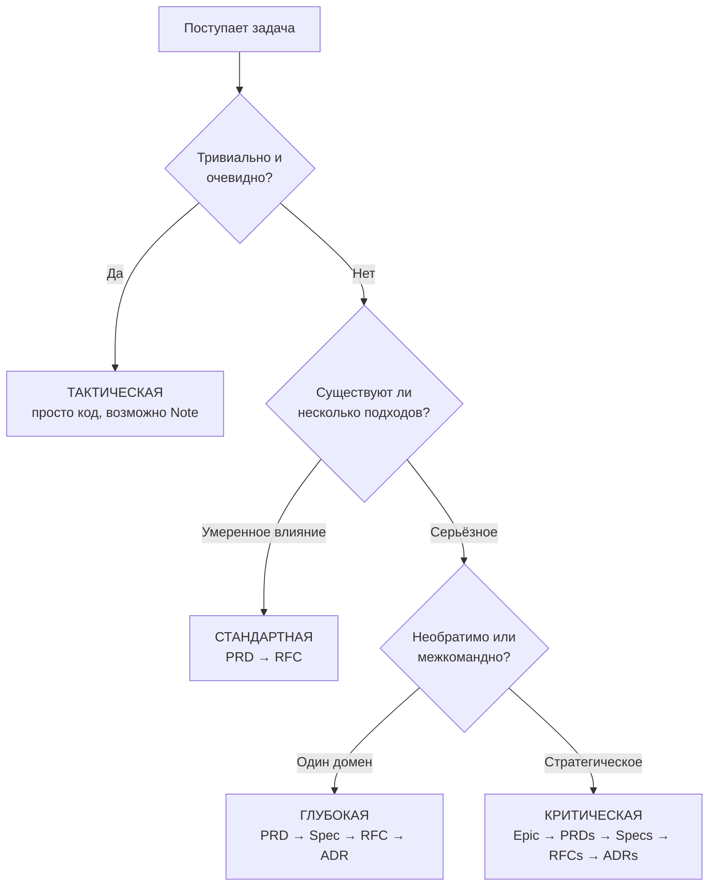

## Почему это важно

Не каждая задача заслуживает одинакового уровня строгости. Исправление опечатки и переработка платёжной системы принципиально различаются - одинаковый подход к ним либо утопит вас в бумажной работе для незначительных изменений, либо оставит критические решения без документации. Роутинг решает эту проблему, задавая один вопрос заранее: **насколько всё может пойти не так?**

Правильное определение глубины экономит реальное время. Избыточное проектирование простого исправления с полным конвейером PRD-Spec-RFC-ADR тратит часы. Недостаточное документирование необратимого архитектурного решения означает, что вы будете пересматривать его через три месяца, когда никто не вспомнит, почему оно было принято.

## Обзор

Прежде чем писать какой-либо код, Forgeplan определяет **глубину** - сколько структуры требуется вашему решению.

Значения вывода ниже условны, не получены измерением. Уверенность router —
эвристическая/model assessment, не измеренная вероятность корректности.
Временные интервалы — ориентиры планирования, не гарантия трудозатрат.

```bash
forgeplan route "добавить платёжную систему"
# -> Глубина: Deep
# -> Конвейер: PRD -> Spec -> RFC -> ADR
# -> Уверенность: 92%
```

## Четыре уровня глубины

| Уровень | Когда | Артефакты | Время |
|---|---|---|---|
| **Тактическая** | Быстрое исправление, 1 файл, легко обратимо | Note или ничего | Минуты |
| **Стандартная** | Функция 1-3 дня, несколько подходов | PRD -> RFC | Часы |
| **Глубокая** | Новый модуль, 1-2 недели, необратимо | PRD -> Spec -> RFC -> ADR | Дни |
| **Критическая** | Межкомандная, стратегическая инициатива | Epic -> PRD[] -> Spec[] -> RFC[] -> ADR[] | Недели |

Critical — стратегическая категория методологии. Текущий core принимает
`critical` как `Deep` и показывает Deep/Critical. Сгенерированный pipeline —
PRD → Spec → RFC → ADR, не автоматически развёрнутая иерархия Epic.

### Примеры из реального мира

**Тактическая**: Исправление ошибки парсинга, при которой не обнаруживается закрывающий `---` в YAML frontmatter. Один файл, один тест, выпускаем. Артефакт не требуется.

**Стандартная**: Добавление JSON export format с умеренным влиянием и
несколькими подходами. Создайте PRD для требований и RFC для дизайна.
Изменения аутентификации могут требовать Deep из-за влияния на безопасность.

**Глубокая**: Создание нового модуля обработки платежей. Он затрагивает финансовые данные пользователей, включает сторонние интеграции, и неправильный выбор поставщика платежей дорого обойдётся для отмены. Полный конвейер: PRD, Spec для контрактов API, RFC для архитектуры, ADR для решения Stripe-vs-PayPal.

**Критическая**: Миграция монолита на микросервисы. Задействовано несколько команд, месяцы работы, затрагивает всю систему. Epic для группировки всего, несколько PRD для каждой границы сервиса, Specs для межсервисных контрактов, RFC для стратегии миграции, ADR для каждого крупного решения.

## Дерево решений

Решение о роутинге сводится к двум последовательно задаваемым вопросам:



Вопрос о тривиальности помогает избежать лишних документов. Измеренная доля
60–70% задач здесь не установлена; выбирайте строгость по реальному риску.

## Триггеры автоэскалации

Это рекомендации методологии, не гарантия срабатывания соответствующего
runtime-правила на каждое описание естественным языком:

| Триггер | Минимальный уровень |
|---|---|
| Трудно откатить (>2 недель влияния) | Standard+ |
| Затрагивает несколько команд | Standard+ |
| Проблема неясна, требует исследования | Standard+ |
| Требования безопасности или соответствия | Deep+ |
| Затрагивает публичный API | Deep+ |
| Затрагивает пользовательские данные | Deep+ |
| Решение уровня дорожной карты | Critical |

:::tip
**При сомнении изучите более рискованную интерпретацию.** Эскалация требует
времени на review, но сама по себе не делает решение безопасным.
Рекомендательный router не разрешает пропускать обязательные Deep artifacts/gates.
:::

Например, кеширование, влияющее на видимую пользователю согласованность,
требует более глубокого анализа. Явно опишите контекст: keyword router
не выведет все последствия из фразы «добавить кеширование».

## Команда Route

```bash
# Интеллектуальный роутинг - LLM, если настроен, иначе ключевые слова
forgeplan route "добавить аутентификацию OAuth2"
```

Условная схема вывода, не записанный CLI transcript:

```
Задача: добавить аутентификацию OAuth2
Глубина: Deep
Конвейер: PRD → Spec → RFC → ADR
Уверенность: 88%
Сигналы:
  + ключевое слово безопасности (auth)
  + затрагивает публичный API (поток аутентификации)
  + необратимый выбор (привязка к провайдеру)
Рекомендация:
  1. forgeplan new prd "Аутентификация OAuth2"
  2. Заполните обязательные разделы (Проблема, Цели, Функциональные требования)
  3. forgeplan reason PRD-XXX  # ADI обязателен для Deep
```

Маршрутизатор анализирует ключевые слова (безопасность, API, миграция) и индикаторы области действия, чтобы предложить правильную глубину. Если вы не согласны, вы принимаете решение - маршрут является рекомендацией, а не принуждением.

### Интеллектуальный роутинг v2: Три уровня

Маршрутизатор Forgeplan (PRD-020) работает на трёх уровнях, корректно переключаясь на предыдущие, если последующие уровни недоступны:

| Уровень | Движок | Когда запускается | Стоимость |
|---|---|---|---|
| **L0** | Keyword/scope rules | Явный `--level 0`; fallback при недоступном LLM routing | Без LLM-вызова |
| **L1** | LLM-классификатор | Настроенный LLM в auto mode либо `--level 1` | Вызов провайдера |
| **L2** | Дополнительный ADI | Handler принимает `--level 2`; auto mode может повысить Deep-результат L1 | Дополнительный вызов провайдера |

Captured help описывает уровни 0/1 и keyword default, но текущий handler
автоматически выбирает доступный LLM и принимает level 2. В этот routing call
он не передаёт ingested KB context. У `route` нет `--fpf`: этот флаг относится
к `reason`. Без пригодной LLM-конфигурации применяется L0. Гарантия покрытия
70% запросов или задержки в миллисекунды здесь не установлена.

### Что ищет маршрутизатор

Маршрутизатор проверяет наличие определённых сигналов, указывающих на сложность:

- **Ключевые слова безопасности** (auth, encryption, credentials) подталкивают к Deep+
- **Ключевые слова данных** (migration, schema, user data) подталкивают к Deep+
- **Scope indicators** различаются: cross-team может требовать Standard, а public API или необратимость — Deep. Critical не является отдельным core enum value.
- **Индикаторы простоты** (fix, typo, rename, bump) сохраняют уровень Tactical

Если router указал Tactical, а последствия требуют Standard или Deep,
зафиксируйте основание и повысьте строгость. Router не знает весь контекст проекта.

## Подводные камни

- **«Добавление новой команды CLI» часто маршрутизируется как Tactical**, хотя должно быть Standard. Если команда вводит новое поведение или поверхность API, переопределите на Standard.
- **Рефакторинг может быть обманчиво глубоким.** «Простой рефакторинг», который изменяет границы модулей или публичные интерфейсы, является Standard или Deep, а не Tactical.
- **Не выполняйте роутинг после того, как вы уже начали кодировать.** Сначала выполните роутинг. Если вы пропустили роутинг и в середине реализации поняли, что это сложнее, чем ожидалось, остановитесь и создайте соответствующие артефакты, прежде чем продолжить.
- **Маршрутизатор не знает историю вашей кодовой базы.** Он не может сказать, что «добавление кеширования» тривиально в одном проекте и занимает неделю в другом. Вы предоставляете контекст, которого ему не хватает.
- **Остерегайтесь ловушки «это всего лишь небольшое изменение».** Изменения схемы базы данных, модификации публичного API и потоки аутентификации никогда не бывают небольшими - даже если разница в коде минимальна. Выполняйте роутинг на основе последствий, а не количества строк кода.

## Связанные материалы

- [CLI: forgeplan route](/ru/docs/cli/route/)
- [ADI](/ru/docs/methodology/adi/) — обязателен для Deep/Critical
- [Жизненный цикл](/ru/docs/methodology/lifecycle/)
- [Быстрый старт](/ru/docs/getting-started/quick-start/)
